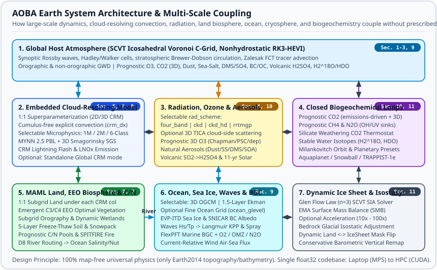
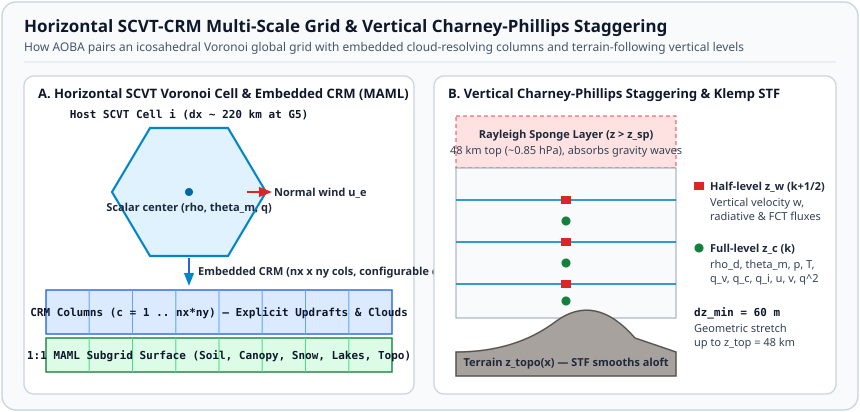
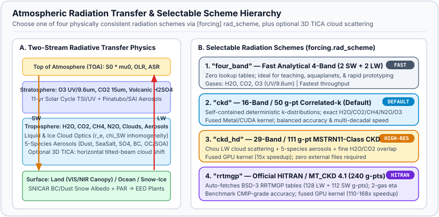
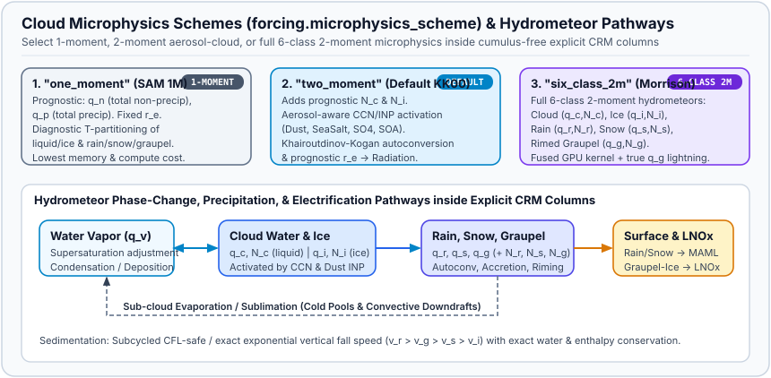
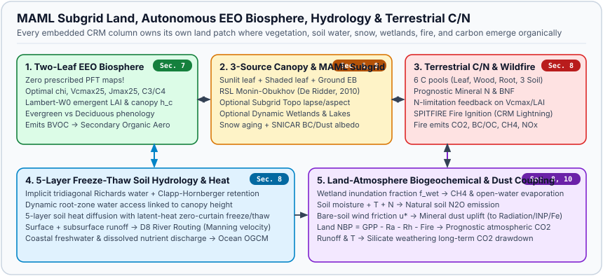
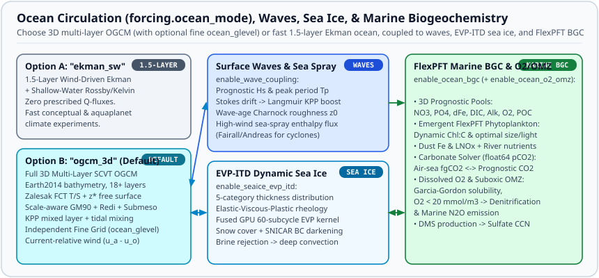
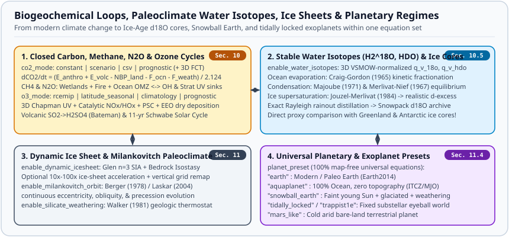

# AOBA Earth System Model — Complete Physical & Numerical Textbook Formulation

> **How to Read This Document**: This manual is written both as a rigorous scientific reference (following the mathematical completeness of *Description of MIROC6 AGCM*, *Description of MATSIRO6*, and *Detailed Formulation of SCALE-RM*) and as a self-contained **textbook for undergraduates and Earth System Model (ESM) newcomers**. Every chapter opens with an intuitive physical narrative and conceptual diagram before introducing numbered governing equations `(S.N)`. Those exact equation numbers are cited directly inside `src/aoba/*.py` so you can jump seamlessly between theory and code.

---

## Contents

1. [System Overview, Physical Constants & Orbital Solar Geometry](#1-system-overview-physical-constants--orbital-solar-geometry)
2. [Spatial Grids: SCVT Voronoi Host, Embedded CRM & Charney–Phillips Levels](#2-spatial-grids-scvt-voronoi-host-embedded-crm--charneyphillips-levels)
3. [Moist Compressible Thermodynamics & Mixed-Phase Saturation Adjustment](#3-moist-compressible-thermodynamics--mixed-phase-saturation-adjustment)
4. [Atmospheric Radiative Transfer — Selectable Schemes (`rad_scheme`) & 3D TICA](#4-atmospheric-radiative-transfer--selectable-schemes-rad_scheme--3d-tica)
5. [Cloud Microphysics — Selectable Schemes (`microphysics_scheme`) & Lightning](#5-cloud-microphysics--selectable-schemes-microphysics_scheme--lightning)
6. [Boundary-Layer Turbulence, Roughness Sublayer (RSL) & 3D SGS Mixing](#6-boundary-layer-turbulence-roughness-sublayer-rsl--3d-sgs-mixing)
7. [Land Surface, MAML Hydrology, Autonomous EEO Biosphere & Terrestrial C/N/Fire](#7-land-surface-maml-hydrology-autonomous-eeo-biosphere--terrestrial-cnfire)
8. [Global Nonhydrostatic SCVT Dynamics, Embedded CRM & Gravity Wave Drag](#8-global-nonhydrostatic-scvt-dynamics-embedded-crm--gravity-wave-drag)
9. [Ocean Circulation (`ocean_mode`), Fine Ocean Grid, Waves, Sea Ice & Marine BGC](#9-ocean-circulation-ocean_mode-fine-ocean-grid-waves-sea-ice--marine-bgc)
10. [Atmospheric Chemistry (`o3_mode`), Aerosols, Carbon (`co2_mode`) & Water Isotopes](#10-atmospheric-chemistry-o3_mode-aerosols-carbon-co2_mode--water-isotopes)
11. [Dynamic Ice Sheet, Milankovitch Paleoclimate & Universal Planetary Presets](#11-dynamic-ice-sheet-milankovitch-paleoclimate--universal-planetary-presets)
12. [Unified 307-Parameter TOML Registry, Zarr v3 Output & AOBA Studio](#12-unified-307-parameter-toml-registry-zarr-v3-output--aoba-studio)

---

## 1. System Overview, Physical Constants & Orbital Solar Geometry

### 1.1 Big Picture: How AOBA Simulates a Whole Planet Without Prescribed Maps

An **Earth System Model (ESM)** predicts how sunlight, air motion, clouds, rain, ocean currents, sea ice, plants, soils, chemistry, and continental ice sheets co-evolve over decades to millennia. Most traditional climate models rely on dozens of present-day geographic lookup maps (prescribed forest types, dust-source maps, ocean heat-flux corrections, or regional aerosol inventories) and empirical cumulus parameterizations. While convenient for today's Earth, those prescribed maps freeze the planet toward modern geography.

**AOBA** takes a clean, first-principles approach designed to be both scientifically universal and easy to study:
1. **Map-Free Universal Physics**: Only planetary elevation, bathymetry, and initial ice-sheet geometry (`Earth2014`) are prescribed. Vegetation biomes, deserts, dust plumes, clouds, lightning, wildfires, ocean circulation, phytoplankton blooms, and wave fields all emerge organically from universal equations.
2. **Cumulus-Free Explicit Convection**: Instead of parameterized convection, each global column embeds a high-resolution ($\Delta x = 4\ \mathrm{km}$) nonhydrostatic Cloud-Resolving Model (CRM) using the exact same Euler equations as the global host. Turning `enable_superparam = false` smoothly converts AOBA into a standalone global cloud-resolving model.
3. **Selectable Complexity**: Key physical components—radiation (`rad_scheme`), microphysics (`microphysics_scheme`), ocean (`ocean_mode`), ozone (`o3_mode`), $\mathrm{CO}_2$ (`co2_mode`), and planetary regimes (`planet_preset`)—can be switched cleanly in [`config/aoba_default.toml`](../config/aoba_default.toml) or AOBA Studio.

### 1.2 Fundamental Physical Constants (`src/aoba/constants.py`)

All physical constants are centralized in `src/aoba/constants.py` and exposed in the `[constants]` TOML section so planetary experiments (changing radius, gravity, rotation rate, or day length) remain self-consistent across every module.

| Symbol | Value | Unit | Physical Meaning |
| :--- | :--- | :--- | :--- |
| $R_E$ | $6.371 \times 10^6$ | $\mathrm{m}$ | Mean planetary radius (`earth_radius`) |
| $g$ | $9.79764$ | $\mathrm{m\ s^{-2}}$ | Surface gravitational acceleration (`gravity`) |
| $\Omega_E$ | $7.292115 \times 10^{-5}$ | $\mathrm{rad\ s^{-1}}$ | Reference sidereal rotation rate (`omega_earth`) |
| $R_d, c_{pd}$ | $287.04,\ 1004.64$ | $\mathrm{J\ kg^{-1}\ K^{-1}}$ | Dry-air gas constant and isobaric specific heat |
| $R_v, c_{pv}$ | $461.5,\ 1846.0$ | $\mathrm{J\ kg^{-1}\ K^{-1}}$ | Water-vapor gas constant and isobaric specific heat |
| $p_0$ | $1.0 \times 10^5$ | $\mathrm{Pa}$ | Reference surface pressure for potential temperature |
| $L_{v0}, L_{f0}$ | $2.501 \times 10^6,\ 3.337 \times 10^5$ | $\mathrm{J\ kg^{-1}}$ | Latent heats of vaporization and fusion at $273.15\ \mathrm{K}$ |
| $\sigma$ | $5.670374419 \times 10^{-8}$ | $\mathrm{W\ m^{-2}\ K^{-4}}$ | Stefan–Boltzmann constant |
| $\rho_{\mathrm{sw}}, c_{p,\mathrm{sw}}$ | $1025.0,\ 3990.0$ | $\mathrm{kg\ m^{-3}},\ \mathrm{J\ kg^{-1}\ K^{-1}}$ | Seawater reference density and specific heat |
| $T_{f,\mathrm{ocn}}$ | $271.35$ | $\mathrm{K}$ | Freezing point of saline ocean water ($-1.8^\circ\mathrm{C}$) |

### 1.3 Orbital Solar Geometry & Calendar (`src/aoba/radiation.py`, `src/aoba/calendar.py`)

Sunlight drives the entire climate engine. Because Earth orbits the Sun on a slightly elliptical path with an axial tilt (obliquity $\varepsilon$), both the Earth–Sun distance $r$ and the subsolar latitude (declination $\delta$) vary continuously through the year. For a given simulation time, the mean anomaly $M$ advances from the vernal equinox and Kepler's equation yields the true solar longitude $\lambda_s$ and orbital distance factor $(a/r)^2$:

$$
M = \frac{2\pi t_{\mathrm{seas}}}{P_{\mathrm{yr}}} - \varpi_{\mathrm{eq}}, \qquad \lambda_s = M + 2e\sin M + \frac{5}{4}e^2 \sin(2M) + \varpi_{\mathrm{eq}} \tag{1.1}
$$

$$
\left(\frac{a}{r}\right)^2 = \left[\frac{1 + e\cos(\lambda_s - \varpi)}{1 - e^2}\right]^2, \qquad S_{\mathrm{TOA}} = S_0 \left(\frac{a}{r}\right)^2 \tag{1.2}
$$

The solar declination $\delta$ and instantaneous cosine of the solar zenith angle $\mu_0 = \cos\theta_0$ at latitude $\phi$ and longitude $\lambda$ follow spherical trigonometry (with local hour angle $H$):

$$
\sin\delta = \sin\varepsilon \sin\lambda_s \tag{1.3}
$$

$$
\mu_0(\phi, \lambda, t) = \max\!\Big(0,\ \sin\phi\sin\delta + \cos\phi\cos\delta\cos H(\lambda, t)\Big) \tag{1.4}
$$

When `diurnal_cycle = false`, `src/aoba/calendar.py` replaces Eq. (1.4) with the exact daytime-averaged zenith cosine $\bar{\mu}_0$ and sunlit fraction over 24 hours. Calendar handling (`calendar_type = "gregorian" | "noleap" | "360_day"`) and perpetual-date experiments (`insolation_mode = "seasonal" | "perpetual_date" | "annual_mean"`) allow both historical dates and idealized equinox/solstice equilibria.

---

## 2. Spatial Grids: SCVT Voronoi Host, Embedded CRM & Charney–Phillips Levels

### 2.1 Why Icosahedral Voronoi Grids and Superparameterization?

A classical longitude–latitude grid converges toward the poles, creating tiny grid cells that force severe time-step restrictions. AOBA instead tiles the sphere quasi-uniformly using a **Spherical Centroidal Voronoi Tessellation (SCVT)** constructed by recursive icosahedral subdivision (`glevel` $g = 0 \dots 6$, yielding $N_{\mathrm{cells}} = 10 \cdot 4^g + 2$: e.g., $G3 = 642$, $G4 = 2562$, $G5 = 10242$ cells) relaxed by Lloyd iterations. Each cell is a hexagon (plus 12 pentagons), with thermodynamic scalars at cell centers and normal winds $u_e$ on orthogonal cell edges (Arakawa C-grid).

Inside every host cell, AOBA embeds a miniature **Cloud-Resolving Model (CRM)** (`crm_nx` $\times$ `crm_ny` columns at $\Delta x = 4\ \mathrm{km}$) and pairs each CRM column 1:1 with its own subgrid land surface patch (**MAML**: Multiple Atmosphere–Multiple Land). Vertically, both host and CRM share a **Charney–Phillips staggered grid** where vertical velocity $w$ sits on half-levels $z_{k+1/2}$ and temperature/moisture/horizontal winds sit on full-levels $z_k$, eliminating computational vertical pressure modes.

### 2.2 Stretched Vertical Levels & Rayleigh Sponge (`src/aoba/vertical_grid.py`)

Near the ground, thin layers (`dz_min = 60 m`) resolve boundary-layer turbulence and fog; aloft, grid spacing stretches smoothly up to the stratopause (`z_top = 48 km`, `nz = 44`) to resolve the Brewer–Dobson circulation, ozone layer, and stratospheric gravity waves:

$$
\Delta z_k = \Delta z_{\min} \, r^k, \qquad \sum_{k=0}^{N_z-1} \Delta z_k = z_{\mathrm{top}}, \qquad z_{c,k} = \frac{1}{2}\left(z_{w,k} + z_{w,k+1}\right) \tag{2.1}
$$

Above the sponge base $z_{\mathrm{sp}}$ (`z_sponge_base = 36 km`), a smooth $\sin^2$ Rayleigh absorber damps upward-propagating gravity waves so they do not spuriously reflect off the rigid model top:

$$
\gamma_{\mathrm{sp}}(z) = \frac{1}{\tau_{\mathrm{sp,min}}} \sin^2\!\left(\frac{\pi}{2}\,\frac{\max(z - z_{\mathrm{sp}}, 0)}{z_{\mathrm{top}} - z_{\mathrm{sp}}}\right) \tag{2.2}
$$

### 2.3 Klemp (2011) Smoothed Terrain-Following (STF) Coordinate

Standard terrain-following coordinates propagate steep mountain bumps all the way into the stratosphere, causing horizontal pressure-gradient errors. AOBA adopts the **Klemp (2011) Smoothed Terrain-Following (STF)** coordinate, which rapidly decays small-scale terrain undulations with height using exponent $p =$ `terrain_scale_exp` ($1.5$):

$$
z(\zeta, x) = \zeta + h_s(x)\left(1 - \frac{\zeta}{z_{\mathrm{top}}}\right)^p, \qquad J = \frac{\partial z}{\partial \zeta} = 1 - \frac{p\,h_s(x)}{z_{\mathrm{top}}}\left(1 - \frac{\zeta}{z_{\mathrm{top}}}\right)^{p-1} \tag{2.3}
$$

The lowest atmospheric reference height $z_1$ above the vegetation canopy displacement height $d_0$ is kept strictly above the canopy top ($z_{\mathrm{ref}} = \max(z_{c,0} - h_s, h_c + 2\ \mathrm{m})$) for consistent surface-layer exchange.

---

## 3. Moist Compressible Thermodynamics & Mixed-Phase Saturation Adjustment

### 3.1 Physical Intuition: Why Moisture Changes Air Buoyancy and Heating

Water vapor molecules ($\mathrm{H}_2\mathrm{O}$, molar mass $18\ \mathrm{g\ mol^{-1}}$) are lighter than dry air ($29\ \mathrm{g\ mol^{-1}}$), so humid air is more buoyant than dry air at the same temperature. Conversely, suspended liquid droplets ($q_c$) and ice crystals ($q_i$) add downward gravitational drag (*condensate loading*). When rising air cools below saturation, excess vapor condenses into droplets or deposits onto ice, releasing huge amounts of latent heat ($L_v \approx 2.5\ \mathrm{MJ\ kg^{-1}}$) that fuels thunderstorms and cyclones.

### 3.2 Equation of State & Moist Potential Temperature (`src/aoba/thermodynamics.py`)

AOBA formulates compressible nonhydrostatic dynamics in terms of dry air density $\rho_d$ and **moist virtual potential temperature** $\theta_m$:

$$
\theta_m = \theta \left(1 + \frac{R_v}{R_d} q_v\right) = \frac{T}{\Pi}\left(1 + \varepsilon_v q_v\right), \qquad \Pi = \left(\frac{p}{p_0}\right)^{R_d / c_{pd}} \tag{3.1}
$$

$$
p = p_0 \left(\frac{\rho_d R_d \theta_m}{p_0}\right)^{\gamma}, \qquad \gamma = \frac{c_{pd}}{c_{pd} - R_d} \approx 1.400 \tag{3.2}
$$

Total moist density entering vertical buoyancy includes all condensed water species:

$$
\rho_{\mathrm{tot}} = \rho_d \left(1 + q_v + q_c + q_i + q_p\right) \tag{3.3}
$$

### 3.3 Mixed-Phase Partitioning & Newton–Raphson Saturation Adjustment

Between $T_{\mathrm{ice}} = 253.15\ \mathrm{K}$ ($-20^\circ\mathrm{C}$) and $T_{\mathrm{liq}} = 273.16\ \mathrm{K}$ ($0^\circ\mathrm{C}$), supercooled liquid water and ice coexist smoothly via the linear liquid fraction $\omega_n(T)$:

$$
\omega_n(T) = \operatorname{clamp}\!\left(\frac{T - T_{\mathrm{ice}}}{T_{\mathrm{liq}} - T_{\mathrm{ice}}},\ 0,\ 1\right), \qquad q_s(T, p) = \omega_n q_{s,\ell}(T, p) + (1 - \omega_n) q_{s,i}(T, p) \tag{3.4}
$$

Given total non-precipitating water $q_n = q_v + q_c + q_i$ and conserved liquid–ice static energy, 3 vectorized Newton–Raphson iterations solve the exact implicit saturation equilibrium:

$$
T^{(m+1)} = T^{(m)} - \frac{T^{(m)} - T_{\mathrm{dry}} - \frac{L_{\mathrm{eff}}}{c_{pd}}\max(q_n - q_s(T^{(m)}), 0)}{1 + \frac{L_{\mathrm{eff}}}{c_{pd}}\frac{\partial q_s}{\partial T}\Big|_{T^{(m)}}} \tag{3.5}
$$

where $L_{\mathrm{eff}} = \omega_n L_{v0} + (1 - \omega_n)(L_{v0} + L_{f0})$.

---

## 4. Atmospheric Radiative Transfer — Selectable Schemes (`rad_scheme`) & 3D TICA

### 4.1 Physical Intuition & Selecting a Radiation Scheme

Radiation is the energy bridge between the planet and outer space. Incoming shortwave (SW) sunlight heats the surface and ozone layer; outgoing longwave (LW) thermal infrared radiation cools the atmosphere and surface to space, while greenhouse gases ($\mathrm{H}_2\mathrm{O}, \mathrm{CO}_2, \mathrm{CH}_4, \mathrm{N}_2\mathrm{O}, \mathrm{O}_3$), clouds, and aerosols trap LW radiation and scatter SW light. Because molecular absorption lines vary violently with wavelength, climate models group wavelengths into bands or cumulative probability bins (**$g$-points**, the *correlated-$k$ distribution* method).

In AOBA, **choose one of four radiation schemes** via `[forcing] rad_scheme` in [`config/aoba_default.toml`](../config/aoba_default.toml) (all four feed into the exact same surface PAR/VIS/NIR energy balance and atmospheric heating rate):

| `rad_scheme` | Spectral Resolution | Greenhouse Gases & Optics | External Files | GPU Acceleration | Best Use Case |
| :--- | :--- | :--- | :--- | :--- | :--- |
| `"four_band"` | 4 bands (2 SW + 2 LW) | $\mathrm{H}_2\mathrm{O}, \mathrm{CO}_2, \mathrm{O}_3$ + clouds | None | Fused Metal/CUDA | Teaching, aquaplanets, ultra-fast prototyping |
| `"ckd"` *(Default)* | 16 bands / 50 $g$-pts | $\mathrm{H}_2\mathrm{O}, \mathrm{CO}_2, \mathrm{CH}_4, \mathrm{N}_2\mathrm{O}, \mathrm{O}_3$ + clouds + aerosols | None | Fused Metal/CUDA | Multi-decadal climate & paleoclimate runs |
| `"ckd_hd"` | 29 bands / 111 $g$-pts | MSTRN11-class CKD + Chou LW cloud scattering + 5-species aerosols | None | Fused Metal/CUDA (15×) | High-accuracy map-free ESM without external tables |
| `"rrtmgp"` | 30 bands / 240 $g$-pts | Official HITRAN + MT\_CKD 4.1 (`128 LW + 112 SW`), 2-gas $\eta$ overlap | Auto-fetched BSD-3 NetCDF | Fused Metal/CUDA (110–168×) | CMIP-grade radiative forcing benchmarks |

### 4.2 Shared Multi-Layer Two-Stream Solver (`src/aoba/radiation.py`, `src/aoba/kernels.py`)

For every spectral band or $g$-point, the upward ($F^\uparrow$) and downward ($F^\downarrow$) diffuse fluxes obey the $\delta$-Eddington two-stream equations across each layer of optical depth $\Delta\tau$, single-scattering albedo $\omega$, and asymmetry factor $g_a$. Scaling out the forward scattering peak ($f = g_a^2$) yields transformed optical properties:

$$
\Delta\tau' = (1 - \omega f)\,\Delta\tau, \qquad \omega' = \frac{(1 - f)\omega}{1 - \omega f}, \qquad g' = \frac{g_a}{1 + g_a} \tag{4.1}
$$

Each layer's reflectance $R_k$, transmittance $T_k$, and direct-beam or Planck source terms $(S_k^\uparrow, S_k^\downarrow)$ are assembled via analytical Meador–Weaver (1980) solutions (using Taylor-safe limits as $\Delta\tau' \to 0$ to prevent float32 cancellation) and coupled from surface to TOA using the unconditionally stable **adding–doubling** sweep:

$$
R_{12} = R_1 + \frac{T_1^2 R_2}{1 - R_1 R_2}, \qquad T_{12} = \frac{T_1 T_2}{1 - R_1 R_2} \tag{4.2}
$$

The radiative heating rate entering the atmospheric energy equation is the vertical flux convergence:

$$
\left(\frac{\partial T}{\partial t}\right)_{\mathrm{rad}} = -\frac{1}{\rho_d c_{pd}} \frac{\partial (F_{\mathrm{SW}}^{\mathrm{net}} + F_{\mathrm{LW}}^{\mathrm{net}})}{\partial z} \tag{4.3}
$$

Subgrid cloud optical inhomogeneity (`cloud_sw_inhomog` $\chi_{\mathrm{SW}} = 0.62$; Cahalan et al., 1994) scales effective cloud liquid/ice optical depth cleanly as $\tau_{\mathrm{cld}}^{\mathrm{eff}} = \chi_{\mathrm{SW}}\,\tau_{\mathrm{cld}}$ to account for unresolved sub-4 km cloud-thickness variability:

$$
\tau_{\mathrm{liq}} = \frac{3}{2} \frac{\mathrm{LWP}}{\rho_{\ell}\, r_{e,\ell}}\,\chi_{\mathrm{SW}}, \qquad \tau_{\mathrm{ice}} = \mathrm{IWP}\left(a_i + \frac{b_i}{r_{e,i}}\right)\chi_{\mathrm{SW}} \tag{4.4}
$$

### 4.3 Option 1: `rad_scheme = "four_band"` (Fast Analytical 4-Band)

Splits radiation into 2 SW bands (UV+VIS $< 0.7\ \mu\mathrm{m}$ driving PAR and $\mathrm{O}_3$ absorption; NIR $> 0.7\ \mu\mathrm{m}$ absorbed by $\mathrm{H}_2\mathrm{O}$) and 2 LW bands (the $8\text{--}12\ \mu\mathrm{m}$ atmospheric window with $\mathrm{H}_2\mathrm{O}$ e-type continuum and $9.6\ \mu\mathrm{m}$ $\mathrm{O}_3$, plus the non-window band containing $15\ \mu\mathrm{m}$ $\mathrm{CO}_2$ and $\mathrm{H}_2\mathrm{O}$ rotational lines):

$$
\Delta\tau_{\mathrm{CO_2,15\mu m}} = k_{\mathrm{CO_2}}\left(1 + c_{\mathrm{log}}\ln\frac{C_{\mathrm{CO_2}}}{284.3}\right)\left(\frac{p}{p_0}\right)^{0.8}\Delta m \tag{4.5}
$$

$$
\Delta\tau_{\mathrm{H_2O,cont}} = k_{\mathrm{cont}}\, e_{\mathrm{H_2O}} \exp\!\left[1800\left(\frac{1}{T} - \frac{1}{296}\right)\right] q_v\,\Delta m \tag{4.6}
$$

### 4.4 Option 2: `rad_scheme = "ckd"` (Default 16-Band / 50 $g$-Point Correlated-$k$, `src/aoba/radiation_ckd.py`)

Replaces gray band averages with 16 spectral bands (6 SW + 10 LW) subdivided into 50 Gauss–Legendre $g$-points covering $\mathrm{H}_2\mathrm{O}$ (line + MT\_CKD continuum), $\mathrm{CO}_2$, $\mathrm{CH}_4$, $\mathrm{N}_2\mathrm{O}$, and $\mathrm{O}_3$ with pressure–temperature Lorentz broadening:

$$
k_{b,g}(p, T) = k_{b,g}^{\mathrm{ref}} \left(\frac{p}{p_{\mathrm{ref}}}\right)^{\alpha_b} \exp\!\left[\beta_b \left(\frac{1}{T_{\mathrm{ref}}} - \frac{1}{T}\right)\right] \tag{4.7}
$$

Total flux sums deterministically over all bands $b$ and quadrature weights $w_{b,g}$:

$$
F^\pm(z) = \sum_{b} \sum_{g=1}^{N_{g,b}} w_{b,g}\, F_{b,g}^\pm(z), \qquad \sum_{g=1}^{N_{g,b}} w_{b,g} = 1 \tag{4.8}
$$

### 4.5 Option 3: `rad_scheme = "ckd_hd"` (29-Band / 111 $g$-Point MSTRN11-Class, `src/aoba/radiation_hd.py`)

Doubles spectral fidelity to **29 bands / 111 $g$-points** (15 LW + 14 SW, inspired by MIROC6's MSTRN11; Sekiguchi & Nakajima, 2008) while remaining 100% self-contained. Adds Chou et al. (1999) LW cloud scattering adjustment $\tilde{\tau}_{\mathrm{LW}} = (1 - \omega_{\mathrm{LW}} b_{\mathrm{LW}})\tau_{\mathrm{LW}}$ and band-resolved extinction/SSA/asymmetry for all 5 natural aerosol species plus volcanic $\mathrm{H}_2\mathrm{SO}_4$:

$$
\Delta\tau_{\mathrm{LW,eff}} = \Delta\tau_{\mathrm{gas}} + (1 - \omega_{\mathrm{cld}} f_{\mathrm{back}})\,\Delta\tau_{\mathrm{cld}} + \sum_{s=1}^{6} (1 - \omega_{s} f_{s})\,\Delta\tau_{s} \tag{4.9}
$$

Executed inside the single-source fused GPU kernel `rad_ckd_hd_col` in `src/aoba/kernels_esm.py`.

### 4.6 Option 4: `rad_scheme = "rrtmgp"` (Official HITRAN / MT\_CKD 4.1, `src/aoba/radiation_rrtmgp.py`)

Automatically downloads the official open-source BSD-3 **RTE+RRTMGP** gas-optics lookup tables (`rrtmgp-gas-lw-g128.nc`, 128 LW $g$-points; `rrtmgp-gas-sw-g112.nc`, 112 SW $g$-points; Pincus et al., 2019) built directly from the HITRAN spectroscopic database and MT\_CKD 4.1 water-vapor continuum. For each $g$-point, the fused GPU kernels `rad_rrtmgp_lw_grp` and `rad_rrtmgp_sw_grp` perform trilinear interpolation in $(T, \ln p, \eta)$ where $\eta$ is the binary major-species mixing ratio fraction:

$$
\eta = \frac{x_1}{x_1 + r_{\mathrm{ref}}(T, p)\, x_2}, \qquad \Delta\tau_{\mathrm{gas}} = N_{\mathrm{col}} \left(x_1 + r_{\mathrm{ref}} x_2\right) k_{\mathrm{maj}}(T, \ln p, \eta) + \Delta\tau_{\mathrm{min}} + \Delta\tau_{\mathrm{cont}} \tag{4.10}
$$

### 4.7 Optional 3D Tilted Independent Column Approximation (`enable_rad_3d_tica`)

Standard 1D column radiation shoots sunlight straight vertically down each column, missing cloud shadows and sunlit cloud sides when the Sun is low. When `enable_rad_3d_tica = true`, AOBA shifts cloud condensate horizontally along the CRM array before SW transfer by an altitude-dependent slant displacement (Várnai & Davies, 1999) while preserving exact column-integrated cloud mass:

$$
\Delta s(z) = \operatorname{round}\!\left(\frac{(z - z_{\mathrm{sfc}})\tan\theta_0}{\Delta x_{\mathrm{CRM}}}\right), \qquad q_{c,i}^{\mathrm{TICA}}(k, x) = q_{c,i}\big(k,\, (x + \Delta s(z_k)) \bmod N_x\big) \tag{4.11}
$$

---

## 5. Cloud Microphysics — Selectable Schemes (`microphysics_scheme`) & Lightning

### 5.1 Physical Intuition & Selecting a Microphysics Scheme

Condensation creates microscopic cloud droplets ($r \approx 10\ \mu\mathrm{m}$) that fall too slowly to reach the ground. To produce rain or snow, droplets must collide and coalesce (*autoconversion* and *accretion*), freeze onto ice-nucleating particles (INP, such as mineral dust), or grow rapidly via the **Wegener–Bergeron–Findeisen** process where ice crystals grow at the expense of surrounding supercooled droplets. In strong convective updrafts, supercooled droplets freeze onto snow to form dense **graupel** ($q_g$), whose collisions with ice crystals separate electric charge and spark **lightning**.

**Choose one of three microphysics schemes** via `[forcing] microphysics_scheme`:

| `microphysics_scheme` | Prognostic Hydrometeors | Aerosol–Cloud Coupling | Lightning Coupling | Best Use Case |
| :--- | :--- | :--- | :--- | :--- |
| `"one_moment"` | $q_n, q_p$ (fixed $r_e$) | Fixed $N_c$ (`re_liq_um`, `re_ice_um`) | Diagnostic frozen $q_p$ | Fast conceptual / idealized CRM runs |
| `"two_moment"` *(Default)* | $q_n, q_p, N_c, N_i$ | Prognostic CCN/INP $\to$ Twomey & lifetime effects | Diagnostic graupel fraction | Standard multi-decadal climate + aerosols |
| `"six_class_2m"` | $(q_c,N_c), (q_i,N_i), (q_r,N_r), (q_s,N_s), (q_g,N_g)$ | Full aerosol activation + prognostic $r_e$ for all classes | True prognostic graupel $q_g$ | Deep convection, hail/graupel, LNOx & Full-ESM |

### 5.2 Option 1: `microphysics_scheme = "one_moment"` (SAM 1-Moment, `src/aoba/microphysics.py`)

Follows Khairoutdinov & Randall (2003). Non-precipitating condensate $q_n = q_v + q_c + q_i$ and precipitating water $q_p = q_r + q_s + q_g$ are partitioned diagnostically by temperature into rain, snow, and graupel with exponential Marshall–Palmer size distributions $n(D) = N_0 e^{-\lambda D}$ and power-law fall speeds $v(D) = a D^b$:

$$
\left(\frac{\partial q_p}{\partial t}\right)_{\mathrm{auto}} = \alpha_{\mathrm{auto}} \max(q_c - q_{c0},\ 0) + \alpha_{\mathrm{agg}} \max(q_i - q_{i0},\ 0) \tag{5.1}
$$

$$
\left(\frac{\partial q_p}{\partial t}\right)_{\mathrm{accr}} = \sum_{x \in \{r,s,g\}} \frac{\pi}{4}\, a_x N_{0,x} \Gamma(3 + b_x)\,\lambda_x^{-(3+b_x)} \left(\frac{\rho_0}{\rho_d}\right)^{1/2} \big(E_{xc} q_c + E_{xi} q_i\big) \tag{5.2}
$$

Sub-cloud evaporation and sublimation cool downdrafts (generating convective cold pools) when ambient air is subsaturated ($q_v < q_s$), and vertical precipitation fallout is subcycled conservatively to guarantee positivity and exact water conservation:

$$
q_p^{n+1}(k) = q_p^n(k) + \frac{\Delta t_{\mathrm{sub}}}{\rho_d \Delta z_k}\Big(F_{\mathrm{fall}}(k+1/2) - F_{\mathrm{fall}}(k-1/2)\Big) \tag{5.3}
$$

$$
F_{\mathrm{fall}}(k-1/2) = \rho_d(k)\, v_{t}(k)\, q_p(k), \qquad \mathrm{CFL}_{\mathrm{sed}} = \frac{v_t \Delta t_{\mathrm{sub}}}{\Delta z_k} \le 0.9 \tag{5.4}
$$

### 5.3 Option 2: `microphysics_scheme = "two_moment"` (Default Aerosol-Aware 2-Moment KK00)

Adds prognostic cloud droplet number $N_c$ and cloud ice crystal number $N_i$ activated from background maritime/continental CCN plus prognostic dust, sea-salt, DMS sulfate, and SOA aerosols. Warm-rain autoconversion switches to the Khairoutdinov & Kogan (2000) nonlinear law, naturally capturing the **aerosol indirect effects** (more CCN $\to$ smaller droplets $\to$ brighter clouds and suppressed drizzle):

$$
\left(\frac{\partial q_p}{\partial t}\right)_{\mathrm{auto,KK00}} = 1350\, q_c^{2.47}\, \left(N_c \cdot 10^{-6}\right)^{-1.79} \tag{5.5}
$$

$$
\left(\frac{\partial q_p}{\partial t}\right)_{\mathrm{accr,KK00}} = 67\, \left(q_c q_r\right)^{1.15} \tag{5.6}
$$

Prognostic cloud droplet and ice effective radii feed directly into all four radiation schemes (Eq. 4.4):

$$
r_{e,\ell} = \kappa_r \left(\frac{3 \rho_d q_c}{4\pi \rho_\ell N_c}\right)^{1/3}, \qquad r_{e,i} = \operatorname{clamp}\!\left(\left(\frac{3 \rho_d q_i}{4\pi \rho_i N_i}\right)^{1/3},\ 10\ \mu\mathrm{m},\ 120\ \mu\mathrm{m}\right) \tag{5.7}
$$

### 5.4 Option 3: `microphysics_scheme = "six_class_2m"` (Morrison 6-Class 2-Moment, `src/aoba/microphysics_6class.py`)

Replaces bulk $q_p$ with **independent prognostic mass and number concentrations** for rain $(q_r, N_r)$, snow $(q_s, N_s)$, and rimed graupel $(q_g, N_g)$ inside the fused GPU kernel `microphysics_6class_col`. Explicit riming of snow by supercooled cloud droplets converts snow into fast-falling graupel, while melting above $0^\circ\mathrm{C}$ converts snow and graupel into rain:

$$
\left(\frac{\partial q_g}{\partial t}\right)_{\mathrm{rime}} = E_{sc}\, \rho_d\, q_c\, \frac{\pi}{4} a_s N_{0,s}\Gamma(3+b_s)\lambda_s^{-(3+b_s)} \cdot f_{\mathrm{conv}}(q_c, q_s) \tag{5.8}
$$

Each precipitation class settles independently with exact exponential-bounded flux updates preserving mass, number, and latent heat:

$$
F_{x,k} = \rho_{d,k} \Delta z_k \frac{q_{x,k}}{\Delta t}\left[1 - \exp\!\left(-\frac{v_{t,x,k}\Delta t}{\Delta z_k}\right)\right], \qquad x \in \{r, s, g\} \tag{5.9}
$$

### 5.5 CRM Non-Inductive Charging Lightning & $\mathrm{LNO}_x$ (`src/aoba/lightning.py`)

Because AOBA resolves convective updrafts explicitly on the embedded CRM, lightning flash rate is computed directly from the non-inductive graupel–ice collision flux (McCaul et al., 2009 / Price & Rind, 1992) inside mixed-phase updrafts ($w > 0$ near $-15^\circ\mathrm{C}$):

$$
F_{\mathrm{flash}} = c_1 \big(w\, q_g\big)_{-15^\circ\mathrm{C}} + c_2 \int_{\mathrm{col}} \rho_d (q_g + q_s + q_i)\,dz \tag{5.10}
$$

Lightning flashes directly ignite SPITFIRE wildfires (Sec. 7.4) and inject nitrogen oxides ($\mathrm{LNO}_x$) into the upper troposphere, feeding both tropospheric ozone production (Sec. 10.1) and marine nitrogen deposition (Sec. 9.6).

---

## 6. Boundary-Layer Turbulence, Roughness Sublayer (RSL) & 3D SGS Mixing

### 6.1 Physical Intuition: Connecting Surface Drag to Atmospheric Mixing

Friction with trees, buildings, mountains, and ocean waves slows surface winds and generates turbulent eddies that pump heat and water vapor upward through the planetary boundary layer (PBL). Over tall forests, standard Monin–Obukhov similarity breaks down right above the treetops inside the **Roughness Sublayer (RSL)** where coherent canopy wakes enhance mixing. AOBA couples a closed-form RSL similarity theory at the surface to an implicit MYNN Level 2.5 turbulent kinetic energy (TKE) closure vertically and a 3D Smagorinsky–Lilly eddy diffusivity horizontally on the CRM.

### 6.2 Aerodynamic Roughness & De Ridder (2010) RSL Similarity (`src/aoba/turbulence.py`)

Over vegetated land of emergent height $h_c$, displacement height $d_0$ and momentum roughness length $z_{0m}$ scale dynamically with canopy geometry; over ocean, Charnock's law links roughness to wind stress (and optionally wave age in Sec. 9.4):

$$
d_0 = 0.67\,h_c, \qquad z_{0m,\mathrm{land}} = \max(0.10\,h_c,\ z_{0,\mathrm{soil}}) \tag{6.1}
$$

$$
z_{0m,\mathrm{ocn}} = \frac{0.11\,\nu_{\mathrm{air}}}{u_*} + \alpha_{\mathrm{Ch}}\frac{u_*^2}{g} \tag{6.2}
$$

De Ridder (2010) derives an analytical correction $\psi_{m,h}^*$ for enhanced turbulence inside the RSL ($z \le z_* \approx 2 h_c$), modifying the classical Monin–Obukhov drag and scalar transfer coefficients ($C_D, C_H$) without iterative overhead:

$$
u_* = \frac{\kappa U_1}{\ln\!\left(\frac{z_1 - d_0}{z_{0m}}\right) - \Psi_m(\zeta) + \psi_m^*(\zeta, z_*)}, \qquad C_H = \frac{\kappa^2}{\big[\ln(\frac{z_1-d_0}{z_{0m}}) - \Psi_m + \psi_m^*\big]\big[\ln(\frac{z_1-d_0}{z_{0h}}) - \Psi_h + \psi_h^*\big]} \tag{6.3}
$$

Surface fluxes of momentum, sensible heat, and moisture follow bulk exchange:

$$
\boldsymbol{\tau}_s = -\rho_1 C_D |\mathbf{U}_1|\mathbf{U}_1, \qquad H_s = \rho_1 c_{pd} C_H |\mathbf{U}_1|(T_s - \theta_1), \qquad E_s = \rho_1 C_H |\mathbf{U}_1|\beta_w(q_s(T_s) - q_{v,1}) \tag{6.4}
$$

### 6.3 Implicit MYNN Level 2.5 PBL & 3D Smagorinsky–Lilly SGS

Prognostic twice-TKE ($q^2 = 2\,\mathrm{TKE}$) balances shear production, buoyancy production/suppression, vertical transport, and dissipation over mixing length $\ell$:

$$
\frac{\partial q^2}{\partial t} = 2\left(K_m S^2 - K_h N^2\right) + \frac{1}{\rho_d}\frac{\partial}{\partial z}\left(\rho_d K_q \frac{\partial q^2}{\partial z}\right) - \frac{2 q^3}{B_1 \ell} \tag{6.5}
$$

Vertical turbulent diffusion of $(u, v, \theta_m, q_n, q^2)$ is solved via a **flux-conserving increment-form implicit tridiagonal Thomas solver** (eliminating float32 conservation drift when $K\Delta t/\Delta z^2 \ll 1$):

$$
\left(\mathbf{I} + \Delta t\,\mathbf{L}_K\right)\Delta \phi = -\Delta t\,\mathbf{L}_K \phi^n, \qquad \phi^{n+1} = \phi^n + \Delta\phi \tag{6.6}
$$

Horizontal subgrid-scale eddies on the 4 km CRM use anisotropic 3D Smagorinsky–Lilly eddy viscosity damped by buoyant stratification:

$$
K_{m,h} = (C_s \Delta x)^2 \sqrt{\max\!\left(0,\ S_h^2 - \frac{N^2}{\mathrm{Pr}_n}\right)} \tag{6.7}
$$

---

## 7. Land Surface, MAML Hydrology, Autonomous EEO Biosphere & Terrestrial C/N/Fire

### 7.1 Physical Intuition: How Plants and Soils Self-Organize Without Biome Maps

Traditional ESMs prescribe static maps saying "Cell 412 is Tropical Broadleaf Evergreen Forest." If $\mathrm{CO}_2$ quadruples or an Ice Age begins, those static maps cannot move forests into thawing tundra or turn drying jungles into savanna. AOBA instead applies **Eco-Evolutionary Optimality (EEO)** (Prentice et al., 2014; Wang et al., 2017; Smith et al., 2019; Cai et al., 2025): natural selection drives plants everywhere to maximize carbon gain per unit cost of maintaining photosynthetic enzymes ($V_{c\max}, J_{\max}$) and losing water through stomata. Combined with **MAML** (every CRM column owns its own independent land patch), rainforests, savannas, deserts, grasslands ($\mathrm{C}_4$), boreal evergreen forests, and tundra emerge autonomously from sunlight, temperature, $\mathrm{CO}_2$, and rainfall.

### 7.2 Autonomous Two-Leaf EEO Biosphere (`src/aoba/biosphere.py`)

Under the least-cost hypothesis, optimal leaf-internal-to-ambient $\mathrm{CO}_2$ ratio $\chi = c_i / c_a$ decreases when air is dry (high vapor pressure deficit $D$) and rises in humid air:

$$
\chi = \frac{\Gamma^*}{c_a} + \left(1 - \frac{\Gamma^*}{c_a}\right)\frac{\xi}{\xi + \sqrt{D}}, \qquad \xi = \sqrt{\frac{\beta (K + \Gamma^*)}{1.6\,\eta^*}} \tag{7.1}
$$

Photosynthetic assimilation $A$ coordinates Rubisco-limited ($A_c$) and electron-transport-limited ($A_j$) rates smoothly via the non-rectangular hyperbola (curvature $\theta = 0.85$), with optimal acclimated capacities ($V_{c\max 25}, J_{\max 25}$) tracked over a 15-day midday EMA:

$$
\theta A^2 - (A_c + A_j) A + A_c A_j = 0, \qquad A = \frac{A_c + A_j - \sqrt{(A_c + A_j)^2 - 4\theta A_c A_j}}{2\theta} \tag{7.2}
$$

Dark respiration scales universally with $V_{c\max}$ ($R_{d25} = b_{\mathrm{resp}} V_{c\max 25}$; Ren et al.) and stomatal conductance links carbon uptake tightly to transpiration:

$$
g_{sw} = \frac{1.6\, A}{c_a (1 - \chi)} \tag{7.3}
$$

To separate brightly lit outer leaves from shaded interior foliage, canopy PAR is partitioned analytically into **sunlit** and **shaded** fractions with Beer–Lambert extinction $k$:

$$
L_{\mathrm{sun}} = \frac{1 - e^{-k_b L}}{k_b}, \qquad L_{\mathrm{shd}} = L - L_{\mathrm{sun}} \tag{7.4}
$$

Equilibrium optimal **Leaf Area Index** ($L^*$) solves the carbon-profit balance against foliage construction cost $z$ in closed form via the overflow-free **Lambert-$W_0$** function, modulated by root-zone soil moisture stress:

$$
L^* = \frac{1}{k}\left[W_0\!\left(\frac{k\,A_0}{z}\right)\right] \cdot f_{\mathrm{water}}(\theta_{\mathrm{root}})^\sigma \tag{7.5}
$$

$\mathrm{C}_4$ grass dominance $F_4$ and evergreen-vs-deciduous fraction $f_{\mathrm{evg}}$ emerge continuously from the net carbon-profit advantage of each pathway under local temperature, $\mathrm{CO}_2$, light, and winter frost risk:

$$
F_4 = \frac{1}{1 + \exp\!\big[-s_4 (P_{\mathrm{net,C4}} - P_{\mathrm{net,C3}})\big]}, \qquad f_{\mathrm{evg}} = \frac{1}{1 + \exp\!\big[-s_e (P_{\mathrm{net,evg}} - P_{\mathrm{net,dec}})\big]} \tag{7.6}
$$

### 7.3 Three-Source Canopy Energy Balance, Snow/SNICAR & 5-Layer Freeze–Thaw Soil (`src/aoba/surface.py`)

Each MAML land patch solves a coupled **3-source energy balance** (sunlit canopy, shaded canopy, and ground/snow surface) iteratively (`land_eb_iterations = 3`) so leaf temperature, stomatal conductance, and sensible/latent heat remain mutually consistent:

$$
R_{n,\mathrm{can}} = H_{\mathrm{can}} + L_v E_{\mathrm{trans}} + L_v E_{\mathrm{int}}, \qquad R_{n,\mathrm{gnd}} = H_{\mathrm{gnd}} + L_v E_{\mathrm{soil}} + G_{\mathrm{soil}} \tag{7.7}
$$

Snowpack albedo decays exponentially with snow age ($\tau_{\mathrm{age}} = 10^6\ \mathrm{s}$) and darkens smoothly when black carbon (BC) or mineral dust deposits onto snow/sea ice (`enable_snow_bc_darkening`; Flanner et al., 2007 SNICAR parameterization):

$$
\alpha_{\mathrm{snow,vis}} = \alpha_{\mathrm{old}} + (\alpha_{\mathrm{new}} - \alpha_{\mathrm{old}})e^{-t_{\mathrm{age}}/\tau_{\mathrm{age}}} - \Delta\alpha_{\mathrm{SNICAR}}(C_{\mathrm{BC}}, C_{\mathrm{dust}}) \tag{7.8}
$$

Five soil layers solve implicit tridiagonal **Richards unsaturated water flow** (Clapp–Hornberger retention with frozen-soil ice impedance $10^{-\Omega f_{\mathrm{ice}}}$) and **5-layer heat diffusion with phase-change latent heat** (capturing the Arctic *zero-curtain* freeze–thaw buffer):

$$
\frac{\partial \theta_\ell}{\partial t} = \frac{\partial}{\partial z}\left[K(\theta_\ell, f_{\mathrm{ice}})\left(\frac{\partial \psi(\theta_\ell)}{\partial z} + 1\right)\right] - S_{\mathrm{root}} \tag{7.9}
$$

$$
\left(C_s + \rho_w L_{f0} \frac{\partial \theta_\ell}{\partial T}\right)\frac{\partial T_s}{\partial t} = \frac{\partial}{\partial z}\left(\kappa_s \frac{\partial T_s}{\partial z}\right) \tag{7.10}
$$

### 7.4 MAML Subgrid Orography & Dynamic Wetlands/Lakes (`src/aoba/maml_land_subgrid.py`)

Even within a single 200 km host grid cell, mountain valleys and alpine peaks experience vastly different temperatures and snowlines, while flat river basins flood into seasonal wetlands.
- **Subgrid Orography (`enable_maml_subgrid_topo`)**: Using `Earth2014` subgrid topographic standard deviation $\sigma_{\mathrm{topo}}$, each MAML patch $m$ receives a deterministic zero-mean elevation offset $\Delta z_m$ and slope aspect, downscaling local temperature via moist lapse rate $\Gamma_m = 6.5\ \mathrm{K\ km^{-1}}$:

$$
T_{\mathrm{air},m} = T_{\mathrm{air}} - \Gamma_m\,\Delta z_m, \qquad \sum_{m=1}^{N_{\mathrm{sub}}} \Delta z_m = 0 \tag{7.11}
$$

- **Dynamic Wetlands & Lakes (`enable_maml_wetlands_lakes`)**: Combines a TOPMODEL topographic flatness index (derived from $\sigma_{\mathrm{topo}}$) with local soil wetness and incoming river discharge to diagnose inundated wetland/lake fraction $f_{\mathrm{wet}} \in [0, 0.85]$, enhancing open-water evaporation and driving natural wetland $\mathrm{CH}_4$ emissions (Sec. 10.4):

$$
f_{\mathrm{wet}} = f_{\mathrm{flat}}(\sigma_{\mathrm{topo}})\cdot \operatorname{clamp}\!\left(\frac{\theta_{\mathrm{top}} - \theta_c}{\theta_{\mathrm{sat}} - \theta_c} + c_Q Q_{\mathrm{riv}},\ 0,\ 0.85\right) \tag{7.12}
$$

### 7.5 Terrestrial 6-Pool C/N Model, SPITFIRE Wildfire & D8 River Routing (`land_carbon.py`, `river_routing.py`)

Terrestrial carbon is tracked across 6 prognostic pools ($C_{\mathrm{leaf}}, C_{\mathrm{wood}}, C_{\mathrm{root}}, C_{\mathrm{lit}}, C_{\mathrm{soil,fast}}, C_{\mathrm{soil,slow}}$) using exact exponential turnover (zero Forward Euler) paired with mineral nitrogen $N_{\mathrm{min}}$ and biological nitrogen fixation (BNF). Net Biome Productivity ($\mathrm{NBP}$) closes the land–atmosphere carbon loop:

$$
\mathrm{NBP} = \mathrm{GPP} - R_a - R_h(T_s, \theta) - F_{\mathrm{fire}} \tag{7.13}
$$

Wildfires (`enable_fire_veg_feedback`; SPITFIRE) ignite from CRM lightning flashes (Eq. 5.10) whenever fine fuel load and Nesterov/VPD drying exceed flammability thresholds, consuming biomass and emitting $\mathrm{CO}_2$, $\mathrm{CH}_4$, BC, and OC smoke:

$$
\left(\frac{dA_{\mathrm{burn}}}{dt}\right) = P_{\mathrm{ign}}(F_{\mathrm{flash}})\cdot f_{\mathrm{dry}}(\mathrm{VPD}, \theta)\cdot R_{\mathrm{spread}}(U_{10}, C_{\mathrm{fuel}}) \tag{7.14}
$$

Excess surface and subsurface runoff drains globally down `Earth2014` steepest-descent D8 channels (`enable_river_routing`) with Manning channel velocity $v_{\mathrm{riv}}$, conserving freshwater and dissolved nutrients into coastal ocean cells:

$$
\frac{dS_{\mathrm{riv},i}}{dt} = R_{\mathrm{runoff},i} + \sum_{j \in \mathrm{up}(i)} Q_{j\to i} - Q_{i\to\mathrm{dn}(i)}, \qquad Q_i = \frac{v_{\mathrm{riv},i}}{L_i} S_{\mathrm{riv},i} \tag{7.15}
$$

---

## 8. Global Nonhydrostatic SCVT Dynamics, Embedded CRM & Gravity Wave Drag

### 8.1 Physical Intuition: One Dynamical Equation Set Across Every Scale

Unlike traditional ESMs that pair a hydrostatic spectral global model with unrelated convection code, AOBA integrates **the exact same flux-form compressible nonhydrostatic Euler equations** on both the global SCVT host and the embedded 4 km CRM. Sound waves travel much faster ($\sim 340\ \mathrm{m\ s^{-1}}$) than winds, especially vertically across thin $60\ \mathrm{m}$ layers. Therefore, AOBA splits time stepping via **RK3–HEVI** (3-stage Wicker–Skamarock Runge–Kutta with Horizontal-Explicit, Vertical-Implicit acoustic tridiagonal solves), guaranteeing stability without restricting time steps to vertical sound speed. All moisture, chemical, aerosol, $\mathrm{CO}_2$, and isotope tracers are advected conservatively by **Zalesak (1979) Flux-Corrected Transport (FCT)**, preventing negative concentrations or spurious ripples.

### 8.2 Unified Compressible Euler Equations & RK3–HEVI (`src/aoba/scvt_dynamics.py`, `src/aoba/crm.py`)

In flux form with terrain-following metric Jacobian $J$:

$$
\frac{\partial (J\rho_d)}{\partial t} + \nabla_h \cdot (J\rho_d \mathbf{u}_h) + \frac{\partial (J\rho_d \dot{\zeta})}{\partial \zeta} = 0 \tag{8.1}
$$

$$
\frac{\partial \mathbf{u}_h}{\partial t} + (\mathbf{u}\cdot\nabla)\mathbf{u}_h + f\hat{\mathbf{k}}\times\mathbf{u}_h = -\frac{1}{\rho_{\mathrm{tot}}}\nabla_h p + \mathbf{F}_{\mathrm{turb}} + \mathbf{F}_{\mathrm{GWD}} + \mathbf{F}_{\mathrm{sp}} \tag{8.2}
$$

$$
\frac{\partial w}{\partial t} + (\mathbf{u}\cdot\nabla)w = -\frac{1}{\rho_{\mathrm{tot}}}\frac{\partial p'}{\partial z} - g\frac{\rho_{\mathrm{tot}}'}{\rho_{\mathrm{tot}}} + F_{w,\mathrm{turb}} + F_{w,\mathrm{sp}} \tag{8.3}
$$

$$
\frac{\partial (J\rho_d \phi)}{\partial t} + \nabla_h\cdot(J\rho_d \mathbf{u}_h \phi) + \frac{\partial (J\rho_d \dot{\zeta}\phi)}{\partial \zeta} = J\rho_d S_\phi, \qquad \phi \in \{\theta_m, q_n, q_p, \chi_{\mathrm{O_3}}, \chi_{\mathrm{CO_2}}, q_{\mathrm{aero}}, q_{\mathrm{iso}}\} \tag{8.4}
$$

### 8.3 Orographic & Map-Free Non-Orographic Gravity Wave Drag (`orography.py`, `gravity_wave.py`)

Subgrid mountains too narrow to resolve on the host mesh exert two forms of drag (Lott & Miller, 1997): low-level **flow blocking** when the non-dimensional mountain height $H_n = N \sigma_{\mathrm{topo}} / U$ exceeds $H_{nc} = 0.5$, and upward-propagating **mountain gravity waves** that break in the upper troposphere and stratosphere:

$$
\boldsymbol{\tau}_{\mathrm{oro}} = \rho_0 G\, N\, \sigma_{\mathrm{topo}}\, \mathbf{U}_0 \cdot \mathcal{A}(\text{anisotropy, slope}) \tag{8.5}
$$

Above flat oceans and midlatitude storm tracks, fronts and deep convection also launch internal gravity waves (`enable_nonoro_gwd`). Rather than tuning latitude-fixed wave source tables, AOBA diagnoses wave momentum flux dynamically from **frontal deformation** (frontogenesis $\mathcal{F}$) and **CRM convective heating** ($Q_{\mathrm{conv}}$), propagating a multi-phase-speed Warner–McIntyre spectrum vertically until wave saturation ($|\bar{u} - c|$ critical levels) deposits momentum:

$$
\tau_{\mathrm{front}} = \tau_{0,f}\tanh\!\left(\frac{\mathcal{F}}{\mathcal{F}_{\mathrm{th}}}\right), \qquad \tau_{\mathrm{conv}} = \tau_{0,c}\tanh\!\left(\frac{\langle Q_{\mathrm{conv}}\rangle}{Q_{\mathrm{ref}}}\right) \tag{8.6}
$$

$$
\left(\frac{\partial \mathbf{u}}{\partial t}\right)_{\mathrm{GWD}} = -\frac{1}{\rho_d}\frac{\partial \boldsymbol{\tau}_{\mathrm{GW}}(z)}{\partial z} \tag{8.7}
$$

### 8.4 Superparameterization (SP) vs Standalone Global CRM Coupling (`src/aoba/coupled_model.py`)

When `enable_superparam = true`, each host time step $\Delta t_{\mathrm{host}}$ forces the embedded CRM with large-scale host tendencies, integrates `n_crm_dyn_substeps` CRM steps explicitly, and feeds back the exact domain-mean CRM convective heating, moistening, and momentum tendencies to the host cell (Grabowski, 2001):

$$
\left(\frac{\partial \bar{\phi}_{\mathrm{host}}}{\partial t}\right)_{\mathrm{SP}} = \frac{\langle \phi_{\mathrm{CRM}}^{n+1} \rangle_{x,y} - \bar{\phi}_{\mathrm{host}}^{*}}{\Delta t_{\mathrm{host}}} \tag{8.8}
$$

Setting `enable_superparam = false` bypasses the embedded curtain and steps the global SCVT mesh directly with full physics for standalone high-resolution global CRM simulations.

---

## 9. Ocean Circulation (`ocean_mode`), Fine Ocean Grid, Waves, Sea Ice & Marine BGC

### 9.1 Physical Intuition & Selecting an Ocean Configuration

The ocean holds over 90% of Earth's excess heat and ~50 times more carbon than the atmosphere. Surface winds push upper-ocean gyres and equatorial upwelling; cooling and sea-ice brine rejection at high latitudes sink dense water into the abyss, driving the global overturning circulation (**AMOC** and **ACC**).

**Choose one of two ocean dynamical cores** via `[forcing] ocean_mode`, and optionally pair `ogcm_3d` with an **independent higher-resolution ocean grid** (`ocean_glevel > glevel`, e.g., eddy-permitting G6/G7 ocean coupled to a G4/G5 atmosphere):

| `ocean_mode` | Vertical Structure | Key Physics | Best Use Case |
| :--- | :--- | :--- | :--- |
| `"ekman_sw"` | 1.5 layers (mixed layer + reduced-gravity thermocline) | Wind-driven Ekman transport + shallow-water Rossby/Kelvin waves (zero $Q$-fluxes) | Fast conceptual runs, aquaplanets, quick sensitivity sweeps |
| `"ogcm_3d"` *(Default)* | Multi-layer (`ocean_nz = 18` to abyss) | Full 3D SCVT OGCM, Earth2014 bathymetry, FCT-$z^*$, GM90/Redi, KPP, submeso, tidal mixing, AMOC/ACC | Realistic climate, paleoclimate, carbon & marine BGC |

### 9.2 Option 1: `ocean_mode = "ekman_sw"` (1.5-Layer Ekman + Shallow-Water, `src/aoba/ocean_ekman.py`)

Solves linear-damped surface Ekman velocity plus 1.5-layer reduced-gravity ($g'$) shallow-water thermocline anomalies $\eta$ without any prescribed $Q$-fluxes:

$$
\mathbf{u}_{\mathrm{Ek}} = \frac{1}{\rho_{\mathrm{sw}} H_{\mathrm{ml}} (f^2 + r_{\mathrm{Ek}}^2)}\big(r_{\mathrm{Ek}}\boldsymbol{\tau}_s - f\hat{\mathbf{k}}\times\boldsymbol{\tau}_s\big) \tag{9.1}
$$

$$
\frac{\partial \eta}{\partial t} + \nabla\cdot\big((H_{\mathrm{th}} + \eta)\mathbf{u}_g\big) = 0, \qquad \frac{\partial \mathbf{u}_g}{\partial t} + f\hat{\mathbf{k}}\times\mathbf{u}_g = -g'\nabla\eta - \frac{\mathbf{u}_g}{\tau_{\mathrm{sw}}} \tag{9.2}
$$

### 9.3 Option 2: `ocean_mode = "ogcm_3d"` (Default 3D Multi-Layer SCVT OGCM, `src/aoba/ocean_ogcm.py`)

Solves the 3D hydrostatic Boussinesq primitive equations on `Earth2014` bathymetry with split-explicit barotropic–baroclinic stepping, $z^*$ free-surface layer thickness ($h_k = h_{k,0}(1 + \eta/H)$), nonlinear UNESCO/TEOS-10 seawater density $\rho(T, S, p)$, and **Neumaier/Kahan compensated float32 accumulation** ensuring near-zero multi-decadal salt and heat drift:

$$
\frac{\partial \mathbf{u}_o}{\partial t} + (\mathbf{u}_o\cdot\nabla)\mathbf{u}_o + f\hat{\mathbf{k}}\times\mathbf{u}_o = -g\nabla\eta - \frac{1}{\rho_0}\nabla p_{\mathrm{hyd}} + \frac{\partial}{\partial z}\left(\nu_v \frac{\partial \mathbf{u}_o}{\partial z}\right) + \mathbf{D}_h \tag{9.3}
$$

$$
\frac{\partial (h_k T)}{\partial t} + \nabla\cdot\big(h_k(\mathbf{u}_o + \mathbf{u}^*_{\mathrm{GM}})T\big) + \Delta_k(w T) = \nabla\cdot\big(h_k \mathbf{K}_{\mathrm{Redi}}\nabla T\big) + \frac{\partial}{\partial z}\left(\kappa_v \frac{\partial T}{\partial z}\right) + Q_{\mathrm{sw}}(z) \tag{9.4}
$$

Here $\mathbf{u}^*_{\mathrm{GM}}$ is the **Gent–McWilliams (1990)** eddy-induced bolus velocity tapered automatically by the Rossby deformation radius $L_d$ (`enable_ogcm_scale_aware_gm`; Hallberg, 2013):

$$
\kappa_{\mathrm{GM,eff}} = \kappa_{\mathrm{GM}} \cdot \frac{1}{1 + (2 L_d / \Delta x)^2} \tag{9.5}
$$

Vertical mixing combines **KPP** surface boundary-layer mixing (Large et al., 1994), interior shear instability, Fox-Kemper et al. (2008) mixed-layer **submesoscale restratification** (`enable_ogcm_submeso`), and St. Laurent et al. (2002) rough-bathymetry **abyssal internal tidal mixing** (`enable_ogcm_tidal_mixing`):

$$
\kappa_v(z) = \kappa_{v,\mathrm{bg}} + \kappa_{\mathrm{KPP}}(z) + \kappa_{\mathrm{shear}}(\mathrm{Ri}) + \frac{\Gamma_{\mathrm{mix}}\,\varepsilon_{\mathrm{tide}}(h_{\mathrm{rough}})}{N^2} \tag{9.6}
$$

### 9.4 Independent Fine Ocean Grid (`ocean_glevel > 0`) & Current-Relative Wind

When `ocean_glevel > 0` (`src/aoba/ocean_coupler.py`), each fine ocean cell $j$ maps uniquely to its containing coarse atmospheric Voronoi cell $p(j) = \arg\max_i (\mathbf{x}_{\mathrm{ocn},j}\cdot\mathbf{x}_{\mathrm{atm},i})$. Extensive freshwater/runoff fluxes are globally conserved across mismatched coastlines, while fine SST and sea ice aggregate back to the host atmosphere by exact wet-area weighting:

$$
\bar{\psi}_{\mathrm{atm},i} = \frac{\sum_{j:\,p(j)=i} A_{\mathrm{ocn},j}\, w_{\mathrm{wet},j}\, \psi_{\mathrm{ocn},j}}{\sum_{j:\,p(j)=i} A_{\mathrm{ocn},j}\, w_{\mathrm{wet},j}} \tag{9.7}
$$

When 3D CRM (`crm_ny > 1, crm_nx > 1`) or standalone CRM (`enable_superparam = false`) is active and `enable_current_rel_wind = true`, air–sea momentum and heat fluxes use the **current-relative wind** (Renault et al., 2016), capturing mesoscale eddy wind-work damping:

$$
\mathbf{U}_{\mathrm{rel}} = \mathbf{u}_a(z_1) - \mathbf{u}_o(z=0) \tag{9.8}
$$

### 9.5 Prognostic Surface Waves, Langmuir Mixing & Sea Spray (`src/aoba/ocean_waves.py`)

When `enable_wave_coupling = true`, AOBA prognoses sea-state energy via significant wave height $H_s$ and peak period $T_p$ relaxing toward Pierson–Moskowitz fully developed seas, producing surface **Stokes drift** $u_{\mathrm{St}}$ and turbulent **Langmuir number** $La_t = \sqrt{u_{*w} / u_{\mathrm{St}}}$ that enhances KPP ocean mixed-layer entrainment (McWilliams & Sullivan, 2000):

$$
\frac{dE_w}{dt} = \frac{E_{\mathrm{PM}}(U_{10}) - E_w}{\tau_{\mathrm{grow}}(U_{10})}, \qquad H_s = 4\sqrt{E_w}, \qquad u_{\mathrm{St}} \approx 0.016\, U_{10}\left(\frac{H_s}{H_{\mathrm{PM}}}\right)^{1/2} \tag{9.9}
$$

$$
\mathcal{E}_{\mathrm{Langmuir}} = \sqrt{1 + \left(0.08\,La_t^{-2}\right)^2} \tag{9.10}
$$

In hurricane-force winds ($U_{10} > 15\ \mathrm{m\ s^{-1}}$), wave breaking ejects sea-spray droplets that supply extra sensible and latent enthalpy to tropical cyclones (Fairall et al., 1994; Andreas et al., 2015):

$$
H_{\mathrm{spray}} + L_v E_{\mathrm{spray}} \propto u_*^3 \cdot \max(0,\ U_{10} - 15)^{1.5} \tag{9.11}
$$

### 9.6 Five-Category EVP–ITD Dynamic Sea Ice (`src/aoba/seaice_evp.py`)

When `enable_seaice_evp_itd = true`, sea ice resolves 5 ice-thickness categories ($0\text{--}0.6,\ 0.6\text{--}1.4,\ 1.4\text{--}2.4,\ 2.4\text{--}3.6,\ >3.6\ \mathrm{m}$) plus leads, and solves **Elastic–Viscous–Plastic (EVP)** internal ice-stress rheology (Hunke & Dukowicz, 1997) inside a fused 60-subcycle GPU kernel:

$$
m_{\mathrm{ice}}\frac{\partial \mathbf{u}_{\mathrm{ice}}}{\partial t} = -m_{\mathrm{ice}} f\hat{\mathbf{k}}\times\mathbf{u}_{\mathrm{ice}} + \boldsymbol{\tau}_a + \boldsymbol{\tau}_w - m_{\mathrm{ice}} g\nabla\eta + \nabla\cdot\boldsymbol{\sigma}_{\mathrm{EVP}} \tag{9.12}
$$

### 9.7 FlexPFT Marine Biogeochemistry, Dissolved $\mathrm{O}_2$ & OMZ (`src/aoba/ocean_bgc.py`)

When `enable_ocean_bgc = true`, AOBA advances 3D marine pools ($\mathrm{NO}_3, \mathrm{PO}_4, \mathrm{dFe}, \mathrm{DIC}, \mathrm{Alk}, \mathrm{POC}$) using the trait-based **FlexPFT** phytoplankton optimality model (Smith et al., 2016) where cellular $\mathrm{Chl}:\mathrm{C}$ acclimates dynamically to light, temperature, nitrogen, phosphorus, and atmospheric dust iron deposition:

$$
\mu_{\mathrm{phyto}} = \mu_{\max}(T)\,\min\!\left(\frac{\mathrm{NO}_3}{K_N + \mathrm{NO}_3},\ \frac{\mathrm{PO}_4}{K_P + \mathrm{PO}_4},\ \frac{\mathrm{dFe}}{K_{\mathrm{Fe}} + \mathrm{dFe}}\right)\left(1 - e^{-\alpha_{\mathrm{Chl}}\,\theta_{\mathrm{Chl:C}}\,\mathrm{PAR}/\mu_{\max}}\right) \tag{9.13}
$$

Air–sea $\mathrm{CO}_2$ flux solves the exact carbonate speciation system ($\mathrm{DIC}, \mathrm{Alk} \to [\mathrm{H}^+], p\mathrm{CO}_2^{\mathrm{ocn}}$) in `float64` (Zeebe & Wolf-Gladrow, 2001) with Wanninkhof (2014) gas-transfer velocity $k_w$:

$$
F_{\mathrm{CO_2}}^{\mathrm{ocn}} = k_w(U_{10}, \mathrm{Sc})\,(1 - f_{\mathrm{ice}})\,K_0(T, S)\,\big(p\mathrm{CO}_2^{\mathrm{atm}} - p\mathrm{CO}_2^{\mathrm{ocn}}\big) \tag{9.14}
$$

When `enable_ocean_o2_omz = true`, 3D prognostic dissolved oxygen ($\mathrm{O}_2$) combines Garcia & Gordon (1992) surface solubility exchange with Anderson & Sarmiento (1994) biological production/respiration ($R_{\mathrm{O_2:C}} = 138/106$):

$$
\frac{\partial \mathrm{O}_2}{\partial t} = \mathcal{T}_{\mathrm{adv/diff}}(\mathrm{O}_2) + R_{\mathrm{O_2:C}}\big(\mathrm{NPP} - R_{\mathrm{remin,aer}}\big) + \frac{k_w^{\mathrm{O_2}}(1-f_{\mathrm{ice}})}{h_0}\big(\mathrm{O}_{2,\mathrm{sat}}(T, S) - \mathrm{O}_2\big)\delta_{k,0} \tag{9.15}
$$

In suboxic **Oxygen Minimum Zones (OMZ)** where $\mathrm{O}_2 < 20\ \mathrm{mmol\ m^{-3}}$, heterotrophic bacteria switch from aerobic respiration to **anaerobic denitrification**, consuming nitrate $\mathrm{NO}_3$ and releasing marine $\mathrm{N}_2\mathrm{O}$:

$$
R_{\mathrm{denit}} = R_{\mathrm{remin}} \cdot \frac{1}{1 + (\mathrm{O}_2 / 5.0)^2}, \qquad F_{\mathrm{N_2O}}^{\mathrm{OMZ}} \propto \int_{\mathrm{col}} R_{\mathrm{denit}}\,dz \tag{9.16}
$$

---

## 10. Atmospheric Chemistry (`o3_mode`), Aerosols, Carbon (`co2_mode`) & Water Isotopes

### 10.1 Physical Intuition: Closing Earth's Chemical and Isotopic Loops

Trace gases and tiny aerosol particles exert outsized control on climate: stratospheric ozone shields life from UV radiation and heats the stratosphere; explosive volcanoes cool the globe for 2–3 years; natural wetlands and ocean OMZs regulate $\mathrm{CH}_4$ and $\mathrm{N}_2\mathrm{O}$; and heavy water molecules ($\mathrm{H}_2^{18}\mathrm{O}$, $\mathrm{HDO}$) record past temperatures inside Greenland and Antarctic ice cores.

### 10.2 Atmospheric Ozone — Selectable Modes (`o3_mode`)

**Choose one of four ozone configurations** via `[forcing] o3_mode`:

| `o3_mode` | Dimensionality | Physics & Source | Best Use Case |
| :--- | :--- | :--- | :--- |
| `"rcemip"` | 1D ($p$) | Wing et al. (2018) analytic profile | Idealized tropical / RCE benchmarks |
| `"latitude_seasonal"` *(Default)* | 2D ($\phi, p, t$) | Map-free analytic latitude–season Brewer–Dobson ozone | Fast multi-decadal climate runs |
| `"climatology"` | 2D zonal monthly | External CMIP6/CMIP7 input4MIPs NetCDF | Historical CMIP intercomparison |
| `"prognostic"` | 3D ($\mathbf{x}, z, t$) | Full 3D FCT + Chapman UV + $\mathrm{NO}_x/\mathrm{HO}_x$ + PSC + dry dep | Ozone hole, volcanic/solar & planetary chemistry |

In `o3_mode = "prognostic"` (`src/aoba/ozone_chemistry.py`, fused GPU kernel `ozone_chem_col`), 3D ozone volume mixing ratio $\chi_{\mathrm{O_3}}$ obeys the odd-oxygen Riccati balance:

$$
\frac{d\chi_{\mathrm{O_3}}}{dt} = P - L_1 \chi_{\mathrm{O_3}} - L_2 \chi_{\mathrm{O_3}}^2 \tag{10.1}
$$

Here $P = 2 J_{\mathrm{O_2}}(s_{\mathrm{O_2}}, s_{\mathrm{O_3}}) f_{\mathrm{O_2}} + P_{\mathrm{trop}}(\mathrm{CH}_4, \mathrm{LNO}_x, F_{\mathrm{fire}})$ combines slant-path Chapman UV photolysis with tropospheric precursors; $L_2$ is JPL quadratic Chapman recombination; and $L_1$ sums catalytic $\mathrm{NO}_x(\mathrm{N}_2\mathrm{O})$ and $\mathrm{HO}_x(q_v)$ destruction, sunlit Polar Stratospheric Cloud (PSC) halogen destruction for $T < 195\ \mathrm{K}$ scaled by $(\mathrm{EESC}/3.5)^2$ (plus volcanic aerosol surface area density $\mathrm{SAD}$), and Wesely (1989) dry deposition onto emergent EEO vegetation. Unconditionally positive integration uses the exact cancellation-free equilibrium root $\chi_+$ and exponential relaxation:

$$
\chi_+ = \frac{2P}{L_1 + \sqrt{L_1^2 + 4 P L_2}} \tag{10.2}
$$

$$
\chi_{\mathrm{O_3}}^{n+1} = \chi_{\mathrm{O_3}}^n + (\chi_+ - \chi_{\mathrm{O_3}}^n)\Big[-\operatorname{expm1}\!\Big(-\big(L_1 + L_2(\chi_{\mathrm{O_3}}^n + \chi_+)\big)\Delta t\Big)\Big] \tag{10.3}
$$

### 10.3 Natural 5-Species Aerosols (`src/aoba/dust.py`, `src/aoba/aerosols.py`)

Mineral dust (`enable_dust`), sea salt, marine DMS sulfate, wildfire BC/OC (`enable_natural_aerosols`), and forest BVOC-derived SOA (`enable_bvoc_soa`) are emitted purely from physical state variables (friction velocity $u_*$, bare-soil dryness, sea-surface wind, marine DMS, wildfire area, and canopy LAI/temperature), advected in 3D via SCVT FCT, and removed by exact exponential wet scavenging and gravitational settling:

$$
E_{\mathrm{dust}} = C_{\mathrm{dust}}\, f_{\mathrm{bare}}\, u_*^2 \max(0,\ u_* - u_{*,t})\,(1 - f_{\mathrm{snow}}) \tag{10.4}
$$

$$
q_a^{n+1} = q_a^n \exp\!\left(-\Lambda_{\mathrm{wet}}(P)\,\Delta t - \frac{v_{d,a}}{\Delta z_0}\Delta t\,\delta_{k,0}\right) \tag{10.5}
$$

### 10.4 Stratospheric Volcanic Aerosols & 11-Year Solar Cycle (`src/aoba/volcanic_solar.py`)

When `enable_volcanic_aerosols = true`, injected stratospheric $\mathrm{SO}_2$ (from either a discrete Pinatubo-style eruption pulse or continuous SAI geoengineering) oxidizes into reflective $\mathrm{H}_2\mathrm{SO}_4$ droplets ($\tau_{\mathrm{ox}} = 35\ \mathrm{d}$) which settle out over $\tau_{\mathrm{set}} = 1.1\ \mathrm{yr}$ via the exact analytical **2-stage Bateman solution** (zero Forward Euler), spreading meridionally along the Brewer–Dobson circulation:

$$
M_{\mathrm{SO_2}}(t+\Delta t) = M_{\mathrm{SO_2}}(t)e^{-k_1 \Delta t} \tag{10.6}
$$

$$
M_{\mathrm{H_2SO_4}}(t+\Delta t) = M_{\mathrm{H_2SO_4}}(t)e^{-k_2 \Delta t} + \frac{98}{64}\, M_{\mathrm{SO_2}}(t)\,\frac{k_1}{k_2 - k_1}\left(e^{-k_1 \Delta t} - e^{-k_2 \Delta t}\right) \tag{10.7}
$$

When `enable_solar_cycle = true`, total solar irradiance and stratospheric UV photolysis oscillate with the 11-year Schwabe cycle (Lean et al., 2005):

$$
S_0(t) = S_{0,\mathrm{base}} + \frac{\Delta S_{\mathrm{cyc}}}{2}\sin\!\left(\frac{2\pi (t_{\mathrm{yr}} - t_0)}{P_{\mathrm{cyc}}}\right), \qquad f_{\mathrm{UV}} = 1 + 0.035\sin\!\left(\frac{2\pi (t_{\mathrm{yr}} - t_0)}{P_{\mathrm{cyc}}}\right) \tag{10.8}
$$

### 10.5 Atmospheric $\mathrm{CO}_2$ (`co2_mode`), $\mathrm{CH}_4/\mathrm{N}_2\mathrm{O}$ & Silicate Weathering

**Choose one of four $\mathrm{CO}_2$ modes** via `[forcing] co2_mode`:

| `co2_mode` | Behavior | Best Use Case |
| :--- | :--- | :--- |
| `"constant"` *(Default)* | Fixed `co2_ppmv` (e.g., 284.3 piControl, 185 LGM, 1137 $4\times\mathrm{CO}_2$) | Equilibrium sensitivity & piControl |
| `"scenario"` | Interpolates bundled NOAA / CMIP5 RCP / CMIP6 SSP / 800 kyr ice-core table | Historical & SSP concentration-driven runs |
| `"csv"` | Reads custom user `(year, co2_ppmv)` table (`co2_csv_path`) | Custom paleoclimate / pulse scenarios |
| `"prognostic"` | Full emissions-driven closed global carbon budget (+ optional 3D FCT transport) | Coupled ESM carbon–climate feedbacks (C4MIP) |

In `co2_mode = "prognostic"` (`src/aoba/prognostic_co2.py`), global atmospheric $\mathrm{CO}_2$ evolves in `float64` (conversion $2.124\ \mathrm{PgC\ ppmv^{-1}}$) with exact mass conservation:

$$
\frac{d C_{\mathrm{CO_2}}}{dt} = \frac{E_{\mathrm{anthro}} + E_{\mathrm{volc}} - \mathrm{NBP}_{\mathrm{land}} - F_{\mathrm{CO_2}}^{\mathrm{ocn}} - F_{\mathrm{weath}}}{2.124} \tag{10.9}
$$

When `enable_prognostic_ch4_n2o = true` (`src/aoba/trace_gas_cycle.py`), global $\mathrm{CH}_4$ and $\mathrm{N}_2\mathrm{O}$ balance emergent wetland/fire/soil/OMZ sources against OH and stratospheric UV destruction via exact exponential updates:

$$
\frac{dC_{\mathrm{CH_4}}}{dt} = \frac{E_{\mathrm{wet}} + E_{\mathrm{fire}}}{2.75} - \frac{C_{\mathrm{CH_4}}}{\tau_{\mathrm{OH}}(C_{\mathrm{CH_4}}, T)}, \qquad \frac{dC_{\mathrm{N_2O}}}{dt} = \frac{E_{\mathrm{soil}} + E_{\mathrm{OMZ}}}{4.79} - \frac{C_{\mathrm{N_2O}}}{\tau_{\mathrm{UV}}} \tag{10.10}
$$

Over geological timescales (`enable_silicate_weathering`; Walker et al., 1981), continental silicate weathering draws down $\mathrm{CO}_2$ faster in warm, wet climates and slows during glaciations, acting as a planetary thermostat:

$$
F_{\mathrm{weath}} = F_{w0} \left(\frac{R_{\mathrm{runoff}}}{R_0}\right)^{0.65} \exp\!\left(\frac{T_s - T_0}{13.7\ \mathrm{K}}\right)\left(\frac{C_{\mathrm{CO_2}}}{284.3}\right)^{0.3} \tag{10.11}
$$

### 10.6 Prognostic Stable Water Isotopes ($\mathrm{H}_2^{18}\mathrm{O}$, $\mathrm{HDO}$, `src/aoba/water_isotopes.py`)

Heavy water molecules ($\mathrm{H}_2^{18}\mathrm{O}$ and $\mathrm{HDO}$) have slightly lower vapor pressures than normal $\mathrm{H}_2^{16}\mathrm{O}$, so they condense preferentially into rain and snow, leaving air masses progressively depleted as they travel poleward or upslope. This creates the famous paleoclimate thermometer recorded in polar ice cores!

When `enable_water_isotopes = true`, AOBA advects VSMOW-normalized 3D vapor mixing ratios $(q_v^{18}, q_v^{\mathrm{D}})$ via SCVT FCT and reports isotope ratios in standard $\delta$-notation ($\text{‰}$):

$$
R_i = \frac{q_v^{(i)}}{q_v}, \qquad \delta_i\ [\text{‰}] = (R_i - 1)\times 1000, \qquad d_{\mathrm{excess}} = \delta\mathrm{D} - 8\,\delta^{18}\mathrm{O} \tag{10.12}
$$

Liquid–vapor equilibrium fractionation follows Majoube (1971), while ice deposition combines Merlivat & Nief (1967) with Jouzel & Merlivat (1984) kinetic supersaturation damping $S_i(T)$:

$$
\ln\alpha_\ell^{18}(T) = \frac{1137}{T^2} - \frac{0.4156}{T} - 0.0020667, \qquad \ln\alpha_\ell^{\mathrm{D}}(T) = \frac{24844}{T^2} - \frac{76.248}{T} + 0.052612 \tag{10.13}
$$

$$
\alpha_{i,\mathrm{kin}} = \alpha_{i,\mathrm{eq}} \frac{S_i}{1 + \alpha_{i,\mathrm{eq}}(S_i - 1)(D_{\mathrm{light}}/D_{\mathrm{heavy}})} \tag{10.14}
$$

Marine evaporation applies the Craig & Gordon (1965) / Merlivat & Jouzel (1979) kinetic exchange model over VSMOW ocean water ($R_{\mathrm{ocn}} = 1.0$, relative humidity $h$):

$$
R_{\mathrm{evap}}^{\mathrm{ocn}} = \frac{\alpha_\ell^{-1} - h\,R_v}{1 - h}(1 - k_{\mathrm{kin}}) \tag{10.15}
$$

Precipitation condensation uses the **exact Rayleigh distillation law** (unconditionally positivity- and ratio-bounded), archiving snowfall $\delta^{18}\mathrm{O}_{\mathrm{snow}}$ into a cumulative ice-core proxy field:

$$
R_v^{n+1} = R_v^n \, f_{\mathrm{rem}}^{\alpha_{\mathrm{eff}} - 1}, \qquad f_{\mathrm{rem}} = \exp\!\left(-\frac{P\,\Delta t}{\mathrm{CWV}}\right) \tag{10.16}
$$

---

## 11. Dynamic Ice Sheet, Milankovitch Paleoclimate & Universal Planetary Presets

### 11.1 Physical Intuition: From Ice Ages to Exoplanets

Over thousands of years, snow piling up faster than summer melt compresses into glacier ice that flows slowly outward under gravity, depressing the underlying bedrock into the viscous mantle. At the same time, slow gravitational tugs from Jupiter and Saturn vary Earth's orbital eccentricity, axial tilt, and precession (**Milankovitch cycles**). Because AOBA uses zero modern geographic maps, the very same equations also simulate completely different worlds—from Snowball Earth to tidally locked exoplanets orbiting red dwarf stars.

### 11.2 Glen ($n=3$) SIA Ice Sheet, Isostasy & Vertical Remapping (`src/aoba/icesheet.py`)

When `enable_dynamic_icesheet = true`, annual climatic surface mass balance $\mathrm{SMB}$ is EMA-filtered over `icesheet_ema_years` and integrated using the Glen ($n=3$) **Shallow-Ice Approximation (SIA)** on the SCVT mesh with optional asynchronous acceleration $\alpha_{\mathrm{acc}}$:

$$
\frac{\partial H}{\partial t_{\mathrm{ice}}} = \nabla\cdot\big(D_{\mathrm{ice}}\nabla s\big) + \overline{\mathrm{SMB}}_{\mathrm{EMA}}, \qquad s = b + H \tag{11.1}
$$

$$
D_{\mathrm{ice}} = \frac{2 A_{\mathrm{Glen}}}{n + 2}(\rho_{\mathrm{ice}} g)^n H^{n+2} |\nabla s|^{n-1}, \qquad n = 3 \tag{11.2}
$$

Subglacial bedrock $b$ relaxes exponentially toward mantle isostatic equilibrium ($\rho_m = 3300\ \mathrm{kg\ m^{-3}}$) over timescale $\tau_{\mathrm{iso}}$ (`1000 yr`):

$$
b_{\mathrm{eq}} = b_0 - \frac{\rho_{\mathrm{ice}}}{\rho_m} H, \qquad b^{n+1} = b^n + \left(1 - e^{-\Delta t_{\mathrm{ice}}/\tau_{\mathrm{iso}}}\right)(b_{\mathrm{eq}} - b^n) \tag{11.3}
$$

Whenever ice thickness crosses $H_{\mathrm{crit}} = 5.0\ \mathrm{m}$, cells switch dynamically between `SURF_LAND` and `SURF_ICESHEET`, and whenever smoothed terrain changes by $\ge 0.05\ \mathrm{m}$, `remap_atmosphere_and_crm_vertical` rebuilds the STF vertical grid with hydrostatic barometric extrapolation:

$$
p(z_c^{\mathrm{new}}) = p_0^{\mathrm{old}} \left[1 - \frac{g(z_c^{\mathrm{new}} - z_{c,0}^{\mathrm{old}})}{c_{pd}\theta_{m,0}^{\mathrm{old}}\Pi_0^{\mathrm{old}}}\right]^{c_{pd}/R_d} \tag{11.4}
$$

### 11.3 Analytical Milankovitch Orbital Evolution (`src/aoba/planetary_geochem.py`)

When `enable_milankovitch_orbit = true`, eccentricity $e(t)$, obliquity $\varepsilon(t)$, and climatic precession $e\sin\varpi(t)$ evolve analytically via Berger (1978) / Laskar (2004) trigonometric series starting at `milankovitch_start_kyr` (e.g., `-21.0` kyr for LGM):

$$
\varepsilon(t) = \varepsilon_0 + \sum_j A_j \cos(\omega_j t + \phi_j), \qquad e(t)\sin\varpi(t) = \sum_k P_k \sin(\nu_k t + \psi_k) \tag{11.5}
$$

### 11.4 Universal Planetary & Exoplanet Presets (`planet_preset`, `src/aoba/planetary_presets.py`)

**Select a planetary regime** via `[forcing] planet_preset`:

| `planet_preset` | Surface & Topography | Solar Constant & Rotation | Special Physics |
| :--- | :--- | :--- | :--- |
| `"earth"` *(Default)* | `Earth2014` continents, bathymetry, ice | $S_0 = 1361\ \mathrm{W\ m^{-2}}$, $24\ \mathrm{h}$ | Present / historical / paleoclimate Earth |
| `"aquaplanet"` | 100% global ocean, $z_{\mathrm{topo}} = 0$ | $S_0 = 1361$, $\varepsilon = 0^\circ$ | Neale–Hoskins ITCZ / MJO / SP benchmark |
| `"snowball_earth"` | Globally glaciated ($3\ \mathrm{m}$ sea ice + snow) | Faint young Sun $S_0 = 1280$, $200\ \mathrm{ppmv}$ | Silicate weathering + SNICAR deglaciation |
| `"tidally_locked"` | 100% ocean, fixed substellar point | $P_{\mathrm{rot}} = 10\ \mathrm{d}$, `enable_tidal_lock = true` | Eyeball climate & substellar cloud shield |
| `"trappist1e"` | 100% ocean, THAI exoplanet benchmark | $S_0 = 900$, $P_{\mathrm{rot}} = 6.101\ \mathrm{d}$, $1000\ \mathrm{ppmv}$ | Habitable-zone M-dwarf exoplanet (Fauchez et al., 2020) |
| `"mars_like"` | 100% cold arid bare land | $S_0 = 589$, $\varepsilon = 25.19^\circ$, $4\%\ \mathrm{CO}_2$ | Dry terrestrial planetary atmosphere |

When `enable_tidal_lock = true`, insolation locks permanently to substellar longitude $\lambda_{\mathrm{sub}}$ (`substellar_lon_deg`):

$$
\mu_0(\phi, \lambda) = \max\!\big(0,\ \cos\phi\cos(\lambda - \lambda_{\mathrm{sub}})\big) \tag{11.6}
$$

---

## 12. Unified 307-Parameter TOML Registry, Zarr v3 Output & AOBA Studio

### 12.1 Single-File TOML Configuration & Native Zarr v3 Streams

All **307 parameters across 14 TOML sections** are centralized in [`config/aoba_default.toml`](../config/aoba_default.toml) (`src/aoba/params.py`) with 100% bilingual JA/EN explanations stored in [`src/aoba/param_docs.py`](../src/aoba/param_docs.py). All model core outputs use **CF-1.11 / UGRID-1.0 Zarr v3** (`mesh.zarr`, `monthly.zarr`, `snapshots.zarr`, optional `cmip7_monthly.zarr`) plus `daily_global.csv` and atomic `restart.pt` / `restart_mid.pt` checkpoints (with automatic vertical hydrostatic remapping when resuming across different `nz` / `z_top`).

| TOML Section | Keys | Scope |
| :--- | ---: | :--- |
| `[grid]` | 16 | SCVT `glevel`, vertical levels `nz`/`z_top`, CRM `(nx, ny, dx)`, time steps, chunk sizes |
| `[forcing]` | 83 | All scheme selectors (`rad_scheme`, `microphysics_scheme`, `ocean_mode`, `o3_mode`, `co2_mode`, `planet_preset`), orbital/calendar, and ESM toggle switches |
| `[icesheet]` | 5 | Dynamic SIA ice-sheet enable, EMA filter, acceleration factor, isostasy timescale |
| `[output]` | 23 | Zarr v3 cadence/partitioning, CSV cadence, monthly restarts, CMIP7 output options |
| `[constants]` | 26 | Planetary radius, gravity, gas constants, latent heats, seawater/sea-ice constants |
| `[radiation]` | 7 | Band fractions, PAR conversion, analytic $\mathrm{O}_3$ profile coefficients |
| `[microphysics]` | 32 | Hydrometeor densities, Marshall–Palmer intercepts, fall-speed laws, CCN/INP scales |
| `[turbulence]` | 13 | MYNN 2.5 closure constants, De Ridder RSL parameters, molecular viscosity |
| `[surface]` | 24 | Soil thermal/hydraulic parameters, canopy interception, snow/sea-ice albedos |
| `[biosphere]` | 41 | $\mathrm{C}_3/\mathrm{C}_4$ EEO photosynthesis, enzyme activation energies, LAI cost, phenology |
| `[ocean_ekman]` | 18 | 1.5-layer Ekman/SW parameters and 3D OGCM GM90/Redi/KPP/tidal/SW-penetration constants |
| `[orography]` | 3 | Lott–Miller blocking height, blocking drag, mountain-wave amplitude |
| `[gravity_wave]` | 11 | Frontal and convective non-orographic GWD source & spectral saturation parameters |
| `[icesheet_physics]` | 5 | Ice/mantle densities, Glen $A$, mask threshold, maximum ice cap |

### 12.2 AOBA Studio Workbench (`scripts/aoba_config_gui.py`)

Launch AOBA Studio locally via `python scripts/aoba_config_gui.py --port 8765` (zero external dependencies):
- **Full Parameter Workbench**: All 307 TOML keys searchable with complete JA/EN physical explanations (`src/aoba/param_docs.py`), interactive SCVT/CRM/vertical-level geometry plots, and 1-click presets (`Modern`, `Full-ESM + RRTMGP`, `0.5×Ω`, `LGM`, `4×CO₂`, `Aquaplanet`, `Snowball Earth`, `TRAPPIST-1e`).
- **Live 3-Globe Monitor & Observational Benchmark**: Renders 3 synchronized rotating Orthographic globes (`T₂`, `Precip`, and a **10-variable Full-ESM selector**: `LAI`, `Total O₃`, `Lightning`, `Volcanic AOD`, `Wetlands`, `Precip δ¹⁸O`, `Surface CO₂`, `Ocean Chl`, `Ocean O₂`, `Wave H_s`) alongside a live **Observational Benchmark Panel** comparing global means against ERA5, CERES EBAF, GPCP, MODIS, and NSIDC.
- **Built-in Textbook Viewer**: Offline recursive-descent LaTeX math + equation-tag renderer and native conceptual SVG diagram viewer for both EN and JA manuals.
