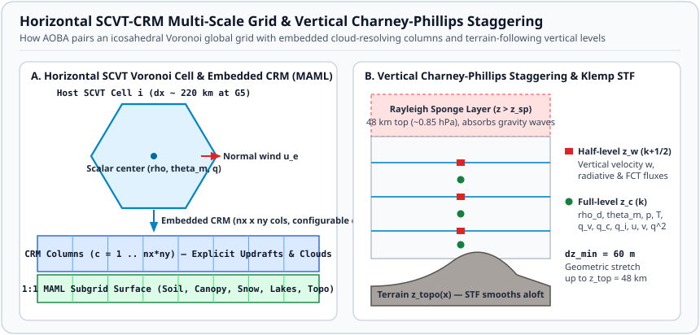
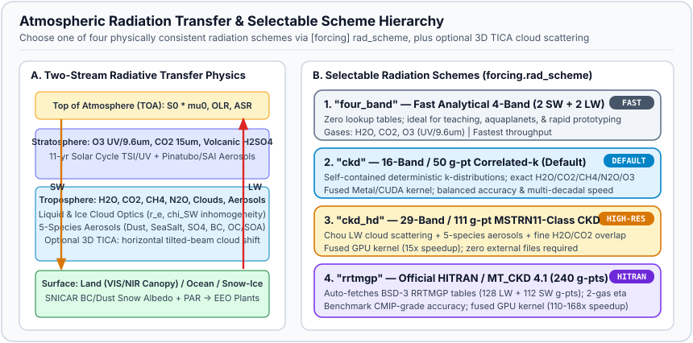
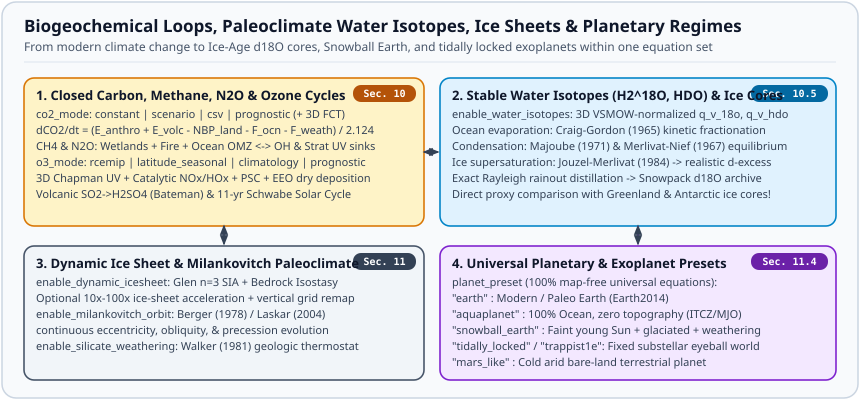

# AOBA 地球システムモデル — 物理・数値定式化

## 目次

1. [モデル全体像・基礎物理定数・天文学的軌道日射幾何](#1-モデル全体像基礎物理定数天文学的軌道日射幾何)
2. [空間格子：SCVT ボロノイ親格子・埋め込み CRM・Charney–Phillips 鉛直層](#2-空間格子scvt-ボロノイ親格子埋め込み-crmcharneyphillips-鉛直層)
3. [湿潤圧縮性熱力学と混合相飽和調節](#3-湿潤圧縮性熱力学と混合相飽和調節)
4. [大気放射伝達 — 選択制スキーム (`rad_scheme`) と 3D TICA](#4-大気放射伝達--選択制スキーム-rad_scheme-と-3d-tica)
5. [雲微物理 — 選択制スキーム (`microphysics_scheme`) と落雷・$\mathrm{LNO}_x$](#5-雲微物理--選択制スキーム-microphysics_scheme-と落雷lno_x)
6. [境界層乱流・粗度サブレイヤ (RSL)・3D SGS 混合](#6-境界層乱流粗度サブレイヤ-rsl3d-sgs-混合)
7. [陸面過程・MAML 水文・自律 EEO 生態系・陸域 C/N・山火事](#7-陸面過程maml-水文自律-eeo-生態系陸域-cn山火事)
8. [全球非静力学 SCVT 力学・埋め込み CRM・重力波抵抗](#8-全球非静力学-scvt-力学埋め込み-crm重力波抵抗)
9. [海洋循環 (`ocean_mode`)・独立高解像海洋・波浪・海氷・海洋 BGC](#9-海洋循環-ocean_mode独立高解像海洋波浪海氷海洋-bgc)
10. [大気化学 (`o3_mode`)・エアロゾル・炭素循環 (`co2_mode`)・水安定同位体](#10-大気化学-o3_modeエアロゾル炭素循環-co2_mode水安定同位体)
11. [動的氷床モデル・ミランコビッチ古気候・汎用惑星プリセット](#11-動的氷床モデルミランコビッチ古気候汎用惑星プリセット)
12. [一元 307 パラメータ TOML レジストリ・Zarr v3 出力・AOBA Studio](#12-一元-307-パラメータ-toml-レジストリzarr-v3-出力aoba-studio)

---

## 1. モデル全体像・基礎物理定数・天文学的軌道日射幾何

### 1.1 モデル構成と設計原則

**地球システムモデル (Earth System Model: ESM)** は、太陽からの日射・大気の大循環・雲と降水・海流と深層循環・海氷・陸上植物・土壌・大気化学・大陸氷床が互いに影響し合いながら数十年〜数万年にわたりどう変化するかを予測する数値結合モデルである。従来の気候モデルの多くは、現代地球の植生分布図（PFT マップ）、砂漠ダスト発生源マップ、海洋熱フラックス補正図、経験的な積雲パラメタリゼーションなどに大きく依存してきた。これらは現代気候の再現には便利だが、氷期・白亜紀・全球凍結（スノーボールアース）や系外惑星のように気候が大きく変わる実験では、現代の地図が物理的な応答を歪めてしまう。

AOBA は現代気候・古気候・理想化惑星実験を単一のコードベースで扱うため、以下の 3 原則に基づいて設計されている。
1. **地図不要の普遍物理**：地理的に与えるのは地形・海底地形・初期氷床幾何（`Earth2014`）のみである。熱帯雨林・サバンナ・砂漠・ダスト嵐・積乱雲・雷・山火事・海流・植物プランクトン・海洋波浪は、すべて普遍的な物理・生態最適則から自律的に創発する。
2. **積雲パラメタリゼーション不要の陽的対流**：各全球格子の中に水平格子幅 $\Delta x = 4\ \mathrm{km}$ の非静力学雲解像モデル (CRM) を埋め込み、親格子と全く同じ圧縮性 Euler 方程式で対流を直接解像する（`enable_superparam = false` で全球単独雲解像モデルへシームレスに切替可能）。
3. **目的に応じた選択制スキーム**：放射（`rad_scheme`）・雲微物理（`microphysics_scheme`）・海洋（`ocean_mode`）・オゾン（`o3_mode`）・$\mathrm{CO}_2$（`co2_mode`）・惑星プリセット（`planet_preset`）を [`config/aoba_default.toml`](../config/aoba_default.toml) や AOBA Studio から簡単に選択できる。

### 1.2 基礎物理定数 (`src/aoba/constants.py`)

全モジュールが参照する基礎物理定数は `src/aoba/constants.py` および TOML の `[constants]` セクションに一元化されており、惑星半径・重力・自転速度・1 日の長さを変更しても全物理過程が自動的に整合する。

| 記号 | 標準値 | 単位 | 物理的意味 |
| :--- | :--- | :--- | :--- |
| $R_E$ | $6.371 \times 10^6$ | $\mathrm{m}$ | 惑星平均半径 (`earth_radius`) |
| $g$ | $9.79764$ | $\mathrm{m\ s^{-2}}$ | 表面重力加速度 (`gravity`) |
| $\Omega_E$ | $7.292115 \times 10^{-5}$ | $\mathrm{rad\ s^{-1}}$ | 地球基準自転角速度 (`omega_earth`) |
| $R_d, c_{pd}$ | $287.04,\ 1004.64$ | $\mathrm{J\ kg^{-1}\ K^{-1}}$ | 乾燥空気の気体定数・定圧比熱 |
| $R_v, c_{pv}$ | $461.5,\ 1846.0$ | $\mathrm{J\ kg^{-1}\ K^{-1}}$ | 水蒸気の気体定数・定圧比熱 |
| $p_0$ | $1.0 \times 10^5$ | $\mathrm{Pa}$ | 温位計算の基準気圧 ($1000\ \mathrm{hPa}$) |
| $L_{v0}, L_{f0}$ | $2.501 \times 10^6,\ 3.337 \times 10^5$ | $\mathrm{J\ kg^{-1}}$ | $273.15\ \mathrm{K}$ における蒸発潜熱・融解潜熱 |
| $\sigma$ | $5.670374419 \times 10^{-8}$ | $\mathrm{W\ m^{-2}\ K^{-4}}$ | シュテファン・ボルツマン定数 |
| $\rho_{\mathrm{sw}}, c_{p,\mathrm{sw}}$ | $1025.0,\ 3990.0$ | $\mathrm{kg\ m^{-3}},\ \mathrm{J\ kg^{-1}\ K^{-1}}$ | 海水の基準密度・定圧比熱 |
| $T_{f,\mathrm{ocn}}$ | $271.35$ | $\mathrm{K}$ | 海水の凝固点 ($-1.8^\circ\mathrm{C}$) |

### 1.3 天文学的軌道要素・太陽天頂角・暦法 (`src/aoba/radiation.py`, `src/aoba/calendar.py`)

気候システムのエネルギー源は太陽放射である。惑星は離心率 $e$ の楕円軌道を描き、自転軸が傾斜角（黄道傾斜角）$\varepsilon$ だけ傾いているため、季節に応じて太陽距離 $r$ と太陽赤緯 $\delta$ が変化する。春分点からの平均近点角 $M$ とケプラー方程式の展開から真黄経 $\lambda_s$ および大気上端入射フラックス $S_{\mathrm{TOA}}$ を求める：

$$
M = \frac{2\pi t_{\mathrm{seas}}}{P_{\mathrm{yr}}} - \varpi_{\mathrm{eq}}, \qquad \lambda_s = M + 2e\sin M + \frac{5}{4}e^2 \sin(2M) + \varpi_{\mathrm{eq}} \tag{1.1}
$$

$$
\left(\frac{a}{r}\right)^2 = \left[\frac{1 + e\cos(\lambda_s - \varpi)}{1 - e^2}\right]^2, \qquad S_{\mathrm{TOA}} = S_0 \left(\frac{a}{r}\right)^2 \tag{1.2}
$$

太陽赤緯 $\delta$ と緯度 $\phi$・経度 $\lambda$・時角 $H$ における太陽天頂角余弦 $\mu_0 = \cos\theta_0$ は球面三角法により次式で与えられる：

$$
\sin\delta = \sin\varepsilon \sin\lambda_s \tag{1.3}
$$

$$
\mu_0(\phi, \lambda, t) = \max\!\Big(0,\ \sin\phi\sin\delta + \cos\phi\cos\delta\cos H(\lambda, t)\Big) \tag{1.4}
$$

`diurnal_cycle = false` とすると、`src/aoba/calendar.py` が式 (1.4) の代わりに 1 日の日照平均天頂角 $\bar{\mu}_0$ を解析的に与える。また暦法（`gregorian` / `noleap` / `360_day`）や日付固定日射（`perpetual_date`）も選択できる。

---

## 2. 空間格子：SCVT ボロノイ親格子・埋め込み CRM・Charney–Phillips 鉛直層

### 2.1 水平・鉛直空間離散化の概要

通常の緯度・経度格子は北極・南極に向かって格子幅が極端に狭くなる「極特異点」を持ち、数値安定性のために時間刻みを非常に小さくしなければならない。AOBA では正二十面体を再帰的に分割して Lloyd 反復で均一化した**球面重心ボロノイ格子 (SCVT)** を採用する（分割レベル `glevel` $g = 0 \dots 6$ に対しセル数は $N_{\mathrm{cells}} = 10\cdot 4^g + 2$：G3 = 642, G4 = 2562, G5 = 10242）。セルはほぼ均一な六角形（と 12 個の五角形）で構成され、スカラー量をセル中心に、法線風速 $u_e$ を直交エッジ上に配置する Arakawa C-grid を採る。

さらに各全球親セルの内部に水平解像度 $\Delta x = 4\ \mathrm{km}$ の**埋め込み雲解像モデル (CRM)**（`crm_nx` $\times$ `crm_ny` カラム）を配置し、各 CRM カラム直下に独立した陸面パッチを 1 対 1 で結合する（**MAML**: Multiple Atmosphere–Multiple Land）。鉛直方向は親格子・CRM 共通の **Charney–Phillips スタッガード格子**とし、鉛直流 $w$ を半レベル $z_{k+1/2}$ に、温位・密度・水平風を全レベル $z_k$ に置くことで鉛直方向の偽の振動モードを除去している。

### 2.2 ストレッチ鉛直層とレイリースポンジ層 (`src/aoba/vertical_grid.py`)

地表付近では境界層乱流を解像するため薄い層厚（`dz_min = 60 m`）とし、上空に向かって等比級数的に層厚を広げ、成層圏界面（`z_top = 48 km`, `nz = 44`）まで連続的に解像する：

$$
\Delta z_k = \Delta z_{\min} \, r^k, \qquad \sum_{k=0}^{N_z-1} \Delta z_k = z_{\mathrm{top}}, \qquad z_{c,k} = \frac{1}{2}\left(z_{w,k} + z_{w,k+1}\right) \tag{2.1}
$$

スポンジ層底面 $z_{\mathrm{sp}}$（`z_sponge_base = 36 km`）より上空では、上方伝播した重力波がモデル上端で反射しないよう滑らかな $\sin^2$ 型レイリー減衰を作用させる：

$$
\gamma_{\mathrm{sp}}(z) = \frac{1}{\tau_{\mathrm{sp,min}}} \sin^2\!\left(\frac{\pi}{2}\,\frac{\max(z - z_{\mathrm{sp}}, 0)}{z_{\mathrm{top}} - z_{\mathrm{sp}}}\right) \tag{2.2}
$$

### 2.3 Klemp (2011) 平滑化地形追従座標 (STF)

単純な地形追従座標では急峻な山岳の凹凸が成層圏上空まで残り、水平気圧傾度力に大きな数値誤差を生む。AOBA では高度とともに地形の歪みを急速に減衰させる **Klemp (2011) 平滑化地形追従座標 (STF)** を用いる（指数 $p =$ `terrain_scale_exp` $= 1.5$）：

$$
z(\zeta, x) = \zeta + h_s(x)\left(1 - \frac{\zeta}{z_{\mathrm{top}}}\right)^p, \qquad J = \frac{\partial z}{\partial \zeta} = 1 - \frac{p\,h_s(x)}{z_{\mathrm{top}}}\left(1 - \frac{\zeta}{z_{\mathrm{top}}}\right)^{p-1} \tag{2.3}
$$

最下層大気参照高度は常に植生樹冠高さ $h_c$ より上（$z_{\mathrm{ref}} = \max(z_{c,0} - h_s, h_c + 2\ \mathrm{m})$）に保ち、森林上での接地境界層交換の整合性を保証する。

---

## 3. 湿潤圧縮性熱力学と混合相飽和調節

### 3.1 湿潤圧縮性大気の熱力学と浮力

水蒸気分子 ($\mathrm{H}_2\mathrm{O}$, 分子量 18) は乾燥空気 (平均分子量 29) より軽いため、同じ温度なら湿った空気ほど浮力が大きく上昇しやすい。反対に、凝結してできた液滴 ($q_c$) や氷晶 ($q_i$) は重力で下向きの荷重（*凝結物荷重*）を与える。空気塊が上昇・断熱冷却して飽和水蒸気量を超えると凝結が起こり、莫大な潜熱（$L_v \approx 2.5\ \mathrm{MJ\ kg^{-1}}$）が放出されて積乱雲や台風を加速する。

### 3.2 状態方程式と湿潤仮温位 (`src/aoba/thermodynamics.py`)

AOBA の圧縮性非静力学力学は、乾燥空気密度 $\rho_d$ と**湿潤仮温位** $\theta_m$ を基本状態量として定式化される：

$$
\theta_m = \theta \left(1 + \frac{R_v}{R_d} q_v\right) = \frac{T}{\Pi}\left(1 + \varepsilon_v q_v\right), \qquad \Pi = \left(\frac{p}{p_0}\right)^{R_d / c_{pd}} \tag{3.1}
$$

$$
p = p_0 \left(\frac{\rho_d R_d \theta_m}{p_0}\right)^{\gamma}, \qquad \gamma = \frac{c_{pd}}{c_{pd} - R_d} \approx 1.400 \tag{3.2}
$$

鉛直浮力に効く総湿潤密度には、水蒸気および全凝結水が含まれる：

$$
\rho_{\mathrm{tot}} = \rho_d \left(1 + q_v + q_c + q_i + q_p\right) \tag{3.3}
$$

### 3.3 混合相分配と Newton–Raphson 飽和調節

$T_{\mathrm{ice}} = 253.15\ \mathrm{K}$ ($-20^\circ\mathrm{C}$) から $T_{\mathrm{liq}} = 273.16\ \mathrm{K}$ ($0^\circ\mathrm{C}$) の間では、過冷却水滴と氷晶が温度の線形関数 $\omega_n(T)$ で滑らかに共存する：

$$
\omega_n(T) = \operatorname{clamp}\!\left(\frac{T - T_{\mathrm{ice}}}{T_{\mathrm{liq}} - T_{\mathrm{ice}}},\ 0,\ 1\right), \qquad q_s(T, p) = \omega_n q_{s,\ell}(T, p) + (1 - \omega_n) q_{s,i}(T, p) \tag{3.4}
$$

総非降水水分 $q_n = q_v + q_c + q_i$ を保存したまま、3 回のベクトル化 Newton–Raphson 反復により厳密な飽和平衡温度を求める：

$$
T^{(m+1)} = T^{(m)} - \frac{T^{(m)} - T_{\mathrm{dry}} - \frac{L_{\mathrm{eff}}}{c_{pd}}\max(q_n - q_s(T^{(m)}), 0)}{1 + \frac{L_{\mathrm{eff}}}{c_{pd}}\frac{\partial q_s}{\partial T}\Big|_{T^{(m)}}} \tag{3.5}
$$

ここで $L_{\mathrm{eff}} = \omega_n L_{v0} + (1 - \omega_n)(L_{v0} + L_{f0})$ は混合相実効潜熱である。

---

## 4. 大気放射伝達 — 選択制スキーム (`rad_scheme`) と 3D TICA

### 4.1 放射伝達の概要と選択制スキーム (`rad_scheme`)

放射伝達は地球と宇宙をつなぐ唯一のエネルギー収支窓口である。太陽からの短波放射 (SW) は地表と成層圏オゾン層を温め、地球が放出する長波熱赤外放射 (LW) は大気を宇宙へ冷却する。温室効果ガス（$\mathrm{H}_2\mathrm{O}, \mathrm{CO}_2, \mathrm{CH}_4, \mathrm{N}_2\mathrm{O}, \mathrm{O}_3$）・雲・エアロゾルは長波を吸収して温室効果をもたらし、短波を散乱して地球のアルベド（反射率）を変える。気体分子の吸収線は波長によって激しく振動するため、高精度モデルでは波長帯を吸収係数の累積分布（**$g$ 点**）に並べ替える **Correlated-$k$ 分布法** を用いる。

AOBA では [`config/aoba_default.toml`](../config/aoba_default.toml) の **`[forcing] rad_scheme` により以下の 4 つのスキームから選択** できる（いずれも地表の可視・近赤外・PAR 収支および大気放射加熱率へ同一インターフェースで結合される）：

| `rad_scheme` | スペクトル解像度 | 気体吸収・光学物理 | 外部ファイル | GPU 高速化 | 主な適用対象 |
| :--- | :--- | :--- | :--- | :--- | :--- |
| `"four_band"` | 4 バンド（SW 2 + LW 2） | $\mathrm{H}_2\mathrm{O}, \mathrm{CO}_2, \mathrm{O}_3$ ＋雲 | 不要 | 融合 Metal/CUDA | 講義・水惑星・超高速プロトタイピング |
| `"ckd"` *(既定)* | 16 バンド / 50 $g$ 点 | $\mathrm{H}_2\mathrm{O}, \mathrm{CO}_2, \mathrm{CH}_4, \mathrm{N}_2\mathrm{O}, \mathrm{O}_3$ ＋雲＋エアロゾル | 不要 | 融合 Metal/CUDA | 数十年〜数百年規模の標準気候・古気候実験 |
| `"ckd_hd"` | 29 バンド / 111 $g$ 点 | MSTRN11 級 CKD＋Chou LW 雲散乱＋5 種エアロゾル | 不要 | 融合 Metal/CUDA (15倍) | 外部テーブル不要で高精度な万能 ESM 実験 |
| `"rrtmgp"` | 30 バンド / 240 $g$ 点 | 公式 HITRAN + MT\_CKD 4.1（128 LW + 112 SW）、2 気体重複 $\eta$ | 自動取得 (BSD-3) | 融合 Metal/CUDA (110〜168倍) | CMIP 準拠の精密放射強制力ベンチマーク |

### 4.2 全スキーム共通の多層 2 ストリーム伝達ソルバ (`src/aoba/radiation.py`, `src/aoba/kernels.py`)

各バンドまたは $g$ 点ごとに、上向き放射フラックス $F^\uparrow$ と下向きフラックス $F^\downarrow$ を $\delta$-Eddington 2 ストリーム法で解く。まず強い前方散乱ピーク（$f = g_a^2$）をスケーリング除去する：

$$
\Delta\tau' = (1 - \omega f)\,\Delta\tau, \qquad \omega' = \frac{(1 - f)\omega}{1 - \omega f}, \qquad g' = \frac{g_a}{1 + g_a} \tag{4.1}
$$

各層の反射率 $R_k$・透過率 $T_k$・直達/プランク湧き出し項を Meador–Weaver (1980) の解析解（$\Delta\tau' \to 0$ では float32 桁落ちを防ぐ Taylor 展開を使用）で計算し、無条件安定な **Adding–Doubling 法** で地表から大気上端まで結合する：

$$
R_{12} = R_1 + \frac{T_1^2 R_2}{1 - R_1 R_2}, \qquad T_{12} = \frac{T_1 T_2}{1 - R_1 R_2} \tag{4.2}
$$

大気への放射加熱率は正味フラックスの鉛直収束で与えられる：

$$
\left(\frac{\partial T}{\partial t}\right)_{\mathrm{rad}} = -\frac{1}{\rho_d c_{pd}} \frac{\partial (F_{\mathrm{SW}}^{\mathrm{net}} + F_{\mathrm{LW}}^{\mathrm{net}})}{\partial z} \tag{4.3}
$$

4 km 未満の雲厚の空間ムラ（サブグリッド不均一性）は Cahalan et al. (1994) の係数 `cloud_sw_inhomog`（$\chi_{\mathrm{SW}} = 0.62$）で表現する：

$$
\tau_{\mathrm{liq}} = \frac{3}{2} \frac{\mathrm{LWP}}{\rho_{\ell}\, r_{e,\ell}}\,\chi_{\mathrm{SW}}, \qquad \tau_{\mathrm{ice}} = \mathrm{IWP}\left(a_i + \frac{b_i}{r_{e,i}}\right)\chi_{\mathrm{SW}} \tag{4.4}
$$

### 4.3 選択肢 1：`rad_scheme = "four_band"`（高速解析 4 バンド）

短波を 2 帯域（可視・紫外 SW1 $< 0.7\ \mu\mathrm{m}$ と近赤外 SW2 $> 0.7\ \mu\mathrm{m}$）、長波を 2 帯域（8–12 $\mu\mathrm{m}$ 大気窓と非窓域）に分け、ルックアップテーブル無しで $\mathrm{CO}_2$ 対数飽和と水蒸気連続吸収を解析計算する：

$$
\Delta\tau_{\mathrm{CO_2,15\mu m}} = k_{\mathrm{CO_2}}\left(1 + c_{\mathrm{log}}\ln\frac{C_{\mathrm{CO_2}}}{284.3}\right)\left(\frac{p}{p_0}\right)^{0.8}\Delta m \tag{4.5}
$$

$$
\Delta\tau_{\mathrm{H_2O,cont}} = k_{\mathrm{cont}}\, e_{\mathrm{H_2O}} \exp\!\left[1800\left(\frac{1}{T} - \frac{1}{296}\right)\right] q_v\,\Delta m \tag{4.6}
$$

### 4.4 選択肢 2：`rad_scheme = "ckd"`（標準 16 バンド / 50 $g$ 点 Correlated-$k$、`src/aoba/radiation_ckd.py`）

短波 6 バンド・長波 10 バンドの計 50 ガウス–ルジャンドル $g$ 点により、$\mathrm{H}_2\mathrm{O}$（吸収線＋連続吸収）・$\mathrm{CO}_2$・$\mathrm{CH}_4$・$\mathrm{N}_2\mathrm{O}$・$\mathrm{O}_3$ の圧力・温度拡がりを決定論的に計算する：

$$
k_{b,g}(p, T) = k_{b,g}^{\mathrm{ref}} \left(\frac{p}{p_{\mathrm{ref}}}\right)^{\alpha_b} \exp\!\left[\beta_b \left(\frac{1}{T_{\mathrm{ref}}} - \frac{1}{T}\right)\right] \tag{4.7}
$$

全フラックスは各バンド $b$・重み $w_{b,g}$ の和として厳密に集計される：

$$
F^\pm(z) = \sum_{b} \sum_{g=1}^{N_{g,b}} w_{b,g}\, F_{b,g}^\pm(z), \qquad \sum_{g=1}^{N_{g,b}} w_{b,g} = 1 \tag{4.8}
$$

### 4.5 選択肢 3：`rad_scheme = "ckd_hd"`（29 バンド / 111 $g$ 点 MSTRN11 級、`src/aoba/radiation_hd.py`）

MIROC6 の MSTRN11（Sekiguchi & Nakajima, 2008）と同クラスの **29 バンド / 111 $g$ 点**（LW 15 帯 + SW 14 帯）を外部ファイル不要で実装する。Chou et al. (1999) の長波雲散乱補正および 5 種自然エアロゾル＋火山性 $\mathrm{H}_2\mathrm{SO}_4$ の帯域別光学特性を組み込む：

$$
\Delta\tau_{\mathrm{LW,eff}} = \Delta\tau_{\mathrm{gas}} + (1 - \omega_{\mathrm{cld}} f_{\mathrm{back}})\,\Delta\tau_{\mathrm{cld}} + \sum_{s=1}^{6} (1 - \omega_{s} f_{s})\,\Delta\tau_{s} \tag{4.9}
$$

単一ソース融合 GPU カーネル `rad_ckd_hd_col`（`src/aoba/kernels_esm.py`）で高速実行される。

### 4.6 選択肢 4：`rad_scheme = "rrtmgp"`（公式 HITRAN / MT\_CKD 4.1 240 $g$ 点、`src/aoba/radiation_rrtmgp.py`）

BSD-3 ライセンスの公式 **RTE+RRTMGP** 気体光学テーブル（`rrtmgp-gas-lw-g128.nc`: 128 LW $g$ 点、`rrtmgp-gas-sw-g112.nc`: 112 SW $g$ 点; Pincus et al., 2019）を初回自動取得し、融合 GPU カーネル `rad_rrtmgp_lw_grp` / `rad_rrtmgp_sw_grp` で $(T, \ln p, \eta)$ の 3 重線形補間を行う：

$$
\eta = \frac{x_1}{x_1 + r_{\mathrm{ref}}(T, p)\, x_2}, \qquad \Delta\tau_{\mathrm{gas}} = N_{\mathrm{col}} \left(x_1 + r_{\mathrm{ref}} x_2\right) k_{\mathrm{maj}}(T, \ln p, \eta) + \Delta\tau_{\mathrm{min}} + \Delta\tau_{\mathrm{cont}} \tag{4.10}
$$

### 4.7 オプション：3D 傾斜独立カラム近似 (`enable_rad_3d_tica`)

通常の 1 次元放射計算では太陽光が真上から差し込む近似になり、太陽高度が低いときの雲側面照明や雲の影が表現されない。`enable_rad_3d_tica = true` にすると、太陽天頂角 $\theta_0$ に応じて CRM カラム上の雲を高度別に水平シフトさせ、総雲量を厳密保存したまま 3 次元放射効果を近似する（Várnai & Davies, 1999）：

$$
\Delta s(z) = \operatorname{round}\!\left(\frac{(z - z_{\mathrm{sfc}})\tan\theta_0}{\Delta x_{\mathrm{CRM}}}\right), \qquad q_{c,i}^{\mathrm{TICA}}(k, x) = q_{c,i}\big(k,\, (x + \Delta s(z_k)) \bmod N_x\big) \tag{4.11}
$$

---

## 5. 雲微物理 — 選択制スキーム (`microphysics_scheme`) と落雷・$\mathrm{LNO}_x$

### 5.1 雲微物理の概要と選択制スキーム (`microphysics_scheme`)

水蒸気が凝結してできたばかりの雲粒は半径約 $10\ \mu\mathrm{m}$ と極めて小さく、上昇気流に乗って浮かび続ける。雨や雪となって地表へ降るには、雲粒同士が衝突併合（*自動変換・捕捉成長*）するか、鉱物ダストなどの氷晶核 (INP) 上で凍結して**ベルジェロン・フィンダイゼン過程**により氷晶が急速成長する必要がある。強い上昇流の中では過冷却水滴が雪に凍り付いて高密度の**霰（あられ, $q_g$）**が成長し、氷晶との衝突による電荷分離が**落雷**を引き起こす。

AOBA では **`[forcing] microphysics_scheme` により以下の 3 つのスキームから選択** できる：

| `microphysics_scheme` | 予報する雲・降水変数 | エアロゾル–雲相互作用 | 落雷との結合 | 主な適用対象 |
| :--- | :--- | :--- | :--- | :--- |
| `"one_moment"` | $q_n, q_p$（固定有効半径） | 固定 $N_c$ (`re_liq_um`, `re_ice_um`) | 診断氷降水 $q_p$ | 超高速な理想化・概念実験 |
| `"two_moment"` *(既定)* | $q_n, q_p, N_c, N_i$ | 予報 CCN/INP $\to$ Twomey・寿命効果 | 診断霰比率 | 標準的な多十年気候・エアロゾル実験 |
| `"six_class_2m"` | $(q_c,N_c), (q_i,N_i), (q_r,N_r), (q_s,N_s), (q_g,N_g)$ | 全 6 種の質量・数濃度を完全予報 | 真の予報霰 $q_g$ を直接入力 | 深い対流・霰/雹・精密落雷 $\mathrm{LNO}_x$・Full-ESM |

### 5.2 選択肢 1：`microphysics_scheme = "one_moment"`（SAM 1 モーメント、`src/aoba/microphysics.py`）

Khairoutdinov & Randall (2003) に基づき、非降水水分 $q_n$ と総降水 $q_p$ の 2 変数から温度診断で雨・雪・霰へ分配し、指数粒径分布 $n(D) = N_0 e^{-\lambda D}$ と終端落下速度則 $v(D) = a D^b$ を用いる：

$$
\left(\frac{\partial q_p}{\partial t}\right)_{\mathrm{auto}} = \alpha_{\mathrm{auto}} \max(q_c - q_{c0},\ 0) + \alpha_{\mathrm{agg}} \max(q_i - q_{i0},\ 0) \tag{5.1}
$$

$$
\left(\frac{\partial q_p}{\partial t}\right)_{\mathrm{accr}} = \sum_{x \in \{r,s,g\}} \frac{\pi}{4}\, a_x N_{0,x} \Gamma(3 + b_x)\,\lambda_x^{-(3+b_x)} \left(\frac{\rho_0}{\rho_d}\right)^{1/2} \big(E_{xc} q_c + E_{xi} q_i\big) \tag{5.2}
$$

雲底下の未飽和空気中では降水蒸発・昇華が冷気プール（下降流）を形成し、降水落下は CFL 条件を満たすサブサイクルで厳密に水分保存する：

$$
q_p^{n+1}(k) = q_p^n(k) + \frac{\Delta t_{\mathrm{sub}}}{\rho_d \Delta z_k}\Big(F_{\mathrm{fall}}(k+1/2) - F_{\mathrm{fall}}(k-1/2)\Big) \tag{5.3}
$$

$$
F_{\mathrm{fall}}(k-1/2) = \rho_d(k)\, v_{t}(k)\, q_p(k), \qquad \mathrm{CFL}_{\mathrm{sed}} = \frac{v_t \Delta t_{\mathrm{sub}}}{\Delta z_k} \le 0.9 \tag{5.4}
$$

### 5.3 選択肢 2：`microphysics_scheme = "two_moment"`（標準 2 モーメント KK00）

雲水数濃度 $N_c$ と雲氷数濃度 $N_i$ を予報変数に加え、海塩・硫酸塩・ダスト・SOA から活性化する CCN/INP と結合する。暖かい雨の自動変換には Khairoutdinov & Kogan (2000) の非線形則を用い、**エアロゾル間接効果**（CCN が増えると雲粒が小さく明るくなり、雨が降りにくくなる）を自律的に再現する：

$$
\left(\frac{\partial q_p}{\partial t}\right)_{\mathrm{auto,KK00}} = 1350\, q_c^{2.47}\, \left(N_c \cdot 10^{-6}\right)^{-1.79} \tag{5.5}
$$

$$
\left(\frac{\partial q_p}{\partial t}\right)_{\mathrm{accr,KK00}} = 67\, \left(q_c q_r\right)^{1.15} \tag{5.6}
$$

予報された数濃度から液雲・氷雲の有効半径 $r_e$ を診断し、第 4 章の放射スキーム（式 4.4）へ直接渡す：

$$
r_{e,\ell} = \kappa_r \left(\frac{3 \rho_d q_c}{4\pi \rho_\ell N_c}\right)^{1/3}, \qquad r_{e,i} = \operatorname{clamp}\!\left(\left(\frac{3 \rho_d q_i}{4\pi \rho_i N_i}\right)^{1/3},\ 10\ \mu\mathrm{m},\ 120\ \mu\mathrm{m}\right) \tag{5.7}
$$

### 5.4 選択肢 3：`microphysics_scheme = "six_class_2m"`（Morrison 6 種 2 モーメント、`src/aoba/microphysics_6class.py`）

融合 GPU カーネル `microphysics_6class_col` 内で、雨 $(q_r, N_r)$・雪 $(q_s, N_s)$・霰 $(q_g, N_g)$ の質量と数濃度をすべて独立予報する。過冷却雲水による雪のライミングが霰を生成し、$0^\circ\mathrm{C}$ 以上では雪・霰が融解して雨となる：

$$
\left(\frac{\partial q_g}{\partial t}\right)_{\mathrm{rime}} = E_{sc}\, \rho_d\, q_c\, \frac{\pi}{4} a_s N_{0,s}\Gamma(3+b_s)\lambda_s^{-(3+b_s)} \cdot f_{\mathrm{conv}}(q_c, q_s) \tag{5.8}
$$

各降水種は厳密な指数有界沈降フラックスにより独立落下し、質量・数濃度・潜熱を厳密保存する：

$$
F_{x,k} = \rho_{d,k} \Delta z_k \frac{q_{x,k}}{\Delta t}\left[1 - \exp\!\left(-\frac{v_{t,x,k}\Delta t}{\Delta z_k}\right)\right], \qquad x \in \{r, s, g\} \tag{5.9}
$$

### 5.5 埋め込み CRM 非誘導帯電落雷と $\mathrm{LNO}_x$ (`src/aoba/lightning.py`)

埋め込み CRM が上昇流 $w$ と混合相氷・霰粒子を直接解像しているため、$-15^\circ\mathrm{C}$ 付近の霰–氷晶衝突フラックスから発雷頻度を物理的に計算する（McCaul et al., 2009 / Price & Rind, 1992）：

$$
F_{\mathrm{flash}} = c_1 \big(w\, q_g\big)_{-15^\circ\mathrm{C}} + c_2 \int_{\mathrm{col}} \rho_d (q_g + q_s + q_i)\,dz \tag{5.10}
$$

落雷は SPITFIRE 山火事（第 7.5 節）の着火源となり、同時に上部対流圏へ雷起源 $\mathrm{NO}_x$ ($\mathrm{LNO}_x$) を放出して対流圏オゾン生成（第 10.2 節）および海洋窒素沈着（第 9.7 節）へ結合する。

---

## 6. 境界層乱流・粗度サブレイヤ (RSL)・3D SGS 混合

### 6.1 接地境界層・粗度サブレイヤ・乱流混合の概要

樹木・地形・海面波浪との摩擦は地表風を減速させ、大小の乱流渦を生み出して地表面の熱（顕熱）と水蒸気（潜熱）を大気境界層 (PBL) へと混合する。背の高い森林の樹冠直上では通常の Monin–Obukhov 相似則が破綻し、樹冠後流のコヒーレント渦が混合を強める**粗度サブレイヤ (RSL)** が形成される。AOBA は地表で閉形式 RSL 相似則を用い、鉛直方向を陰的 MYNN Level 2.5 乱流運動エネルギー (TKE) クロージャ、CRM 水平方向を 3D Smagorinsky–Lilly 渦拡散で解く。

### 6.2 空力粗度と De Ridder (2010) RSL 相似則 (`src/aoba/turbulence.py`)

自律成長した樹冠高さ $h_c$ からゼロ面変位 $d_0$ と粗度長 $z_{0m}$ を動的に与え、海面では Charnock 則（および第 9.5 節の波齢効果）を用いる：

$$
d_0 = 0.67\,h_c, \qquad z_{0m,\mathrm{land}} = \max(0.10\,h_c,\ z_{0,\mathrm{soil}}) \tag{6.1}
$$

$$
z_{0m,\mathrm{ocn}} = \frac{0.11\,\nu_{\mathrm{air}}}{u_*} + \alpha_{\mathrm{Ch}}\frac{u_*^2}{g} \tag{6.2}
$$

De Ridder (2010) の解析的 RSL 補正関数 $\psi_{m,h}^*$ を Monin–Obukhov 相似則へ組み込み、摩擦速度 $u_*$・バルク輸送係数 $C_D, C_H$・地表面フラックスを反復なしで高精度に求める：

$$
u_* = \frac{\kappa U_1}{\ln\!\left(\frac{z_1 - d_0}{z_{0m}}\right) - \Psi_m(\zeta) + \psi_m^*(\zeta, z_*)}, \qquad C_H = \frac{\kappa^2}{\big[\ln(\frac{z_1-d_0}{z_{0m}}) - \Psi_m + \psi_m^*\big]\big[\ln(\frac{z_1-d_0}{z_{0h}}) - \Psi_h + \psi_h^*\big]} \tag{6.3}
$$

$$
\boldsymbol{\tau}_s = -\rho_1 C_D |\mathbf{U}_1|\mathbf{U}_1, \qquad H_s = \rho_1 c_{pd} C_H |\mathbf{U}_1|(T_s - \theta_1), \qquad E_s = \rho_1 C_H |\mathbf{U}_1|\beta_w(q_s(T_s) - q_{v,1}) \tag{6.4}
$$

### 6.3 陰的 MYNN Level 2.5 PBL と 3D Smagorinsky–Lilly SGS

乱流運動エネルギーの 2 倍量 $q^2 = 2\,\mathrm{TKE}$ はシアー生成・浮力生成/抑制・鉛直輸送・粘性散逸の収支で予報される：

$$
\frac{\partial q^2}{\partial t} = 2\left(K_m S^2 - K_h N^2\right) + \frac{1}{\rho_d}\frac{\partial}{\partial z}\left(\rho_d K_q \frac{\partial q^2}{\partial z}\right) - \frac{2 q^3}{B_1 \ell} \tag{6.5}
$$

鉛直乱流拡散は float32 での保存性劣化を完全に防ぐ**増分形式の陰的三重対角 Thomas ソルバ**で解く：

$$
\left(\mathbf{I} + \Delta t\,\mathbf{L}_K\right)\Delta \phi = -\Delta t\,\mathbf{L}_K \phi^n, \qquad \phi^{n+1} = \phi^n + \Delta\phi \tag{6.6}
$$

4 km CRM の水平サブグリッド渦粘性には浮力減衰付きの 3D Smagorinsky–Lilly 拡散を用いる：

$$
K_{m,h} = (C_s \Delta x)^2 \sqrt{\max\!\left(0,\ S_h^2 - \frac{N^2}{\mathrm{Pr}_n}\right)} \tag{6.7}
$$

---

## 7. 陸面過程・MAML 水文・自律 EEO 生態系・陸域 C/N・山火事

### 7.1 陸面・生態系・水文結合の概要

従来の ESM では「この格子は熱帯雨林」と静的な植生分類図 (PFT マップ) を張り付けるため、温暖化や氷期に植生帯が自律移動できない。AOBA は **生態進化最適性理論 (Eco-Evolutionary Optimality: EEO)**（Prentice et al., 2014; Wang et al., 2017; Smith et al., 2019; Cai et al., 2025）を採用する。自然選択のもとで植物は「光合成酵素 ($V_{c\max}, J_{\max}$) を維持するコスト」と「気孔を開いて水を失う蒸散コスト」の和を最小化しながら炭素同化を最大化する。これを各 CRM カラム直下の独立陸面パッチ（**MAML**）で解くことで、熱帯雨林・サバンナ・$\mathrm{C}_4$ 草原・砂漠・針葉樹林・ツンドラが日射・気温・$\mathrm{CO}_2$・降水から自律的に創発する。

### 7.2 自律 Two-Leaf EEO 生態系 (`src/aoba/biosphere.py`)

最小コスト仮説により、葉内対大気 $\mathrm{CO}_2$ 濃度比 $\chi = c_i / c_a$ は空気の乾燥度（飽差 $D$）に応じて解析的に決まる：

$$
\chi = \frac{\Gamma^*}{c_a} + \left(1 - \frac{\Gamma^*}{c_a}\right)\frac{\xi}{\xi + \sqrt{D}}, \qquad \xi = \sqrt{\frac{\beta (K + \Gamma^*)}{1.6\,\eta^*}} \tag{7.1}
$$

光合成速度 $A$ は Rubisco 律速 ($A_c$) と電子伝達律速 ($A_j$) を曲率 $\theta = 0.85$ の非直角双曲線で滑らかに配位し、15 日間の正午 EMA で酵素容量 $(V_{c\max 25}, J_{\max 25})$ を順化する：

$$
\theta A^2 - (A_c + A_j) A + A_c A_j = 0, \qquad A = \frac{A_c + A_j - \sqrt{(A_c + A_j)^2 - 4\theta A_c A_j}}{2\theta} \tag{7.2}
$$

気孔コンダクタンス $g_{sw}$ は光合成と蒸散を直接結び付ける：

$$
g_{sw} = \frac{1.6\, A}{c_a (1 - \chi)} \tag{7.3}
$$

直射光の当たる**陽葉**と散乱光のみの**陰葉**の非線形応答を区別するため、Beer–Lambert 減衰係数 $k_b$ で葉面積指数 $L$ を解析的に 2 層分割する：

$$
L_{\mathrm{sun}} = \frac{1 - e^{-k_b L}}{k_b}, \qquad L_{\mathrm{shd}} = L - L_{\mathrm{sun}} \tag{7.4}
$$

平衡最適 **葉面積指数 ($L^*$)** は葉の建設コスト $z$ に対する純利益最大化の厳密解としてオーバーフローしない **Lambert-$W_0$ 関数** で閉形式表現され、根圏土壌水分ストレスで変調される：

$$
L^* = \frac{1}{k}\left[W_0\!\left(\frac{k\,A_0}{z}\right)\right] \cdot f_{\mathrm{water}}(\theta_{\mathrm{root}})^\sigma \tag{7.5}
$$

$\mathrm{C}_4$ 植物優占度 $F_4$ および常緑/落葉比率 $f_{\mathrm{evg}}$ も同様に、各戦略の年間純炭素利得の差から連続的に創発する：

$$
F_4 = \frac{1}{1 + \exp\!\big[-s_4 (P_{\mathrm{net,C4}} - P_{\mathrm{net,C3}})\big]}, \qquad f_{\mathrm{evg}} = \frac{1}{1 + \exp\!\big[-s_e (P_{\mathrm{net,evg}} - P_{\mathrm{net,dec}})\big]} \tag{7.6}
$$

### 7.3 3 源エネルギー収支・積雪 SNICAR・5 層凍土リチャーズ土壌 (`src/aoba/surface.py`)

各 MAML パッチは陽葉・陰葉・地表面の **3 源連成エネルギー収支** を陰的反復（`land_eb_iterations = 3`）で解く：

$$
R_{n,\mathrm{can}} = H_{\mathrm{can}} + L_v E_{\mathrm{trans}} + L_v E_{\mathrm{int}}, \qquad R_{n,\mathrm{gnd}} = H_{\mathrm{gnd}} + L_v E_{\mathrm{soil}} + G_{\mathrm{soil}} \tag{7.7}
$$

積雪アルベドは時間経過とともに低下（エージング）し、`enable_snow_bc_darkening = true` 時は黒色炭素 (BC) やダスト沈着による **SNICAR 暗化効果**（Flanner et al., 2007）を反映する：

$$
\alpha_{\mathrm{snow,vis}} = \alpha_{\mathrm{old}} + (\alpha_{\mathrm{new}} - \alpha_{\mathrm{old}})e^{-t_{\mathrm{age}}/\tau_{\mathrm{age}}} - \Delta\alpha_{\mathrm{SNICAR}}(C_{\mathrm{BC}}, C_{\mathrm{dust}}) \tag{7.8}
$$

5 層土壌は氷の透水阻害（$10^{-\Omega f_{\mathrm{ice}}}$）を含む陰的三重対角 **Richards 水分輸送方程式** と、凍結・融解潜熱（*ゼロカーテン効果*）を含む **5 層熱伝導方程式** を解く：

$$
\frac{\partial \theta_\ell}{\partial t} = \frac{\partial}{\partial z}\left[K(\theta_\ell, f_{\mathrm{ice}})\left(\frac{\partial \psi(\theta_\ell)}{\partial z} + 1\right)\right] - S_{\mathrm{root}} \tag{7.9}
$$

$$
\left(C_s + \rho_w L_{f0} \frac{\partial \theta_\ell}{\partial T}\right)\frac{\partial T_s}{\partial t} = \frac{\partial}{\partial z}\left(\kappa_s \frac{\partial T_s}{\partial z}\right) \tag{7.10}
$$

### 7.4 MAML サブグリッド山岳微気候と動的湿地・湖沼 (`src/aoba/maml_land_subgrid.py`)

200 km 四方の親セル内にも高山と谷、あるいは氾濫原の湿地が混在している。
- **サブグリッド山岳微気候（`enable_maml_subgrid_topo`）**：`Earth2014` の地形標準偏差 $\sigma_{\mathrm{topo}}$ から各 MAML パッチ $m$ に親格子平均ゼロの標高差 $\Delta z_m$ と斜面方位を与え、湿潤気温減率 $\Gamma_m = 6.5\ \mathrm{K\ km^{-1}}$ で局所気温・雪線をダウンスケーリングする：

$$
T_{\mathrm{air},m} = T_{\mathrm{air}} - \Gamma_m\,\Delta z_m, \qquad \sum_{m=1}^{N_{\mathrm{sub}}} \Delta z_m = 0 \tag{7.11}
$$

- **動的湿地・湖沼（`enable_maml_wetlands_lakes`）**：地形平坦度（TOPMODEL 指標）と土壌水分・河川流量から冠水率 $f_{\mathrm{wet}} \in [0, 0.85]$ を診断し、水面蒸発強化および自然湿地 $\mathrm{CH}_4$ 放出（第 10.5 節）へ結合する：

$$
f_{\mathrm{wet}} = f_{\mathrm{flat}}(\sigma_{\mathrm{topo}})\cdot \operatorname{clamp}\!\left(\frac{\theta_{\mathrm{top}} - \theta_c}{\theta_{\mathrm{sat}} - \theta_c} + c_Q Q_{\mathrm{riv}},\ 0,\ 0.85\right) \tag{7.12}
$$

### 7.5 陸域 6 プール C/N モデル・SPITFIRE 山火事・D8 河川流路 (`land_carbon.py`, `river_routing.py`)

陸域炭素は 6 プール（葉・木部・根・リター・速/遅土壌炭素）を厳密指数更新で追跡し、無機窒素制限および生物的窒素固定 (BNF) と連成して純生態系生産量 $\mathrm{NBP}$ を大気 $\mathrm{CO}_2$ 収支へ渡す：

$$
\mathrm{NBP} = \mathrm{GPP} - R_a - R_h(T_s, \theta) - F_{\mathrm{fire}} \tag{7.13}
$$

山火事（`enable_fire_veg_feedback`; SPITFIRE）は CRM 発雷頻度（式 5.10）と乾燥度・燃料量から焼失面積を予報し、$\mathrm{CO}_2$・$\mathrm{CH}_4$・BC/OC 煙を放出する：

$$
\left(\frac{dA_{\mathrm{burn}}}{dt}\right) = P_{\mathrm{ign}}(F_{\mathrm{flash}})\cdot f_{\mathrm{dry}}(\mathrm{VPD}, \theta)\cdot R_{\mathrm{spread}}(U_{10}, C_{\mathrm{fuel}}) \tag{7.14}
$$

陸域流出水は `Earth2014` 最急降下 D8 河川網（`enable_river_routing`）を Manning 流速 $v_{\mathrm{riv}}$ で流下し、沿岸海洋の塩分・栄養塩へ保存的に流入する：

$$
\frac{dS_{\mathrm{riv},i}}{dt} = R_{\mathrm{runoff},i} + \sum_{j \in \mathrm{up}(i)} Q_{j\to i} - Q_{i\to\mathrm{dn}(i)}, \qquad Q_i = \frac{v_{\mathrm{riv},i}}{L_i} S_{\mathrm{riv},i} \tag{7.15}
$$

---

## 8. 全球非静力学 SCVT 力学・埋め込み CRM・重力波抵抗

### 8.1 統一非静力学力学コアと時間分離法の概要

従来の ESM は全球大気と対流で別個の近似式を用いるが、AOBA では全球 SCVT 親格子と埋め込み 4 km CRM の双方で**全く同一のフラックス形式圧縮性非静力学 Euler 方程式**を解く。音波は風速より桁違いに速いため（$\sim 340\ \mathrm{m\ s^{-1}}$）、特に薄い鉛直層での時間刻み制約を避けるために **RK3–HEVI**（3 段 Wicker–Skamarock Runge–Kutta ＋水平陽的・鉛直陰的音波三重対角解法）を採用する。さらにすべての水蒸気・オゾン・エアロゾル・$\mathrm{CO}_2$・水同位体トレーサは **Zalesak (1979) フラックス補正輸送法 (FCT)** により負値や振動を出さず厳密に質量保存移流される。

### 8.2 統一圧縮性 Euler 方程式と RK3–HEVI (`src/aoba/scvt_dynamics.py`, `src/aoba/crm.py`)

地形追従計量ヤコビアン $J$ を用いたフラックス形式支配方程式：

$$
\frac{\partial (J\rho_d)}{\partial t} + \nabla_h \cdot (J\rho_d \mathbf{u}_h) + \frac{\partial (J\rho_d \dot{\zeta})}{\partial \zeta} = 0 \tag{8.1}
$$

$$
\frac{\partial \mathbf{u}_h}{\partial t} + (\mathbf{u}\cdot\nabla)\mathbf{u}_h + f\hat{\mathbf{k}}\times\mathbf{u}_h = -\frac{1}{\rho_{\mathrm{tot}}}\nabla_h p + \mathbf{F}_{\mathrm{turb}} + \mathbf{F}_{\mathrm{GWD}} + \mathbf{F}_{\mathrm{sp}} \tag{8.2}
$$

$$
\frac{\partial w}{\partial t} + (\mathbf{u}\cdot\nabla)w = -\frac{1}{\rho_{\mathrm{tot}}}\frac{\partial p'}{\partial z} - g\frac{\rho_{\mathrm{tot}}'}{\rho_{\mathrm{tot}}} + F_{w,\mathrm{turb}} + F_{w,\mathrm{sp}} \tag{8.3}
$$

$$
\frac{\partial (J\rho_d \phi)}{\partial t} + \nabla_h\cdot(J\rho_d \mathbf{u}_h \phi) + \frac{\partial (J\rho_d \dot{\zeta}\phi)}{\partial \zeta} = J\rho_d S_\phi, \qquad \phi \in \{\theta_m, q_n, q_p, \chi_{\mathrm{O_3}}, \chi_{\mathrm{CO_2}}, q_{\mathrm{aero}}, q_{\mathrm{iso}}\} \tag{8.4}
$$

### 8.3 サブグリッド山岳ドラッグと地図不要の非地形性重力波抵抗 (`orography.py`, `gravity_wave.py`)

親格子で解像できない山脈は Lott & Miller (1997) により、無次元山岳高度 $H_n = N\sigma_{\mathrm{topo}}/U > H_{nc}$ での**低層迂回ブロッキング抗力**と、上空へ伝播して砕波する**山岳重力波応力**を与える：

$$
\boldsymbol{\tau}_{\mathrm{oro}} = \rho_0 G\, N\, \sigma_{\mathrm{topo}}\, \mathbf{U}_0 \cdot \mathcal{A}(\text{異方性, 勾配}) \tag{8.5}
$$

また海洋上や中緯度傾圧帯では前線や深い積雲対流が内部重力波を発射する（`enable_nonoro_gwd`）。AOBA は緯度固定のチューニング表を使わず、**前線生成関数** $\mathcal{F}$ と **CRM 対流加熱率** $Q_{\mathrm{conv}}$ から重力波運動量フラックスを動的に診断し、Warner–McIntyre 多位相速度スペクトルが臨界層で砕波する高度に運動量を付与する：

$$
\tau_{\mathrm{front}} = \tau_{0,f}\tanh\!\left(\frac{\mathcal{F}}{\mathcal{F}_{\mathrm{th}}}\right), \qquad \tau_{\mathrm{conv}} = \tau_{0,c}\tanh\!\left(\frac{\langle Q_{\mathrm{conv}}\rangle}{Q_{\mathrm{ref}}}\right) \tag{8.6}
$$

$$
\left(\frac{\partial \mathbf{u}}{\partial t}\right)_{\mathrm{GWD}} = -\frac{1}{\rho_d}\frac{\partial \boldsymbol{\tau}_{\mathrm{GW}}(z)}{\partial z} \tag{8.7}
$$

### 8.4 超パラメタリゼーション (SP) と単独全球 CRM 結合 (`src/aoba/coupled_model.py`)

`enable_superparam = true` の場合、1 親ステップ $\Delta t_{\mathrm{host}}$ ごとに CRM を大気大規模傾向で強制しながら `n_crm_dyn_substeps` 回陽的時間積分し、領域平均の対流加熱・加湿・運動量輸送傾向を親格子へ還元する（Grabowski, 2001）：

$$
\left(\frac{\partial \bar{\phi}_{\mathrm{host}}}{\partial t}\right)_{\mathrm{SP}} = \frac{\langle \phi_{\mathrm{CRM}}^{n+1} \rangle_{x,y} - \bar{\phi}_{\mathrm{host}}^{*}}{\Delta t_{\mathrm{host}}} \tag{8.8}
$$

`enable_superparam = false` とすれば埋め込み CRM をバイパスし、全球 SCVT 格子単独の雲解像シミュレーションへ切り替わる。

---

## 9. 海洋循環 (`ocean_mode`)・独立高解像海洋・波浪・海氷・海洋 BGC

### 9.1 海洋循環の概要と選択制モード (`ocean_mode`)

海洋は地球の余剰熱の 90% 以上、大気の約 50 倍の炭素を蓄える地球システム最大の熱・炭素貯蔵庫である。風応力は表層の亜熱帯還流や赤道湧昇を駆動し、高緯度での冷却と海氷結氷時の塩分排出（ブライン排出）が重い深層水を沈み込ませて**大西洋子午面循環 (AMOC)** や**南極周極流 (ACC)** を維持する。

AOBA では **`[forcing] ocean_mode` により以下の 2 つの海洋力学コアから選択** でき、さらに `ocean_glevel > glevel` を指定すれば大気より高解像度な独立海洋格子を結合できる：

| `ocean_mode` | 鉛直構造 | 主な物理過程 | 主な適用対象 |
| :--- | :--- | :--- | :--- |
| `"ekman_sw"` | 1.5 層（混合層＋還元重力躍層） | 風成エクマン輸送＋浅水ロスビー/ケルビン波（$Q$ フラックス不要） | 高速概念実験・水惑星・感度解析 |
| `"ogcm_3d"` *(既定)* | 3 次元多層（`ocean_nz = 18`〜深海） | 実海底地形・FCT-$z^*$・GM90/Redi・KPP・サブメソ・潮汐混合・AMOC/ACC | 本格的気候・古気候・炭素循環・海洋 BGC 実験 |

### 9.2 選択肢 1：`ocean_mode = "ekman_sw"`（1.5 層エクマン＋浅水波海洋、`src/aoba/ocean_ekman.py`）

処方 $Q$ フラックスを一切用いず、線形摩擦付きエクマン流速と還元重力 $g'$ の 1.5 層浅水躍層変動 $\eta$ を解く：

$$
\mathbf{u}_{\mathrm{Ek}} = \frac{1}{\rho_{\mathrm{sw}} H_{\mathrm{ml}} (f^2 + r_{\mathrm{Ek}}^2)}\big(r_{\mathrm{Ek}}\boldsymbol{\tau}_s - f\hat{\mathbf{k}}\times\boldsymbol{\tau}_s\big) \tag{9.1}
$$

$$
\frac{\partial \eta}{\partial t} + \nabla\cdot\big((H_{\mathrm{th}} + \eta)\mathbf{u}_g\big) = 0, \qquad \frac{\partial \mathbf{u}_g}{\partial t} + f\hat{\mathbf{k}}\times\mathbf{u}_g = -g'\nabla\eta - \frac{\mathbf{u}_g}{\tau_{\mathrm{sw}}} \tag{9.2}
$$

### 9.3 選択肢 2：`ocean_mode = "ogcm_3d"`（標準 3D 多層 SCVT OGCM、`src/aoba/ocean_ogcm.py`）

`Earth2014` 海底地形上で 3 次元静水圧 Boussinesq プリミティブ方程式を順圧・傾圧分離解法と $z^*$ 自由表面座標（$h_k = h_{k,0}(1+\eta/H)$）で積分し、**Neumaier/Kahan 補償加算**により float32 でも数十年間の熱・塩分ドリフトを極限まで抑える：

$$
\frac{\partial \mathbf{u}_o}{\partial t} + (\mathbf{u}_o\cdot\nabla)\mathbf{u}_o + f\hat{\mathbf{k}}\times\mathbf{u}_o = -g\nabla\eta - \frac{1}{\rho_0}\nabla p_{\mathrm{hyd}} + \frac{\partial}{\partial z}\left(\nu_v \frac{\partial \mathbf{u}_o}{\partial z}\right) + \mathbf{D}_h \tag{9.3}
$$

$$
\frac{\partial (h_k T)}{\partial t} + \nabla\cdot\big(h_k(\mathbf{u}_o + \mathbf{u}^*_{\mathrm{GM}})T\big) + \Delta_k(w T) = \nabla\cdot\big(h_k \mathbf{K}_{\mathrm{Redi}}\nabla T\big) + \frac{\partial}{\partial z}\left(\kappa_v \frac{\partial T}{\partial z}\right) + Q_{\mathrm{sw}}(z) \tag{9.4}
$$

ここで中規模渦の等密度面平坦化速度 $\mathbf{u}^*_{\mathrm{GM}}$ の拡散係数 $\kappa_{\mathrm{GM}}$ は、第一傾圧ロスビー変形半径 $L_d$ に応じて解像度適応的に自動減衰する（`enable_ogcm_scale_aware_gm`; Hallberg, 2013）：

$$
\kappa_{\mathrm{GM,eff}} = \kappa_{\mathrm{GM}} \cdot \frac{1}{1 + (2 L_d / \Delta x)^2} \tag{9.5}
$$

鉛直混合 $\kappa_v$ は KPP 境界層混合（Large et al., 1994）・内部シアー不安定・混合層サブメソスケール再成層（`enable_ogcm_submeso`; Fox-Kemper et al., 2008）・海底粗さ深海内部潮汐混合（`enable_ogcm_tidal_mixing`; St. Laurent et al., 2002）を統合する：

$$
\kappa_v(z) = \kappa_{v,\mathrm{bg}} + \kappa_{\mathrm{KPP}}(z) + \kappa_{\mathrm{shear}}(\mathrm{Ri}) + \frac{\Gamma_{\mathrm{mix}}\,\varepsilon_{\mathrm{tide}}(h_{\mathrm{rough}})}{N^2} \tag{9.6}
$$

### 9.4 独立高解像度海洋グリッド結合 (`ocean_glevel > 0`) と海流相対風速

`ocean_glevel > 0`（`src/aoba/ocean_coupler.py`）を指定すると、細密海洋セル $j$ を包含する親大気セル $p(j) = \arg\max_i (\mathbf{x}_{\mathrm{ocn},j}\cdot\mathbf{x}_{\mathrm{atm},i})$ との間で淡水・河川流出を全球保存しつつ、高解像な SST や海氷を厳密な海面面積加重平均で大気へ返す：

$$
\bar{\psi}_{\mathrm{atm},i} = \frac{\sum_{j:\,p(j)=i} A_{\mathrm{ocn},j}\, w_{\mathrm{wet},j}\, \psi_{\mathrm{ocn},j}}{\sum_{j:\,p(j)=i} A_{\mathrm{ocn},j}\, w_{\mathrm{wet},j}} \tag{9.7}
$$

3D CRM（`crm_ny > 1, crm_nx > 1`）または単独全球 CRM（`enable_superparam = false`）かつ `enable_current_rel_wind = true` のとき、海面フラックスは**海流相対風速**（Renault et al., 2016）で計算され、中規模渦の風仕事減衰を再現する：

$$
\mathbf{U}_{\mathrm{rel}} = \mathbf{u}_a(z_1) - \mathbf{u}_o(z=0) \tag{9.8}
$$

### 9.5 予報海洋波浪・Langmuir KPP 混合・海塩飛沫フラックス (`src/aoba/ocean_waves.py`)

`enable_wave_coupling = true` 時、有義波高 $H_s$ とピーク周期 $T_p$ を Pierson–Moskowitz 平衡スペクトルへ向かう波浪エネルギー緩和方程式で予報し、表層 Stokes ドリフト $u_{\mathrm{St}}$ とラングミュア数 $La_t = \sqrt{u_{*w}/u_{\mathrm{St}}}$ から KPP 混合を強化する（McWilliams & Sullivan, 2000）：

$$
\frac{dE_w}{dt} = \frac{E_{\mathrm{PM}}(U_{10}) - E_w}{\tau_{\mathrm{grow}}(U_{10})}, \qquad H_s = 4\sqrt{E_w}, \qquad u_{\mathrm{St}} \approx 0.016\, U_{10}\left(\frac{H_s}{H_{\mathrm{PM}}}\right)^{1/2} \tag{9.9}
$$

$$
\mathcal{E}_{\mathrm{Langmuir}} = \sqrt{1 + \left(0.08\,La_t^{-2}\right)^2} \tag{9.10}
$$

台風級の強風（$U_{10} > 15\ \mathrm{m\ s^{-1}}$）では砕波による海塩飛沫が追加の顕熱・潜熱エンタルピーを供給する（Fairall et al., 1994; Andreas et al., 2015）：

$$
H_{\mathrm{spray}} + L_v E_{\mathrm{spray}} \propto u_*^3 \cdot \max(0,\ U_{10} - 15)^{1.5} \tag{9.11}
$$

### 9.6 5 カテゴリ EVP–ITD 力学海氷 (`src/aoba/seaice_evp.py`)

`enable_seaice_evp_itd = true` 時、海氷を 5 つの氷厚カテゴリ＋リードに分割し、融合 GPU カーネル（60 サブサイクル）で**弾粘塑性 (EVP)** 内部応力レオロジー（Hunke & Dukowicz, 1997）を解く：

$$
m_{\mathrm{ice}}\frac{\partial \mathbf{u}_{\mathrm{ice}}}{\partial t} = -m_{\mathrm{ice}} f\hat{\mathbf{k}}\times\mathbf{u}_{\mathrm{ice}} + \boldsymbol{\tau}_a + \boldsymbol{\tau}_w - m_{\mathrm{ice}} g\nabla\eta + \nabla\cdot\boldsymbol{\sigma}_{\mathrm{EVP}} \tag{9.12}
$$

### 9.7 FlexPFT 海洋生物地球化学・溶存酸素 $\mathrm{O}_2$・貧酸素水塊 (OMZ) (`src/aoba/ocean_bgc.py`)

`enable_ocean_bgc = true` 時、3D 海洋栄養塩・炭素プール（$\mathrm{NO}_3, \mathrm{PO}_4, \mathrm{dFe}, \mathrm{DIC}, \mathrm{Alk}, \mathrm{POC}$）と光・栄養塩・ダスト鉄に順化する **FlexPFT** 植物プランクトン最適成長モデル（Smith et al., 2016）を解く：

$$
\mu_{\mathrm{phyto}} = \mu_{\max}(T)\,\min\!\left(\frac{\mathrm{NO}_3}{K_N + \mathrm{NO}_3},\ \frac{\mathrm{PO}_4}{K_P + \mathrm{PO}_4},\ \frac{\mathrm{dFe}}{K_{\mathrm{Fe}} + \mathrm{dFe}}\right)\left(1 - e^{-\alpha_{\mathrm{Chl}}\,\theta_{\mathrm{Chl:C}}\,\mathrm{PAR}/\mu_{\max}}\right) \tag{9.13}
$$

大気海洋 $\mathrm{CO}_2$ 交換は炭酸平衡（$\mathrm{DIC}, \mathrm{Alk} \to [\mathrm{H}^+], p\mathrm{CO}_2^{\mathrm{ocn}}$）を倍精度（`float64`）で厳密に解き、Wanninkhof (2014) ガス交換速度 $k_w$ で計算する：

$$
F_{\mathrm{CO_2}}^{\mathrm{ocn}} = k_w(U_{10}, \mathrm{Sc})\,(1 - f_{\mathrm{ice}})\,K_0(T, S)\,\big(p\mathrm{CO}_2^{\mathrm{atm}} - p\mathrm{CO}_2^{\mathrm{ocn}}\big) \tag{9.14}
$$

さらに `enable_ocean_o2_omz = true` 時、Garcia & Gordon (1992) の酸素溶解度と $R_{\mathrm{O_2:C}} = 138/106$ の光合成・有機物分解から 3D 溶存酸素 $\mathrm{O}_2$ を予報する：

$$
\frac{\partial \mathrm{O}_2}{\partial t} = \mathcal{T}_{\mathrm{adv/diff}}(\mathrm{O}_2) + R_{\mathrm{O_2:C}}\big(\mathrm{NPP} - R_{\mathrm{remin,aer}}\big) + \frac{k_w^{\mathrm{O_2}}(1-f_{\mathrm{ice}})}{h_0}\big(\mathrm{O}_{2,\mathrm{sat}}(T, S) - \mathrm{O}_2\big)\delta_{k,0} \tag{9.15}
$$

$\mathrm{O}_2 < 20\ \mathrm{mmol\ m^{-3}}$ の**貧酸素水塊 (OMZ)** では好気呼吸が**嫌気的脱窒**へ切り替わり、硝酸を消費して海洋 $\mathrm{N}_2\mathrm{O}$ を大気へ放出する：

$$
R_{\mathrm{denit}} = R_{\mathrm{remin}} \cdot \frac{1}{1 + (\mathrm{O}_2 / 5.0)^2}, \qquad F_{\mathrm{N_2O}}^{\mathrm{OMZ}} \propto \int_{\mathrm{col}} R_{\mathrm{denit}}\,dz \tag{9.16}
$$

---

## 10. 大気化学 (`o3_mode`)・エアロゾル・炭素循環 (`co2_mode`)・水安定同位体

### 10.1 大気化学・エアロゾル・物質循環・水同位体の概要

微量気体と微粒子（エアロゾル）は濃度はごくわずかでも気候を大きく左右する。成層圏オゾンは太陽紫外線を吸収して成層圏の逆転層を作り、大規模火山噴火は数年間地球を寒冷化させ、湿地と海洋 OMZ は $\mathrm{CH}_4$・$\mathrm{N}_2\mathrm{O}$ を制御する。また重い水分子（$\mathrm{H}_2^{18}\mathrm{O}$, $\mathrm{HDO}$）は気温に応じた同位体分別を起こすため、南極・グリーンランドの氷床コア記録とモデルを直接比較する定量的古気候プロキシとして機能する。

### 10.2 大気オゾン — 選択制モード (`o3_mode`)

**`[forcing] o3_mode` により以下の 4 モードから選択** できる：

| `o3_mode` | 次元 | 物理内容・データ源 | 主な適用対象 |
| :--- | :--- | :--- | :--- |
| `"rcemip"` | 1D ($p$) | Wing et al. (2018) 解析プロファイル | 熱帯・放射対流平衡 (RCE) 基準実験 |
| `"latitude_seasonal"` *(既定)* | 2D ($\phi, p, t$) | 地図不要の緯度×季節 Brewer–Dobson 解析オゾン | 高速な標準多十年気候実験 |
| `"climatology"` | 2D 帯状月平均 | 外部 CMIP6/CMIP7 input4MIPs NetCDF | 歴史気候再現・CMIP 相互比較 |
| `"prognostic"` | 3D ($\mathbf{x}, z, t$) | 3D FCT＋Chapman UV＋$\mathrm{NO}_x/\mathrm{HO}_x$＋PSC＋乾性沈着 | オゾンホール・火山/太陽応答・系外惑星大気化学 |

`o3_mode = "prognostic"`（`src/aoba/ozone_chemistry.py`、融合 GPU カーネル `ozone_chem_col`）では、奇酸素の Riccati 収支方程式を解く：

$$
\frac{d\chi_{\mathrm{O_3}}}{dt} = P - L_1 \chi_{\mathrm{O_3}} - L_2 \chi_{\mathrm{O_3}}^2 \tag{10.1}
$$

生成項 $P$ は球殻スランパス上の Chapman UV 光解離と対流圏前駆体（$\mathrm{CH}_4, \mathrm{LNO}_x, F_{\mathrm{fire}}$）を合わせ、$L_2$ は JPL 二次再結合、$L_1$ は $\mathrm{NO}_x/\mathrm{HO}_x$ 触媒破壊・極域成層圏雲 (PSC, $T < 195\ \mathrm{K}$, $(\mathrm{EESC}/3.5)^2$ および火山エアロゾル表面積密度 $\mathrm{SAD}$ 依存) の不均一破壊・EEO 植生への乾性沈着の和である。桁落ちのない正の平衡根 $\chi_+$ と厳密指数緩和により無条件安定・正値保存で時間積分する：

$$
\chi_+ = \frac{2P}{L_1 + \sqrt{L_1^2 + 4 P L_2}} \tag{10.2}
$$

$$
\chi_{\mathrm{O_3}}^{n+1} = \chi_{\mathrm{O_3}}^n + (\chi_+ - \chi_{\mathrm{O_3}}^n)\Big[-\operatorname{expm1}\!\Big(-\big(L_1 + L_2(\chi_{\mathrm{O_3}}^n + \chi_+)\big)\Delta t\Big)\Big] \tag{10.3}
$$

### 10.3 自然起源 5 種エアロゾル (`src/aoba/dust.py`, `src/aoba/aerosols.py`)

鉱物ダスト（`enable_dust`）・海塩・海洋 DMS 硫酸塩・山火事 BC/OC（`enable_natural_aerosols`）・森林 BVOC 由来 SOA（`enable_bvoc_soa`）はすべて物理量のみから発生し、3D SCVT FCT 移流および厳密指数型の湿性洗浄・乾性沈着で除去される：

$$
E_{\mathrm{dust}} = C_{\mathrm{dust}}\, f_{\mathrm{bare}}\, u_*^2 \max(0,\ u_* - u_{*,t})\,(1 - f_{\mathrm{snow}}) \tag{10.4}
$$

$$
q_a^{n+1} = q_a^n \exp\!\left(-\Lambda_{\mathrm{wet}}(P)\,\Delta t - \frac{v_{d,a}}{\Delta z_0}\Delta t\,\delta_{k,0}\right) \tag{10.5}
$$

### 10.4 成層圏火山性エアロゾルと 11 年太陽活動周期 (`src/aoba/volcanic_solar.py`)

`enable_volcanic_aerosols = true` 時、大規模噴火パルス（例：1991 年ピナツボ $17\ \mathrm{Tg\ SO_2}$）または連続 SAI 注入の $\mathrm{SO}_2$ が $\tau_{\mathrm{ox}} = 35\ \mathrm{日}$ で硫酸エアロゾル $\mathrm{H}_2\mathrm{SO}_4$ へ酸化され、$\tau_{\mathrm{set}} = 1.1\ \mathrm{年}$ で沈降する過程を厳密な **2 段 Bateman 解析解**（Forward Euler ゼロ）で解き、Brewer–Dobson 拡散・放射・オゾン不均一破壊へ結合する：

$$
M_{\mathrm{SO_2}}(t+\Delta t) = M_{\mathrm{SO_2}}(t)e^{-k_1 \Delta t} \tag{10.6}
$$

$$
M_{\mathrm{H_2SO_4}}(t+\Delta t) = M_{\mathrm{H_2SO_4}}(t)e^{-k_2 \Delta t} + \frac{98}{64}\, M_{\mathrm{SO_2}}(t)\,\frac{k_1}{k_2 - k_1}\left(e^{-k_1 \Delta t} - e^{-k_2 \Delta t}\right) \tag{10.7}
$$

`enable_solar_cycle = true` 時は 11 年シュワーベ太陽活動周期（Lean et al., 2005）で全太陽放射照度 (TSI) と成層圏 UV 光解離を変調する：

$$
S_0(t) = S_{0,\mathrm{base}} + \frac{\Delta S_{\mathrm{cyc}}}{2}\sin\!\left(\frac{2\pi (t_{\mathrm{yr}} - t_0)}{P_{\mathrm{cyc}}}\right), \qquad f_{\mathrm{UV}} = 1 + 0.035\sin\!\left(\frac{2\pi (t_{\mathrm{yr}} - t_0)}{P_{\mathrm{cyc}}}\right) \tag{10.8}
$$

### 10.5 大気 $\mathrm{CO}_2$ (`co2_mode`)・$\mathrm{CH}_4/\mathrm{N}_2\mathrm{O}$・ケイ酸塩風化

**`[forcing] co2_mode` により以下の 4 モードから選択** できる：

| `co2_mode` | 動作仕様 | 主な適用対象 |
| :--- | :--- | :--- |
| `"constant"` *(既定)* | 固定値 `co2_ppmv`（例: 284.3 piControl, 185 LGM, 1137 $4\times\mathrm{CO}_2$） | 平衡気候感度・産業革命前基準実験 |
| `"scenario"` | 同梱 NOAA / CMIP5 RCP / CMIP6 SSP / 80 万年氷床コア表を線形補間 | 濃度駆動の歴史再現・将来予測 (SSP) |
| `"csv"` | ユーザ任意の `(year, co2_ppmv)` CSV ファイル (`co2_csv_path`) | 独自古気候・パルス実験 |
| `"prognostic"` | 排出駆動・完全双方向の大気炭素収支（＋任意 3D FCT 移流） | 炭素–気候フィードバック完全結合 ESM (C4MIP) |

`co2_mode = "prognostic"`（`src/aoba/prognostic_co2.py`）では、全フラックス収支を倍精度（換算係数 $2.124\ \mathrm{PgC\ ppmv^{-1}}$）で厳密保存積分する：

$$
\frac{d C_{\mathrm{CO_2}}}{dt} = \frac{E_{\mathrm{anthro}} + E_{\mathrm{volc}} - \mathrm{NBP}_{\mathrm{land}} - F_{\mathrm{CO_2}}^{\mathrm{ocn}} - F_{\mathrm{weath}}}{2.124} \tag{10.9}
$$

`enable_prognostic_ch4_n2o = true`（`src/aoba/trace_gas_cycle.py`）では湿地・山火事・土壌・海洋 OMZ 放出と OH / 成層圏 UV 消滅を厳密指数法で解く：

$$
\frac{dC_{\mathrm{CH_4}}}{dt} = \frac{E_{\mathrm{wet}} + E_{\mathrm{fire}}}{2.75} - \frac{C_{\mathrm{CH_4}}}{\tau_{\mathrm{OH}}(C_{\mathrm{CH_4}}, T)}, \qquad \frac{dC_{\mathrm{N_2O}}}{dt} = \frac{E_{\mathrm{soil}} + E_{\mathrm{OMZ}}}{4.79} - \frac{C_{\mathrm{N_2O}}}{\tau_{\mathrm{UV}}} \tag{10.10}
$$

地質学的長期実験（`enable_silicate_weathering`; Walker et al., 1981）では、温暖湿潤になるほど進むケイ酸塩風化が $\mathrm{CO}_2$ を吸収し惑星の負のフィードバック安定化装置として働く：

$$
F_{\mathrm{weath}} = F_{w0} \left(\frac{R_{\mathrm{runoff}}}{R_0}\right)^{0.65} \exp\!\left(\frac{T_s - T_0}{13.7\ \mathrm{K}}\right)\left(\frac{C_{\mathrm{CO_2}}}{284.3}\right)^{0.3} \tag{10.11}
$$

### 10.6 予報 3D 水安定同位体 ($\mathrm{H}_2^{18}\mathrm{O}$, $\mathrm{HDO}$, `src/aoba/water_isotopes.py`)

重い水分子（$\mathrm{H}_2^{18}\mathrm{O}$, $\mathrm{HDO}$）は通常の水 ($\mathrm{H}_2^{16}\mathrm{O}$) より飽和蒸気圧がわずかに低いため、降水時に優先的に液滴・氷晶へ取り込まれる。結果として極域や高山へ運ばれる空気塊ほど重い同位体が枯渇し、南極・グリーンランドの氷床コアに刻まれる緯度・高度・気温に応じた空間勾配が形成される。

`enable_water_isotopes = true` 時、VSMOW 規格化 3D 重水蒸気 $(q_v^{18}, q_v^{\mathrm{D}})$ を SCVT FCT 移流し、$\delta$ 値（$\text{‰}$）と重水素過剰 $d_{\mathrm{excess}}$ を診断する：

$$
R_i = \frac{q_v^{(i)}}{q_v}, \qquad \delta_i\ [\text{‰}] = (R_i - 1)\times 1000, \qquad d_{\mathrm{excess}} = \delta\mathrm{D} - 8\,\delta^{18}\mathrm{O} \tag{10.12}
$$

液–気平衡分別は Majoube (1971)、氷晶昇華分別は Merlivat & Nief (1967) および Jouzel & Merlivat (1984) の過飽和動的分別 $S_i(T)$ を用いる：

$$
\ln\alpha_\ell^{18}(T) = \frac{1137}{T^2} - \frac{0.4156}{T} - 0.0020667, \qquad \ln\alpha_\ell^{\mathrm{D}}(T) = \frac{24844}{T^2} - \frac{76.248}{T} + 0.052612 \tag{10.13}
$$

$$
\alpha_{i,\mathrm{kin}} = \alpha_{i,\mathrm{eq}} \frac{S_i}{1 + \alpha_{i,\mathrm{eq}}(S_i - 1)(D_{\mathrm{light}}/D_{\mathrm{heavy}})} \tag{10.14}
$$

海面蒸発分別には Craig & Gordon (1965) / Merlivat & Jouzel (1979) モデルを適用する（海水 $R_{\mathrm{ocn}} = 1.0$、相対湿度 $h$）：

$$
R_{\mathrm{evap}}^{\mathrm{ocn}} = \frac{\alpha_\ell^{-1} - h\,R_v}{1 - h}(1 - k_{\mathrm{kin}}) \tag{10.15}
$$

凝結降水による残存水蒸気の枯渇は**厳密な Rayleigh 蒸留解析解**で更新し、降雪 $\delta^{18}\mathrm{O}_{\mathrm{snow}}$ を氷床コア比較用アーカイブへ質量加重積算する：

$$
R_v^{n+1} = R_v^n \, f_{\mathrm{rem}}^{\alpha_{\mathrm{eff}} - 1}, \qquad f_{\mathrm{rem}} = \exp\!\left(-\frac{P\,\Delta t}{\mathrm{CWV}}\right) \tag{10.16}
$$

---

## 11. 動的氷床モデル・ミランコビッチ古気候・汎用惑星プリセット

### 11.1 氷床力学・軌道強制・汎用惑星構成の概要

数千年の時間スケールでは、夏の融解を上回って積もった雪が巨大な大陸氷床となり、自重でゆっくりと流動しながら下の地殻をマントルへ沈み込ませる。同時に惑星間重力による**ミランコビッチ軌道変化**が北半球夏の日射量を変動させて氷期・間氷期を引き起こす。AOBA は現代地図を一切持たないため、同じ方程式系のまま全球凍結（スノーボールアース）や赤色矮星を公転する潮汐固定系外惑星（TRAPPIST-1e）も自然にシミュレートできる。

### 11.2 Glen ($n=3$) SIA 氷床・アイソスタシー・鉛直格子再構築 (`src/aoba/icesheet.py`)

`enable_dynamic_icesheet = true` 時、年次表面質量収支 (SMB) を `icesheet_ema_years` で平滑化し、SCVT 格子上の Glen ($n=3$) **浅氷近似 (SIA)** 方程式を任意の加速倍率 $\alpha_{\mathrm{acc}}$ で解く：

$$
\frac{\partial H}{\partial t_{\mathrm{ice}}} = \nabla\cdot\big(D_{\mathrm{ice}}\nabla s\big) + \overline{\mathrm{SMB}}_{\mathrm{EMA}}, \qquad s = b + H \tag{11.1}
$$

$$
D_{\mathrm{ice}} = \frac{2 A_{\mathrm{Glen}}}{n + 2}(\rho_{\mathrm{ice}} g)^n H^{n+2} |\nabla s|^{n-1}, \qquad n = 3 \tag{11.2}
$$

氷床下の岩盤高度 $b$ はマントル（$\rho_m = 3300\ \mathrm{kg\ m^{-3}}$）とのアイソスタシー平衡へ向かって時定数 $\tau_{\mathrm{iso}} = 1000\ \mathrm{年}$ で指数緩和する：

$$
b_{\mathrm{eq}} = b_0 - \frac{\rho_{\mathrm{ice}}}{\rho_m} H, \qquad b^{n+1} = b^n + \left(1 - e^{-\Delta t_{\mathrm{ice}}/\tau_{\mathrm{iso}}}\right)(b_{\mathrm{eq}} - b^n) \tag{11.3}
$$

氷厚が $H_{\mathrm{crit}} = 5.0\ \mathrm{m}$ を横切ると `SURF_LAND` $\leftrightarrow$ `SURF_ICESHEET` が自動遷移し、地形変化が $0.05\ \mathrm{m}$ を超えると静水圧測高外挿による保存的鉛直格子再補間（`remap_atmosphere_and_crm_vertical`）を実行する：

$$
p(z_c^{\mathrm{new}}) = p_0^{\mathrm{old}} \left[1 - \frac{g(z_c^{\mathrm{new}} - z_{c,0}^{\mathrm{old}})}{c_{pd}\theta_{m,0}^{\mathrm{old}}\Pi_0^{\mathrm{old}}}\right]^{c_{pd}/R_d} \tag{11.4}
$$

### 11.3 解析的ミランコビッチ軌道進化 (`src/aoba/planetary_geochem.py`)

`enable_milankovitch_orbit = true` 時、Berger (1978) / Laskar (2004) の三角級数により離心率 $e(t)$・傾斜角 $\varepsilon(t)$・気候歳差 $e\sin\varpi(t)$ を連続更新する（開始時期 `milankovitch_start_kyr`、例：LGM なら `-21.0` kyr）：

$$
\varepsilon(t) = \varepsilon_0 + \sum_j A_j \cos(\omega_j t + \phi_j), \qquad e(t)\sin\varpi(t) = \sum_k P_k \sin(\nu_k t + \psi_k) \tag{11.5}
$$

### 11.4 汎用惑星・系外惑星プリセット (`planet_preset`, `src/aoba/planetary_presets.py`)

**`[forcing] planet_preset` により以下の 6 つの惑星設定から選択** できる：

| `planet_preset` | 地表面・地形 | 太陽定数・自転 | 特徴的物理 |
| :--- | :--- | :--- | :--- |
| `"earth"` *(既定)* | `Earth2014` 実大陸・海底・氷床 | $S_0 = 1361\ \mathrm{W\ m^{-2}}$, 24 時間 | 現代・歴史・古気候の地球 |
| `"aquaplanet"` | 100% 全球海・地形ゼロ | $S_0 = 1361$, $\varepsilon = 0^\circ$ | Neale–Hoskins ITCZ / MJO / SP 標準ベンチマーク |
| `"snowball_earth"` | 全球凍結（海氷 3 m＋積雪） | 微弱な若い太陽 $S_0 = 1280$, $200\ \mathrm{ppmv}$ | ケイ酸塩風化＋SNICAR 融解サーモスタット |
| `"tidally_locked"` | 100% 海洋・太陽直下点固定 | 自転周期 10 日、`enable_tidal_lock = true` | 眼球型気候と太陽直下点厚雲シールド |
| `"trappist1e"` | 100% 海洋・THAI 系外惑星基準 | $S_0 = 900$, $P_{\mathrm{rot}} = 6.101\ \mathrm{d}$, $1000\ \mathrm{ppmv}$ | ハビタブルゾーン赤色矮星惑星 (Fauchez et al., 2020) |
| `"mars_like"` | 100% 寒冷乾燥裸地 | $S_0 = 589$, $\varepsilon = 25.19^\circ$, $4\%\ \mathrm{CO}_2$ | 乾燥岩石惑星の大気循環 |

`enable_tidal_lock = true` 時、太陽天頂角は固定された太陽直下経度 $\lambda_{\mathrm{sub}}$（`substellar_lon_deg`）に対して定常となる：

$$
\mu_0(\phi, \lambda) = \max\!\big(0,\ \cos\phi\cos(\lambda - \lambda_{\mathrm{sub}})\big) \tag{11.6}
$$

---

## 12. 一元 307 パラメータ TOML レジストリ・Zarr v3 出力・AOBA Studio

### 12.1 単一 TOML 設定管理とネイティブ Zarr v3 出力

全 **14 セクション・307 パラメータ** が [`config/aoba_default.toml`](../config/aoba_default.toml)（`src/aoba/params.py`）に集約され、全 306 ユニークキーの日英物理説明が [`src/aoba/param_docs.py`](../src/aoba/param_docs.py) で 100% 管理されている。モデルコアの出力はすべて **CF-1.11 / UGRID-1.0 準拠 Zarr v3**（`mesh.zarr`, `monthly.zarr`, `snapshots.zarr`, オプション `cmip7_monthly.zarr`）および `daily_global.csv`・原子的チェックポイント `restart.pt` / `restart_mid.pt` を用いる。

| TOML セクション | 項目数 | 主な役割 |
| :--- | ---: | :--- |
| `[grid]` | 16 | SCVT `glevel`、鉛直層 `nz`/`z_top`、CRM `(nx, ny, dx)`、時間刻み、メモリチャンク |
| `[forcing]` | 83 | 全選択制スキーム（`rad_scheme`, `microphysics_scheme`, `ocean_mode`, `o3_mode`, `co2_mode`, `planet_preset`）、軌道・暦法、全 ESM スイッチ |
| `[icesheet]` | 5 | 動的 SIA 氷床有効化、EMA 時定数、時間加速倍率、アイソスタシー時定数 |
| `[output]` | 23 | Zarr v3 出力間隔・分割方式、CSV、月末リスタート、CMIP7 Data Request 出力 |
| `[constants]` | 26 | 惑星半径・重力・気体定数・潜熱・海水/海氷基礎定数 |
| `[radiation]` | 7 | バンド分割比・PAR 換算・解析的オゾン鉛直係数 |
| `[microphysics]` | 32 | 雨/雪/霰密度・粒径分布切片・落下速度則・CCN/INP スケール |
| `[turbulence]` | 13 | MYNN 2.5 クロージャ定数・De Ridder RSL 係数・空気動粘性係数 |
| `[surface]` | 24 | 土壌熱/水文定数・樹冠遮断・積雪/海氷アルベド・射出率 |
| `[biosphere]` | 41 | $\mathrm{C}_3/\mathrm{C}_4$ EEO 光合成・酵素活性化エネルギー・LAI コスト・フェノロジー |
| `[ocean_ekman]` | 18 | 1.5 層海洋定数および 3D OGCM GM90/Redi/KPP/潮汐/短波透過定数 |
| `[orography]` | 3 | Lott–Miller ブロッキング臨界高度・抗力係数・山岳波振幅係数 |
| `[gravity_wave]` | 11 | 前線・対流起源の非地形性重力波スペクトル定数 |
| `[icesheet_physics]` | 5 | 氷・マントル密度、Glen 係数 $A$、マスク切替閾値、氷厚上限 |

### 12.2 AOBA Studio 統合ワークベンチ (`scripts/aoba_config_gui.py`)

外部依存ゼロのローカル Web アプリ（`python scripts/aoba_config_gui.py --port 8765`）により、設定・実行・監視・学習を一気通貫で行える：
- **全 307 パラメータ完全日英解説 & ドロップダウン**：`src/aoba/param_docs.py` を直結し、すべての設定項目に単位と物理的意味を表示。`Full-ESM + RRTMGP`・`Aquaplanet`・`Snowball Earth`・`TRAPPIST-1e` 等のワンクリックプリセットを搭載。
- **ライブ 3 地球儀モニター & 現代地球観測ベンチマーク**：`T₂`・`Precip` に加え、第 3 地球儀で **10 種の Full-ESM 2D 場**（`LAI`, `全オゾン O₃`, `発雷頻度`, `火山 AOD`, `湿地率`, `降水 δ¹⁸O`, `地表 CO₂`, `海洋 Chl`, `海洋 O₂`, `波高 H_s`）を切替描画し、ERA5 / CERES / GPCP / MODIS / NSIDC の観測範囲とリアルタイム比較できる。
- **内蔵ドキュメントビューア**：再帰下降 LaTeX 数式レンダラ（右揃え式番号対応）および SVG 図のオフライン表示に対応する。
