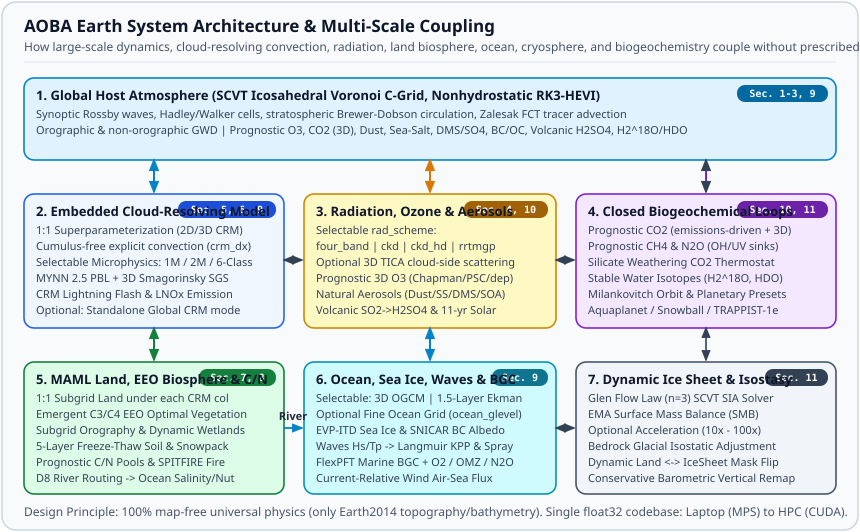
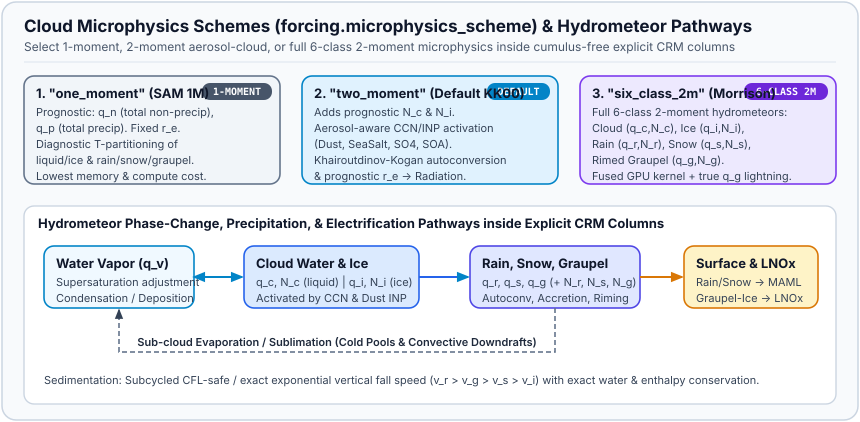
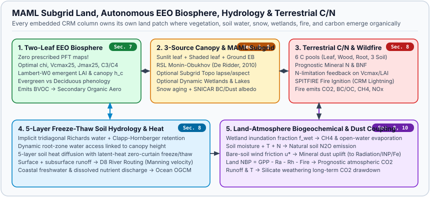
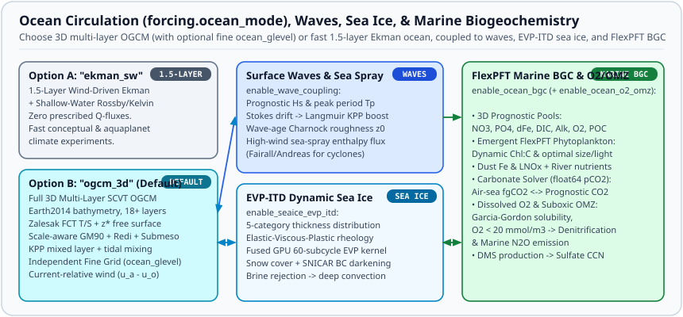

# AOBA 地球システムモデル — 物理・数値定式化

## 目次

1. [モデル構成・基礎物理定数・暦法・軌道日射幾何](#1-モデル構成基礎物理定数暦法軌道日射幾何)
2. [空間離散化：SCVT ボロノイ親格子・埋め込み CRM・鉛直 STF 座標](#2-空間離散化scvt-ボロノイ親格子埋め込み-crm鉛直-stf-座標)
3. [湿潤圧縮性熱力学と混合相飽和調節](#3-湿潤圧縮性熱力学と混合相飽和調節)
4. [大気放射伝達：選択制スキーム (`rad_scheme`) と 3D TICA](#4-大気放射伝達選択制スキーム-rad_scheme-と-3d-tica)
5. [雲微物理：選択制スキーム (`microphysics_scheme`) と非誘導帯電落雷・$\mathrm{LNO}_x$](#5-雲微物理選択制スキーム-microphysics_scheme-と非誘導帯電落雷lno_x)
6. [境界層乱流・粗度サブレイヤ (RSL)・MYNN 2.5・3D Smagorinsky–Lilly SGS](#6-境界層乱流粗度サブレイヤ-rslmynn-253d-smagorinskylilly-sgs)
7. [陸面過程・自律 2 葉 $\mathrm{C}_3/\mathrm{C}_4$ EEO 生態系・土壌水文・陸域 C/N・山火事・河川流路](#7-陸面過程自律-2-葉-c_3c_4-eeo-生態系土壌水文陸域-cn山火事河川流路)
8. [全球非静力学 SCVT 力学・埋め込み CRM・重力波抵抗・SP 結合](#8-全球非静力学-scvt-力学埋め込み-crm重力波抵抗sp-結合)
9. [海洋循環 (`ocean_mode`)・独立高解像海洋・波浪・EVP–ITD 海氷・FlexPFT 海洋 BGC](#9-海洋循環-ocean_mode独立高解像海洋波浪evpitd-海氷flexpft-海洋-bgc)
10. [大気化学 (`o3_mode`)・自然/火山エアロゾル・炭素/微量気体循環 (`co2_mode`)・水安定同位体](#10-大気化学-o3_mode自然火山エアロゾル炭素微量気体循環-co2_mode水安定同位体)
11. [動的氷床モデル・ミランコビッチ軌道進化・汎用惑星プリセット](#11-動的氷床モデルミランコビッチ軌道進化汎用惑星プリセット)
12. [一元 324 パラメータ TOML レジストリ・診断（Köppen–Geiger / CMIP7）・Zarr v3・AOBA Studio](#12-一元-324-パラメータ-toml-レジストリ診断köppengeiger--cmip7zarr-v3aoba-studio)

---

## 1. モデル構成・基礎物理定数・暦法・軌道日射幾何

### 1.1 モデル構成・設計原則・時間積分シーケンス (`src/aoba/coupled_model.py`)

AOBA は、圧縮性非静力学大気力学、多波長大気放射伝達、選択制雲微物理、境界層乱流・粗度サブレイヤ (RSL)、多層凍土・リチャーズ陸面水文、自律生態進化最適性 (EEO) $\mathrm{C}_3/\mathrm{C}_4$ 陸域生態系、陸域炭素・窒素循環・永久凍土・SPITFIRE 山火事、Priority-Flood 河川流路、選択制海洋大循環 (1.5 層または 3D SCVT OGCM)、予報表面波浪、5 カテゴリ EVP–ITD 力学海氷、FlexPFT 海洋生物地球化学・溶存酸素・OMZ、大気オゾン光化学、自然・成層圏火山エアロゾル、閉ループ $\mathrm{CO}_2/\mathrm{CH}_4/\mathrm{N}_2\mathrm{O}$・ケイ酸塩風化、3D 安定水同位体 ($\mathrm{H}_2^{18}\mathrm{O}$, $\mathrm{HDO}$) および動的 SIA 氷床を単一のコードベースで結合した地球システムモデル (ESM) である。

空間固定的な現代地球マップ（PFT 植生分布図、地域別ダスト発生源マップ、海洋熱フラックス補正、緯度依存非地形性重力波源テーブル）および積雲パラメタリゼーションを排し、外部地理境界条件は地表面標高・海底地形・初期氷床幾何（`Earth2014`）および選択時のオゾン気候値のみに限定される。全球親格子と埋め込み雲解像モデル (CRM; 水平格子間隔 `crm_dx` は任意設定、既定 $4\ \mathrm{km}$) は同一のフラックス形式圧縮性非静力学 Euler 方程式を共有し、`enable_superparam = true` の超パラメタリゼーション (SP) と `enable_superparam = false` の単独全球雲解像実行を同一離散化で切り替える。主要物理スキーム（`rad_scheme`, `microphysics_scheme`, `ocean_mode`, `o3_mode`, `co2_mode`, `planet_preset`）は [`config/aoba_default.toml`](../config/aoba_default.toml) から一元選択される。

親時間ステップ $\Delta t_{\mathrm{host}}$（既定 $720\ \mathrm{s}$）ごとの結合時間積分 `step_aoba_model` は以下の順序で実行される：
1. 軌道時刻・日射・南中判定：`AobaCalendar` により季節時刻 $t_{\mathrm{seas}}$ と日周時刻 $t_{\mathrm{diur}}$ を算出し、ミランコビッチ軌道要素・11 年太陽周期・潮汐固定日射を評価する。
2. サブカラム気象抽出：CRM 最下層風速・気温・水蒸気および全層プロファイルを全サブカラム数 $M_{\mathrm{sub}} = N_c N_y N_x$ へ展開し、地表面気圧 $p_{\mathrm{sfc}}$ および地表面参照高度 $z_{\mathrm{ref,rel}}$ を診断する。
3. 地表面アルベドおよび間引き独立カラム放射（`rad_stride` ステップごと、既定 5 ステップ $= 3600\ \mathrm{s}$）：2 帯域直達・散乱アルベド、複合海洋・海氷放射温度 $T_{\mathrm{rad,ocn}}$、2M/6C 雲有効半径、3D TICA シフト、エアロゾル・火山光学厚およびオゾン混合比を入力し選択制放射スキームを実行する。
4. MAML 地表面および海洋・海氷更新：任意で MAML サブグリッド地形ダウンスケーリングおよび海流相対風速を適用したうえで `step_surface` を積分し、湿地蒸発補正・波浪/海塩飛沫フラックスを加算する。続いて `step_ogcm_voronoi`（独立高解像海洋結合・河川流路を含む）または `step_ekman_ocean_voronoi` を進め、海洋増分 $(\Delta T_{\mathrm{ml}}, \Delta m_{\mathrm{ice}}, \Delta\mathrm{SWE}_{\mathrm{ice}})$ を凍結エンタルピー保存条件付きで地表面へ反映する。
5. 山岳および非地形性重力波抵抗：親セル風速を再構成し、Lott–Miller 山岳抵抗および任意で前線・対流起源非地形性重力波抵抗（前ステップの $Q_{\mathrm{conv}}$ 駆動）を評価してエッジ傾向 `du_oro_edge` へ射影する。
6. 親格子 SCVT RK3–HEVI 力学およびバッチ Zalesak FCT 移流：CFL 判定で決定した $n_{\mathrm{hdyn}}$ サブステップで `step_scvt_rk3_hevi` を積分し、時間平均質量フラックスを用いて全スカラー・トレーサ（$q_n, q_p, q_{\mathrm{dust}}, q_{\mathrm{ss}}, q_{\mathrm{so4}}, q_{\mathrm{bc}}, q_{\mathrm{oc}}, \chi_{\mathrm{O_3}}, \chi_{\mathrm{CO_2}}, q_v^{18}, q_v^{\mathrm{D}}$）を単一の `fct_advect_scvt_batch` で移流する。力学前後の差分から大規模強制傾向 $(\partial\theta_m/\partial t)_{\mathrm{LS}}, (\partial q_n/\partial t)_{\mathrm{LS}}$ を得る。
7. 1 対 1 超パラメタリゼーション結合（`enable_superparam = true` 時）：CRM 密度を親格子平均に整合させたのち、`step_crm_physics_and_dynamics`（RK3–HEVI + 3D SGS + MYNN 2.5 + 選択制雲微物理）を積分し、質量加重平均で親格子状態量とエッジ風速へ還元して対流加熱率 $Q_{\mathrm{conv}}$ を診断する。
8. 化学・物質循環・生態系順化：CRM 発雷・$\mathrm{LNO}_x$、鉱物ダスト、Priestley–Taylor 潜在蒸発散量 $\mathrm{PET}$、南中時 EEO 酵素順化、陸域 C/N・SPITFIRE 山火事、自然エアロゾル・BVOC SOA、SNICAR 積雪暗化、ケイ酸塩風化、海洋 BGC 大気沈着、予報 $\mathrm{CH}_4/\mathrm{N}_2\mathrm{O}$、成層圏火山エアロゾル、予報 $\mathrm{CO}_2$、予報 3D $\mathrm{O}_3$、3D 水安定同位体、日次 LAI・根圏・樹高更新および月次 Köppen–Geiger 積算を実行する。
9. 年次動的氷床更新および鉛直再補間：年次境界で Glen SIA 氷床およびアイソスタシーを更新し、地形変化が $0.05\ \mathrm{m}$ を超えた場合に静水圧測高外挿による STF 鉛直格子再構築を行う。

上記手順 2・3・8 で評価される地表面静水圧外挿気圧 $p_{\mathrm{sfc}}$、植生樹冠高さ $h_c$ によるゼロ面変位を考慮した参照高度 $z_{\mathrm{ref,rel}}$、開水面と海氷を放射平衡で合成した海洋表面有効放射温度 $T_{\mathrm{rad,ocn}}$、および陸面水収支・植生最適化に用いる Priestley–Taylor (1972) 潜在蒸発散量 $\mathrm{PET}$ は次式で与えられる：

$$
p_{\mathrm{sfc}} = p_0 + g\,\rho_{d,0}(1 + q_{v,0})(z_{c,0} - z_{w,0}) \tag{1.1}
$$

$$
z_{\mathrm{ref,rel}} = \max\!\big(z_{\mathrm{rel},0} - 0.65\,h_c,\ 5.0\ \mathrm{m}\big) \tag{1.2}
$$

$$
T_{\mathrm{rad,ocn}} = \Big[(1 - f_{\mathrm{ice}})T_{\mathrm{ml}}^4 + f_{\mathrm{ice}}T_{\mathrm{ice}}^4\Big]^{1/4} \tag{1.3}
$$

$$
\mathrm{PET} = 1.26\,\frac{s}{s + \gamma_{\mathrm{psy}}}\,\frac{R_n^+}{L_{v0}} \tag{1.4}
$$

ここで $p_0, \rho_{d,0}, q_{v,0}$ は大気最下層中心（高度 $z_{c,0}$、地表界面 $z_{w,0}$、地上高度 $z_{\mathrm{rel},0} = z_{c,0} - z_{w,0}$）の気圧・乾燥空気密度・水蒸気混合比、$f_{\mathrm{ice}}, T_{\mathrm{ml}}, T_{\mathrm{ice}}$ は海氷面積率・海洋混合層水温・海氷表面温度、$s = de_{sw}/dT$ は飽和水蒸気圧曲線の温度勾配、$\gamma_{\mathrm{psy}} = c_{pd} p_{\mathrm{sfc}} / (\varepsilon_w L_{v0})$ は乾湿計定数、$R_n^+ = \max(R_n, 0)$ は地表正味放射エネルギーである。式 (1.1) は最下層半分厚の静水圧荷重を加えて正確な地表気圧を復元し、式 (1.3) は Stefan–Boltzmann 則の 4 乗平均により開水面と海氷の混在セルからの上向き長波放射を厳密に保存する。

### 1.2 基礎物理定数 (`src/aoba/constants.py`)

全モジュールが参照する基礎定数は `src/aoba/constants.py` および TOML `[constants]` に集約され、惑星プリセット適用時に `recompute_derived_constants()` が従属定数（$c_{vd}, \kappa_d, \gamma_d, \varepsilon_w, R_v/R_d, \delta_v, L_{s0}$）を自動再計算する。

| 記号 | 標準値 | 単位 | 物理的定義 |
| :--- | :--- | :--- | :--- |
| $R_E$ | $6.371 \times 10^6$ | $\mathrm{m}$ | 惑星平均半径 (`earth_radius`) |
| $g$ | $9.79764$ | $\mathrm{m\ s^{-2}}$ | 表面重力加速度 (`gravity`) |
| $\Omega_E$ | $7.292115 \times 10^{-5}$ | $\mathrm{rad\ s^{-1}}$ | 基準恒星自転角速度 (`omega_earth`) |
| $T_{\mathrm{day}}, N_{\mathrm{yr}}$ | $86400.0,\ 365.2425$ | $\mathrm{s},\ \mathrm{d}$ | 1 太陽日長および回帰年日数 |
| $S_0, \varepsilon, e, \varpi$ | $1361.0,\ 23.44^\circ,\ 0.0167,\ 283.0^\circ$ | $\mathrm{W\ m^{-2}}, ^\circ, -, ^\circ$ | 基準太陽定数・黄道傾斜角・離心率・近日点黄経 |
| $R_d, c_{pd}, c_{vd}$ | $287.04,\ 1004.64,\ 717.60$ | $\mathrm{J\ kg^{-1}\ K^{-1}}$ | 乾燥空気の気体定数・定圧比熱・定積比熱 |
| $R_v, c_{pv}$ | $461.50,\ 1846.0$ | $\mathrm{J\ kg^{-1}\ K^{-1}}$ | 水蒸気の気体定数・定圧比熱 |
| $\varepsilon_w, \delta_v$ | $0.62197,\ 0.60779$ | $-$ | $R_d/R_v$ および仮温度係数 $R_v/R_d - 1$ |
| $p_0, T_{\mathrm{freeze}}, T_0, e_0$ | $10^5,\ 273.15,\ 273.16,\ 611.2$ | $\mathrm{Pa},\ \mathrm{K},\ \mathrm{K},\ \mathrm{Pa}$ | 基準気圧・氷点・三重点温度・三重点飽和蒸気圧 |
| $L_{v0}, L_{f0}, L_{s0}$ | $2.501\times 10^6,\ 3.337\times 10^5,\ 2.8347\times 10^6$ | $\mathrm{J\ kg^{-1}}$ | 蒸発潜熱・融解潜熱・昇華潜熱 |
| $\sigma_{\mathrm{SB}}, R^*$ | $5.670374419\times 10^{-8},\ 8.314462618$ | $\mathrm{W\ m^{-2}\ K^{-4}},\ \mathrm{J\ mol^{-1}\ K^{-1}}$ | シュテファン・ボルツマン定数・普遍気体定数 |
| $\kappa, X_{\mathrm{O}_2}$ | $0.40,\ 0.20946$ | $-,\ \mathrm{mol\ mol^{-1}}$ | カルマン定数・大気酸素体積混合比 |
| $\rho_{\mathrm{sw}}, c_{p,\mathrm{sw}}, T_{f,\mathrm{ocn}}$ | $1025.0,\ 3990.0,\ 271.35$ | $\mathrm{kg\ m^{-3}},\ \mathrm{J\ kg^{-1}\ K^{-1}},\ \mathrm{K}$ | 海水基準密度・定圧比熱・凝固点 |
| $\rho_{\mathrm{ice}}, k_{\mathrm{ice}}, k_{\mathrm{snow}}$ | $917.0,\ 2.034,\ 0.3096$ | $\mathrm{kg\ m^{-3}},\ \mathrm{W\ m^{-1}\ K^{-1}}$ | 海氷/氷床密度・海氷および積雪熱伝導率 |

### 1.3 暦法および軌道時刻写像 (`src/aoba/calendar.py`)

暦法は `gregorian`（負の紀元前暦年を含む先発グレゴリオ暦：4 で割り切れかつ 100 で割り切れないか 400 で割り切れる年を閏年 366 日とする）、`noleap`（一律 365 日）および `360_day`（$12\times 30 = 360$ 日）に対応する。経過時間 $t\ [\mathrm{s}]$ に対する日内端数 $f_{\mathrm{day}}$、10 進暦年 $Y_{\mathrm{dec}}$ および春分点基準の年端数 $f_{\mathrm{yr}}$ は次式で定義される：

$$
\begin{aligned}
f_{\mathrm{day}} &= \frac{t \bmod T_{\mathrm{day}}}{T_{\mathrm{day}}}, \\
Y_{\mathrm{dec}} &= Y + \frac{(\mathrm{doy} - 1) + f_{\mathrm{day}}}{N_{\mathrm{days}}(Y)}, \\
f_{\mathrm{yr}} &= \frac{(\mathrm{doy} - 1 + f_{\mathrm{day}} - d_{\mathrm{VE}}) \bmod N_{\mathrm{days}}(Y)}{N_{\mathrm{days}}(Y)}
\end{aligned} \tag{1.5}
$$

ここで $Y$ は暦年、$\mathrm{doy}$ は年初からの通日（1 始まり）、$N_{\mathrm{days}}(Y)$ は年日数、$d_{\mathrm{VE}}$ は春分点通日（`360_day` で 80、閏グレゴリオ年で 79、平年で 78）である。$f_{\mathrm{yr}}$ は暦日と太陽黄経の基準点（春分）を結合する無次元軌道位相を表す。`insolation_mode = "perpetual_date"` では指定日付の正午（$f_{\mathrm{day}} = 0.5$）に季節時刻を固定する。

### 1.4 軌道日射幾何と太陽天頂角 (`src/aoba/radiation.py`, `src/aoba/coupled_model.py`)

Berger (1978) および Davis et al. (2017) に基づき、春分点（真近点角 $\nu_0 = -\varpi$）における離心近点角 $E_0$ を起点として、季節端数 $f_{\mathrm{yr}}$ における平均近点角 $M$、離心率 $e$ に関する 3 次中心差展開による真近点角 $\nu$ および真太陽黄経 $\lambda_s$ を求める：

$$
\begin{aligned}
E_0 &= 2\arctan\!\left(\sqrt{\frac{1-e}{1+e}}\tan\frac{-\varpi}{2}\right), \\
M &= E_0 - e\sin E_0 + 2\pi f_{\mathrm{yr}}
\end{aligned} \tag{1.6}
$$

$$
\begin{aligned}
\nu &= M + \left(2e - \frac{1}{4}e^3\right)\sin M + \frac{5}{4}e^2\sin(2M) + \frac{13}{12}e^3\sin(3M), \\
\lambda_s &= \nu + \varpi
\end{aligned} \tag{1.7}
$$

ケプラー楕円軌道に伴う太陽距離逆二乗因子 $(a/r)^2$、大気上端入射フラックス $S_{\mathrm{TOA}}$ および太陽赤緯 $\delta$ は次式で与えられる：

$$
\begin{aligned}
\left(\frac{a}{r}\right)^2 &= \left[\frac{1 + e\cos\nu}{1 - e^2}\right]^2, \\
S_{\mathrm{TOA}} &= S_0\left(\frac{a}{r}\right)^2, \\
\sin\delta &= \sin\varepsilon\sin\lambda_s
\end{aligned} \tag{1.8}
$$

緯度 $\phi$・経度 $\lambda$ における地方時角 $H$（正午で $0$、東西対称に $[-\pi, \pi]$ へ折り返す）および瞬間太陽天頂角余弦 $\mu_0$（`diurnal_cycle = true`）は次式で評価する：

$$
\begin{aligned}
H &= \operatorname{atan2}\!\Big(\sin(2\pi f_{\mathrm{day}} + \lambda - \pi),\ \cos(2\pi f_{\mathrm{day}} + \lambda - \pi)\Big), \\
\mu_0(\phi, \lambda, t) &= \max\!\big(0,\ \sin\phi\sin\delta + \cos\phi\cos\delta\cos H\big)
\end{aligned} \tag{1.9}
$$

日周変化を無効化した場合（`diurnal_cycle = false`）には、日出・日没の半日長時角 $h_0$（極昼で $\pi$、極夜で $0$）を用いて 24 時間平均の太陽天頂角余弦 $\bar{\mu}_0$ を解析積分で与える：

$$
\begin{aligned}
h_0 &= \arccos\!\big(\operatorname{clamp}(-\tan\phi\tan\delta, -1, 1)\big), \\
\bar{\mu}_0(\phi, t) &= \max\!\left(0,\ \frac{h_0\sin\phi\sin\delta + \cos\phi\cos\delta\sin h_0}{\pi}\right)
\end{aligned} \tag{1.10}
$$

---

## 2. 空間離散化：SCVT ボロノイ親格子・埋め込み CRM・鉛直 STF 座標

### 2.1 正二十面体 SCVT ボロノイ格子と Arakawa C-Grid 幾何 (`src/aoba/scvt_mesh.py`)

水平親格子には極特異点のない準一様球面重心ボロノイ格子 (Spherical Centroidal Voronoi Tessellation: SCVT; Ringler et al., 2008, 2010) を採用する。正二十面体を単位球面上で細分化レベル `glevel` $= g$ 回再帰分割し、Lloyd 反復（既定 10〜12 回）により母点を各ボロノイ多角形の球面重心へ収束させる。総セル数 $N_c$（12 個の五角形と $N_c - 12$ 個の六角形）、双対三角形数 $N_v$、エッジ数 $N_e$ および単位球面三角形 $(\mathbf{a}, \mathbf{b}, \mathbf{c})$ の厳密面積 $A_\triangle$（Eriksson の公式）は次式で与えられる：

$$
\begin{aligned}
N_c &= 10\cdot 4^g + 2, \qquad N_v = 2N_c - 4, \qquad N_e = 3N_c - 6, \\
A_\triangle(\mathbf{a},\mathbf{b},\mathbf{c}) &= 2\operatorname{atan2}\!\Big(|\mathbf{a}\cdot(\mathbf{b}\times\mathbf{c})|,\ \max\big(1 + \mathbf{a}\cdot\mathbf{b} + \mathbf{b}\cdot\mathbf{c} + \mathbf{c}\cdot\mathbf{a},\ 10^{-15}\big)\Big)
\end{aligned} \tag{2.1}
$$

各エッジ $e$ は隣接セル $(c_0, c_1)$ と双対頂点 $(v_0, v_1)$ を結び、単位法線 $\mathbf{n}_e$（$c_0\to c_1$）と単位接線 $\mathbf{t}_e = \mathbf{r}_e\times\mathbf{n}_e$ が厳密に直交する。セル中心間の大円距離 $d_e$、ボロノイ辺長 $l_e$、およびエッジ菱形面積 $A_e$ は次式で定義される：

$$
\begin{aligned}
d_e &= R_E\arccos(\mathbf{r}_{c_0}\cdot\mathbf{r}_{c_1}), \\
l_e &= R_E\arccos(\mathbf{v}_0\cdot\mathbf{v}_1), \\
A_e &= \frac{1}{2}\,d_e l_e
\end{aligned} \tag{2.2}
$$

スカラー量および質量はセル中心に、法線風速 $u_e$ はエッジ中点に配置する直交 Arakawa C-grid を採る。超パラメタリゼーション構成では各親セル内に任意の水平格子間隔 $\Delta x = \Delta y$（`crm_dx`、既定 $4\ \mathrm{km}$）およびカラム数（`crm_nx` $\times$ `crm_ny`）をもつ 2D/3D 周期 CRM を埋め込み、各 CRM カラム直下に独立した陸面サブグリッドを 1 対 1 で対応付ける（MAML）。

SCVT ボロノイ格子上の Arakawa C-grid には以下の利点と数値的制約があり、AOBA ではそれぞれの制約に対応する数値安定化策を組み込んでいる。
- 利点：
  1. 極特異点の排除と準一様解像度：緯度経度格子のような極域での子午線収束が存在しないため、極フィルタを要さず全球で均一な CFL 時間刻みを維持できる。
  2. 厳密直交性と大域保存性：ボロノイ辺と母点間線分が直交するため、有限体積発散および水平気圧傾度力が 2 次精度で簡潔に記述でき、離散ガウスの発散定理（$\sum_i A_i (\nabla\cdot F)_i \equiv 0$）が厳密に成立する。
  3. 重力波分散特性と厳密エネルギー保存：Arakawa C-grid はロスビー変形半径に対して良好な等方重力波分散特性を持ち、歪対称 TRiSK コリオリ重み（式 2.5）により定常地衡流モードと運動エネルギー保存を両立できる（Thuburn et al., 2009; Ringler et al., 2010）。
  4. 局所細分化への拡張性：重心ボロノイ分割は密度関数の導入によりハンギングノードなしに滑らかな可変解像度格子へ拡張できる。
- 欠点および AOBA における対処：
  1. 自由度比不整合に伴う数値計算モード（Thuburn, 2008; Gassmann, 2011）：六角形格子では質量自由度 $N_c$ に対しエッジ速度自由度が $N_e \approx 3 N_c$、双対三角形の渦度自由度が $N_v \approx 2 N_c$ と 2 倍過剰になり、格子スケールに偽の慣性重力・ロスビー計算モード（Hollingsworth 型の不安定や停滞渦度モード）が生じ得る。AOBA では厳密歪対称 TRiSK 重みの採用に加え、力学ステップでスケール選択的な 4 階超粘性拡散および発散減衰（第 8.2 節）を作用させて格子スケール雑音を抑止している。
  2. 接線風速再構成の局所 1 次精度と五角形インプリンティング（Peixoto, 2016; Gassmann, 2018）：12 個の五角形セル近傍やボロノイ辺中点と母点間線分中点が厳密一致しない箇所では、TRiSK 接線風速再構成の打ち切り誤差が局所的に 1 次精度へ低下する。AOBA では 10〜12 回の Lloyd SCVT 緩和を施して母点とボロノイ重心を一致させ、格子歪みとインプリンティングを最小化している。
  3. 非構造間接参照によるメモリアクセス負荷：規則構造格子に比べエッジ–セル間や TRiSK 10 近傍ステンシルの間接ギャザー・スキャッタが増加するため、AOBA では全水平演算子をバッチ化テンソル演算および融合 Metal/CUDA カーネルで実装している。

### 2.2 離散 SCVT 演算子・厳密歪対称 TRiSK 重み・風速再構成

SCVT 上のセル中心発散 $(\nabla\cdot F)_i$、双対頂点渦度 $\zeta_v$、エッジ上のベクトルラプラシアン $(\nabla^2 u)_e$ およびセル中心スカラーラプラシアン $(\nabla^2 \phi)_i$ は、球面全域で厳密保存を満たす有限体積形式で定義される（Ringler et al., 2010）：

$$
\begin{aligned}
(\nabla\cdot F)_i &= \frac{1}{A_i}\sum_{e\in E(i)} s_{i,e}\,l_e F_e, \\
\zeta_v &= \frac{1}{A_v}\sum_{e\in E(v)} s_{v,e}\,d_e u_e
\end{aligned} \tag{2.3}
$$

$$
\begin{aligned}
(\nabla^2 u)_e &= \frac{(\nabla\cdot u)_{c_1} - (\nabla\cdot u)_{c_0}}{d_e} - \frac{\zeta_{v_1} - \zeta_{v_0}}{\max(l_e, 100)}, \\
(\nabla^2 \phi)_i &= \nabla\cdot\!\left(\frac{\phi_{c_1}-\phi_{c_0}}{d_e}\right)
\end{aligned} \tag{2.4}
$$

ここで $A_i, A_v$ はセルおよび双対三角形の球面面積、$s_{i,e}\in\{+1,-1\}$ はセル外向き法線符号、$s_{v,e}\in\{+1,-1\}$ は頂点周りの反時計回り循環符号である。接線風速を再構成する TRiSK 重み $w_{e,e'}$（Thuburn et al., 2009; Ringler et al., 2010, Eq. 23）は、各セル $i\in\{c_0, c_1\}$ 周りのカイト面積比 $R_{i,v}/A_i$ の累積和 $t_{e,e'}$ から素の重み $w_{e,e'}^{\mathrm{raw}}$ を構築したのち、コリオリ力による運動エネルギー生成が浮動小数点精度まで厳密ゼロ（歪対称性）となるよう次式で反対称化する：

$$
\begin{aligned}
w_{e,e'}^{\mathrm{raw}} &= s_{i,e}\,s_{i,e'}\,t_{e,e'}\,\frac{l_{e'}}{d_e}, \\
w_{e_1,e_2} &= \frac{g_{e_1} w_{e_1,e_2}^{\mathrm{raw}} - g_{e_2} w_{e_2,e_1}^{\mathrm{raw}}}{2 g_{e_1}}, \qquad g_e = l_e d_e \implies l_{e_1}d_{e_1}w_{e_1,e_2} + l_{e_2}d_{e_2}w_{e_2,e_1} = 0
\end{aligned} \tag{2.5}
$$

セル中心の東西・南北水平風 $(u_i, v_i)$ の再構成（Perot, 2000; Ringler et al., 2010, Eq. 29）およびセル中心風傾向からエッジ法線風速 $v_e$ への射影は次式による：

$$
\begin{aligned}
(u_i, v_i) &= \frac{1}{A_i}\sum_{e\in E(i)} \frac{1}{2}\,d_e l_e u_e \big(\mathbf{n}_e\cdot\hat{\mathbf{e}}_\lambda,\ \mathbf{n}_e\cdot\hat{\mathbf{e}}_\phi\big), \\
v_e &= \frac{1}{2}\Big[(u_{c_0}+u_{c_1})(\mathbf{n}_e\cdot\hat{\mathbf{e}}_\lambda) + (v_{c_0}+v_{c_1})(\mathbf{n}_e\cdot\hat{\mathbf{e}}_\phi)\Big]
\end{aligned} \tag{2.6}
$$

### 2.3 `Earth2014` 地形集約と Lott–Miller サブグリッド山岳テンソル

5 分角（$2160\times 4320$）の `Earth2014` データ（`SUR2014`, `ICE2014`, `TBI2014`, `BED2014`; Hirt & Rexer, 2015）を $\cos\phi$ 面積重み付きで最近傍ボロノイセルへ集約する。海洋率 $f_{\mathrm{ocn}} \ge 0.5$ のセルを海洋 (`SURF_OCEAN=0`)、それ以外で氷床率 $f_{\mathrm{ice}} \ge f_{\mathrm{land}}$ を大陸氷床 (`SURF_ICESHEET=2`)、残余を陸面 (`SURF_LAND=1`) と分類する。高解像地形の局所勾配 $(h_x, h_y)$ に対する 2 次勾配テンソル不変量 $(K, M, L)$ から、Lott & Miller (1997, App. A) のサブグリッド山岳標準偏差 $\mu$、山脈主軸方位角 $\psi$、異方性比 $\gamma$（$\gamma=1$ で等方、$\gamma\to 0$ で線状山脈）および平均二乗平方根勾配 $\sigma$ を算出する：

$$
\begin{aligned}
K &= \frac{1}{2}\big(\overline{h_x^2} + \overline{h_y^2}\big), \qquad M = \frac{1}{2}\big(\overline{h_x^2} - \overline{h_y^2}\big), \qquad L = \overline{h_x h_y}, \\
\mu &= \sqrt{\max(\overline{h^2} - \bar{h}^2, 0)}, \qquad \psi = \frac{1}{2}\operatorname{atan2}(L, M), \\
\gamma &= \sqrt{\frac{\max(K - \sqrt{M^2+L^2},\ 0)}{\max(K + \sqrt{M^2+L^2},\ 10^{-12})}}, \qquad \sigma = \sqrt{\overline{h_x^2} + \overline{h_y^2}}
\end{aligned} \tag{2.7}
$$

解像地形 $z_{\mathrm{topo}}$ には格子スケール急勾配による気圧傾度誤差を防ぐため、陸域上で 2 回の加重ラプラシアン平滑化を適用する：

$$
z_i^{(m+1)} = 0.75\,z_i^{(m)} + \frac{0.25}{\deg(i)}\sum_{j\in N(i)} z_j^{(m)} \qquad (m = 0, 1) \tag{2.8}
$$

ここで $N(i)$ はセル $i$ の隣接セル集合、$\deg(i) \in \{5, 6\}$ は隣接セル数である。

### 2.4 Charney–Phillips 鉛直格子・ハイブリッド伸長・Klemp STF 座標・スポンジ層 (`src/aoba/vertical_grid.py`)

鉛直方向には親格子・CRM 共通の Charney–Phillips スタッガード格子を採用し、鉛直速度 $w$ および層界面高度 $z_w$ を $N_z + 1$ 半レベルに、密度・気圧・水平風・湿潤仮温位・トレーサを $N_z$ 全レベル中心 $z_{c,k} = \frac{1}{2}(z_{w,k}+z_{w,k+1})$ に配置する。基準計算鉛直座標 $\zeta$ の層厚 $\Delta\zeta_k$（`float64` 初期化、既定 $N_z = 44$, $z_{\mathrm{top}} = 48\ \mathrm{km}$, $\Delta z_{\min} = 60\ \mathrm{m}$）は境界層と対流圏・成層圏の解像度を両立するハイブリッドべき乗則（下層を $s^{1.35}$ で緩やかに、上層を $s^{4.2}$ で急峻に伸長）で決定する：

$$
\begin{aligned}
s_k &= \frac{k}{\max(N_z - 1, 1)}, \qquad S_k = 0.38\,s_k^{1.35} + 0.62\,s_k^{4.2}, \\
\Delta\zeta_k &= \Delta z_{\min} + \frac{z_{\mathrm{top}} - N_z \Delta z_{\min}}{\sum_{j=0}^{N_z-1} S_j}\,S_k
\end{aligned} \tag{2.9}
$$

山岳上の水平気圧傾度力誤差を抑えつつ高度 $24\ \mathrm{km}$ 以高の成層圏・中間圏座標面を完全に平坦に保つため、減衰上限高度 $z_{\mathrm{atten}} = \min(z_{\mathrm{top}}, 24\ \mathrm{km})$ に対して Klemp (2011, Eqs. 4 & 7) の余弦べき乗減衰関数 $A(\zeta_w)$ と最小層厚圧縮保護（$\gamma_{\min} = 0.20$）を組み合わせた平滑化地形追従座標 (STF) を構成する（既定指数 $p =$ `terrain_scale_exp` $= 1.5$）：

$$
\begin{aligned}
z_{\mathrm{atten}} &= \min(z_{\mathrm{top}},\ 24000\ \mathrm{m}), \qquad A(\zeta_w) = \left[\cos\!\left(\frac{\pi}{2}\,\min\!\left(\frac{\zeta_w}{z_{\mathrm{atten}}},\ 1\right)\right)\right]^{2p}, \\
z_{w,k} &= \max\!\Big(\zeta_{w,k} + A(\zeta_{w,k})h_s,\ z_{w,k-1} + \gamma_{\min}\Delta\zeta_{c,k-1}\Big)
\end{aligned} \tag{2.10}
$$

剛体上端境界での内部重力波反射を抑えるため、スポンジ層底面 $z_{\mathrm{sp}}$（既定 `z_sponge_base = 36 km`）以高に $\sin^2$ 型レイリー減衰率 $\gamma_r(\zeta)$ を適用する（最小減衰時定数 $\tau_{\mathrm{sp,min}} = 300\ \mathrm{s}$）：

$$
\gamma_r(\zeta) = \frac{1}{\tau_{\mathrm{sp,min}}}\sin^2\!\left(\frac{\pi}{2}\,\operatorname{clamp}\!\left(\frac{\zeta - z_{\mathrm{sp}}}{\max(z_{\mathrm{top}} - z_{\mathrm{sp}}, 1)},\ 0,\ 1\right)\right) \tag{2.11}
$$

---

## 3. 湿潤圧縮性熱力学と混合相飽和調節

### 3.1 圧縮性状態方程式と凝結物荷重 (`src/aoba/thermodynamics.py`)

圧縮性非静力学力学コアは乾燥空気密度 $\rho_d$ と湿潤仮温位 $\theta_m$ を基本状態量として予報する（Skamarock et al., 2012, Eqs. 5–6）。水蒸気混合比 $q_v$ に対するエクスナー関数 $\Pi$、全気圧 $p$ および絶対温度 $T$ は次式で診断される：

$$
\theta_m = \theta\left(1 + \frac{R_v}{R_d} q_v\right), \qquad \xi = \max\!\left(\frac{R_d\rho_d\theta_m}{p_0},\ 10^{-8}\right), \qquad \Pi = \xi^{R_d / c_{vd}} \tag{3.1}
$$

$$
p = p_0\,\xi^{\gamma_d} = p_0\,\xi\,\Pi, \qquad T = \frac{\Pi\,\theta_m}{1 + (R_v / R_d)\max(q_v, 0)}, \qquad \gamma_d = \frac{c_{pd}}{c_{vd}} \approx 1.400 \tag{3.2}
$$

鉛直浮力および気圧傾度項に入る総湿潤密度 $\rho_{\mathrm{tot}}$ には水蒸気および全凝結水（雲水 $q_c$、雲氷 $q_i$、降水 $q_p$）の荷重が含まれる：

$$
\rho_{\mathrm{tot}} = \rho_d\left(1 + q_v + q_c + q_i + q_p\right) \tag{3.3}
$$

### 3.2 飽和水蒸気圧・混合相分配・飽和微分

液面および氷面に対する飽和水蒸気圧 $e_{sw}(T)$（Bolton, 1980, Eq. 10）および $e_{si}(T)$（Murray, 1967）を次式で計算する：

$$
e_{sw}(T) = 611.2\exp\!\left(\frac{17.67(T - 273.15)}{T - 29.65}\right), \qquad e_{si}(T) = 611.2\exp\!\left(\frac{21.8745584(T - 273.15)}{T - 7.66}\right) \tag{3.4}
$$

$T_{00n} = 253.15\ \mathrm{K}$ から $T_{0n} = 273.16\ \mathrm{K}$ の混合相域では区分線形液相割合 $\omega_n(T)$ により混合相飽和混合比 $q_{\mathrm{sat}}(T, p)$ および厳密な温度微分 $\partial q_{\mathrm{sat}}/\partial T$ を与える（Khairoutdinov & Randall, 2003, Eqs. A8–A14）：

$$
\omega_n(T) = \operatorname{clamp}\!\left(\frac{T - T_{00n}}{T_{0n} - T_{00n}},\ 0,\ 1\right), \qquad q_{sx}(T, p) = \frac{\varepsilon_w e_{sx}(T)}{\max(p - e_{sx}(T),\ 0.05 p)}, \qquad q_{\mathrm{sat}} = \omega_n q_{sw} + (1 - \omega_n) q_{si} \tag{3.5}
$$

### 3.3 エンタルピー保存 Newton–Raphson 飽和調節と RCEMIP 初期プロファイル

液氷相当温度 $T_{li}$ および総非降水水分 $q_n = q_v + q_c + q_i$ を保存したまま、過飽和格子（$q_n > q_{\mathrm{sat}}(T_{li}, p)$）に対して 4 回のベクトル化 Newton–Raphson 反復で飽和平衡温度 $T$ を解く。混合相遷移帯の潜熱勾配もヤコビアン $f'(T)$ に厳密に含める：

$$
\begin{aligned}
T_{li} &= T - \frac{L_{v0} q_c + L_{s0} q_i}{c_{pd}}, \\
L_{\mathrm{eff}}(T) &= \omega_n(T) L_{v0} + \big(1 - \omega_n(T)\big) L_{s0}, \\
f(T) &= T - T_{li} - \frac{L_{\mathrm{eff}}(T)}{c_{pd}}\max\!\big(q_n - q_{\mathrm{sat}}(T, p),\ 0\big) = 0
\end{aligned} \tag{3.6}
$$

$$
\begin{aligned}
f'(T) &= 1 + \frac{L_{\mathrm{eff}}(T)}{c_{pd}}\frac{\partial q_{\mathrm{sat}}}{\partial T} - \frac{\mathbf{1}_{(T_{00n}, T_{0n})}(L_{v0} - L_{s0})}{c_{pd}(T_{0n} - T_{00n})}\,q_{\mathrm{cond}}, \\
T^{(m+1)} &= T^{(m)} - \frac{f(T^{(m)})}{\max(f'(T^{(m)}), 1)}
\end{aligned} \tag{3.7}
$$

収束後、凝結総量 $q_{\mathrm{cond}}$ と各相混合比 $(q_v, q_c, q_i)$ を次式で確定する：

$$
\begin{aligned}
q_{\mathrm{cond}} &= \max\!\big(q_n - q_{\mathrm{sat}}(T, p),\ 0\big), \\
q_v &= q_n - q_{\mathrm{cond}}, \qquad q_c = \omega_n(T)\,q_{\mathrm{cond}}, \qquad q_i = \big(1 - \omega_n(T)\big)\,q_{\mathrm{cond}}
\end{aligned} \tag{3.8}
$$

理想化放射対流平衡実験向けには、Wing et al. (2018, Sec. 3.2.3) の RCEMIP 解析初期成層（対流圏界面 $z_t = 15\ \mathrm{km}$、減率 $\Gamma = 6.7\ \mathrm{K\ km^{-1}}$、水蒸気スケールハイト $z_{q1} = 4\ \mathrm{km}, z_{q2} = 7.5\ \mathrm{km}$、地表気圧 $p_{\mathrm{sfc}} = 1014.8\ \mathrm{hPa}$）を `rcemip_analytic_sounding` として実装する。

---

## 4. 大気放射伝達：選択制スキーム (`rad_scheme`) と 3D TICA

### 4.1 選択制スキーム階層 (`rad_scheme`)

AOBA は `[forcing] rad_scheme` により 4 つの放射伝達スキームを切り替えることができる。全スキームは同一インターフェースで短波直達・散乱（VIS/NIR）・PAR 地表フラックス、長波下向きフラックス、大気上端放射収支（ASR/OLR）および大気放射加熱率を出力する。

| `rad_scheme` | スペクトル解像度 | 気体吸収・光学物理 | 利点 | 制約・留意点 |
| :--- | :--- | :--- | :--- | :--- |
| `"four_band"` | 4 バンド（SW 2 + LW 2） | Lacis–Hansen $\mathrm{O}_3/\mathrm{H}_2\mathrm{O}$、解析 $\mathrm{CO}_2/\mathrm{H}_2\mathrm{O}$ LW、雲・ダスト | 計算負荷が最小で外部ファイル不要。理想化水惑星・高速プロトタイピングに最適。 | $\mathrm{CH}_4/\mathrm{N}_2\mathrm{O}$ および非ダスト 4 種エアロゾルの直接効果を含まず、高 $\mathrm{CO}_2$ 域のバンド重複精度は近似的。 |
| `"ckd"` *(既定)* | 16 バンド / 50 $g$ 点 | 6 SW (18 $g$) + 10 LW (32 $g$)、$\mathrm{H}_2\mathrm{O}, \mathrm{CO}_2, \mathrm{CH}_4, \mathrm{N}_2\mathrm{O}, \mathrm{O}_3, \mathrm{O}_2$、雲・ダスト | 外部テーブル不要で 5 種主要温室効果ガスと水蒸気連続吸収を扱い、速度と精度の均衡が良い。多十年〜多世紀実験の標準。 | 長波雲散乱を省略し、2 気体重複は独立加算近似のため極端な高濃度域では RRTMGP に比べ微小な放射強制力バイアスが残る。 |
| `"ckd_hd"` | 16 基底 / 111 $g$ 点 | 39 SW + 72 LW $g$ 点、Chou LW 雲散乱補正、5 種自然＋火山エアロゾル | 外部テーブル不要のまま長波雲散乱補正と全自然＋火山エアロゾルの帯域光学特性を直接統合（融合 GPU カーネル対応）。 | `ckd` の約 2 倍の放射計算コストを要し、吸収係数は HITRAN 厳密テーブルではなく基底 $g$ 点細分化に基づく。 |
| `"rrtmgp"` | 30 バンド / 240 $g$ 点 | 公式 HITRAN + MT\_CKD 4.1（128 LW + 112 SW）、9 気体 $(T, \ln p, \eta)$ 補間 | 公式 HITRAN 分光データと 2 気体重複 $\eta$ 補間により CMIP 準拠の最高精度を実現（融合 GPU で高速化）。 | 初回に BSD-3 係数ファイルの自動取得が必要で、放射計算負荷は 4 スキーム中最大。またテーブル温度範囲（$160\text{–}355\ \mathrm{K}$）外の極端惑星条件ではクランプされる。 |

### 4.2 共通 2 ストリーム伝達ソルバ（Toon et al., 1989）(`src/aoba/radiation.py`)

全 4 スキームは、短波に Toon et al. (1989) の $\delta$-Quadrature $2N\times 2N$ 三重対角 2 ストリーム法 (`toon_two_stream_sw`) を、長波に純吸収（$\omega_0 = 0$）線形 $\tau$ 非結合 2 ストリーム掃引法 (`toon_two_stream_lw`) を用いる。内部では上端 $n=0$ から地表面 $n=N-1$ へのトップダウン添字に変換して解く。

短波では各層の光学的厚さ $\tau$・単一散乱アルベド $\omega_0$・非対称因子 $g_0$ に対し、前方散乱ピークを直達光へ繰り込む Joseph, Wiscombe & Weinman (1976) の $\delta$ スケーリング（前方散乱率 $f = g_0^2$）および Quadrature 2 ストリーム係数（拡散余弦 $\mu_1 = 1/\sqrt{3}$; Toon et al., 1989, Table 1）を適用する：

$$
\begin{aligned}
\tau' &= \max\!\big(\tau(1 - \omega_0 g_0^2),\ 10^{-7}\big), \\
\omega' &= \operatorname{clamp}\!\left(\frac{\omega_0(1 - g_0^2)}{1 - \omega_0 g_0^2},\ 0,\ 0.999999\right), \\
g' &= \frac{g_0 - g_0^2}{1 - g_0^2}
\end{aligned} \tag{4.1}
$$

$$
\begin{aligned}
\gamma_1 &= \frac{\sqrt{3}}{2}\big[2 - \omega'(1 + g')\big], \qquad \gamma_2 = \frac{\sqrt{3}}{2}\omega'(1 - g'), \\
\gamma_3 &= \frac{1}{2}\big(1 - \sqrt{3}\,g'\mu_0\big), \qquad \gamma_4 = 1 - \gamma_3
\end{aligned} \tag{4.2}
$$

2 ストリーム常微分方程式系の固有値 $\lambda_n$、半無限層反射率 $\Gamma_n$、上端からの累積光学的厚さ $\tau_{c,n}$、および各層の同次解基底因子 $(e_{1,n}, e_{2,n}, e_{3,n}, e_{4,n})$ と直達太陽光の特解 $C_n^\pm(\tau)$（共鳴分母 $\lambda_n^2 - \mu_0^{-2}$ は $\pm 10^{-5}$ で正則化）を次式で構成する：

$$
\begin{aligned}
\lambda_n &= \sqrt{\max(\gamma_{1,n}^2 - \gamma_{2,n}^2,\ 10^{-12})}, \qquad \Gamma_n = \frac{\gamma_{2,n}}{\gamma_{1,n} + \lambda_n}, \qquad \tau_{c,n} = \sum_{j=0}^{n-1}\tau'_j, \\
e_{1,n} &= 1 + \Gamma_n e^{-\lambda_n\tau'_n}, \qquad e_{2,n} = 1 - \Gamma_n e^{-\lambda_n\tau'_n}, \\
e_{3,n} &= \Gamma_n + e^{-\lambda_n\tau'_n}, \qquad e_{4,n} = \Gamma_n - e^{-\lambda_n\tau'_n}
\end{aligned} \tag{4.3}
$$

$$
C_n^\pm(\tau) = \frac{\omega'_n F_s\big[(\gamma_{1,n} \mp \mu_0^{-1})\gamma_{3/4,n} + \gamma_{4/3,n}\gamma_{2,n}\big]}{\lambda_n^2 - \mu_0^{-2}}\,e^{-(\tau_{c,n}+\tau)/\mu_0} \tag{4.4}
$$

上端の散乱下向き入射ゼロ条件 $F_0^-(0) = 0$、層間フラックス連続条件（Toon et al., 1989, Eqs. 39–43）、および直達・散乱別地表アルベド $(r_{\mathrm{dir}}, r_{\mathrm{dif}})$ に対する下端反射境界条件から $2N\times 2N$ 三重対角連立一次方程式を `solve_tridiagonal_batched` で解き、各界面の上向き・下向き直達・下向き散乱フラックスを復元する：

$$
F^\uparrow_N = r_{\mathrm{dir}}\,\mu_0 F_s\,e^{-\tau_{c,N}/\mu_0} + r_{\mathrm{dif}}\,F^\downarrow_{\mathrm{dif},N} \tag{4.5}
$$

長波では拡散因子 $D$（`four_band` で $D=2$、`ckd`/`ckd_hd` で $D=1.66$、`rrtmgp` で帯域最適セカント角）に対する有効層光学的厚さ $\Delta\tau_{\mathrm{eff}}$ と透過率 $E$ を定義し、層内プランク関数の線形 $\tau$ 分布を仮定した非結合掃引を小 $\Delta\tau$ での桁落ちを回避する形式で解く：

$$
\begin{aligned}
\Delta\tau_{\mathrm{eff}} &= \operatorname{clamp}(D\tau,\ 10^{-6},\ 50), \qquad E = e^{-\Delta\tau_{\mathrm{eff}}}, \\
\alpha &= \begin{cases} -\operatorname{expm1}(-\Delta\tau_{\mathrm{eff}})/\Delta\tau_{\mathrm{eff}}, & \Delta\tau_{\mathrm{eff}} > 10^{-3} \\ 1 - \frac{1}{2}\Delta\tau_{\mathrm{eff}} + \frac{1}{6}\Delta\tau_{\mathrm{eff}}^2, & \Delta\tau_{\mathrm{eff}} \le 10^{-3} \end{cases}, \\
w_1 &= 1 - \alpha, \qquad w_2 = \max(\alpha - E,\ 0)
\end{aligned} \tag{4.6}
$$

$$
\begin{aligned}
F^\downarrow_{n+1} &= F^\downarrow_n E_n + w_{2,n} B_{\mathrm{top},n} + w_{1,n} B_{\mathrm{bot},n}, \\
F^\uparrow_N &= \epsilon_s B_s + (1 - \epsilon_s) F^\downarrow_N, \\
F^\uparrow_n &= F^\uparrow_{n+1} E_n + w_{1,n} B_{\mathrm{top},n} + w_{2,n} B_{\mathrm{bot},n}
\end{aligned} \tag{4.7}
$$

`ckd_hd` および `rrtmgp` ではこれと等価な Fu & Liou (1992) の線形 $\tau$ 重み $w_{\mathrm{lin}}$ を用いる：

$$
w_{\mathrm{lin}} = \begin{cases} \Delta\tau_{\mathrm{eff}}^{-1} - \dfrac{E}{1 - E}, & \Delta\tau_{\mathrm{eff}} > 10^{-3} \\ \dfrac{1}{2} - \dfrac{\Delta\tau_{\mathrm{eff}}}{12}, & \Delta\tau_{\mathrm{eff}} \le 10^{-3} \end{cases} \tag{4.8}
$$

大気各層の放射加熱率 $Q_{\mathrm{rad},k}$ は正味上向きフラックス $F^{\mathrm{net}} = F^\uparrow - F^\downarrow$ の鉛直収束を層熱容量 $C_{\mathrm{layer},k}$ で除して与えられる：

$$
\begin{aligned}
Q_{\mathrm{rad},k} &= -\frac{F^{\mathrm{net}}_{k+1} - F^{\mathrm{net}}_k}{C_{\mathrm{layer},k}}, \\
C_{\mathrm{layer},k} &= \begin{cases}(c_{pd} + c_{pv} q_{v,k})\rho_{d,k}\Delta z_k & (\text{four\_band, ckd}) \\ c_{pd}\rho_{d,k}\Delta z_k & (\text{ckd\_hd, rrtmgp})\end{cases}
\end{aligned} \tag{4.9}
$$

### 4.3 選択肢 1：`rad_scheme = "four_band"`（4 バンド解析放射、`src/aoba/radiation.py`)

短波を SW1（$0.25\text{–}0.69\ \mu\mathrm{m}$, 太陽重み $f_{\mathrm{SW1}} = 0.459760$）および SW2（$0.69\text{–}4.00\ \mu\mathrm{m}$, $f_{\mathrm{SW2}} = 0.540240$）に、長波を非窓帯 LW1（重み $1-\beta = 0.680$）および $8\text{–}12.5\ \mu\mathrm{m}$ 大気窓帯 LW2（重み $\beta = 0.320$）に分割する。

SW1 では地球曲率を考慮した球殻空気質量因子 $M(\mu_0)$（Rodgers, 1967）、Lacis & Hansen (1974, Eqs. 8–10) のオゾン UV+VIS 吸収率 $A_{\mathrm{oz}}(x)$ およびレイリー散乱光学的厚さ $\Delta\tau_{\mathrm{ray}}$ を、SW2 では圧力・温度スケーリング水蒸気路程 $y$ に対する Lacis & Hansen (1974, Eq. 21) の水蒸気吸収率 $A_{\mathrm{wv}}(y)$ を評価して層別光学的厚さへ変換する：

$$
\begin{aligned}
M(\mu_0) &= \frac{35}{\sqrt{1224\mu_0^2 + 1}}, \qquad \Delta\tau_{\mathrm{ray}} = 0.095\,\frac{\Delta p}{p_0}, \\
A_{\mathrm{wv}}(y) &= \frac{2.9\,y}{(1 + 141.5\,y)^{0.635} + 5.925\,y}
\end{aligned} \tag{4.10}
$$

雲の短波光学特性は Slingo (1989) の液雲および Ebert & Curry (1992) の氷雲パラメータに、水平サブグリッド雲不均一性を表す Cahalan et al. (1994) の低減係数 $\chi_{\mathrm{SW}}$（既定 `cloud_sw_inhomog = 0.62`）を乗じて計算する（$W$ は雲水路 $\mathrm{LWP}$ または雲氷路 $\mathrm{IWP}\ [\mathrm{g\ m^{-2}}]$、$r_e$ は有効半径 $[\mu\mathrm{m}]$）：

$$
\begin{aligned}
\tau_{\mathrm{cld}} &= \chi_{\mathrm{SW}}\,W\left(a + \frac{b}{r_e}\right), \\
\omega_0 &= \operatorname{clamp}\big(1 - (c + d\,r_e),\ 0,\ 0.999999\big), \\
g &= e + f\,r_e
\end{aligned} \tag{4.11}
$$

雲長波吸収は Stephens (1978)（$\kappa_{\mathrm{liq}} = 0.090\ \mathrm{m^2\ g^{-1}}$）および Ebert & Curry (1992) に拡散因子比 $1.66/2.0 = 0.83$ を乗じて与え、鉱物ダストは Balkanski et al. (2007)（SW1 $k_{\mathrm{ext}}=600$, SW2 $400$, LW1 $k_{\mathrm{abs}}=100$, LW2 $150\ \mathrm{m^2\ kg^{-1}}$）を結合する。

LW1・LW2 の気体光学的厚さは対数 $\mathrm{CO}_2$ 濃度比 $r_{\mathrm{CO_2}}$、成層圏 $15\ \mu\mathrm{m}$ 冷却項 $c_{\mathrm{strat}}$、Roberts et al. (1976) の水蒸気自己連続吸収および任意で $9.6\ \mu\mathrm{m}$ オゾン吸収（$4.5\,m_{\mathrm{O_3}}$）を含む：

$$
\begin{aligned}
r_{\mathrm{CO_2}} &= \frac{\max(C_{\mathrm{CO_2}}, 1)}{284.3}, \\
\Delta\tau_{\mathrm{CO_2,LW1}} &= \max(0.02,\ 0.85 + 0.22\ln r_{\mathrm{CO_2}})\,\frac{\Delta(p^2)}{p_0^2} + (0.020 + c_{\mathrm{strat}})\,\frac{\Delta p}{p_0}, \\
\Delta\tau_{\mathrm{wv,LW1}} &= 0.30\left(\frac{p}{p_0}\right)^{0.55} q_v\,\Delta m_d
\end{aligned} \tag{4.12}
$$

$$
\Delta\tau_{\mathrm{wv,LW2}} = \left(0.45\,\frac{e_v}{p_0}\exp\!\left[1800\left(\frac{1}{T} - \frac{1}{296}\right)\right] + 0.0025\,\frac{p}{p_0}\right)q_v\,\Delta m_d \tag{4.13}
$$

陸域光合成へ渡す地表光合成有効放射 $\mathrm{PAR}$ および光合成有効光量子束密度 $\mathrm{PPFD}$ は SW1 地表下向きフラックスから次式で変換する：

$$
\mathrm{PAR} = 0.88\,F^\downarrow_{\mathrm{SW1,sfc}}, \qquad \mathrm{PPFD} = 4.57\,\mathrm{PAR} \quad [\mu\mathrm{mol\ m^{-2}\ s^{-1}}] \tag{4.14}
$$

### 4.4 選択肢 2：`rad_scheme = "ckd"`（16 バンド / 50 $g$ 点 Correlated-$k$、`src/aoba/radiation_ckd.py`）

短波 6 バンド（$0.20\text{–}4.00\ \mu\mathrm{m}$, 計 18 $g$ 点；地表 $\mathrm{PAR} = 0.94\,F^\downarrow_{\mathrm{SW1,sfc}}$）と長波 10 バンド（波数境界 $0, 350, 500, 630, 700, 820, 980, 1080, 1180, 1400, \infty\ \mathrm{cm^{-1}}$, 計 32 $g$ 点）により $\mathrm{H}_2\mathrm{O}, \mathrm{CO}_2, \mathrm{CH}_4, \mathrm{N}_2\mathrm{O}, \mathrm{O}_3, \mathrm{O}_2$ の吸収を扱う。長波バンド別プランク関数は Widger & Woodall (1976) の 6 項級数展開による厳密積分比 $F_{\mathrm{tail}}(\nu, T)$ の差分で求め、全バンド和が恒等的に $\sigma_{\mathrm{SB}} T^4$ へ一致するエネルギー保存性を保証する：

$$
\begin{aligned}
F_{\mathrm{tail}}(\nu, T) &= \frac{15}{\pi^4}\sum_{n=1}^{6}\frac{e^{-nx}}{n^4}\Big[(nx)^3 + 3(nx)^2 + 6(nx) + 6\Big], \\
x &= \frac{c_2 \nu}{\max(T, 100)}, \qquad c_2 = 1.438776877\ \mathrm{cm\ K}, \\
B_b(T) &= \sigma_{\mathrm{SB}} T^4\big[F_{\mathrm{tail}}(\nu_{b,\mathrm{low}}, T) - F_{\mathrm{tail}}(\nu_{b,\mathrm{high}}, T)\big]
\end{aligned} \tag{4.15}
$$

成層圏上部で光解離により減少する $\mathrm{CH}_4$・$\mathrm{N}_2\mathrm{O}$ には圧力減衰因子 $s_{\mathrm{strat}}$ を適用する。各長波 $g$ 点の気体線吸収光学的厚さ $\tau_{g,\mathrm{line}}$ は Voigt 圧力下限および $\mathrm{CO}_2$ ホットバンド・ボルツマン温度補正を含み、さらにバンド別の水蒸気自己・外気連続吸収 $\tau_{b,\mathrm{cont}}$、雲（Hu & Stamnes, 1993; Ebert & Curry, 1992）およびダスト吸収を加算して重み付き和で広帯域フラックスを合成する：

$$
\begin{aligned}
s_{\mathrm{strat}}(p) &= \min\!\left(\frac{p}{8000},\ 1\right)^{0.38}, \\
\tau_{g,\mathrm{line}} &= k_{\mathrm{H_2O}}\!\left(\frac{p+80}{p_0}\right)^{\gamma_h}\!u_{\mathrm{H_2O}} + k_{\mathrm{CO_2}}\!\left(\frac{p+p_{\mathrm{vc}}}{p_0}\right)^{\gamma_c}\!e^{b_{T,c}(260^{-1}-T^{-1})} u_{\mathrm{CO_2}} \\
&\quad + k_{\mathrm{O_3}}\!\left(\frac{p+120}{p_0}\right)^{\gamma_o}\!u_{\mathrm{O_3}} + k_{\mathrm{CH_4}}\!\left(\frac{p+100}{p_0}\right)^{\gamma_m}\!s_{\mathrm{strat}} u_{\mathrm{CH_4}} + k_{\mathrm{N_2O}}\!\left(\frac{p+100}{p_0}\right)^{\gamma_n}\!s_{\mathrm{strat}} u_{\mathrm{N_2O}}
\end{aligned} \tag{4.16}
$$

$$
\begin{aligned}
\tau_{b,\mathrm{cont}} &= \Big[C_{\mathrm{self},b}\,e_{\mathrm{atm}}\,e^{1800(T^{-1}-296^{-1})} + C_{\mathrm{for},b}\,p_{\mathrm{atm}}\Big]\,u_{\mathrm{H_2O}}, \\
F^\pm(z) &= \sum_{b}\sum_{g=1}^{N_{g,b}} w_{b,g}\,F_{b,g}^\pm(z)
\end{aligned} \tag{4.17}
$$

### 4.5 選択肢 3：`rad_scheme = "ckd_hd"`（111 $g$ 点 CKD-HD とエアロゾル直接効果、`src/aoba/radiation_hd.py`）

16 バンド基底の各 $g$ 点を平均保存 2 分割 $(0.52w, 0.72k)$ および $(0.48w, 1.30k)$ し、さらに吸収の強い長波 $\mathrm{CO}_2$/$\mathrm{O}_3$ 帯および短波 UV 帯を再細分化することで計 111 $g$ 点（39 SW + 72 LW; Sekiguchi & Nakajima, 2008 MSTRN11 級）を構築する。長波雲吸収係数には Chou et al. (1999) の後方散乱補正係数（$0.91\text{–}0.97$）を乗じ、5 種自然エアロゾルおよび火山性硫酸エアロゾルの短波帯域スケーリング（Ångström 指数 $\alpha \approx 1.1$）と長波光学厚を直接統合する。また他スキームとの高速結合用に、2 回の短波 2 ストリーム差分および長波窓域射出率 $\varepsilon_a$ による広帯域エアロゾル直接放射強制力差分 `apply_aerosol_rad_delta` も備える：

$$
\varepsilon_a = 1 - \exp(-1.66\,\tau_{a,\mathrm{LW}}) \tag{4.18}
$$

### 4.6 選択肢 4：`rad_scheme = "rrtmgp"`（公式 HITRAN / MT\_CKD 4.1 240 $g$ 点、`src/aoba/radiation_rrtmgp.py`）

BSD-3 公式 RTE+RRTMGP 気体光学係数（`rrtmgp-gas-lw-g128.nc`: 16 バンド / 128 LW $g$ 点、`rrtmgp-gas-sw-g112.nc`: 14 バンド / 112 SW $g$ 点; Pincus et al., 2019）を自動取得し、9 気体（$\mathrm{H}_2\mathrm{O}, \mathrm{CO}_2, \mathrm{O}_3, \mathrm{N}_2\mathrm{O}, \mathrm{CO}, \mathrm{CH}_4, \mathrm{O}_2, \mathrm{N}_2$ ＋連続吸収）を扱う。単精度浮動小数点での桁落ち・アンダーフローを防ぐため乾燥空気分子柱密度 $N_{\mathrm{dry}}$ を $10^{-20}$ スケーリングし、対流圏界面 $p_{\mathrm{ref,trop}}$ の上下で 2 種の主要吸収気体 $(s_1, s_2)$ の相対混合比 $\eta$ に関する $(T, \ln p, \eta)$ の 3 重線形補間を行う：

$$
\begin{aligned}
f_{\mathrm{ref}}(j_T) &= \frac{\mathrm{VMR}_{\mathrm{ref}}(j_T, s_1)}{\mathrm{VMR}_{\mathrm{ref}}(j_T, s_2)}, \\
\eta &= \frac{v_{s_1}}{v_{s_1} + f_{\mathrm{ref}} v_{s_2}}, \\
\tau_{\mathrm{maj}} &= N_{\mathrm{dry}}\big(v_{s_1} + f_{\mathrm{ref}} v_{s_2}\big)\,k_{\mathrm{maj}}(T, \ln p, \eta)
\end{aligned} \tag{4.19}
$$

微量気体および MT\_CKD 4.1 連続吸収には $(T, \eta)$ 双線形補間と密度・希釈スケーリングを適用し、長波プランク源は `totplnk` 表と 3 重線形補間 `plank_fraction` の積、長波拡散因子は帯域最適セカント角 $\operatorname{clamp}(\sec\theta_{\mathrm{opt}}, 1.45, 2.05)$ を用いる。雲・ダスト・エアロゾル光学特性は各バンド中心波数 $\tilde{\nu}_b$ の滑らかな解析関数として与えられる。

### 4.7 3D 傾斜独立カラム近似 (`enable_rad_3d_tica`, `src/aoba/radiation_hd.py`)

`enable_rad_3d_tica = true` 時、Várnai & Davies (1999) に従い太陽天頂角 $\theta_z$（$\mu_0 > 0.08$）と時角符号 $s = \operatorname{sgn}(H)$ に応じて CRM 周期配列上の雲水・雲氷 $(q_c, q_i)$ を高度別に水平シフトさせ、領域総雲量を厳密保存したまま雲側面照明および斜め雲影効果を近似する：

$$
\begin{aligned}
k_{\mathrm{shift}}(z) &= \operatorname{clamp}\!\left(\operatorname{round}\!\left(\frac{z_{\mathrm{rel}}\min(\tan\theta_z, 2.5)}{\max(\Delta x_{\mathrm{CRM}}, 100)}\right),\ 0,\ 3\right), \\
i_x^{\mathrm{src}} &= (i_x - s\,k_{\mathrm{shift}}) \bmod N_x
\end{aligned} \tag{4.20}
$$

---

## 5. 雲微物理：選択制スキーム (`microphysics_scheme`) と非誘導帯電落雷・$\mathrm{LNO}_x$

### 5.1 選択制スキーム階層 (`microphysics_scheme`)

`[forcing] microphysics_scheme` により以下の 3 つのバルク雲微物理スキームを選択できる。

| `microphysics_scheme` | 予報水物質変数 | 利点 | 制約・留意点 |
| :--- | :--- | :--- | :--- |
| `"one_moment"` | $q_n, q_p$（固定有効半径） | 予報変数が 2 種のみで計算量・メモリ消費が最小。理想化 RCE や力学コア検証に好適。 | 雲粒数濃度と有効半径が固定のためエアロゾル間接効果（Twomey・寿命効果）を表現できず、雨・雪・霰は温度診断分配に依存する。 |
| `"two_moment"` *(既定)* | $q_n, q_p, n_c, n_i$ | 海塩・ダスト CCN および Cooper–DeMott INP と結合し、エアロゾル間接効果・予報有効半径・粒径依存氷落下を低負荷で実現。 | 降水物質（雨・雪・霰）は単一バルク $q_p$ の温度診断分配であり、過冷却雨や霰の独立滞留・ライミング履歴を直接追跡しない。 |
| `"six_class_2m"` | $(q_c,n_c),(q_i,n_i),(q_r,n_r),(q_s,n_s),(q_g,n_g)$ | 雨・雪・霰の質量・数濃度・ライミング・過冷却凍結・融解・種別沈降を完全予報し、深対流・霰/雹・非誘導落雷 $\mathrm{LNO}_x$ の物理忠実度が最高。 | 予報水物質が 11 変数へ増加するため CRM メモリ使用量と移流・微物理計算コストが増大する。 |

### 5.2 共通降水定数および温度診断分配 (`src/aoba/microphysics.py`)

Khairoutdinov & Randall (2003, App. A–B) に従い、雨 ($r$)、雪 ($s$)、霰 ($g$) の各降水種 $m$ には指数型粒径分布 $n_m(D)$ および空気密度補正付きべき乗終端落下速度則 $v_m(D)$（基準空気密度 $\rho_0 = 1.29\ \mathrm{kg\ m^{-3}}$）を仮定する：

$$
\begin{aligned}
n_m(D) &= N_{0m}\,\exp(-\lambda_m D), \\
v_m(D) &= a_m D^{b_m}\left(\frac{\rho_0}{\rho_d}\right)^{1/2}
\end{aligned} \tag{5.1}
$$

ここで $D$ は粒子径 $[\mathrm{m}]$、$N_{0m}$ は粒径分布切片パラメータ $[\mathrm{m^{-4}}]$、$\lambda_m = (\pi\rho_m N_{0m} / (\rho_d q_m))^{1/4}$ は傾斜パラメータ、$(a_m, b_m)$ は落下速度係数である。

| 降水種 $m$ | $\rho_m\ [\mathrm{kg\ m^{-3}}]$ | $N_{0m}\ [\mathrm{m^{-4}}]$ | $a_m$ | $b_m$ | $a_{fm}$ | $b_{fm}$ | $C_m$ | $E_{mc}$ | $E_{mi}$ |
| :--- | ---: | ---: | ---: | ---: | ---: | ---: | ---: | ---: | ---: |
| 雨 ($r$) | $1000$ | $8.0\times 10^6$ | $842.0$ | $0.80$ | $0.78$ | $0.31$ | $1.0$ | $1.0$ | $1.0$ |
| 雪 ($s$) | $100$ | $3.0\times 10^6$ | $4.84$ | $0.25$ | $0.65$ | $0.44$ | $2/\pi$ | $1.0$ | $0.1$ |
| 霰 ($g$) | $400$ | $4.0\times 10^6$ | $94.5$ | $0.50$ | $0.78$ | $0.31$ | $1.0$ | $1.0$ | $0.1$ |

`one_moment` および `two_moment` では、総降水混合比 $q_p$ を温度ランプ関数 $\omega_p(T)$（雨・固体降水遷移帯 $T_{00p}=268.16\ \mathrm{K}$〜$T_{0p}=283.16\ \mathrm{K}$）および $\omega_g(T)$（雪・霰遷移帯 $T_{00g}=223.16\ \mathrm{K}$〜$T_{0g}=283.16\ \mathrm{K}$）により診断分配する：

$$
\begin{aligned}
\omega_p(T) &= \operatorname{clamp}\!\left(\frac{T - T_{00p}}{T_{0p} - T_{00p}},\ 0,\ 1\right), \\
\omega_g(T) &= \operatorname{clamp}\!\left(\frac{T - T_{00g}}{T_{0g} - T_{00g}},\ 0,\ 1\right)
\end{aligned} \tag{5.2}
$$

$$
q_r = \omega_p q_p, \qquad q_s = (1 - \omega_p)(1 - \omega_g)q_p, \qquad q_g = (1 - \omega_p)\omega_g q_p \tag{5.3}
$$

### 5.3 選択肢 1：`microphysics_scheme = "one_moment"`（SAM 1 モーメント）

1. 液氷相当温度 $T_{li}$ を保存した第 1 飽和調節により $(T, q_v, q_c, q_i)$ を得る。
2. 暖雲自動変換は、雲粒数濃度 $N_d > 0$（既定 $60\ \mathrm{cm^{-3}}$）時に Berry (1968) / Tomita (2008; SCALE-RM Eqs. 8.221–8.222) の分散幅 $D_d$ を用いた変換率を適用し（$N_d = 0$ 時は KR03 閾値則 $\alpha\max(q_c - q_{co}, 0)$）、雲氷凝集は KR03 Eq. A31（$\beta = 10^{-3}\ \mathrm{s^{-1}}$, 閾値 $q_{io} = 10^{-4}\ \mathrm{kg\ kg^{-1}}$）を用いる：

$$
\begin{aligned}
D_d &= \max\!\left(0.146 - 5.964\times 10^{-2}\ln\frac{\max(N_d, 1)}{2000},\ 0.05\right), \\
\left(\frac{\partial q_p}{\partial t}\right)_{\mathrm{auto}} &= \frac{16.7\,D_d(\rho_d q_c)^2 q_c}{5.0\,D_d\rho_d q_c + 3.6\times 10^{-5} N_d}
\end{aligned} \tag{5.4}
$$

$$
\left(\frac{\partial q_p}{\partial t}\right)_{\mathrm{aggr}} = \beta\,e^{0.025(T - T_0)}\max(q_i - q_{io},\ 0) \tag{5.5}
$$

3. Marshall–Palmer 連続捕捉成長係数 $A_{\mathrm{pref},ml}$（KR03 Eqs. A27–A29; $l\in\{c, i\}$）による捕捉成長率、および未飽和度 $S_{\mathrm{sub}}$ に対する通風補正付き降水蒸発・昇華率 $E_m$（KR03 Eqs. A21–A26）を計算する：

$$
\begin{aligned}
A_{\mathrm{pref},ml} &= \frac{\pi}{4}\,a_m N_{0m} E_{ml}\,\Gamma(3 + b_m)\,\rho_0^{1/2}\big(\pi\rho_m N_{0m}\big)^{-(3+b_m)/4}, \\
\left(\frac{\partial q_p}{\partial t}\right)_{\mathrm{accr}} &= \rho_d^{-1/2}\sum_{m\in\{r,s,g\}}\Big[A_{\mathrm{pref},mc}\,q_c + e^{0.025(T-T_0)} A_{\mathrm{pref},mi}\,q_i\Big](\rho_d q_m)^{(3+b_m)/4}
\end{aligned} \tag{5.6}
$$

$$
\begin{aligned}
S_{\mathrm{sub}} &= \max\!\left(1 - \frac{q_v}{q_{\mathrm{sat}}},\ 0\right), \\
E_m &= \frac{2\pi C_m N_{0m}}{\rho_d (A+B)_{l/i}}\Big[a_{em}(\rho_d q_m)^{1/2} + b_{em}\rho_d^{-1/4}(\rho_d q_m)^{(5+b_m)/8}\Big]S_{\mathrm{sub}}
\end{aligned} \tag{5.7}
$$

4. 潜熱変化を $T_{li}$ へ保存的に反映したのち、降水 $q_p$ の鉛直落下質量フラックス $P_0$・実効質量落下速度 $r_{p,k}$ および雲氷 $q_i$（終端速度 $V_{TI} = 0.75\ \mathrm{m\ s^{-1}}$）を無条件安定な陰的ドナーセル上二重対角 Thomas ソルバで鉛直沈降させる：

$$
\begin{aligned}
P_0 &= \rho_d^{-1/2}\sum_{m\in\{r,s,g\}} F_{\mathrm{pref},m}(\rho_d q_m)^{1 + b_m/4}, \\
r_{p,k} &= \min\!\left(\frac{P_{0,k}}{q_{p,k}},\ 15\,\rho_{d,k}\right), \\
\left(1 + \frac{\Delta t\,r_k}{m_k}\right) q_k^{n+1} - \frac{\Delta t\,r_{k+1}}{m_k} q_{k+1}^{n+1} &= q_k^n, \qquad m_k = \rho_{d,k}\Delta z_k
\end{aligned} \tag{5.8}
$$

最後に第 2 飽和調節により $(T, q_v, q_c, q_i)$ と $\theta_m$ を更新する。

### 5.4 選択肢 2：`microphysics_scheme = "two_moment"`（エアロゾル結合 2 モーメント KK00）

雲水数混合比 $n_c\ [\mathrm{kg^{-1}}]$ および雲氷数混合比 $n_i\ [\mathrm{kg^{-1}}]$ を予報変数に追加する。自然起源 CCN 活性化数濃度 $N_{\mathrm{act}}$ は海洋風速依存海塩数濃度 $N_{\mathrm{CCN,ocn}}$（陸上背景は $95\ \mathrm{cm^{-3}}$）、鉱物ダスト質量濃度 $D_{\mu\mathrm{g}} = 10^9\rho_d q_{\mathrm{dust}}\ [\mu\mathrm{g\ m^{-3}}]$ および上昇流活性化率 $f_{\mathrm{act}}$ から算出する：

$$
\begin{aligned}
N_{\mathrm{CCN,ocn}} &= \operatorname{clamp}\!\big(30\,e^{0.055 U_{10}},\ 30,\ 140\big)\ [\mathrm{cm^{-3}}], \\
f_{\mathrm{act}} &= \left(\frac{w_+}{w_+ + 0.35}\right)^{0.45}, \\
N_{\mathrm{act}} &= 10^6\,\operatorname{clamp}\!\left(\left[N_{\mathrm{base}} + 120\left(\frac{D_{\mu\mathrm{g}}}{10}\right)^{0.5}\right]f_{\mathrm{act}},\ 15,\ 450\right)\ [\mathrm{m^{-3}}]
\end{aligned} \tag{5.9}
$$

氷晶核 INP 数濃度 $N_{\mathrm{INP}}$ は Cooper (1986) 過冷却曲線と DeMott et al. (2010) ダスト強化項による不均質凍結 $N_{\mathrm{het}}$ に、$238\ \mathrm{K}$ 以下での均質凍結重み $f_{\mathrm{hom}}$ を結合して評価する：

$$
\begin{aligned}
f_{\mathrm{hom}} &= \operatorname{clamp}\!\left(\frac{238 - T}{6},\ 0,\ 1\right), \\
N_{\mathrm{het}} &= \operatorname{clamp}\!\left(5.0\,e^{0.304\,\mathrm{clamp}(273.15 - T,\,0,\,40)}\left[1 + 4.0\left(\frac{D_{\mu\mathrm{g}}}{10}\right)^{0.4}\right],\ 3\times 10^4,\ 5\times 10^5\right), \\
N_{\mathrm{INP}} &= (1 - f_{\mathrm{hom}})N_{\mathrm{het}} + 2\times 10^5\,f_{\mathrm{hom}}
\end{aligned} \tag{5.10}
$$

暖雲自動変換は、50 m LES（$1350$）から雲解像格子（$\Delta x = 4\ \mathrm{km}$ で $42000$）まで水平格子間隔 $\Delta x$ に応じてサブグリッド雲水量分散補正を自動スケーリングする Khairoutdinov & Kogan (2000) 則 $C_{\mathrm{KK00}}(\Delta x)$（Morrison & Gettelman, 2008; Boutle et al., 2014）を採用し、予報数濃度から算出した雲粒・氷晶有効半径 $(r_{e,l}, r_{e,i})$（分散係数 $\kappa_{\mathrm{disp}} = 0.72$, 雲氷密度 $\rho_{i,\mathrm{cld}} = 500\ \mathrm{kg\ m^{-3}}$）を放射スキーム（式 4.11）および粒径依存雲氷終端落下速度 $V_{TI,\mathrm{eff}}$ へ渡す：

$$
\begin{aligned}
C_{\mathrm{KK00}}(\Delta x) &= \operatorname{clamp}\!\left(1350\left(\frac{\max(\Delta x,\,50)}{50}\right)^{0.7845},\ 1350,\ 1.2\times 10^5\right), \\
\left(\frac{\partial q_p}{\partial t}\right)_{\mathrm{auto,KK00}} &= C_{\mathrm{KK00}}(\Delta x)\,q_c^{2.47}\,N_{c,\mathrm{cm^{-3}}}^{-1.79}
\end{aligned} \tag{5.11}
$$

$$
\begin{aligned}
r_{e,l} &= \operatorname{clamp}\!\left(10^6\left(\frac{3 q_c}{4\pi\rho_r\kappa_{\mathrm{disp}} n_c}\right)^{1/3},\ 4,\ 25\right)\ [\mu\mathrm{m}], \\
r_{e,i} &= \operatorname{clamp}\!\left(0.85\times 10^6\left(\frac{3 q_i}{4\pi\rho_{i,\mathrm{cld}} n_i}\right)^{1/3},\ 15,\ 120\right)\ [\mu\mathrm{m}], \\
V_{TI,\mathrm{eff}} &= \operatorname{clamp}\!\left(0.75\,\frac{r_{e,i}}{48},\ 0.10,\ 1.20\right)\ [\mathrm{m\ s^{-1}}]
\end{aligned} \tag{5.12}
$$

### 5.5 選択肢 3：`microphysics_scheme = "six_class_2m"`（6 種 2 モーメント、`src/aoba/microphysics_6class.py`）

雨 $(q_r, n_r)$・雪 $(q_s, n_s)$・霰 $(q_g, n_g)$ を含む全 6 種 11 変数を独立予報し、融合 GPU カーネル `microphysics_6class_col` 内で全変換過程を厳密有界な指数変換因子 $1 - e^{-k\Delta t} = -\operatorname{expm1}(-k\Delta t)$ で積分する（Morrison et al., 2005; Seifert & Beheng, 2006）。暖雲自動変換速度 $k_{\mathrm{auto}}$、雨滴捕捉速度 $k_{\mathrm{accr}}$、$T < 273.15\ \mathrm{K}$ での雪・霰ライミング速度 $k_{\mathrm{rime}}$、重ライミングによる雪 $\to$ 霰変換速度 $k_{s\to g}$、および $T < 268.15\ \mathrm{K}$ での過冷却雨滴凍結速度 $k_{\mathrm{frz}}$ は次式で与えられる：

$$
\begin{aligned}
C_{\mathrm{KK00,6c}}(\Delta x) &= \operatorname{clamp}\!\left(1350\left(\frac{\max(\Delta x,\,50)}{50}\right)^{0.5254},\ 1350,\ 6\times 10^4\right), \\
k_{\mathrm{auto}} &= C_{\mathrm{KK00,6c}}(\Delta x)\,q_c^{1.47}\,N_c^{-1.79}, \qquad k_{\mathrm{accr}} = 67\,q_r^{1.15}\,q_c^{0.15}, \\
k_{\mathrm{rime}} &= 0.6\,q_s^{0.80} + 1.2\,q_g^{0.80}, \qquad k_{s\to g} = 250\,q_c, \\
k_{\mathrm{frz}} &= 0.015\,\exp\!\big(0.25(268.15 - T)\big)
\end{aligned} \tag{5.13}
$$

さらに雲氷凝集（閾値 $q_{i,\mathrm{th}} = 6\times 10^{-5}\ \mathrm{kg\ kg^{-1}}$ 超過時の $q_i\to q_s$）、$T > 273.15\ \mathrm{K}$ での雪・霰融解、液水飽和 $q_{\mathrm{sat,w}}$ 基準の雲底下雨滴蒸発、および氷飽和 $q_{\mathrm{sat,i}}$ 基準の雪・霰昇華を処理し、潜熱変化に伴う湿潤仮温位を $\theta_m^{n+1} = (T^{n+1}/\Pi)(1 + (R_v/R_d) q_v^{n+1})$ により厳密再構成する。その後、空気密度補正 $f_\rho$ 付きの種別終端落下速度 $(v_i, v_r, v_s, v_g)$ によりトップダウン陰的上風沈降を実行する：

$$
\begin{aligned}
f_\rho &= \sqrt{\operatorname{clamp}\!\left(\frac{1.2}{\rho_d},\ 0.5,\ 6.0\right)}, \qquad v_i = \operatorname{clamp}\!\left(0.22 + 0.45\left(\frac{q_i}{10^{-4}}\right)^{0.25},\ 0.18,\ 0.80\right), \\
v_r &= 6.5\,(10^3\rho_d q_r)^{0.14} f_\rho, \qquad v_s = 1.1\,(10^3\rho_d q_s)^{0.10} f_\rho, \qquad v_g = 4.2\,(10^3\rho_d q_g)^{0.18} f_\rho
\end{aligned} \tag{5.14}
$$

$$
q_{x,k}^{n+1} = \frac{m_k q_{x,k}^n + \Delta t\,F_{x,k+1}}{m_k + \Delta t\,\rho_{d,k} v_{x,k}}, \qquad F_{x,k} = \rho_{d,k} v_{x,k} q_{x,k}^{n+1}, \qquad x\in\{r, s, g\} \tag{5.15}
$$

### 5.6 選択制 CRM 非誘導帯電落雷および $\mathrm{LNO}_x$ スキーム (`lightning_scheme`)

いずれの発雷スキームも地理ルックアップ表を一切用いず、埋め込み CRM が陽的に解像する水物質場・鉛直流場から駆動され、同一形式の `LightningDiagnostics`（サブコラム全発雷率・対地雷率および質量保存型 $\mathrm{LNO}_x$ 沈着フラックス）を SPITFIRE 火災、予報オゾン化学、および陸域・海洋窒素循環へ供給する。

| `lightning_scheme` | 予報電荷変数 | 物理範囲と放電表現 | 計算コストと推奨用途 |
| :--- | :--- | :--- | :--- |
| `"diagnostic"` *(既定)* | なし（診断型） | McCaul et al. (2009) 混相霰–上昇流フラックスおよび IWP 指標と Price & Rind (1993) 冷雲厚 IC/CG 比。 | 追加コスト極小。数十年スケールの 2D 超パラメータ化気候計算に推奨。 |
| `"explicit_bulk"` | 5 種水物質電荷密度 $\rho_{q,s}\ (s\in\{c,r,i,s,g\})$ | SCALE-LT 相当の陽的バルク帯電：Takahashi (1978) / Sato et al. (2019) の $T$–LWC 極性反転雲粒捕捉帯電、保存的 3D 移流・重力沈降、FFT ＋ Thomas 厳密ポアソン電場求解、および Dwyer (2003) / Fierro et al. (2013) 絶縁破壊 IC/CG 放電。 | 中程度の CRM 追加コスト（5 種電荷配列＋親ステップ当たり 1 回の非反復 FFT–Thomas 求解）。3D CRM 深対流・雷雲電荷構造研究向け。 |

#### 5.6.1 診断型非誘導帯電スキーム (`lightning_scheme = "diagnostic"`, `src/aoba/lightning.py`)

CRM が陽的に解像する上昇流 $w_+ = \max(\bar{w}_k, 0)$ と霰混合比 $q_g$ から、氷晶–霰衝突の電荷分離が最も活発な $-15^\circ\mathrm{C}$ 混合相帯ガウス重み $W_T(T)$ を用いて、McCaul et al. (2009) と Saunders et al. (1991) の非誘導帯電指標 $(G_{\max}, G_{\mathrm{chg}})$ および全発雷頻度 $\mathcal{F}_{\mathrm{tot}}$（全球校正係数 $c_{\mathrm{cal}} = 3.6$）を算出する：

$$
\begin{aligned}
W_T(T) &= \exp\!\left(-\left(\frac{T - 258.15}{7.0}\right)^2\right), \\
G_{\max} &= \max_k\!\big[W_T(T_k)\,\rho_{d,k}\,w_{+,k}\,(10^3 q_{g,k})\big], \\
G_{\mathrm{chg}} &= \max_k\!\big[W_T(T_k)\,\rho_{d,k}\,w_{+,k}^{1.25}\,(10^3 q_{g,k})\big]
\end{aligned} \tag{5.16}
$$

$$
\begin{aligned}
F_1 &= 0.042\,G_{\mathrm{chg}}, \qquad F_2 = 0.20\,\mathrm{IWP}_{\mathrm{tot}}\left(\frac{G_{\max}}{G_{\max} + 1.0}\right)^2, \\
\mathcal{F}_{\mathrm{tot}} &= \frac{c_{\mathrm{cal}}(0.95 F_1 + 0.05 F_2)}{300\times 10^6}\ [\mathrm{flashes\ m^{-2}\ s^{-1}}]
\end{aligned} \tag{5.17}
$$

雲内放電対対地雷比 $Z$ および対地雷割合 $f_{\mathrm{CG}}$ は Price & Rind (1993, Eq. 1) に従い $0^\circ\mathrm{C}$ 高度から雲頂（$q_i + q_{p,\mathrm{ice}} \ge 10^{-5}$）までの冷雲厚 $H\in[5.5, 14.0]\ \mathrm{km}$ の 4 次多項式で与える。Schumann & Huntrieser (2007) の 1 閃光当たり窒素生成量 $Y_{\mathrm{N}} = 3.5\ \mathrm{kg\ N\ flash^{-1}}$ から局所生成 $S_{\mathrm{N,loc}} = Y_{\mathrm{N}}\mathcal{F}_{\mathrm{tot}}$ を算出し、対流圏輸送による長距離拡散を反映した局所 50%・全球平均 50% の質量保存 $\mathrm{LNO}_x$ 窒素沈着フラックス $D_{\mathrm{N,LNOx}}$ を陸域および海洋 BGC へ供給する：

$$
\begin{aligned}
Z &= \operatorname{clamp}\!\big(0.021 H^4 - 0.648 H^3 + 7.493 H^2 - 36.54 H + 63.09,\ 1,\ 19\big), \\
f_{\mathrm{CG}} &= \frac{1}{1 + Z}, \qquad D_{\mathrm{N,LNOx}} = 0.50\,S_{\mathrm{N,loc}} + 0.50\,\overline{S}_{\mathrm{N,glob}}
\end{aligned} \tag{5.18}
$$

#### 5.6.2 陽的バルク帯電・放電スキーム (`lightning_scheme = "explicit_bulk"`, `src/aoba/lightning_explicit.py`)

`explicit_bulk` モードでは、2D/3D CRM 格子上で 5 種の凝結水物質 $s \in \{c, r, i, s_{\mathrm{nw}}, g\}$ の体積電荷密度 $\rho_{q,s}\ [\mathrm{C\ m^{-3}}]$ を陽的に予報する。対流コア基準スケール $\Delta x_{\mathrm{ref}} = 500\ \mathrm{m}$ を超える水平格子幅 $\Delta x_{\mathrm{eff}} = \max(\sqrt{\Delta x\,\Delta y}, \Delta x_{\mathrm{ref}})$ では上昇流コアの過冷却雲水が格子平均で希釈されるため、着氷衝突にはコア雲水量 $\mathrm{LWC}_{\mathrm{core}} = 10^3\rho_d q_c \sqrt{\Delta x_{\mathrm{eff}}/\Delta x_{\mathrm{ref}}}\ [\mathrm{g\ m^{-3}}]$ を用いる。霰と雲氷・雪の反発衝突に伴う 1 衝突当たりの霰側移動電荷量 $\delta q_{\mathrm{coll}}(T, \mathrm{LWC}_{\mathrm{core}})$ は、$-40^\circ\mathrm{C} < T_C < 0^\circ\mathrm{C}$ の過冷却混合相領域でのみ活性となる平滑な Takahashi (1978) / Sato et al. (2019) 極性反転則で与え（$\delta q_{\max} = 2.5\times 10^{-14}\ \mathrm{C}$）、さらに $-9^\circ\mathrm{C} < T_C < -2^\circ\mathrm{C}$ の着氷帯では Hallett–Mossop 二次氷晶破砕増殖 $N_{i,\mathrm{HM}}$ を考慮する：

$$
\begin{aligned}
T_{\mathrm{rev}}(\mathrm{LWC}_{\mathrm{core}}) &= -10.0 - 10.0\,\tanh\!\big(0.65(\mathrm{LWC}_{\mathrm{core}} - 0.55)\big), \\
\delta q_{\mathrm{coll}} &= \delta q_{\max}\,\tanh\!\left(\frac{T_C - T_{\mathrm{rev}}}{4.0}\right)\frac{\mathrm{LWC}_{\mathrm{core}}}{\mathrm{LWC}_{\mathrm{core}} + 0.15}\,\sigma\!\left(\frac{T_C + 40}{3.0}\right)\sigma\!\left(-\frac{T_C}{1.5}\right)\,\mathbf{1}_{T_C < 0}, \\
N_{i,\mathrm{eff}} &= \max\!\left(N_i,\ 4.0\times 10^4\,\max\!\left(1 - \frac{|T_C + 5.5|}{3.5},\ 0\right)\frac{\mathrm{LWC}_{\mathrm{core}}}{\mathrm{LWC}_{\mathrm{core}} + 0.10}\right)
\end{aligned} \tag{5.19}
$$

ここで $\sigma(x) = (1 + e^{-x})^{-1}$ はロジスティックゲート関数である。重力捕捉衝突頻度 $R_{gi}, R_{gs}$ には上昇流コア共存補正係数 $C_{\mathrm{clump}} = \Delta x_{\mathrm{eff}} / \Delta x_{\mathrm{ref}}$（$\Delta x \le 500\ \mathrm{m}$ の LES で $C_{\mathrm{clump}} = 1$ に帰着）と反発割合 $\alpha_{\mathrm{reb}} = 0.90$ を導入し、厳密ゼロ和の電荷分離（$\Delta\rho_{q,g} = -(\Delta\rho_{q,i} + \Delta\rho_{q,s})$）を晴天イオン導電緩和（$\tau_{\mathrm{ion}} = 600\ \mathrm{s}$; Chiu, 1978）との厳密連続指数積分 $\Delta t_{\mathrm{chg}} = \tau_{\mathrm{ion}}(1 - e^{-\Delta t / \tau_{\mathrm{ion}}})$ で与え、全 5 種の電荷密度に対し保存的周期水平ドナーセル移流、終端落下速度 $v_{t,s}$ を含む無条件安定な陰的鉛直移流・沈降、$0^\circ\mathrm{C}$ 以上での霰・雪から雨への融解電荷移行、および無水物質層での乾燥漏洩緩和（$\tau_{\mathrm{dry}} = 300\ \mathrm{s}$）を結合する：

$$
\begin{aligned}
R_{gx} &= C_{\mathrm{clump}}\,\alpha_{\mathrm{reb}}\,\frac{\pi}{4}(D_g + D_x)^2\,|v_{t,g} - v_{t,x}|\,N_g N_x, \qquad x\in\{i, s\}, \\
\frac{\partial \rho_{q,s}}{\partial t} &= -\nabla_h\cdot(\mathbf{u}_h \rho_{q,s}) - \frac{\partial}{\partial z}\big[(w - v_{t,s})\rho_{q,s}\big] + S_{\mathrm{ni},s} + S_{\mathrm{melt},s} - \frac{\rho_{q,s}}{\tau_{\mathrm{rel},s}}
\end{aligned} \tag{5.20}
$$

総空間電荷密度 $\rho_q = \sum_s \rho_{q,s}$ から、水平周期・上下端接地 Dirichlet 境界条件 $\Phi_e(0) = \Phi_e(z_{\mathrm{top}}) = 0$ の 2D/3D ポアソン方程式を解き電位 $\Phi_e$ と 3 次元電場 $\mathbf{E} = -\nabla \Phi_e$ を求める。水平 $(x, y)$ のバッチ 2D 実数 FFT と離散水平固有値 $\lambda_{m,n}$ ごとの鉛直伸縮格子三重対角 Thomas 法を組み合わせることで反復ゼロの厳密解を 1 ステップで得る：

$$
\begin{aligned}
\nabla^2 \Phi_e &= -\frac{\rho_q}{\varepsilon_0}, \qquad \mathbf{E} = -\nabla \Phi_e, \\
\lambda_{m,n} &= \frac{4}{\Delta x^2}\sin^2\!\left(\frac{\pi m}{N_x}\right) + \frac{4}{\Delta y^2}\sin^2\!\left(\frac{\pi n}{N_y}\right)
\end{aligned} \tag{5.21}
$$

CRM コラム内の最大電場強度 $|\mathbf{E}|$ が空気密度および格子解像度でスケーリングされた絶縁破壊閾値 $E_{\mathrm{crit}}$（$\Delta x_{\mathrm{ref}} = 500\ \mathrm{m}$ で $E_{\mathrm{crit},0} = 120\ \mathrm{kV\ m^{-1}}$; Dwyer, 2003; Sato et al., 2019）を超過すると、$|\mathbf{E}| \ge 0.30\,E_{\mathrm{crit}}$ を満たす放電路（Fierro et al., 2013）内で局所電荷の割合 $f_{\mathrm{neut}} = \min(0.30\min(\max(|\mathbf{E}|/E_{\mathrm{crit}}), 3), 0.80)$ を中和する。純粋な雲内放電（IC）では放電路体積平均の電荷不均衡を $|\rho_{q,s}|$ 比例で差し引き、総空間電荷保存を厳密に保つ：

$$
\begin{aligned}
E_{\mathrm{crit}} &= E_{\mathrm{crit},0}\left(\frac{\Delta x_{\mathrm{ref}}}{\Delta x_{\mathrm{eff}}}\right)^{0.75}\max\!\left(\frac{\rho_d}{\rho_0},\ 0.05\right), \\
\Delta\rho_{q,s}^{\mathrm{neut}} &= -f_{\mathrm{neut}}\,\rho_{q,s} - \mathbf{1}_{\mathrm{IC}}\,\frac{|\rho_{q,s}|}{\sum_{s'}|\rho_{q,s'}|}\,\overline{\Delta\rho_q^{\mathrm{raw}}}_{\mathrm{chan}}
\end{aligned} \tag{5.22}
$$

放電路が対地高度 $z_{\mathrm{cg,max}} = 3.5\ \mathrm{km}$ 以下に達するか地表鉛直電場が $|E_z(z_0)| \ge 0.25\,E_{\mathrm{crit}}(z_0)$ を満たす場合、対地雷割合 $f_{\mathrm{CG}}$ は下層（$z \le z_{\mathrm{cg,max}}$）と全層における正規化静電場エネルギーの比から連続的に決まる。サブコラム全発雷頻度密度 $\mathcal{F}_{\mathrm{tot}}$ は中和された双極子電荷量（$Q_{\mathrm{flash}} = 15\ \mathrm{C\ flash^{-1}}$; Rakov & Uman, 2003）から診断し、診断型と同一の Schumann & Huntrieser (2007) 質量保存型 $\mathrm{LNO}_x$ 窒素沈着フラックスへ接続する：

$$
\begin{aligned}
\mathcal{F}_{\mathrm{tot}} &= \frac{1}{2\,Q_{\mathrm{flash}}\,\Delta t}\int_0^{z_{\mathrm{top}}} \left|\sum_s \Delta\rho_{q,s}^{\mathrm{neut}}\right|\,dz\ [\mathrm{flashes\ m^{-2}\ s^{-1}}], \\
f_{\mathrm{CG}} &= \mathbf{1}_{\mathrm{ground\text{-}link}}\,\mathrm{clamp}\!\left(\frac{\int_0^{z_{\mathrm{cg,max}}}(|\mathbf{E}|/E_{\mathrm{crit}})^2\,dz}{\int_0^{z_{\mathrm{top}}}(|\mathbf{E}|/E_{\mathrm{crit}})^2\,dz},\ 0.05,\ 0.80\right), \\
D_{\mathrm{N,LNOx}} &= 0.50\,Y_{\mathrm{N}}\mathcal{F}_{\mathrm{tot}} + 0.50\,\overline{Y_{\mathrm{N}}\mathcal{F}_{\mathrm{tot}}}_{\mathrm{glob}}
\end{aligned} \tag{5.23}
$$

オンライン自己蒸留超パラメータ化（`enable_crm_self_distill = true`）有効時は、フル解像度 2 km CRM 発雷（`explicit_bulk` または `diagnostic`）を活性教師セル集合（全セルの `1 / stride`、切替スロットのみ中立初期化し `crm_distill_dwell_steps` 間連続積分）上でのみ厳密実行し、14 個の普遍的コラム物理特徴量（降水・混合相雲水/氷水・CAPE 指標・地表面浮力フラックス等、ゼロ雲ゲート付き）から発雷確率 $P(\mathcal{F}_{\mathrm{tot}} > 0 \mid \mathbf{x})$・発雷時強度 $\mathbb{E}[\ln(1 + \mathcal{F}_{\mathrm{tot}}/\mathcal{F}_0) \mid \text{strike}, \mathbf{x}]$・対地雷割合 $f_{\mathrm{CG}}$ を予測するマップ不要の 2 段階 Hurdle MLP（`LightningSelfDistillNet`）によって全生徒セルへオンライン蒸留する。

#### 5.6.3 任意オプション：中間圏レッドスプライト・スプライトハローモデル (`enable_red_sprites = true`, `src/aoba/red_sprites.py`)

`enable_red_sprites = true`（既定 `false`）を有効化すると、地理マップを一切用いず AOBA 上部大気 $(\rho, T)$ へ静水圧接続した 26 層の中間圏鉛直格子（$z \in [38, 88]\ \mathrm{km}$, $\Delta z = 2\ \mathrm{km}$）上で、準静電（QE）型超高層発光現象（TLE：スプライトハロー・即発下方ストリーマ・亜破壊遅延スプライト・$\mathrm{N}_2$ 光学発光・中間圏 $\mathrm{NO}_x$ 生成）を評価する。太陽天頂角 $\mu_0$ に応じて Wait & Spies (1964) / Pasko et al. (1997) の昼夜 D 層電離圏電子密度 $N_e(z)$（夜間 $h' = 85\ \mathrm{km}, \beta = 0.50\ \mathrm{km}^{-1}$、昼間 $h' = 70\ \mathrm{km}, \beta = 0.30\ \mathrm{km}^{-1}$）と全導電率 $\sigma(z)$ を与え、誘電緩和時間 $\tau_\sigma(z) = \varepsilon_0/\sigma(z)$ を求める：

$$
\begin{aligned}
N_e(z) &= 1.43\times 10^{13}\exp\!\big(-0.15\,h' + (\beta - 0.15)(z - h')\big)\ [\mathrm{m^{-3}}], \\
\sigma(z) &= q_e N_e(z)\,\mu_{e0}\frac{N_0}{N(z)} + 5\times 10^{-14}\exp\!\left(\frac{z}{6\ \mathrm{km}}\right), \qquad \tau_\sigma(z) = \frac{\varepsilon_0}{\sigma(z)}
\end{aligned} \tag{5.24}
$$

放電時定数 $\tau_f = 1\ \mathrm{ms}$ で鉛直電荷モーメント変化 $\Delta M_Q = Q_{\mathrm{CG}} z_Q\ [\mathrm{C\ km}]$ を除去する対地雷（CG）上空の鏡像双極子準静電場 $E_{\mathrm{QE}}(z)$ に対し、誘電緩和遮蔽係数（$r = \tau_\sigma/\tau_f$, $u = \ln r$）を解析的に適用し、Townsend 密度相似則による通常絶縁破壊電場 $E_k(z) = E_{k0}(N/N_0)$（$E_{k0} = 3.2\times 10^6\ \mathrm{V\ m^{-1}} \approx 120\ \mathrm{Td}$; Pasko et al., 1997）と比較する：

$$
\begin{aligned}
E_{\mathrm{QE}}(z) &= \frac{\Delta M_Q}{\pi\varepsilon_0}\frac{z}{(z^2 - z_Q^2)^2}, \\
E_{\mathrm{peak}}(z) &= E_{\mathrm{QE}}(z)\,\exp\!\left(-\frac{u}{e^u - 1}\right), \qquad E_k(z) = E_{k0}\frac{N(z)}{N_0}
\end{aligned} \tag{5.25}
$$

スプライトハローは $E_{\mathrm{peak}} \ge 0.50\,E_k$（Qin et al., 2014）、即発下方ストリーマは $E_{\mathrm{peak}} \ge E_k$（Luque & Ebert, 2009）、$\mathrm{O}^- + \mathrm{N}_2 \to \mathrm{N}_2\mathrm{O} + e^-$ 結合電子脱離による亜破壊遅延スプライトは $\tau_\sigma \ge 1.5\ \mathrm{ms}$ の夜間中間圏で $0.70\,E_k \le E_{\mathrm{peak}} < E_k$ を満たすときに発火する（Luque & Gordillo-Vázquez, 2012）。層状アンビル氷水量で条件付けた対数正規 CG 電荷モーメント分布（$\sigma_{\ln} = 1.15$）の超過確率を $\operatorname{erfc}$ で解析積分し、下方ストリーマの終端高度 $z_{\mathrm{stop}}$ は Ebert et al. (2010) の正・負ストリーマ安定電場（$E_{\mathrm{st},0}^+ = 4.4\times 10^5$, $E_{\mathrm{st},0}^- = 1.25\times 10^6\ \mathrm{V\ m^{-1}}$）で決定する：

$$
\begin{aligned}
P(\Delta M_Q \ge \Delta M_{Q,\mathrm{crit}}) &= \frac{1}{2}\operatorname{erfc}\!\left(\frac{\ln(\Delta M_{Q,\mathrm{crit}} / \Delta M_{Q,\mathrm{med}})}{\sqrt{2}\,\sigma_{\ln}}\right), \\
z_{\mathrm{stop}} &= \min\!\big\{z \le z_{\mathrm{init}} : E_{\mathrm{peak}}(z) \ge E_{\mathrm{st}}^\pm(z)\big\}
\end{aligned} \tag{5.26}
$$

$\mathrm{N}_2$ 第 1 正帯（$1\mathrm{PN}_2$、深紅 650–750 nm；$A_{1P} = 1.7\times 10^5\ \mathrm{s^{-1}}$、約 $53\ \mathrm{km}$ 以下で $\mathrm{N}_2$ 衝突消光）および第 2 正帯（$2\mathrm{PN}_2$、青紫 337 nm；$A_{2P} = 2.0\times 10^7\ \mathrm{s^{-1}}$、約 $30\ \mathrm{km}$ 以下で $\mathrm{O}_2$ 衝突消光）の発光輝度 [kR] により上部赤・下部青いひげ（tendrils）の色遷移を再現し（Pasko et al., 1997）、中間圏 $\mathrm{NO}_x$ 生成量は Sentman et al. (2008; $Y_{\mathrm{NOx}} = 5\times 10^{22}\ \mathrm{molecules\ sprite^{-1}}$) に従う：

$$
\begin{aligned}
Q_{1P}(z) &= \frac{A_{1P}}{A_{1P} + k_{q,1P} f_{\mathrm{N}_2} N(z)}, \qquad Q_{2P}(z) = \frac{A_{2P}}{A_{2P} + k_{q,2P} f_{\mathrm{O}_2} N(z)}, \\
S_{\mathrm{NOx,TLE}} &= \mathcal{F}_{\mathrm{sprite}}\,Y_{\mathrm{NOx,sp}}\,\operatorname{clamp}\!\left(\frac{z_{\mathrm{init}} - z_{\mathrm{stop}}}{25\ \mathrm{km}},\ 0.3,\ 2.0\right) + \mathcal{F}_{\mathrm{GJ}}\,Y_{\mathrm{NOx,GJ}}
\end{aligned} \tag{5.27}
$$

さらに同一 TLE モジュール内で、夜間 D 層下端における電磁パルス（EMP）起因のエルブス（ELVES；Inan et al., 1991; Barrington-Leigh & Inan, 1999；帰還雷撃速度 $v_{\mathrm{rs}} = 1.5\times 10^8\ \mathrm{m\ s^{-1}}$、斜距離 $R = 150\ \mathrm{km}$、対数正規ピーク電流分散 $\sigma_{\ln,I} = 0.72$、閾値 $E_{\mathrm{EMP}} \ge 0.45\,E_k(z_{\mathrm{ion}})$）、オーバーシュート雲頂（$z_{\mathrm{cld}} \gtrsim 11.5\ \mathrm{km}$）から成層圏へ伸展するブルージェット（Blue Jets）、および夜間高雲頂（$z_{\mathrm{cld}} \gtrsim 14.2\ \mathrm{km}$）から電離圏下端まで直接架橋する巨大ジェット（Gigantic Jets；Pasko et al., 2002; Krehbiel et al., 2008；$Y_{\mathrm{NOx,GJ}} = 5\times 10^{23}\ \mathrm{molecules\ GJ^{-1}}$）も同時に評価する：

$$
\begin{aligned}
E_{\mathrm{EMP}} &= \frac{\mu_0 v_{\mathrm{rs}} I_{\mathrm{peak}}}{2\pi R}\sin\theta\,\exp(-3.2\,f_{\mathrm{day}}), \\
\mathcal{F}_{\mathrm{ELVES}} &= \mathcal{F}_{\mathrm{CG}}\,\frac{1}{2}\operatorname{erfc}\!\left(\frac{\ln(I_{\mathrm{crit}} / I_{\mathrm{med}})}{\sqrt{2}\,\sigma_{\ln,I}}\right), \qquad \mathcal{F}_{\mathrm{GJ}} = \mathcal{F}_{\mathrm{BJ}}\cdot 0.14\,\sigma\!\left(\frac{z_{\mathrm{cld}} - 14.2}{0.85}\right)(1 - 0.85\,f_{\mathrm{day}})\,\min\!\left(\frac{P_{\mathrm{halo}}}{0.05}, 1.5\right)
\end{aligned} \tag{5.28}
$$

モデル上端 `z_top >= 70 km` のハイトップ構成では TLE 格子は AOBA が陽に解像した中間圏密度 $\rho(z)$ を直接内挿参照し、`lightning_scheme = "explicit_bulk"` が全セルの 3D 電荷を保持するときは実電荷分布から $z_Q$ と +CG 極性バイアスを診断する。

---

## 6. 境界層乱流・粗度サブレイヤ (RSL)・MYNN 2.5・3D Smagorinsky–Lilly SGS

### 6.1 植生および海面の空力粗度長 (`src/aoba/turbulence.py`)

植生上のゼロ面変位 $d_0$ および粗度長 $(z_{0m}, z_{0h})$ は、自律成長した樹冠高さ $h_c$ と露出葉面積指数 $\mathrm{LAI}$ から Raupach (1994, Eqs. 8, 10–11) の解析則で決定する（$c_{d1} = 7.5$, $\psi_{cw} = 0.193$, $z_{0,\mathrm{soil}} = 0.01\ \mathrm{m}$）：

$$
x = \sqrt{7.5\,\max(\mathrm{LAI}, 10^{-4})}, \qquad 1 - \frac{d_0}{h_c} = \frac{1 - e^{-x}}{x}, \qquad \frac{u_*}{U_h} = \min\!\left(\sqrt{0.003 + 0.15\,\mathrm{LAI}},\ 0.30\right) \tag{6.1}
$$

$$
z_{0m,\mathrm{land}} = \max\!\left(h_c\left(1 - \frac{d_0}{h_c}\right)\exp\!\left(-\frac{\kappa}{u_*/U_h} + 0.193\right),\ z_{0,\mathrm{soil}}\right), \qquad z_{0h,\mathrm{land}} = e^{-2} z_{0m,\mathrm{land}} \tag{6.2}
$$

海面粗度長は Miller, Beljaars & Palmer (1992, Eqs. 3–5; SCALE-RM Eqs. 8.360–8.362; $\nu_a = 1.5\times 10^{-5}\ \mathrm{m^2\ s^{-1}}$) による滑面粘性項と Charnock 則の和で与える：

$$
z_{0m,\mathrm{ocn}} = \frac{0.11\,\nu_a}{u_*} + \frac{0.018\,u_*^2}{g}, \qquad z_{0h,\mathrm{ocn}} = \frac{0.40\,\nu_a}{u_*} + 1.4\times 10^{-5}, \qquad z_{0q,\mathrm{ocn}} = \frac{0.62\,\nu_a}{u_*} + 1.3\times 10^{-4} \tag{6.3}
$$

### 6.2 Monin–Obukhov 相似則および De Ridder (2010) 解析 RSL 補正

森林樹冠直上の粗度サブレイヤ（RSL 厚さ $z_* = \max(2h_c - d_0, 0)$ 以下の領域、無次元高度 $\chi = z/z_*$）におけるコヒーレント渦による混合強化を、De Ridder (2010, Eq. 22) の解析的 RSL 補正関数 $\psi_i^*(\zeta, \chi)$（$\mu_M = 2.59$, $\mu_H = 0.95$, $\nu_{\mathrm{RSL}} = 0.50$, $\lambda_{\mathrm{RSL}} = 1.50$）で Paulson–Dyer 安定度関数 $(\Phi_i, \Psi_i)$ へ組み込む：

$$
\psi_i^*(\zeta, \chi) = \Phi_i\!\left(\left(1 + \frac{\nu_{\mathrm{RSL}}}{\mu_i\chi}\right)\zeta\right)\frac{1}{\lambda_{\mathrm{RSL}}}\ln\!\left(1 + \frac{\lambda_{\mathrm{RSL}}}{\mu_i\chi}\right)e^{-\mu_i\chi}, \qquad i\in\{M, H\} \tag{6.4}
$$

低風速時の対流ガスト下限を含む有効風速 $U_{\mathrm{eff}}$ とバルクリチャードソン数 $\mathrm{Ri}_b$ に対し 4 回の不動点反復で安定度パラメータ $\zeta$ とプロファイル関数 $f_i$ を求め、バルク輸送係数 $(C_M, C_H, C_Q)$ および摩擦速度 $u_*$ を得る：

$$
\begin{aligned}
U_{\mathrm{eff}} &= \sqrt{u_1^2 + v_1^2 + 0.25}, \\
f_i &= \max\!\left(\ln\frac{z}{z_{0i}} - \Psi_i(\zeta) + \Psi_i(\zeta_{0i}) - \big[\psi_i^*(\zeta_{0i}, \chi_{0i}) - \psi_i^*(\zeta, \chi)\big],\ 0.8\right), \\
\zeta &\leftarrow \operatorname{clamp}\!\left(\mathrm{Ri}_b\frac{f_M^2}{f_H},\ -5,\ 2\right)
\end{aligned} \tag{6.5}
$$

$$
C_M = \frac{\kappa^2}{f_M^2}, \qquad C_H = \frac{\kappa^2}{f_M f_H}, \qquad C_Q = \frac{\kappa^2}{f_M f_Q}, \qquad u_* = \sqrt{C_M}\,U_{\mathrm{eff}} \tag{6.6}
$$

### 6.3 陰的 MYNN Level 2.5 PBL クロージャ (`step_mynn_level25`)

Nakanishi & Niino (2009) および SCALE-RM v5.5.5（Sec. 8.2.1, Eqs. 8.96–8.176）に準拠し、基礎定数 $B_1 = 24.0, B_2 = 15.0, C_2 = 0.75, C_3 = 0.352, C_5 = 0.20, \gamma_1 = 0.235, \mathrm{Pr}_N = 0.74$（導出定数 $A_1 = 1.180, A_2 = 0.6645, C_1 = 0.1371, \gamma_2 = 0.5525, R_{f1} = 0.3737, R_{f2} = 0.3131, R_{fc} = 0.2984$）を用いる。保存変数として液氷温位 $\theta_l$ をとり、乱流積分長 $L_T$ は境界層高度包絡内（$z_{\mathrm{rel}} \le 4\ \mathrm{km}$）の超過乱流速度 $q_{\mathrm{exc}} = \max(q - \sqrt{2\,\mathrm{TKE}_{\min}}, 0)$ で重み付けして $[20, 500]\ \mathrm{m}$ に有界化する。接地層スケール $L_S$・乱流積分長 $L_T$・浮力長 $L_B$ の調和平均から、高度依存上限 $L_{\max}(z) = 30 + 270\exp(-\max(z - 3\ \mathrm{km}, 0)/1.5\ \mathrm{km})\ \mathrm{m}$ の範囲内でマスター混合距離 $L$ を決定する：

$$
\begin{aligned}
\theta_l &= \theta - \frac{L_{v0} q_c + L_{s0} q_i}{c_{pd}\Pi}, \\
L_T &= 0.23\,\frac{\int_{0}^{4\ \mathrm{km}} q_{\mathrm{exc}}\,z_{\mathrm{rel}}\,dz}{\int_{0}^{4\ \mathrm{km}} q_{\mathrm{exc}}\,dz}, \\
L &= \big(L_S^{-1} + L_T^{-1} + L_B^{-1}\big)^{-1}
\end{aligned} \tag{6.7}
$$

さらにサブグリッドガウス部分凝結スキーム（標準偏差 $\sigma_s$、規格化過飽和度 $Q_1$、部分雲量 $R$、有効雲量 $\tilde{R}$）により湿潤浮力振動数 $N^2$ を評価し、Level-2 平衡強度 $q_2^2$ との比 $\alpha_c$ から Level-2.5 安定度関数 $(S_M, S_H)$ および渦拡散係数 $(K_M, K_H)$（$[0, 500]\ \mathrm{m^2\ s^{-1}}$ に有界化）を求める：

$$
\begin{aligned}
\sigma_s &= \frac{1}{2}\,a L\sqrt{\frac{B_2}{2}}\left|\frac{\partial q_n}{\partial z} - b\frac{\partial \theta_l}{\partial z}\right|, \qquad Q_1 = \frac{a(q_n - q_{sl})}{2\sigma_s}, \\
N^2 &= \frac{g}{\theta}\left(\beta_\theta\frac{\partial \theta_l}{\partial z} + \beta_q\frac{\partial q_n}{\partial z}\right), \\
q_2^2 &= B_1 L^2 S_{M2}(1 - R_f) S^2, \qquad \alpha_c = \min\!\left(\frac{q}{q_2},\ 1\right), \\
K_M &= \min(L q S_M,\ 500), \qquad K_H = \min(L q S_H,\ 500)
\end{aligned} \tag{6.8}
$$

乱流運動エネルギーの 2 倍量 $q^2 = 2e$（$[2\,\mathrm{TKE}_{\min}, 100]\ \mathrm{m^2\ s^{-2}}$）の時間発展は、正の生成項 $P_+ = \max(P, 0)$ を陽的に、負の浮力減衰・鉛直拡散（拡散係数 $3 K_M$）・平衡整合型粘性散逸 $2 q_{\mathrm{diss}}/(B_1 L)$（$q_{\mathrm{diss}} = \max\!\big(q,\ (B_1 L P_+ / 2)^{1/3}\big)$）を陰的三重対角 Thomas ソルバで積分し、親格子時間刻みでも局所 3 次平衡へ単調収束させる：

$$
\frac{\partial q^2}{\partial t} = 2\left(K_M S^2 - K_H N^2\right) + \frac{1}{\rho_d}\frac{\partial}{\partial z}\left(3\rho_d K_M \frac{\partial q^2}{\partial z}\right) - \frac{2 q^3}{B_1 L} \tag{6.9}
$$

水平風 $(u, v)$ の陰的鉛直拡散では地表応力が風に逆らう場合（$\tau_{\mathrm{sfc}}\cdot u_0 < 0$）に最下層対角項へ陰的レイリー抗力 $r_{\mathrm{drag}}$ を組み込み、大時間刻みでの逆転振動を防ぐ。その後 $(\theta_l, q_n)$ を $K_H$ で陰的拡散して飽和調節を実行し $\theta_m$ を再構成する：

$$
r_{\mathrm{drag}} = \frac{|\tau_{\mathrm{sfc}}|}{\max(|u_0|,\ 0.10)} \tag{6.10}
$$

### 6.4 異方性 3D Smagorinsky–Lilly SGS クロージャ (`compute_smagorinsky_lilly_3d`)

CRM の水平サブグリッド乱流混合には、扁平格子における等方長さと鉛直解像度の不整合を補正する Lilly (1962) および Scotti, Meneveau & Lilly (1993) のアスペクト比補正因子 $f(a)$（SCALE-RM Eqs. 8.25–8.40; $C_S = 0.18$, $\mathrm{Pr}_N = 0.70$, 臨界リチャードソン数 $\mathrm{Ri}_c = 0.25$, $g_c = (1 - \mathrm{Pr}_N)/\mathrm{Ri}_c = 1.2$）を適用する：

$$
\begin{aligned}
a &= \max\!\left(\frac{\Delta_h}{\Delta z},\ \frac{\Delta z}{\Delta_h}\right), \qquad \lambda = f(a)(\Delta x\Delta y\Delta z)^{1/3}, \\
\nu_{\mathrm{SGS}} &= \begin{cases} (C_S\lambda)^2 |S|\sqrt{1 - 16\,\mathrm{Ri}}, & \mathrm{Ri} < 0 \\ (C_S\lambda)^2 |S|(1 - \mathrm{Ri}/\mathrm{Ri}_c)^4, & 0 \le \mathrm{Ri} < \mathrm{Ri}_c \\ 0, & \mathrm{Ri} \ge \mathrm{Ri}_c \end{cases}, \\
D_{\mathrm{SGS}} &= \begin{cases} \dfrac{(C_S\lambda)^2 |S|}{\mathrm{Pr}_N}\sqrt{1 - 40\,\mathrm{Ri}}, & \mathrm{Ri} < 0 \\ \dfrac{(C_S\lambda)^2 |S|}{\mathrm{Pr}_N}(1 - \mathrm{Ri}/\mathrm{Ri}_c)^4(1 - g_c\mathrm{Ri}), & 0 \le \mathrm{Ri} < \mathrm{Ri}_c \\ 0, & \mathrm{Ri} \ge \mathrm{Ri}_c \end{cases}
\end{aligned} \tag{6.11}
$$

---

## 7. 陸面過程・自律 2 葉 $\mathrm{C}_3/\mathrm{C}_4$ EEO 生態系・土壌水文・陸域 C/N・山火事・河川流路

### 7.1 陸面・生態系・生物地球化学結合の全体像

AOBA の陸面系は静的な植生機能型 (PFT) マップや土壌テクスチャマップを一切使用せず、各 CRM カラム直下の独立陸面タイル（MAML）において、2 葉群落放射伝達・自律 $\mathrm{C}_3/\mathrm{C}_4$ 生態進化最適性 (EEO) 光合成および呼吸順化・最適 LAI/常緑落葉比/根圏貯水容量/樹高予測・3 源エネルギー収支・積雪被覆ヒステリシスおよび SNICAR 暗化・5 層凍土 Richards 水文および熱伝導・サブグリッド地形微気候および動的湿地・Stocker–Prentice 陸域炭素窒素循環および 5 層永久凍土 C/N・MAML 離散パッチ SPITFIRE 山火事・Priority-Flood ボロノイ河川流路を結合して解く。

### 7.2 群落放射伝達・離散樹冠クランピング・最適葉傾角・2 葉酵素配分 (`src/aoba/biosphere.py`)

葉角分布は球面仮定に固定せず、Ross (1975) および Goudriaan (1977) の葉傾角指数 $\chi_L \in [-0.40, +0.50]$（$\chi_L = 0$: 球面分布、$\chi_L < 0$: 直立葉、$\chi_L > 0$: 水平葉）により投影関数 $G(\mu_0; \chi_L)$ と散乱光平均逆光学厚さ $\bar{\mu}(\chi_L)$（Dai et al., 2004, Eq. A4c; $\phi_2\to 0$ で 3 項 Taylor 展開により $\bar{\mu}\to (2\phi_1)^{-1}=1$ へ滑らかに接続）を定める。さらに反復不要の閉形式最適則により、高 LAI における群落深部への光配分（直立葉化; Monsi & Saeki, 1953; Hikosaka & Hirose, 1997）と乾燥・高 VPD・強日射環境での過昇温・蒸散コスト回避（直立葉化; Ehleringer & Werk, 1986; Falster & Westoby, 2003; Pisek et al., 2013）の均衡点 $\chi_L^*$ へ約 30 日時定数で日次順化する：

$$
\begin{aligned}
\phi_1 &= 0.5 - 0.633\,\chi_L - 0.330\,\chi_L^2, \qquad \phi_2 = 0.877(1 - 2\phi_1), \qquad G(\mu_0;\chi_L) = \phi_1 + \phi_2\,\mu_0, \\
\bar{\mu}(\chi_L) &= \frac{1}{\phi_2}\left[1 - \frac{\phi_1}{\phi_2}\ln\!\left(1 + \frac{\phi_2}{\phi_1}\right)\right], \\
\chi_{\mathrm{light}} &= 0.25\tanh\!\left(\frac{2.5 - L}{2.0}\right), \qquad S_{\mathrm{dry}} = \operatorname{clamp}\!\left(\frac{1.2 - \mathrm{MI}}{1.2},\ 0,\ 1\right), \\
S_{\mathrm{vpd}} &= \frac{D_{\mathrm{mid}}}{D_{\mathrm{mid}} + 1500\ \mathrm{Pa}}, \qquad S_{\mathrm{sun}} = \operatorname{clamp}\!\left(\frac{\bar{\mu}_{0,\mathrm{mid}} - 0.35}{0.55},\ 0,\ 1\right), \\
\chi_L^* &= \operatorname{clamp}\!\Big(\chi_{\mathrm{light}} - 0.55(0.60 S_{\mathrm{dry}} + 0.40 S_{\mathrm{vpd}})(0.40 + 0.60 S_{\mathrm{sun}}),\ -0.40,\ +0.50\Big)
\end{aligned} \tag{7.1}
$$

ここで $\mathrm{MI} = P_{\mathrm{ann}}/\mathrm{PET}_{\mathrm{ann}}$ は年水収支指数、$D_{\mathrm{mid}}, \bar{\mu}_{0,\mathrm{mid}}$ は南中 EMA 飽差および太陽天頂角余弦である。次に、水平一様・無限広がり群落（de Pury & Farquhar, 1997）が低 LAI 域（サバンナ・疎林・乾燥地）で受光量を過大評価するバイアスを PFT マップなしで除去するため、最小樹冠内葉密度 $L_{c,0} = 1.50\ \mathrm{m^2\ m^{-2}}$ をもつポアソン離散球状樹冠の幾何光学ギャップ理論（Li & Strahler, 1992; Nilson, 1999; Ni-Meister et al., 2010; Braghiere et al., 2019）により太陽天頂角依存の直達・散乱クランピング係数 $\Omega(\mu, L_c) \in [0.35, 1.0]$ を解析的に導出する：

$$
\begin{aligned}
f_c(\mu) &= 1 - \exp\!\left(-\frac{L_c}{L_{c,0}\max(\mu,\ 0.15)}\right), \qquad k_0(\mu) = \frac{G(\mu;\chi_L)}{\mu}, \\
P_{\mathrm{gap}}(\mu) &= \big(1 - f_c(\mu)\big) + f_c(\mu)\exp\!\left(-\frac{k_0(\mu)\,L_c}{f_c(\mu)}\right), \\
\Omega(\mu, L_c) &= \frac{-\ln P_{\mathrm{gap}}(\mu)}{k_0(\mu)\,L_c}, \qquad \lim_{L_c\to 0}\Omega(\mu, L_c) = \frac{1 - e^{-G(\mu;\chi_L) L_{c,0}}}{G(\mu;\chi_L) L_{c,0}}
\end{aligned} \tag{7.2}
$$

低 LAI では樹冠間の裸地ギャップと樹冠内自己遮蔽により $\Omega < 1$ が自動創発し、低太陽高度（小 $\mu$）では横影の重なりにより $\Omega$ が増大、閉鎖林冠（$L_c \gg L_{c,0}$）では $\Omega \to 1$ へ滑らかに収束する。McCree (1972) の光子換算係数（直達 $4.57$, 散乱 $4.24\ \mu\mathrm{mol\ J^{-1}}$）および葉面散乱係数（可視 $\sigma_{\mathrm{vis}} = 0.15$, 近赤外 $\sigma_{\mathrm{nir}} = 0.80$）に対し、クランピングおよび葉傾角を反映した直達消散係数 $k_{db}$、散乱補正消散係数 $k'_b$、散乱光消散係数 $k'_d$（散乱光代表余弦 $\mu_d = \operatorname{clamp}(0.55\bar{\mu}, 0.25, 0.90)$ に対する $\Omega_d = \Omega(\mu_d, L_c)$）、および直達・散乱群落頂面反射率 $(\rho_{cb}, \rho_{cd})$ を次式で定義する：

$$
\begin{aligned}
k_{db} &= \Omega(\mu_0, L_c)\,\frac{G(\mu_0;\chi_L)}{\max(\mu_0,\ 0.01)}, \qquad k'_b = k_{db}\sqrt{1 - \sigma_{\mathrm{vis}}}, \qquad k'_d = \frac{0.719\,\Omega_d}{\bar{\mu}(\chi_L)}, \\
\rho_h &= \frac{1 - \sqrt{1 - \sigma_{\mathrm{vis}}}}{1 + \sqrt{1 - \sigma_{\mathrm{vis}}}}, \qquad \rho_{cb} = \frac{2\rho_h k_{db}}{1 + k_{db}}, \qquad \rho_{cd} = 0.036
\end{aligned} \tag{7.3}
$$

これらを用いて群落全体・陽葉・陰葉の吸収光合成有効光量子束密度 $(I_c, I_{\mathrm{sun}}, I_{\mathrm{sh}})$ および陽葉・陰葉面積指数 $(L_{\mathrm{sun}}, L_{\mathrm{sh}})$ を解析計算する：

$$
\begin{aligned}
I_c &= (1 - \rho_{cb}) I_{b0}\big(1 - e^{-k'_b L_c}\big) + (1 - \rho_{cd}) I_{d0}\big(1 - e^{-k'_d L_c}\big), \\
L_{\mathrm{sun}} &= \frac{1 - e^{-k_{db} L_c}}{k_{db}}, \qquad L_{\mathrm{sh}} = L_c - L_{\mathrm{sun}}
\end{aligned} \tag{7.4}
$$

$$
\begin{aligned}
I_{\mathrm{sun}} &= I_{b0}(1 - \sigma_{\mathrm{vis}})\big(1 - e^{-k_{db} L_c}\big) + I_{b0}\!\left[\frac{(1-\rho_{cb})k'_b\big(1 - e^{-(k'_b+k_{db})L_c}\big)}{k'_b+k_{db}} - \frac{1-\sigma_{\mathrm{vis}}}{2}\big(1 - e^{-2k_{db} L_c}\big)\right] \\
&\quad + I_{d0}\,\frac{(1-\rho_{cd})k'_d\big(1 - e^{-(k'_d+k_{db})L_c}\big)}{k'_d+k_{db}}, \\
I_{\mathrm{sh}} &= \max(I_c - I_{\mathrm{sun}},\ 0)
\end{aligned} \tag{7.5}
$$

群落全体の順化酵素容量 $X_{\mathrm{tot}}\in\{V_{c\max 25}, J_{\max 25}, V_{p\max 25}, R_{25}\}$ は、南中 EMA 平滑化入射放射 $(\tilde{I}_{b0}, \tilde{I}_{d0}, \tilde{k}'_b, \tilde{\rho}_{cb}, \tilde{I}_c)$ の鉛直吸収プロファイルに比例して最適配置されている（Field, 1983; Farquhar, 1989; de Pury & Farquhar, 1997）として、瞬間陽葉確率 $f_{\mathrm{sun}}(L) = e^{-k_{db} L}$ で積分した閉形式により陽葉・陰葉へ配分する：

$$
\begin{aligned}
X_{\mathrm{sun}} &= \frac{X_{\mathrm{tot}}}{\tilde{I}_c}\left[\frac{(1-\tilde{\rho}_{cb})\tilde{k}'_b\tilde{I}_{b0}}{\tilde{k}'_b + k_{db}}\big(1 - e^{-(\tilde{k}'_b+k_{db})L_c}\big) + \frac{(1-\rho_{cd})k'_d\tilde{I}_{d0}}{k'_d + k_{db}}\big(1 - e^{-(k'_d+k_{db})L_c}\big)\right], \\
X_{\mathrm{sh}} &= \max(X_{\mathrm{tot}} - X_{\mathrm{sun}},\ 10^{-6})
\end{aligned} \tag{7.6}
$$

地表面 VIS/NIR 直達・散乱群落アルベドおよび林床透過率は、一般 Ross–Goudriaan 投影 $(G(\mu_0;\chi_L), \bar{\mu}(\chi_L))$ およびクランピング実効光学厚さ（直達 $L_{\mathrm{dir}} = \Omega(\mu_0, L_c)L_c$、散乱 $L_{\mathrm{dif}} = \Omega_d L_c$）に対する Sellers (1985, Eq. 15) / Dai, Dickinson & Wang (2004, App. A) の 2 ストリーム解析解（特異点判別式 $\sigma_{\mathrm{sing}} = (\bar{\mu} k_{\mathrm{opt}})^2 - (b^2 - c^2) \to 0$ を微小正則化）で計算し、反射・透過・吸収の放射エネルギー保存を厳密維持する。

### 7.3 日次 EEO 光合成順化（$\mathrm{C}_3$ および $\mathrm{C}_4$ P-Model）と暗呼吸 (`src/aoba/biosphere.py`)

南中時の入射可視放射・太陽天頂角・葉温 $T_g$・飽差 $D$ および夜間温度 $T_{\mathrm{night}}$ を 15 日時定数（$\alpha_{\mathrm{EMA}} = 0.067$; Mengoli et al., 2022）で指数移動平均し、さらに生育期（$T > 273.15\ \mathrm{K}$）の 3 年時定数順応温度 $T_{\mathrm{home}}$ を追跡する。水の相対粘性 $\eta^*(T)$（Vogel 式; Prentice et al., 2014）、光化学系 II 実効量子収率 $\phi_{\mathrm{PSII}}(T)$（Bernacchi et al., 2003; Smith et al., 2019）、および葉暗呼吸の MMRT 温度応答 $f_r(T)$（Heskel et al., 2016; Ren et al., 2024, 2025）は次式で与えられる（$T_C = T - 273.15$）：

$$
\begin{aligned}
\eta^*(T) &= \frac{\exp\!\left(-3.719 + \dfrac{580}{T - 138}\right)}{\exp\!\left(-3.719 + \dfrac{580}{298.15 - 138}\right)}, \\
\phi_{\mathrm{PSII}}(T) &= 0.257\,\frac{\max(0.352 + 0.022 T_C - 3.4\times 10^{-4} T_C^2,\ 0.02)}{0.656}, \\
f_r(T) &= \exp\!\big(0.1012\,T_C - 0.0005\,T_C^2 - 2.2175\big)
\end{aligned} \tag{7.7}
$$

酵素活性のピーク型 Arrhenius 温度応答（Kumarathunge et al., 2019; Schneider, Gessler & Stocker, 2025; 失活エネルギー $H_d = 200\ \mathrm{kJ\ mol^{-1}}$, 基準温度 $T_0 = 298.15\ \mathrm{K}$）は、生育温度 $T_g$ および多年生育環境温度 $T_{\mathrm{home}}$ に順応した活性化エネルギー $H_a$ とエントロピー因子 $\Delta S$ を用いて次式で表される：

$$
\begin{aligned}
f_{\mathrm{enz}}(T; T_g, T_{\mathrm{home}}) &= \exp\!\left[\frac{H_a(T - T_0)}{R^* T_0 T}\right]\frac{1 + \exp\!\left(\dfrac{T_0\Delta S - H_d}{R^* T_0}\right)}{1 + \exp\!\left(\dfrac{T\Delta S - H_d}{R^* T}\right)}, \\
H_{a,V}(T_g) &= 42600 + 1140\,T_{g,C}, \qquad \Delta S_V(T_g) = 645.13 - 0.38\,T_{g,C}, \\
H_{a,J} &= 40710, \qquad \Delta S_J(T_g, T_{\mathrm{home}}) = 658.77 - 0.84\,T_{\mathrm{home},C} - 0.52(T_{g,C} - T_{\mathrm{home},C}), \\
H_{a,P} &= 55000, \qquad \Delta S_P(T_g) = \Delta S_V(T_g)
\end{aligned} \tag{7.8}
$$

**$\mathrm{C}_3$ P-Model（Smith et al., 2019, Eqs. 1–20）**：電子伝達速度 $J$ を非直角双曲線 $\theta J^2 - (\phi_{\mathrm{PSII}} I_{\mathrm{abs}} + J_{\max})J + \phi_{\mathrm{PSII}} I_{\mathrm{abs}} J_{\max} = 0$（曲率 $\theta = 0.85$、電子伝達限界コスト $c = 0.05336251$、水対カルボキシル化コスト比 $\beta_{\mathrm{C3}} = 146.0$）で表し、最小コスト仮説から気孔感度係数 $\xi_{\mathrm{C3}}$、最適葉内 $\mathrm{CO}_2$ 比 $\chi_{\mathrm{C3}}$、電子伝達因子 $m_{\mathrm{C3}}$ および閉形式最適係数 $(\omega, \omega^*)$ を算出する：

$$
\begin{aligned}
\xi_{\mathrm{C3}} &= \sqrt{\frac{\beta_{\mathrm{C3}}(K_{m,\mathrm{C3}} + \Gamma^*_{\mathrm{C3}})}{1.6\,\eta^*}}, \\
\chi_{\mathrm{C3}} &= \operatorname{clamp}\!\left(\frac{\Gamma^*_{\mathrm{C3}}}{c_a} + \left(1 - \frac{\Gamma^*_{\mathrm{C3}}}{c_a}\right)\frac{\xi_{\mathrm{C3}}}{\xi_{\mathrm{C3}} + \sqrt{D}},\ 0.05,\ 0.95\right), \\
m_{\mathrm{C3}} &= \frac{c_{i,\mathrm{C3}} - \Gamma^*_{\mathrm{C3}}}{c_{i,\mathrm{C3}} + 2\Gamma^*_{\mathrm{C3}}}, \qquad c_{i,\mathrm{C3}} = \chi_{\mathrm{C3}} c_a
\end{aligned} \tag{7.9}
$$

$$
\begin{aligned}
\omega &= -(1 - 2\theta) + \operatorname{sgn}\!\left(1 - 2\theta\frac{4c}{m}\right)\sqrt{(1 - \theta)\left[\frac{1}{\dfrac{4c}{m}\left(1 - \theta\dfrac{4c}{m}\right)} - 4\theta\right]}, \\
\omega^* &= 1 + \omega - \sqrt{(1 + \omega)^2 - 4\theta\omega}
\end{aligned} \tag{7.10}
$$

協調仮説（$A_c = A_j$）のもとで最適順化酵素容量 $(J_{\max,\mathrm{opt}}^{\mathrm{C3}}, V_{c\max,\mathrm{opt}}^{\mathrm{C3}})$ および $25^\circ\mathrm{C}$ 基準夜間呼吸容量 $R_{25}$（$b_{\mathrm{resp}} = 0.018$; Ren et al., 2025, Eq. 13）は次式で求まる（$m \le 4c$ ではゼロ）：

$$
\begin{aligned}
J_{\max,\mathrm{opt}}^{\mathrm{C3}} &= \phi_{\mathrm{PSII}} I_{\mathrm{abs}}\,\omega_{\mathrm{C3}}, \\
A_{j,\mathrm{opt}}^{\mathrm{C3}} &= \frac{\phi_{\mathrm{PSII}} I_{\mathrm{abs}}\,m_{\mathrm{C3}}\,\omega^*_{\mathrm{C3}}}{8\theta}, \\
V_{c\max,\mathrm{opt}}^{\mathrm{C3}} &= A_{j,\mathrm{opt}}^{\mathrm{C3}}\,\frac{c_{i,\mathrm{C3}} + K_{m,\mathrm{C3}}}{c_{i,\mathrm{C3}} - \Gamma^*_{\mathrm{C3}}}, \\
R_{25} &= \frac{b_{\mathrm{resp}}\,V_{c\max,\mathrm{opt}}}{f_r(T_{\mathrm{night}})}
\end{aligned} \tag{7.11}
$$

**$\mathrm{C}_4$ P-Model（Scott & Smith, 2022, JAMES, Eqs. 1–26; von Caemmerer, 2000）**：$\mathrm{C}_4$ 植物は葉肉細胞での PEPC 炭酸固定（ミカエリス定数 $K_{p25} = 60.5\ \mu\mathrm{mol\ mol^{-1}}$, $\Delta H_{a,K_p} = 27.2\ \mathrm{kJ\ mol^{-1}}$, $\beta_{\mathrm{C4}} = 166.0$）と維管束鞘細胞への $\mathrm{CO}_2$ 濃縮機構（漏出率 $\phi_L = 0.20$、維管束鞘コンダクタンス $g_{bs} = 0.003\ \mathrm{mol\ m^{-2}\ s^{-1}}$、$\Gamma^*_{25,\mathrm{C4}} = 2.60\ \mathrm{Pa}$, $K_{c25,\mathrm{C4}} = 121.0\ \mathrm{Pa}$, $K_{o25,\mathrm{C4}} = 29200\ \mathrm{Pa}$）を持つ。最適葉肉 $\mathrm{CO}_2$ 比 $\chi_{m,\mathrm{C4}}$ および葉肉分圧 $c_m = \chi_{m,\mathrm{C4}} c_a$ は次式で与えられる：

$$
\begin{aligned}
\xi_{\mathrm{C4}} &= \sqrt{\frac{\beta_{\mathrm{C4}} K_p}{1.6\,\eta^*}}, \\
\chi_{m,\mathrm{C4}} &= \operatorname{clamp}\!\left(\frac{\xi_{\mathrm{C4}}}{\xi_{\mathrm{C4}} + \sqrt{D}},\ 0.05,\ 0.92\right)
\end{aligned} \tag{7.12}
$$

$\mathrm{C}_4$ の RuBP/PEP 再生に要する $5\ \mathrm{mol\ e^- / mol\ CO_2}$ 化学量論（比 $4/5 = 0.80$）、維管束鞘漏出 ATP 損失 $(1 - \phi_L)$（実効量子収率比 $0.64$）および低温感受性シグモイドゲート $g_{\mathrm{chill}}(T_g)$ を含め、2 回の不動点反復で維管束鞘 $\mathrm{CO}_2$ 分圧 $c_{bs}$ と光律速同化速度 $A_{l,\mathrm{opt}}^{\mathrm{C4}}$ を連立する：

$$
\begin{aligned}
g_{\mathrm{chill}}(T_g) &= \frac{1}{1 + \exp\!\big(-0.35(T_{g,C} - 12.0)\big)}, \\
m_{\mathrm{C4}} &= 0.80(1 - \phi_L)\,g_{\mathrm{chill}}(T_g)\,\frac{c_{bs} - \Gamma^*_{\mathrm{C4}}}{c_{bs} + 2\Gamma^*_{\mathrm{C4}}}, \\
A_{l,\mathrm{opt}}^{\mathrm{C4}} &= \frac{\phi_{\mathrm{PSII}} I_{\mathrm{abs}}\,m_{\mathrm{C4}}\,\omega^*_{\mathrm{C4}}}{8\theta}
\end{aligned} \tag{7.13}
$$

$$
\begin{aligned}
L_{\mathrm{leak}} &= \frac{\phi_L}{1 - \phi_L}\,A_{l,\mathrm{opt}}^{\mathrm{C4}}, \\
c_{bs} &= c_m + \frac{L_{\mathrm{leak}}\times 10^{-6}}{g_{bs}\,\max(L_{\mathrm{exp}}, 0.1)}\,p_{\mathrm{sfc}}
\end{aligned} \tag{7.14}
$$

収束後の 3 酵素配位（電子伝達・PEPC・Rubisco）の最適容量は次式で決まり、$\mathrm{C}_3$ と同じく 15 日 EMA で $25^\circ\mathrm{C}$ 基準プールへ順化される：

$$
\begin{aligned}
J_{\max,\mathrm{opt}}^{\mathrm{C4}} &= \phi_{\mathrm{PSII}} I_{\mathrm{abs}}\,\omega_{\mathrm{C4}}, \\
V_{p\max,\mathrm{opt}}^{\mathrm{C4}} &= \big(A_{l,\mathrm{opt}}^{\mathrm{C4}} + L_{\mathrm{leak}}\big)\frac{K_p + c_m}{c_m}, \\
V_{c\max,\mathrm{opt}}^{\mathrm{C4}} &= A_{l,\mathrm{opt}}^{\mathrm{C4}}\,\frac{c_{bs} + K_{m,\mathrm{C4}}}{c_{bs} - \Gamma^*_{\mathrm{C4}}}
\end{aligned} \tag{7.15}
$$

**自律 $\mathrm{C}_4$ 優占度 $F_4$（Scott & Smith, 2022, Eq. 26; Luo et al., 2024; Lavergne et al., 2026）**：南中純同化速度の相対優位度 $\Delta A_{\mathrm{rel}}$ に、閉鎖林冠下での $\mathrm{C}_4$ 草本被陰を表現する Beer–Lambert ギャップ透過率 $e^{-k L}$（$k = 0.50$）を乗じた目標値 $F_{4,\mathrm{tgt}}$ へ約 60 日時定数（$0.25\alpha_{\mathrm{EMA}}$）で緩和する：

$$
\begin{aligned}
\Delta A_{\mathrm{rel}} &= \frac{A_{n,\mathrm{C4}}^{\mathrm{mid}} - A_{n,\mathrm{C3}}^{\mathrm{mid}}}{|A_{n,\mathrm{C3}}^{\mathrm{mid}}| + 1.0}, \\
F_{4,\mathrm{tgt}} &= e^{-k L}\,\frac{1}{1 + \exp(-8\,\Delta A_{\mathrm{rel}})}
\end{aligned} \tag{7.16}
$$

### 7.4 瞬間 2 葉ガス交換・$\mathrm{C}_3/\mathrm{C}_4$ リービッヒ共律速と重み付け混合・葉面境界層連成・土壌水分ストレス $\beta_{\mathrm{opt}}$

日周ステップでは、順化気孔感度 $\xi(T_g)$ と量子収率 $\phi_{\mathrm{PSII}}(T_g)$ を日内一定に保持したまま（Schneider et al., 2025）、陽葉・陰葉（添字 $f\in\{\mathrm{sun}, \mathrm{sh}\}$）のそれぞれで土壌水分ストレス $\beta_{\mathrm{opt}}$ とピーク型 Arrhenius 応答により瞬時酵素活性 $(V_c, J_{\max}, V_p)$ を評価し、非直角双曲線（曲率 $\theta = 0.85$）で電子伝達速度 $(J_{\mathrm{C3}}, J_{\mathrm{C4}})$ を求める。

AOBA は 2 葉（陽葉・陰葉）分割および MAML サブグリッド不均一性により群落スケールで自然な律速遷移を生じるため、単葉の双曲線平滑化に伴う協調点での系統的目減り（$\mathrm{C}_3$ で約 $-12\%$、$\mathrm{C}_4$ 二重平滑化で約 $-29\text{–}41\%$）を排し、各葉区分で厳密なリービッヒ最小値則（Farquhar et al., 1980; von Caemmerer, 2000）により $\mathrm{C}_3$ および $\mathrm{C}_4$ 総同化速度 $(A_{\mathrm{C3}}, A_{\mathrm{C4}})$ を算出する：

$$
\begin{aligned}
A_{c,\mathrm{C3}} &= V_{c,\mathrm{C3}}\,\max\!\left(\frac{c_{i,\mathrm{C3}} - \Gamma^*_{\mathrm{C3}}}{c_{i,\mathrm{C3}} + K_{m,\mathrm{C3}}},\ 0\right), \qquad A_{j,\mathrm{C3}} = \frac{J_{\mathrm{C3}}}{4}\,\max\!\left(\frac{c_{i,\mathrm{C3}} - \Gamma^*_{\mathrm{C3}}}{c_{i,\mathrm{C3}} + 2\Gamma^*_{\mathrm{C3}}},\ 0\right), \\
A_{\mathrm{C3}} &= \min\!\big(A_{c,\mathrm{C3}},\ A_{j,\mathrm{C3}}\big)
\end{aligned} \tag{7.17}
$$

$$
\begin{aligned}
A_{c,\mathrm{C4}} &= V_{c,\mathrm{C4}}, \qquad A_{l,\mathrm{C4}} = 0.20(1 - \phi_L)\,J_{\mathrm{C4}}\,g_{\mathrm{chill}}(T_l), \\
A_{p,\mathrm{C4}} &= (1 - \phi_L)\,V_{p,\mathrm{C4}}\,\frac{c_{m,\mathrm{C4}}}{\max(c_{m,\mathrm{C4}} + K_p,\ 0.5)}, \\
A_{\mathrm{C4}} &= \min\!\big(A_{c,\mathrm{C4}},\ A_{l,\mathrm{C4}},\ A_{p,\mathrm{C4}}\big)
\end{aligned} \tag{7.18}
$$

ここで $T_l$ は陽葉または陰葉の葉温である。式 (7.17)–(7.18) により、南中順化点における瞬時同化速度は式 (7.11) および式 (7.13) の協調順化速度へ厳密比 $1.000$ で一致する。各経路の気孔コンダクタンス（モル単位）および自律優占度 $F_4$ による $\mathrm{C}_3/\mathrm{C}_4$ 重み付け混合（総同化 $A_{\mathrm{mix}}$・葉呼吸 $R_{d,\mathrm{mix}}$・気孔コンダクタンス $g_{sw,\mathrm{mol}}$、残留クチクラ最小値 $g_0 = 0.002\,\beta_{\mathrm{opt}}\ \mathrm{mol\ m^{-2}\ s^{-1}}$）は次式で与えられる：

$$
\begin{aligned}
g_{sw,3} &= \frac{1.6\,\max(A_{\mathrm{C3}} - R_{d,\mathrm{C3}},\ 0)\times 10^{-6}}{\max\!\big((c_s/p_{\mathrm{sfc}})(1 - \chi_{\mathrm{C3}}),\ 10^{-6}\big)}, \\
g_{sw,4} &= \frac{1.6\,\max(A_{\mathrm{C4}} - R_{d,\mathrm{C4}},\ 0)\times 10^{-6}}{\max\!\big((c_s/p_{\mathrm{sfc}})(1 - \chi_{m,\mathrm{C4}}),\ 10^{-6}\big)}, \\
A_{\mathrm{mix}} &= (1 - F_4) A_{\mathrm{C3}} + F_4 A_{\mathrm{C4}}, \\
R_{d,\mathrm{mix}} &= (1 - F_4) R_{d,\mathrm{C3}} + F_4 R_{d,\mathrm{C4}}, \\
g_{sw,\mathrm{mol}} &= (1 - F_4) g_{sw,3} + F_4 g_{sw,4} + g_0
\end{aligned} \tag{7.19}
$$

さらに葉面境界層コンダクタンス $g_{bw}$ との直列連成を二重計上なく整合させるため、葉面 $\mathrm{CO}_2$ 分圧 $c_s$ および葉面飽差 $D_s$ について 2 回の不動点反復を実行する（$\mathrm{CO}_2$ 境界層コンダクタンス $g_{bc} = g_{bw}/1.37$; Dai et al., 2004, Eqs. 11, 45; Bonan et al., 2018）：

$$
\begin{aligned}
c_s &= \operatorname{clamp}\!\left(c_a - \frac{\max(A_{\mathrm{mix}} - R_{d,\mathrm{mix}},\ 0)\times 10^{-6}}{g_{bc}}\,p_{\mathrm{sfc}},\ 0.35\,c_a,\ c_a\right), \\
D_s &= \max\!\left(\frac{g_{bw}}{g_{bw} + g_{sw,\mathrm{mol}}}\,D_{\mathrm{af}},\ 20.0\right), \\
g_{sw,\mathrm{ms}} &= g_{sw,\mathrm{mol}}\,\frac{R^* T_l}{p_{\mathrm{sfc}}}
\end{aligned} \tag{7.20}
$$

気孔土壌水分ストレス係数 $\beta_{\mathrm{opt}}\in[0,1]$ は経験的閾値を用いず、Holtzman et al. (2024, Eqs. 2, 7) および Lu, Duursma & Medlyn (2016) の時間積分最適気孔理論により、気候学的生育期最長無降雨日数 $D_{\max}$ から決まる乾燥時定数 $\tau$、15 日平均潜在蒸発散量 $E_{\mathrm{pot}}$、根圏貯水容量 $S_R$ および根圏有効液相水分 $W_{\mathrm{avail}}$（下限 $w_c = 0.05 S_R$）から求める：

$$
\begin{aligned}
\tau &= 0.85\,D_{\max} + 6.59\ [\mathrm{days}], \\
\beta_{\mathrm{opt}} &= \operatorname{clamp}\!\left(\sqrt{\frac{\max(W_{\mathrm{avail}} - w_c,\ 0)}{\max(\tau E_{\mathrm{pot}},\ 0.10 S_R)}},\ 0,\ 1\right)
\end{aligned} \tag{7.21}
$$

### 7.5 予報 EEO 葉面積指数（Lambert-$W_0$ 導出）・常緑/落葉比・根圏容量 $S_R$・樹高 $h_c$

日次更新 `update_daily_lai_root_height` では、完全被覆（$\mathrm{fAPAR} = 1$）時の日次潜在総一次生産 $A_{0,\mathrm{day}}$（Körner, 2012 の $5^\circ\mathrm{C}$ 維管束成長ゲート付き）および土壌水分ゲート付き生産 $A_{0,\mathrm{fav}}$ を定義し、年次 EMA 積算値（$A_{0,\mathrm{yr}}, A_{0,\mathrm{fav,yr}}$, 年降水量 $P_{\mathrm{yr}}$, 年潜在蒸発散量 $\mathrm{PET}_{\mathrm{yr}}$, 生育期割合 $f_{\mathrm{gsl}}$）から群落構造を決定する：

$$
\begin{aligned}
A_{0,\mathrm{day}} &= \mathrm{LUE}_{\mathrm{C3}}\,\mathrm{PPFD}_{\mathrm{day}}\,\frac{1}{1 + \exp\!\big(-0.5(T_C - 5.0)\big)}, \\
A_{0,\mathrm{fav}} &= A_{0,\mathrm{day}}\,\beta_{\mathrm{opt}}
\end{aligned} \tag{7.22}
$$

**1. 年間上限 $\mathrm{fAPAR}_{\max}$ と $L_{\max}$（Cai et al., 2025, Eqs. 1–2, 12; Zhou et al., 2025, Eq. 6）**：乾燥指数 $\mathrm{AI} = \mathrm{PET}_{\mathrm{yr}} / P_{\mathrm{yr}}$ に対する利用可能降水率 $f_0(\mathrm{AI})$ から水律速上限 $\mathrm{fAPAR}_w$ を、葉の年次実効建設コスト $z_{\mathrm{eff}}$ から光・エネルギー律速上限 $\mathrm{fAPAR}_c$（限界利益条件 $\partial[A_{0,\mathrm{yr}}(1 - e^{-k L}) - z_{\mathrm{eff}} L]/\partial L = 0$ の解）を算出し、対数和指数平滑最小（$K_{\mathrm{lse}} = 10$）で結合する：

$$
\begin{aligned}
\mathrm{AI} &= \frac{\mathrm{PET}_{\mathrm{yr}}}{\max(P_{\mathrm{yr}},\ 1.0)}, \\
f_0(\mathrm{AI}) &= 0.65\exp\!\left(-0.604169\left[\ln\frac{\max(\mathrm{AI},\ 1.9)}{1.9}\right]^2\right), \\
\mathrm{fAPAR}_w &= \frac{f_0(\mathrm{AI})\,P_{\mathrm{mol,yr}}\,c_a(1 - \chi_{\mathrm{C3}})}{1.6\,D\,A_{0,\mathrm{yr}}}, \qquad \mathrm{fAPAR}_c = 1 - \frac{z_{\mathrm{eff}}}{k A_{0,\mathrm{yr}}}
\end{aligned} \tag{7.23}
$$

$$
\begin{aligned}
\mathrm{fAPAR}_{\max} &= \operatorname{clamp}\!\Big(\operatorname{lsemin}_{K=10}(\mathrm{fAPAR}_w,\ \mathrm{fAPAR}_c),\ 0,\ 0.96\Big), \\
L_{\max} &= -\frac{1}{k}\ln(1 - \mathrm{fAPAR}_{\max})
\end{aligned} \tag{7.24}
$$

**2. 季節定常落葉葉面積指数 $L_s$ と Lambert-$W_0$ 厳密解の導出（Zhou et al., 2025, Eqs. 15–20）**：季節的な葉面積の炭素収支均衡は、1 日の光合成同化量 $A_{0,\mathrm{fav}}(1 - e^{-k L_s})$ に葉への炭素配分効率 $m_{\mathrm{alloc}}$（配分係数 $\sigma_{\mathrm{Zhou}} = 0.771$、生育期日数 $\mathrm{GSL}$）を乗じた葉生成量が現存葉面積 $L_s$ の代謝・落葉損失と釣り合う不動点方程式で与えられる：

$$
\begin{aligned}
m_{\mathrm{alloc}} &= \frac{\sigma_{\mathrm{Zhou}}\,\mathrm{GSL}\,L_{\max}}{A_{0,\mathrm{fav,yr}}\,\mathrm{fAPAR}_{\max}}, \qquad \mu = m_{\mathrm{alloc}}\,A_{0,\mathrm{day}}\,\beta_{\mathrm{opt}}, \\
L_s &= \mu\left(1 - e^{-k L_s}\right)
\end{aligned} \tag{7.25}
$$

式 (7.25) を $k(L_s - \mu) = -k\mu e^{-k L_s} = -k\mu e^{-k\mu} e^{-k(L_s - \mu)}$ すなわち $[-k(L_s - \mu)]e^{-k(L_s - \mu)} = -k\mu e^{-k\mu}$ と変形すると、Lambert-$W$ 関数の主枝 $W_0$（$W_0(x)e^{W_0(x)} = x$, Halley 3 次反復 5 回で評価）により厳密閉形式解が得られる：

$$
L_s = \min\!\left(\mu + \frac{1}{k} W_0\!\left(-k\mu e^{-k\mu}\right),\ L_{\max}\right) \tag{7.26}
$$

ここで $u = k\mu \le 1$ のとき $W_0(-u e^{-u}) = -u$ となって $L_s \equiv 0$（群落が自己維持できない休眠・乾燥状態）、$u > 1$ のとき $W_0(-u e^{-u}) \in (-1, 0) > -u$ となって正の定常葉面積 $L_s > 0$ が滑らかに立ち上がる。

**3. 自律常緑・落葉葉習性 $f_{\mathrm{evg}}$ と窒素・低温結合実効コスト $z_{\mathrm{eff}}$（Kikuzawa, 1991; Givnish, 2002; Sakai & Larcher, 1987; Wang et al., 2023）**：落葉コスト $c_{\mathrm{dec}} = 12.227\ \mathrm{mol\ C\ m^{-2}\ yr^{-1}}$ に対し、年最低気温 $T_{\min,\mathrm{yr}}$ における耐寒強化因子 $f_{\mathrm{cold}}$、常緑葉建設コスト $c_{\mathrm{evg}}$、針葉光合成効率 $\eta_{\mathrm{evg}}$ および $-40^\circ\mathrm{C}$ 以下の極寒凍害ペナルティ $\mathrm{frost}_{\mathrm{pen}}$ を次式で定める：

$$
\begin{aligned}
f_{\mathrm{cold}} &= \sigma\!\left(\frac{273.15 - T_{\min,\mathrm{yr}}}{5.0}\right), \\
c_{\mathrm{dec,eff}} &= c_{\mathrm{dec}}\big[1 + 0.80(1 - \phi_N)\big], \qquad c_{\mathrm{evg}} = \big[1.35 + 0.55\,f_{\mathrm{cold}} + 0.80(1 - \phi_N)\big]\,c_{\mathrm{dec}}, \qquad \eta_{\mathrm{evg}} = 1 - 0.14\,f_{\mathrm{cold}}, \\
\mathrm{frost}_{\mathrm{pen}} &= 18.0\,\sigma\!\left(\frac{233.15 - T_{\min,\mathrm{yr}}}{4.0}\right)
\end{aligned} \tag{7.27}
$$

Kikuzawa (1991, Eq. 5) の最適常緑葉寿命 $\tau_{\mathrm{evg}}$（葉老化時定数 $b = 15\ \mathrm{yr}$）、非生育期維持呼吸 $f_{\mathrm{resp,off}}$（$Q_{10}\approx 2$）および落葉展葉遅延（25 日）を用いて常緑・落葉の年間純炭素利得 $(g_{\mathrm{evg}}, g_{\mathrm{dec}})$ と常緑優占度目標 $f_{\mathrm{evg,tgt}}$ を評価する：

$$
\begin{aligned}
\tau_{\mathrm{evg}} &= \operatorname{clamp}\!\left(\sqrt{\frac{2 b\, c_{\mathrm{evg}}}{\eta_{\mathrm{evg}} a_{\mathrm{leaf}}}},\ 1,\ 8\right), \\
g_{\mathrm{evg}} &= \eta_{\mathrm{evg}}\!\left(1 - \frac{\tau_{\mathrm{evg}}}{2b}\right)a_{\mathrm{leaf}} - \frac{c_{\mathrm{evg}}}{\tau_{\mathrm{evg}}} - 32\,f_{\mathrm{resp,off}}(1 - f_{\mathrm{gsl}}) - \mathrm{frost}_{\mathrm{pen}}, \\
g_{\mathrm{dec}} &= \left(1 - \frac{25}{365.2425 f_{\mathrm{gsl}}}\right)\!\left(1 - \frac{f_{\mathrm{gsl}}}{2 b_{\mathrm{dec}}}\right)a_{\mathrm{leaf}} - c_{\mathrm{dec,eff}}, \\
f_{\mathrm{evg,tgt}} &= \sigma\!\left(\frac{4(g_{\mathrm{evg}} - g_{\mathrm{dec}})}{c_{\mathrm{dec}}}\right)
\end{aligned} \tag{7.28}
$$

常緑葉の償却コスト・短生育期凍土ペナルティ・陸域 CN モデル（第 7.8 節）の窒素充足度 $\phi_N \in [0.25, 1.0]$（Stocker & Prentice, 2024）を統合して実効葉建設コスト $z_{\mathrm{eff}}$ を定め、常緑成分 $L_{\mathrm{evg}}$（時定数 $\tau_{\mathrm{evg}}$、$-40^\circ\mathrm{C}$ 急性凍死付き）と落葉成分 $L_{\mathrm{dec}}$（15 日 EMA）の 2 時間スケールで総葉面積 $L = L_{\mathrm{evg}} + L_{\mathrm{dec}}$ を予報する：

$$
z_{\mathrm{eff}} = \max\!\left((1 - f_{\mathrm{evg}})c_{\mathrm{dec}} + f_{\mathrm{evg}}\frac{c_{\mathrm{evg}}}{\tau_{\mathrm{evg}}},\ 0.55\,c_{\mathrm{dec}}\right)\Big[1 + 1.5\,\sigma\big(20(0.28 - f_{\mathrm{gsl}})\big)\Big]\Big[1 + 0.80(1 - \phi_N)\Big] \tag{7.29}
$$

**4. 最適耐乾根圏貯水容量 $S_R$（Gao et al., 2014; Davis et al., 2017）**：植物が乾季を乗り切るために発達させる最小限の根圏貯水容量を、日次の累積水不足量 $D_{\mathrm{cum}}$（蒸発散需要が降水量を上回る期間に積算され、湿潤期にゼロへ回復）から算出し、乾燥拡大時は 10 倍速い非対称ラチェット応答（$10\alpha_{\mathrm{yr}}$ 対 $\alpha_{\mathrm{yr}}$）で適応させる：

$$
\begin{aligned}
D_{\mathrm{cum}}^{n+1} &= \operatorname{clamp}\!\big(D_{\mathrm{cum}}^n + \mathrm{fAPAR}_{\max}\mathrm{PET}_{\mathrm{day}} - P_{\mathrm{day}},\ 0,\ 800\big)\ [\mathrm{mm}], \\
S_{R,\mathrm{tgt}} &= \operatorname{clamp}\!\big(50 + 1.35\,D_{\mathrm{cum}},\ 50,\ 650\big)\ [\mathrm{kg\ m^{-2}}]
\end{aligned} \tag{7.30}
$$

**5. 利用可能水収支指数・生産指数および森林限界による潜在樹高 $h_c$（Kempes et al., 2011; Körner, 2012; Paulsen & Körner, 2014）**：樹木の最大到達樹高は、維管束水輸送の重力・摩擦損失を支える水収支余裕度（利用可能水収支指数 $\mathrm{MI}$：年降水量と年潜在蒸発散量の比で湿潤度を無次元化、$1.2$ で飽和）、幹・枝の木部建設を支える年間炭素供給量（群落生産指数 $\mathrm{PI}$：基準年生産 $180\ \mathrm{mol\ C\ m^{-2}\ yr^{-1}}$ に対する比）、および形成層木部細胞分裂の低温下限（日平均 $5^\circ\mathrm{C}$ 超の生育期間 $\ge 94$ 日すなわち $f_{\mathrm{gsl}} \approx 0.30$ での熱的森林限界ゲート）の積で決まり、1 年時定数 EMA で更新する：

$$
\begin{aligned}
\mathrm{MI} &= \operatorname{clamp}\!\left(\frac{P_{\mathrm{yr}}}{\max(\mathrm{PET}_{\mathrm{yr}},\ 1.0)},\ 0,\ 1.2\right), \\
\mathrm{PI} &= \operatorname{clamp}\!\left(\frac{\mathrm{fAPAR}_{\max}\,A_{0,\mathrm{yr}}}{180.0},\ 0,\ 2.0\right), \\
h_{c,\mathrm{tgt}} &= \operatorname{clamp}\!\Big(34.0\,\mathrm{MI}^{0.85}\,\mathrm{PI}^{0.75}\,\sigma\big(30(f_{\mathrm{gsl}} - 0.30)\big),\ 0.05,\ 40.0\Big)\ [\mathrm{m}]
\end{aligned} \tag{7.31}
$$

### 7.6 3 源エネルギー収支・積雪ヒステリシス/SNICAR・5 層凍土 Richards 土壌 (`src/aoba/surface.py`)

**積雪被覆率・樹冠埋没・積雪/裸地アルベド・SNICAR 暗化**：Swenson & Lawrence (2012, Eqs. 4–6) に従い、季節最大積雪水量 $S_{n,\max}$ とサブグリッド地形粗度 $\sigma_{\mathrm{topo}}$ により決まる融雪形状指数 $N_{\mathrm{melt}}$ から積雪・融雪ヒステリシス付き被覆率 $A_{\mathrm{sn}}$ を診断し、MATSIRO6 (2021, Eqs. 2.1–2.3) により積雪深 $d_{\mathrm{sn}} = S_n/\rho_{\mathrm{sn}}$（$\rho_{\mathrm{sn}} = 250\ \mathrm{kg\ m^{-3}}$）による樹冠埋没後の露出樹高 $h_{\mathrm{exp}}$ および露出葉面積 $L_{\mathrm{exp}}$ を評価する：

$$
\begin{aligned}
N_{\mathrm{melt}} &= \frac{200}{\operatorname{clamp}(\sigma_{\mathrm{topo}},\ 10,\ 1000)}, \\
A_{\mathrm{sn}} &= \min\!\left(\tanh\frac{S_n}{25},\ 1 - \left[\frac{\arccos(2 S_n/S_{n,\max} - 1)}{\pi}\right]^{N_{\mathrm{melt}}}\right), \\
h_{\mathrm{exp}} &= (1 - A_{\mathrm{sn}})h_c + A_{\mathrm{sn}}\max(h_c - d_{\mathrm{sn}},\ 0), \qquad L_{\mathrm{exp}} = L\frac{h_{\mathrm{exp}}}{\max(h_c,\ 0.05)}
\end{aligned} \tag{7.32}
$$

積雪アルベドは Yang et al. (1997) / MATSIRO6 の無次元雪齢 $A_g$（時定数 $\tau_{\mathrm{age}} = 10^6\ \mathrm{s}$, 太陽天頂角補正 $0.4(1-\mu_0)^5$）で VIS ($0.90\to 0.65$)・NIR ($0.70\to 0.35$) を更新する。`enable_snow_bc_darkening = true` 時は表層 2 cm の黒色炭素・ダスト負荷 $(C_{\mathrm{BC}}, C_{\mathrm{dust}})$（新雪 $15\ \mathrm{kg\ m^{-2}}$ 埋没および 45 日流出で指数減衰）による SNICAR 可視暗化率 $d_{\mathrm{frac}}$（Flanner et al., 2007）を適用し、裸地アルベドは表層土壌飽和度 $s_0$ に応じた連続湿潤暗化（CLM4.5 Sec. 3.2）を用いる：

$$
\begin{aligned}
d_{\mathrm{frac}} &= \operatorname{clamp}\!\big(180\sqrt{C_{\mathrm{BC}}} + 3.5\sqrt{C_{\mathrm{dust}}},\ 0,\ 0.45\big), \\
\alpha_{\mathrm{soil,vis}} &= 0.14 + 0.14(1 - s_0)^{1.5}, \qquad \alpha_{\mathrm{soil,nir}} = 0.28 + 0.22(1 - s_0)^{1.5}
\end{aligned} \tag{7.33}
$$

**CLM5 樹冠遮断・乾燥表層 (DSL) 土壌蒸発抵抗・3 源 $3\times 3$ Newton エネルギー収支**：液相樹冠遮断率 $f_{\mathrm{int}}$、最大貯水量 $W_{c,\max}$、湿潤葉面積割合 $f_{\mathrm{wet}}$（水収支制限付き $f_{\mathrm{wet,eff}}$; CLM5 Eqs. 7.4, 7.12, 7.23）、および裸地土壌蒸発における Kelvin 間隙相対湿度 $h_{\mathrm{soil}}$ と乾燥表層 (DSL) 土壌蒸発抵抗 $r_{\mathrm{soil}}$（Swenson & Lawrence, 2014; CLM5 Eqs. 5.72–5.81; 最大乾燥表層厚 $d_{\mathrm{sl}} \le 15\ \mathrm{mm}$、屈曲度 $\tau_{\mathrm{soil}}$、水蒸気拡散係数 $D_{\mathrm{vap}}(T)$）は次式で与えられる：

$$
\begin{aligned}
f_{\mathrm{int}} &= \tanh(L_{\mathrm{exp}}), \qquad W_{c,\max} = 0.10\,L_{\mathrm{exp}}, \qquad f_{\mathrm{wet}} = \left(\frac{W_c}{W_{c,\max}}\right)^{2/3}, \\
h_{\mathrm{soil}} &= \exp\!\left(\frac{\psi_0 g}{R_v T_{s,0}}\right), \qquad r_{\mathrm{soil}} = \frac{d_{\mathrm{sl}}}{D_{\mathrm{vap}}(T_{s,0})\,\tau_{\mathrm{soil}}}
\end{aligned} \tag{7.34}
$$

林冠下空力抵抗 $r_{d,\mathrm{uc}}$ および陽葉・陰葉境界層コンダクタンス $(g_{b,\mathrm{sun}}, g_{b,\mathrm{sh}})$ のもとで、陽葉温度 $T_{\mathrm{sun}}$・陰葉温度 $T_{\mathrm{sh}}$・地表面温度 $T_{\mathrm{gnd}}$ の 3 源エネルギー収支および林冠空気 $(T_{\mathrm{af}}, q_{\mathrm{af}})$・気孔コンダクタンス・創発的な樹冠バイオマス＋樹冠内気層熱容量 $C_{\mathrm{can}}(L_{\mathrm{exp}}, h_{\mathrm{exp}})$（Swenson et al., 2019; Bonan, 2019）を $3\times 3$ 余因子ヤコビアン陰的 Newton 法（`LAND_EB_ITERATIONS = 3`）で連成解法する：

$$
\begin{aligned}
C_{\mathrm{can}} &= 4200\,L_{\mathrm{exp}} + 5500\,h_{\mathrm{exp}}, \qquad c_i = \frac{f_i\,C_{\mathrm{can}}}{\Delta t} \quad (i \in \{\mathrm{sun}, \mathrm{sh}\}), \quad c_{\mathrm{gnd}} = 0, \\
R_{n,i} &- H_i(T_i, T_{\mathrm{af}}) - \lambda_i E_i(T_i, q_{\mathrm{af}}) - c_i(T_i - T_i^n) - \delta_{i,2} G_0(T_{\mathrm{gnd}}, T_{s,0}) = 0, \qquad i \in \{\mathrm{sun}, \mathrm{sh}, \mathrm{gnd}\}
\end{aligned} \tag{7.35}
$$

薄い最下層大気（$\Delta z_1 = 60\ \mathrm{m}$）と高樹冠の組み合わせで生じる $2\Delta t$ 顕熱数値振動を抑止するため、空力バルク輸送係数 $C_x$（$x \in \{h, m\}$）には $C^\infty$ 滑らかな 2 次 Kalnay–Kanamitsu (1988) 陰的最下層コンダクタンスリミッタ（`_implicit_coupled_transfer`, $\alpha_{\max} = 1.50$）を適用する：

$$
\alpha = \frac{C_x\,\Delta t}{\Delta z_1}, \qquad C_{x,\mathrm{eff}} = \frac{C_x}{\sqrt{1 + (\alpha / \alpha_{\max})^2}} \tag{7.35b}
$$

樹冠貯熱項 $S_{\mathrm{can}} = c_{\mathrm{sun}}(T_{\mathrm{sun}}^{n+1} - T_{\mathrm{sun}}^n) + c_{\mathrm{sh}}(T_{\mathrm{sh}}^{n+1} - T_{\mathrm{sh}}^n)$ を正味地表面エネルギー残差から差し引いて地中熱フラックス $G_{\mathrm{soil}} = \mathrm{SW}_{\mathrm{abs}} + \mathrm{LW}_\downarrow - \mathrm{LW}_\uparrow - \mathrm{SHF} - \mathrm{LHF} - Q_{\mathrm{melt}} - S_{\mathrm{can}}$ を構成し、陸面–樹冠–土壌系の厳密エネルギー保存を保証する。積雪融解時は $T_{\mathrm{gnd}} \le 273.15\ \mathrm{K}$ にクランプして余剰熱を融雪潜熱へ振り分け、積雪水量が上限 $S_{\max} = 1000\ \mathrm{kg\ m^{-2}}$ を超えた分を氷河流出（calving）として分離するとともに気候的表面質量収支 $\mathrm{SMB}$ を記録する。

**動的根系深さ・5 層陰的 Richards 土壌水文・エンタルピー保存凍土熱伝導**：鉛直 5 層（層厚 $0.05, 0.15, 0.40, 0.80, 1.60\ \mathrm{m}$, 総厚 $3.00\ \mathrm{m}$）の汎用ローム土壌（間隙率 $w_{\mathrm{sat}} = 0.43$, 飽和マトリックポテンシャル $\psi_s = -0.20\ \mathrm{m}$, Clapp–Hornberger 指数 $b = 5.39$, 飽和透水係数 $K_{\mathrm{sat}} = 7.0\times 10^{-6}\ \mathrm{m\ s^{-1}}$）において、最適根圏容量 $S_R$ から動的根系深さ $z_{\mathrm{root}}$、凍土透水阻害係数 $f_{\mathrm{ice}}$（Swenson et al., 2012; CLM5 Eq. 7.89）、および飽和/凍土不浸透地表流出率 $f_{\mathrm{sat}}$ を定める：

$$
\begin{aligned}
z_{\mathrm{root}} &= \operatorname{clamp}\!\left(\frac{S_R}{\rho_w(\theta_{\mathrm{fc}} - \theta_{\mathrm{wp}})},\ 0.15,\ 3.0\right)\ [\mathrm{m}], \\
f_{\mathrm{ice}} &= 10^{-6\,w_i/w_{\mathrm{sat}}}, \qquad f_{\mathrm{sat}} = (1 - f_{\mathrm{ice},0}) + f_{\mathrm{ice},0}\,s_0^4
\end{aligned} \tag{7.36}
$$

下端自由重力排水 $q_{\mathrm{drain}} = K_{\mathrm{bot}}$ を含む線形化陰的三重対角 Richards 方程式を解く：

$$
\begin{aligned}
\frac{\partial \theta_\ell}{\partial t} &= \frac{\partial}{\partial z}\left[f_{\mathrm{ice}} K_{\mathrm{sat}}\left(\frac{\theta_\ell}{w_{\mathrm{sat}}}\right)^{2b+3}\left(\frac{\partial \psi(\theta_\ell)}{\partial z} + 1\right)\right] - S_{\mathrm{root}}, \\
\psi(\theta_\ell) &= \psi_s\left(\frac{\theta_\ell}{w_{\mathrm{sat}}}\right)^{-b}
\end{aligned} \tag{7.37}
$$

土壌熱伝導では SCALE-RM Sec. 8.7.1 および MATSIRO6 Ch. 10 に従い、層体積熱容量 $C_{\mathrm{vol},k}$ および氷融解潜熱を含む層内部エネルギー $U_k$ を厳密保存する $0^\circ\mathrm{C}$ 相変化（ゼロカーテン効果）を適用したのち、水分・氷依存熱伝導率 $\kappa_s$ による陰的 Fourier 熱拡散を 5 層 Thomas ソルバで積分する：

$$
\begin{aligned}
C_{\mathrm{vol},k} &= 1.26\times 10^6 + c_\ell\rho_w w_{\ell,k} + c_i\rho_i w_{i,k}, \\
U_k &= C_{\mathrm{vol},k}(T_{s,k} - T_0) - L_{f0}\rho_i w_{i,k}, \\
\kappa_{s,k} &= 0.30\left[1 + 5.5\tanh\!\left(\frac{w_{\ell,k} + w_{i,k}}{0.25}\right)\right] + 0.8\,w_{i,k}
\end{aligned} \tag{7.38}
$$

### 7.7 MAML サブグリッド山岳微気候および動的湿地・湖沼 (`src/aoba/maml_land_subgrid.py`)

`enable_maml_subgrid_topo = true` 時、`Earth2014` 標高標準偏差 $\sigma_{\mathrm{topo}}$ から各親セル内 $N_{\mathrm{sub}} = N_y N_x$ 個の MAML タイルへ親セル平均ゼロの対称標高分位点 $\Delta z_m \in [-1800, 1800]\ \mathrm{m}$ と交互斜面方位による日射変調因子 $s_{\mathrm{sw},m}$ を与え、気温減率 $\Gamma_m = 6.5\ \mathrm{K\ km^{-1}}$ および静水圧測高で微気候ダウンスケーリングする（Fiddes & Gruber, 2014）：

$$
\begin{aligned}
T_{\mathrm{air},m} &= T_{\mathrm{air}} - \Gamma_m\Delta z_m, \qquad p_{\mathrm{sfc},m} = p_{\mathrm{sfc}}\exp\!\left(-\frac{g\Delta z_m}{R_d T_{\mathrm{air}}}\right), \\
s_{\mathrm{sw},m} &= 1 \pm 0.12\min\!\left(\frac{\sigma_{\mathrm{topo}}}{400},\ 1\right), \qquad \sum_{m=1}^{N_{\mathrm{sub}}}\Delta z_m = 0
\end{aligned} \tag{7.39}
$$

`enable_maml_wetlands_lakes = true` 時、TOPMODEL 原理（Beven & Kirkby, 1979）に基づく地形平坦度 $f_{\mathrm{flat}}$、表層土壌飽和超過項、谷底重み $w_{\mathrm{val}}$、融解因子 $f_{\mathrm{thaw}}$ および河川氾濫項 $f_{\mathrm{flood}}$ から目標冠水率 $f_{\mathrm{wet,tgt}}$ を算出し、時定数 $\tau_{\mathrm{wet}} = 10$ 日 の厳密指数緩和で動的湿地率 $f_{\mathrm{wet}} \in [0, 0.85]$ を更新する：

$$
\begin{aligned}
f_{\mathrm{flat}} &= \left(1 + \frac{\sigma_{\mathrm{topo}}}{80}\right)^{-1}, \qquad f_{\mathrm{flood}} = 0.35\,\frac{Q_{\mathrm{riv}}}{Q_{\mathrm{riv}} + 4000}, \\
f_{\mathrm{thaw}} &= \operatorname{clamp}\!\left(\frac{T_{s,0} - 270.15}{5.0},\ 0.15,\ 1.0\right), \\
f_{\mathrm{wet,tgt}} &= \operatorname{clamp}\!\left(f_{\mathrm{flat}}\,w_{\mathrm{val}}\,f_{\mathrm{thaw}}\left(\left[\frac{\max(s_0 - 0.58,\ 0)}{0.42}\right]^{1.6} + f_{\mathrm{flood}}\right),\ 0,\ 0.85\right)
\end{aligned} \tag{7.40}
$$

### 7.8 陸域炭素–窒素循環・5 層永久凍土 C/N・MAML SPITFIRE 山火事 (`src/aoba/land_carbon.py`)

炭素 6 プール（葉 $C_l$・木部 $C_w$・細根 $C_r$・速分解リター $C_{lf}$・遅分解リター $C_{ls}$・5 層土壌有機炭素 $C_{s,0..4}$）および窒素 7 プール（各有機プール $N_l, N_w, N_r, N_{lf}, N_{ls}, N_{s,0..4}$ に加え土壌無機窒素 $N_{\min}$）を Neumaier/Kahan 補償加算で厳密保存積分する：

$$
\begin{aligned}
\frac{dC_{\mathrm{tot}}}{dt} &= \mathrm{GPP} - R_{a,\mathrm{eff}} - R_h - F_{\mathrm{fire,C}} \equiv \mathrm{NBP}, \\
\frac{dN_{\mathrm{tot}}}{dt} &= F_{\mathrm{dep}} + F_{\mathrm{BNF}} - F_{\mathrm{leach}} - F_{\mathrm{denit}} - F_{\mathrm{fire,N}}
\end{aligned} \tag{7.41}
$$

1. **独立栄養呼吸および機能均衡動的炭素配分**：木部・細根維持呼吸（$Q_{10}=2.0$）と葉暗呼吸 $R_{\mathrm{leaf}}$ の和に対し正の余剰へ成長呼吸 $25\%$（Clark et al., 2011）を加える。新成長炭素の配分では樹高依存の基本木部配分 $f_{w0}$ に加え、窒素制限時（$\phi_N < 1$）に細根配分を自律増加させる機能均衡則（Stocker & Prentice, 2024）を適用する：

$$
\begin{aligned}
f_{w0} &= 0.05 + 0.42\,\frac{h_c}{h_c + 4.0}, \\
f_{\mathrm{root}} &= \operatorname{clamp}\!\big(0.45(1 - f_{w0}) + 0.35(1 - \phi_N),\ 0.15,\ 0.72\big)
\end{aligned} \tag{7.42}
$$

2. **Stocker & Prentice (2024) 最適葉窒素需要・土壌溶質輸送窒素吸収・FUN/Houlton 生物的窒素固定 (BNF)**：Dong et al. (2022) に従い、順化 $V_{c\max 25}$ および創発葉面積重 $\mathrm{LMA}$ から最適葉窒素量 $N_{\mathrm{area,opt}}$ と最適葉 C:N 比 $\mathrm{CN}_{l,\mathrm{opt}} = \operatorname{clamp}(\mathrm{LMA}/N_{\mathrm{area,opt}}, 15, 65)$ を決定する（細根 $45$、木部 $250$、腐植土壌 $14$）。枯死回転時の内部再転流（葉 $50\%$・細根 $25\%$）を差し引いた正味窒素需要に対し、土壌無機窒素 $N_{\min}$ からの吸収を蒸散質量流 $u_{\mathrm{mass}}$ と細根拡散吸収 $u_{\mathrm{diff}}$ で評価する：

$$
\begin{aligned}
\mathrm{LMA} &= 0.045 + 0.055\,f_{\mathrm{evg}} + 0.025\,f_{\mathrm{cold}} + 0.035(1 - \phi_N)\ [\mathrm{kg\ C\ m^{-2}}], \qquad \tau_{\mathrm{leaf,eff}} = \tau_{\mathrm{leaf},0}\big[1 + 0.80(1 - \phi_N)\big], \\
N_{\mathrm{area,opt}} &= 1.76\times 10^{-5}\,V_{c\max 25} + 0.016\,\mathrm{LMA}, \\
u_{\mathrm{mass}} &= \Big[1 - \exp\!\left(-\frac{E_{\mathrm{tr}}\Delta t}{W_{\mathrm{root,col}}}\right)\Big]N_{\min}, \\
k_{\mathrm{diff}} &= 8.0\,f_{\mathrm{moist}}\,f_{\mathrm{freeze}}\,\frac{C_r}{C_r + 0.25}, \qquad u_{\mathrm{diff}} = \big(1 - e^{-k_{\mathrm{diff}}\Delta t_{\mathrm{yr}}}\big)(N_{\min} - u_{\mathrm{mass}})
\end{aligned} \tag{7.43}
$$

不足需要には Houlton et al. (2008) および Fisher et al. (2010, FUN Eq. 6) の土壌温度依存共生 BNF 炭素コスト $\mathrm{cost}_{\mathrm{BNF}}(T_{s,0})$（$25.15^\circ\mathrm{C}$ で最小 $\sim 6.3\ \mathrm{kg\ C / kg\ N}$、$0^\circ\mathrm{C}$ で $\sim 187\ \mathrm{kg\ C / kg\ N}$）で最大 NPP の $2.2\%$ を投資し（消費炭素は $R_{a,\mathrm{eff}}$ に加算して厳密保存）、瞬間窒素充足度 $\phi_N^{\mathrm{inst}}$ を算出する：

$$
\begin{aligned}
\mathrm{cost}_{\mathrm{BNF}}(T_C) &= 5.0\,\exp\!\left(-\left[-3.62 + 0.27\,T_C\left(1 - \frac{T_C}{50.30}\right)\right]\right), \\
\phi_N^{\mathrm{inst}} &= \operatorname{clamp}\!\left(\frac{N_{\mathrm{retrans}} + u_{\mathrm{soil}} + \mathrm{BNF}_{\mathrm{sym}}}{D_{N,\mathrm{gross}}},\ 0.15,\ 1.0\right)
\end{aligned} \tag{7.44}
$$

15 日 EMA 平滑化した窒素充足度 $\phi_N$ は式 (7.42) の細根配分および式 (7.29) の葉建設コスト $z_{\mathrm{eff}}$ へ双方向結合する。非共生自由生活 BNF（最大 $2\times 10^{-4}\ \mathrm{kg\ N\ m^{-2}\ yr^{-1}}$）、雷 $\mathrm{LNO}_x$ 大気沈着、有機態窒素の無機化・不動化、湿潤溶脱（$0.60\ \mathrm{yr^{-1}}$）および嫌気脱窒（$0.80\ \mathrm{yr^{-1}}$）が $N_{\min}$ 収支を閉じる。

3. **5 層永久凍土土壌 C/N 分解および凍土撹乱（Koven et al., 2013）**：土壌 5 層（$0.05\text{–}1.60\ \mathrm{m}$）の分解速度は深さ減衰因子 $\exp(-z_{\mathrm{mid},k}/0.50\ \mathrm{m})$、$Q_{10}=2.0$ 温度応答、水分正弦応答および完全凍結時 $0.05$ への永久凍土抑制を受け、厳密指数分解と鉛直保存凍土撹乱（拡散係数 $D_{\mathrm{cryo}} = 5.0\times 10^{-4}\ \mathrm{m^2\ yr^{-1}}$）で炭素・窒素を同時更新する。

4. **プロセスベース MAML SPITFIRE 山火事（Thonicke et al., 2010; Rothermel, 1972; Byram, 1959; Van Wagner, 1973）**：Nesterov 乾燥指数 $\mathrm{DI}$ を日積算（日降水 $> 3\ \mathrm{mm}$ または $f_{\mathrm{snow}} > 0.20$ でリセット）して火災危険指数 $\mathrm{FDI}$ を算出する。地表燃料層を 1 時間細粒リター＋乾季枯化 $\mathrm{C}_4$ 草本燃料（$c_{1\mathrm{h}} = c_{\mathrm{lit,fast}} + f_{\mathrm{cure}} f_{\mathrm{C4}} c_{\mathrm{leaf}}$, $f_{\mathrm{cure}} = \operatorname{clamp}(0.25 + 0.75\,\mathrm{FDI},\ 0.25,\ 1.0)$）と 100 時間粗粒木質リター（$c_{100\mathrm{h}} = c_{\mathrm{lit,slow}}$）へ分離し、粒径別 Rothermel 水分減衰 $(\eta_M, \eta_{M,100\mathrm{h}})$、燃料層依存の基礎延焼速度 $R_{\mathrm{base}} \in [3.2, 8.5]\ \mathrm{m\ min^{-1}}$、樹冠減速風速・`Earth2014` 地形勾配加速（$\phi_w + \phi_s$, $\phi_s = 3.5\tan^2\theta$）から前進・後退延焼速度 $(R_f, R_b)$、風速楕円長短軸比 $L_B$、継続時間 $t_{\mathrm{fire}}$、焼失面積 $A_{\mathrm{fire}}$、Byram 火線強度 $I_B$（自己消火閾値 $50\ \mathrm{kW\ m^{-1}}$）、Van Wagner 焦げ高さ $\mathrm{SH}$ および樹高依存樹皮厚 $d_{\mathrm{bark}}$ を評価して樹冠・形成層枯死率 $p_{\mathrm{mort}}$ を求める：

$$
\begin{aligned}
\mathrm{FDI} &= 1 - \exp(-3\times 10^{-4}\,\mathrm{DI}), \qquad R_f = \operatorname{clamp}\!\big(R_{\mathrm{base}}\,\eta_M\,(1 + \phi_w + \phi_s)\,f_{\mathrm{fuel}},\ 0,\ 60\big), \\
A_{\mathrm{fire}} &= \frac{\pi}{4 L_B}\big[(R_f + R_b)\,t_{\mathrm{fire}}\big]^2, \qquad F_c = 2.0\big(0.80\,c_{1\mathrm{h}} + 0.35\,\eta_{M,100\mathrm{h}}\,c_{100\mathrm{h}}\big), \\
I_B &= 18000\,F_c\,\frac{R_f}{60}\ [\mathrm{kW\ m^{-1}}], \qquad \mathrm{SH} = 0.11\,I_B^{2/3}\ [\mathrm{m}], \qquad d_{\mathrm{bark}} = 0.8 + 1.8\left(\frac{h_c}{10}\right)^{0.6}\ [\mathrm{cm}]
\end{aligned} \tag{7.45}
$$

CRM 対地落雷（親セル平均 50% ブレンドによる乾燥雷着火）から離散 MAML パッチ累積ハザードおよび 2D 隣接乾燥パッチ延焼を判定し、燃焼パッチの $\mathrm{LAI}$・$h_c$ を直接低下させて森林–サバンナ双安定モザイクを創発させるとともに、燃焼炭素・BC/OC 煙および燃焼窒素（$85\%$ 揮散、$15\%$ 灰分として $N_{\min}$ 還元）を厳密保存計算する。

### 7.9 Priority-Flood SCVT ボロノイ河川流路網 (`src/aoba/river_routing.py`)

外部河川方向マップを用いず、`Earth2014` 標高から Barnes, Lehman & Mulla (2014) の最小ヒープ Priority-Flood アルゴリズムにより全海洋セルから内陸へ無閉路・内陸盆地ゼロのボロノイ河川網を自動構築する。各セルの流路勾配 $S_i \in [10^{-4}, 10^{-1}]$ から運動学的流速 $v_{\mathrm{riv},i}$（Miller et al., 1994; Mizukami et al., 2016）を定め、厳密指数線形貯水池流出と Kahan 補償加算により陸域液体流出を沿岸海洋セルへ保存的に輸送する：

$$
\begin{aligned}
v_{\mathrm{riv},i} &= \operatorname{clamp}\!\left(0.50\sqrt{\frac{S_i}{10^{-3}}},\ 0.15,\ 2.00\right)\ [\mathrm{m\ s^{-1}}], \\
f_{\mathrm{out},i} &= -\operatorname{expm1}\!\left(-\frac{v_{\mathrm{riv},i}}{L_i}\Delta t\right), \qquad Q_{\mathrm{out},i} = f_{\mathrm{out},i}\,S_{\mathrm{riv},i}, \\
\Delta S_{\mathrm{riv},i} &= R_{\mathrm{liq},i} A_i \Delta t + \sum_{j\in\mathrm{up}(i)} Q_{\mathrm{out},j} - Q_{\mathrm{out},i}
\end{aligned} \tag{7.46}
$$

陸域炭素・窒素循環および海洋生物地球化学が有効な場合、同一の Priority-Flood 河川網上で陸域溶脱窒素 $F_{\mathrm{leach},i}$、河川溶存・懸濁炭素輸出 $F_{C,\mathrm{riv},i} = 0.02\,R_{h,i}$（Regnier et al., 2013）、および風化アルカリ度 $F_{\mathrm{Alk},i}$ を Kahan 補償付き河道貯留量 $S_{X,i}$ として沿岸海洋セルへ輸送する。河川窒素には水温依存の河道内・河畔帯脱窒（$k_{\mathrm{denit},20} = 0.03\ \mathrm{d^{-1}}$, $Q_{10} = 2$; Seitzinger et al., 2002）を適用し、河口凝集を経て外洋へ到達する生物利用可能鉄フラックス（$c_{\mathrm{Fe,est}} = 10^{-7}\ \mathrm{mol\ kg^{-1}}$; Raiswell & Canfield, 2012）は河口淡水流入 $F_{\mathrm{mouth},i}$ に比例して与える：

$$
\begin{aligned}
f_{\mathrm{denit},i} &= -\operatorname{expm1}\!\left(-k_{\mathrm{denit},20}\,2^{(T_{\mathrm{sfc},i}-293.15)/10}\Delta t\right), \\
\Delta S_{X,i} &= F_{X,i} A_i \Delta t + \sum_{j\in\mathrm{up}(i)} f_{\mathrm{out},j}(1 - f_{\mathrm{loss},j})S_{X,j} - \big[f_{\mathrm{out},i} + (1 - f_{\mathrm{out},i})f_{\mathrm{loss},i}\big]S_{X,i}, \\
F_{\mathrm{Fe,mouth},i} &= c_{\mathrm{Fe,est}}\,F_{\mathrm{mouth},i}
\end{aligned} \tag{7.46b}
$$

ここで窒素では $f_{\mathrm{loss},i} = f_{\mathrm{denit},i}$、河川炭素およびアルカリ度では $f_{\mathrm{loss},i} = 0$ である。河口到達フラックス $(F_{\mathrm{N,mouth}}, F_{\mathrm{C,mouth}}, F_{\mathrm{Alk,mouth}}, F_{\mathrm{Fe,mouth}})$ は保存的に海洋格子へ再配分され、海洋表層の $\mathrm{NO}_3, \mathrm{DIC}, \mathrm{Alk}, \mathrm{Fe}_{\mathrm{sfc}}$ へ供給される（第 9.8 節）。

### 7.10 マップフリー自律動的湖沼モデル（地形凹地＋2 層 FLake 熱力学・湖氷、`src/aoba/lakes.py`, `enable_dynamic_lakes`）

気候変化に伴う内陸湖の拡大・縮小・乾燥消失（例：完新世中期「緑のサハラ」のメガチャド湖、アラル海の干拓・乾燥化、氷床後退に伴う氷河湖アガシの形成と決壊）を湖沼分布マップや規定水深マップを一切用いずに表現する。固体地球の `Earth2014` 岩盤凹地（非海洋・非氷床ピクセルにおける $z_{\mathrm{SUR}} - z_{\mathrm{BED}} > 0.5\ \mathrm{m}$ の面積率 $f_{\mathrm{bed},i}$ と体積 $V_{\mathrm{bed},i}$）と、谷底標高 $z_{\mathrm{valley},i}$（粗格子でのアマゾン川・コンゴ川渓谷偽ダムを回避するセル内最小非海洋標高 `z_min_land`、氷床連動時は動的地形更新に追従）上の Barnes et al. (2014) Priority-Flood 閉凹地深さ $d_{\mathrm{pf},i} = \max(z_{\mathrm{filled},i} - z_{\mathrm{valley},i}, 0)$ から、各陸域 Voronoi セルの幾何学的最大貯留容量 $(f_{\mathrm{cap},i}, h_{\mathrm{cap},i}, V_{\mathrm{cap},i})$ を決定する：

$$
\begin{aligned}
f_{\mathrm{pf},i} &= f_{\max}\,\frac{d_{\mathrm{pf},i}}{d_{\mathrm{pf},i} + \max(\sigma_{\mathrm{topo},i},\ 50\ \mathrm{m})}, \qquad V_{\mathrm{pf},i} = \frac{1}{1.5}\,(f_{\mathrm{pf},i} A_i)\,\min(d_{\mathrm{pf},i},\ d_{\max}), \\
f_{\mathrm{cap},i} &= \min\!\big(f_{\max},\ \max(f_{\mathrm{bed},i},\ f_{\mathrm{pf},i})\big), \qquad h_{\mathrm{cap},i} = \operatorname{clamp}\!\left(\frac{\max(V_{\mathrm{bed},i}, V_{\mathrm{pf},i})}{f_{\mathrm{cap},i} A_i},\ 1.0,\ d_{\max}\right), \\
V_{\mathrm{cap},i} &= f_{\mathrm{cap},i} A_i h_{\mathrm{cap},i}
\end{aligned} \tag{7.47}
$$

ここで $f_{\max} = 0.85$（`lake_max_frac`）、$d_{\max} = 400\ \mathrm{m}$（`lake_max_depth_m`）である。予報液相＋湖氷水当量体積 $V_i \in [0, V_{\mathrm{cap},i}]$（Kahan 補償加算付き）から、放物面盆地の厳密体積保存ヒプソメトリ則により動的水面面積率 $f_{\mathrm{lake},i}$ と平均水深 $h_{\mathrm{lake},i}$ を診断し（$h_{\mathrm{lake},i} < 0.05\ \mathrm{m}$ で完全乾燥 $f_{\mathrm{lake},i} = 0$）、河川ルーティング（式 7.46）と溢流結合する：

$$
\begin{aligned}
\phi_i &= \operatorname{clamp}\!\left(\frac{V_i}{V_{\mathrm{cap},i}},\ 0,\ 1\right), \qquad f_{\mathrm{lake},i} = f_{\mathrm{cap},i}\,\phi_i^{2/3}, \qquad h_{\mathrm{lake},i} = h_{\mathrm{cap},i}\,\phi_i^{1/3}, \\
M_{\mathrm{in},i} &= (1 - f_{\mathrm{lake},i}) R_{\mathrm{liq},i} A_i \Delta t + \sum_{j\in\mathrm{up}(i)} Q_{\mathrm{out},j}, \qquad M_{\mathrm{spill},i} = \rho_w\max\!\left(V_i + \frac{M_{\mathrm{in},i}}{\rho_w} - V_{\mathrm{cap},i},\ 0\right)
\end{aligned} \tag{7.48}
$$

$f_{\mathrm{lake},i} A_i h_{\mathrm{lake},i} \equiv V_i$ が恒等的に成り立ち、内陸閉鎖湖（$V_i < V_{\mathrm{cap},i} \Rightarrow M_{\mathrm{spill},i} = 0$; カスピ海・チャド湖・エア湖）と外洋流出湖（$V_i = V_{\mathrm{cap},i} \Rightarrow M_{\mathrm{spill},i} > 0$; 五大湖・バイカル湖）が同一方程式から自律創発する。

熱力学は Mironov (2008, FLake) および Hostetler & Bartlein (1990) に基づく 2 層液相（表水層温度 $T_{\mathrm{ml}}$・深さ $h_{\mathrm{ml}}$、深水層温度 $T_{\mathrm{bot}}$・深さ $h_{\mathrm{bot}} = h_{\mathrm{liq}} - h_{\mathrm{ml}}$）および湖氷・氷上積雪層 $(h_{\mathrm{ice}}, \mathrm{SWE}_{\mathrm{ice}}, T_{\mathrm{ice}})$ で記述する。開水面では Beer–Lambert 短波透過分配 $f_{\mathrm{sw,ml}} = 1 - e^{-k_{\mathrm{ext}} h_{\mathrm{ml}}}$（既定 $k_{\mathrm{ext}} = 0.5\ \mathrm{m^{-1}}$）と無条件安定な陰的後退オイラー表面熱収支（降雪融解潜熱 $-L_f P_{\mathrm{snow}}$ を含む）により $T_{\mathrm{ml}}$ を更新し、$T_{\mathrm{ml}}^* < T_f$ の過冷却熱量から新湖氷を生成する：

$$
\begin{aligned}
F_{\mathrm{net},0} &= f_{\mathrm{sw,ml}} F_{\mathrm{sw}} + \epsilon_l F_{\mathrm{lw}\downarrow} - \epsilon_l \sigma T_{\mathrm{ml}}^4 - c_p g_a (T_{\mathrm{ml}} - T_a) - L_v g_a\big(q_{\mathrm{sat}}(T_{\mathrm{ml}}) - q_v\big) - L_f P_{\mathrm{snow}}, \\
\Delta T_{\mathrm{ml}} &= \frac{F_{\mathrm{net},0}\,\Delta t}{\rho_w c_{pw} h_{\mathrm{ml}} + \Delta t\left(4\epsilon_l\sigma T_{\mathrm{ml}}^3 + c_p g_a + L_v g_a \frac{\partial q_{\mathrm{sat}}}{\partial T}\right)}, \qquad \Delta h_{\mathrm{ice}} = \frac{\rho_w c_{pw} h_{\mathrm{ml}}\max(T_f - T_{\mathrm{ml}}^*,\ 0)}{\rho_{\mathrm{ice}} L_f}
\end{aligned} \tag{7.49}
$$

結氷湖（$h_{\mathrm{ice}} > 10^{-4}\ \mathrm{m}$）では氷・積雪の直列実効熱伝導率 $k_{\mathrm{eff}} = (h_{\mathrm{ice}}/k_{\mathrm{ice}} + h_{\mathrm{snow}}/k_{\mathrm{snow}})^{-1}$ を含む陰的熱収支から氷面温度 $T_{\mathrm{ice}} \le T_f$、表面融雪・融氷、氷底伝導凍結および氷下水塊からの厳密指数融解熱束 $F_w$ を計算し、アルベドは開水面の Fresnel 反射（式 9.1）から裸湖氷（VIS $0.55$ / NIR $0.30$）・積雪湖氷（VIS $0.82$ / NIR $0.52$）へ滑らかに遷移させる：

$$
\begin{aligned}
k_{\mathrm{eff}} &= \left(\frac{h_{\mathrm{ice}}}{k_{\mathrm{ice}}} + \frac{\mathrm{SWE}_{\mathrm{ice}}}{\rho_{\mathrm{snow}} k_{\mathrm{snow}}}\right)^{-1}, \qquad F_{\mathrm{cond}} = k_{\mathrm{eff}}(T_f - T_{\mathrm{ice}}), \\
\Delta h_{\mathrm{ice,base}} &= \frac{F_{\mathrm{cond}}\,\Delta t - \rho_w c_{pw} h_{\mathrm{ml}}(T_{\mathrm{ml}} - T_f)\big(1 - e^{-\gamma_w \Delta t / h_{\mathrm{ml}}}\big)}{\rho_{\mathrm{ice}} L_f}
\end{aligned} \tag{7.50}
$$

淡水の $T_{\mathrm{md}} = 277.13\ \mathrm{K}$（$3.98^\circ\mathrm{C}$）における密度極大を表す 2 次状態方程式 $\rho_f(T)$ を用い、表水層密度が深水層以上（$\rho_f(T_{\mathrm{ml}}) \ge \rho_f(T_{\mathrm{bot}})$）になった瞬間にエンタルピー厳密保存の春・秋全層対流転倒を行い、安定成層時には風応力–浮力平衡深さ $h_{\mathrm{eq}}$ への指数緩和によるエンタルピー保存エントレインメント／デトレインメントおよび解析的 2 層指数温度躍層拡散（$K_z = 2\times 10^{-5}\ \mathrm{m^2\ s^{-1}}$）を適用する：

$$
\begin{aligned}
\rho_f(T) &= \rho_w\Big[1 - 6.8\times 10^{-6}\,(T - 277.13)^2\Big], \qquad T_{\mathrm{mix}} = \frac{h_{\mathrm{ml}} T_{\mathrm{ml}} + h_{\mathrm{bot}} T_{\mathrm{bot}}}{h_{\mathrm{ml}} + h_{\mathrm{bot}}}, \\
h_{\mathrm{eq}} &= \operatorname{clamp}\!\left(\frac{0.25\,u_{*w}}{|f| + 0.15\,N + 10^{-4}},\ \min(1.0, h_{\mathrm{liq}}),\ h_{\mathrm{liq}}\right), \qquad d_{\mathrm{fac}} = -\operatorname{expm1}\!\left(-\frac{K_z\,\Delta t}{0.5\,h_{\mathrm{ml}} h_{\mathrm{bot}}}\right)
\end{aligned} \tag{7.51}
$$

最後に、各陸域セルの地表面アルベド・射出温度・乱流フラックスおよび鉱物ダスト発生率を陸面 $(1 - f_{\mathrm{lake},i})$ と湖面 $f_{\mathrm{lake},i}$ で厳密面積重み付けタイリングし、単一起動融合 Metal/CUDA カーネル `dynamic_lake_step_col`（`src/aoba/kernels_esm.py`）で全セル同時積分する：

$$
\begin{aligned}
\alpha_{\mathrm{cell}} &= (1 - f_{\mathrm{lake}})\,\alpha_{\mathrm{land}} + f_{\mathrm{lake}}\,\alpha_{\mathrm{lake}}, \qquad T_{\mathrm{rad,cell}}^4 = (1 - f_{\mathrm{lake}})\,T_{\mathrm{rad,land}}^4 + f_{\mathrm{lake}}\,T_{\mathrm{rad,lake}}^4, \\
(H, \mathrm{LHF}, E, \boldsymbol{\tau})_{\mathrm{cell}} &= (1 - f_{\mathrm{lake}})\,(H, \mathrm{LHF}, E, \boldsymbol{\tau})_{\mathrm{land}} + f_{\mathrm{lake}}\,(H, \mathrm{LHF}, E, \boldsymbol{\tau})_{\mathrm{lake}}, \qquad F_{\mathrm{dust,eff}} = (1 - f_{\mathrm{lake}})\,F_{\mathrm{dust,land}}
\end{aligned} \tag{7.52}
$$

---

## 8. 全球非静力学 SCVT 力学・埋め込み CRM・重力波抵抗・SP 結合

### 8.1 統一圧縮性 Euler 方程式系・静水圧初期化・Held–Suarez 基準 (`src/aoba/scvt_dynamics.py`)

全球 SCVT 親格子と埋め込み CRM の双方は、同一のフラックス形式圧縮性非静力学 Euler 方程式系（結合質量 $m = \rho_d\Delta z_c$, 結合湿潤仮温位 $\Theta_m = m\theta_m$, 水平風 $\mathbf{u}_h$, 鉛直速度 $w$）を解く：

$$
\begin{aligned}
\frac{\partial m}{\partial t} + \nabla_h\cdot(m\mathbf{u}_h) + \frac{\partial \Omega}{\partial \zeta} &= 0, \\
\frac{\partial \Theta_m}{\partial t} + \nabla_h\cdot(m\mathbf{u}_h\theta_m) + \frac{\partial (\Omega\theta_m)}{\partial \zeta} &= m S_{\theta_m}
\end{aligned} \tag{8.1}
$$

$$
\frac{\partial \mathbf{u}_h}{\partial t} + (\zeta + f)\hat{\mathbf{k}}\times\mathbf{u}_h + \nabla_h K + \tilde{w}\frac{\partial \mathbf{u}_h}{\partial z} = -\frac{1}{\rho_{\mathrm{tot}}}\nabla_h p + \mathbf{F}_{\mathrm{turb}} + \mathbf{F}_{\mathrm{GWD}} + \mathbf{F}_{\mathrm{sp}} + \mathcal{D}_u \tag{8.2}
$$

$$
\frac{\partial w}{\partial t} + (\mathbf{u}\cdot\nabla)w = -\frac{1}{\rho_{\mathrm{tot}}}\frac{\partial p'}{\partial z} - g\frac{\rho_{\mathrm{tot}}'}{\rho_{\mathrm{tot}}} + F_{w,\mathrm{turb}} + F_{w,\mathrm{sp}} - \gamma_r w \tag{8.3}
$$

ここで地形追従反変鉛直質量フラックス $\Omega$（剛体上下境界条件 $\Omega_0 = \Omega_{N_z} = 0$）およびセル中心運動エネルギー $K_i$ は次式で定義される：

$$
\Omega = \rho_{dw}\big(w - \mathbf{u}_h\cdot\nabla z_w\big), \qquad K_i = \frac{1}{2 A_i}\sum_{e\in E(i)} A_e u_e^2 \tag{8.4}
$$

初期大気は `float64` 離散台形静水圧積分で構築され（赤道 $300\ \mathrm{K}$・極差 $35\ \mathrm{K}$ の地表温度、$6.5\ \mathrm{K\ km^{-1}}$ 対流圏減率、U.S. Standard Atmosphere 1976 成層圏逆転層、任意傾圧波摂動および指数減少相対湿度）、乾燥力学コア検証用の Held & Suarez (1994, Eqs. 1–4) 強制も内蔵する。

### 8.2 SCVT 親格子 RK3–HEVI 音波分離解法とバッチ Zalesak FCT (`src/aoba/scvt_dynamics.py`)

各力学ステップ $\Delta t_{\mathrm{dyn}}$（移流 CFL 制限 $\Delta t_{\mathrm{adv,host}} = \min(900, 0.40 d_{\min}/100)$ による自動サブステップ）では、総観規模の前線・ジェット・雲バンドの実効水平解像度を完全に保ったまま格子スケール雑音と単一セル対流グリッドポイントストームを抑止するため、水平発散減衰 $\nu_{\mathrm{div}}$、ナイキスト減衰時定数約 $5\text{–}6\ \mathrm{h}$ の緩やかな固有値整合 4 階超拡散 $(\nu_4, \nu_{4,\mathrm{div}}, \nu_{4,s})$、および閾値付き単調 2 次元 Smagorinsky 渦拡散 $K_h$（Skamarock et al., 2012, Sec. 3d; Zängl et al., 2015, Sec. 2.5）を組み合わせる：

$$
\begin{aligned}
\nu_{\mathrm{div}} &= 0.02\,\frac{d_{\min}^2}{\Delta t_{\mathrm{dyn}}}, \qquad \nu_4 = 0.0002\,\frac{d_{\min}^4}{\Delta t_{\mathrm{dyn}}}, \\
\nu_{4,\mathrm{div}} &= 0.0018\,\frac{d_{\min}^4}{\Delta t_{\mathrm{dyn}}}, \qquad \nu_{4,s} = 0.0010\,\frac{d_{\min}^4}{\Delta t_{\mathrm{dyn}}}, \\
\mathcal{D}_u &= \nu_{\mathrm{div}}\nabla(\nabla\cdot\mathbf{u}) - \nu_4\nabla^4\mathbf{u} - \nu_{4,\mathrm{div}}\nabla\!\big(\nabla^2(\nabla\cdot\mathbf{u})\big), \\
\mathcal{D}_{\Theta_m} &= -\nabla\cdot\!\big(\nu_{4,s}\,\bar{m}_e\,\nabla(\nabla^2\theta_m)\big), \qquad \Delta w_{\mathrm{diff}} = -\nu_{4,s}\Delta t_{\mathrm{dyn}}\,\nabla^4 w, \\
K_{h,\mathrm{sc}} &= \min\!\left((0.90\,d_{c,e})^2\max\!\big(-(\nabla\cdot\mathbf{u})_{c_0},\ -(\nabla\cdot\mathbf{u})_{c_1},\ 0\big),\ 0.12\,\frac{d_{\min}^2}{\Delta t}\right)
\end{aligned} \tag{8.5}
$$

水平収束辺（$\max(-(\nabla\cdot\mathbf{u})_{c_0}, -(\nabla\cdot\mathbf{u})_{c_1}) > 0$）でのみ、閾値不要でスケール不変な単調フラックス発散演算子 $\nabla\cdot(\bar{m}_e K_{h,\mathrm{sc}}\nabla\phi)$ が $q_n, \theta_m, w$ を混合し、$K_{h,\mathrm{div}}\nabla(\nabla\cdot\mathbf{u})$（$C_{s,\mathrm{div}} = 1.25$）が純発散の対流流入を減衰させる。上層の発散アンビル雲（$\nabla\cdot\mathbf{u} \ge 0$）および回転ジェットでは $K_h = 0$ となるため、雲頂構造の鮮鋭さを保ちつつ、ギブス振動ゼロ・離散最大値原理および球面厳密保存を満たす。

3 段 Wicker–Skamarock RK3（$\Delta\tau \in \{\Delta t_{\mathrm{dyn}}/3, \Delta t_{\mathrm{dyn}}/2, \Delta t_{\mathrm{dyn}}\}$）の各段で、非線形 TRiSK コリオリ・渦度項 $\sum_{e'} w_{e,e'}\frac{\eta_e+\eta_{e'}}{2}u_{e'}$、運動エネルギー勾配 $-\nabla K$、鉛直運動量移流および散逸項からなる低速傾向を凍結し、高速音波サブステップ（最大時間刻み $\Delta t_{\mathrm{ac,max}} = \min(\max(0.16 d_{\min}/350, 1), 300)\ \mathrm{s}$, 鉛直陰的重み $\beta_{\mathrm{HEVI}} = 0.60$）を積分する。山岳上の水平気圧傾度力には Klemp (2011) の静水圧指数係数 $(f_{z0}, f_{z1})$ を適用し、水平質量フラックスには前向きオフセンタリング $U_h^{(k)}$ を用いる。さらに内部境界面 $k + \tfrac{1}{2}$ の陽的鉛直 $\theta_m$ 移流には保存型 MPAS-A 3 次上風バイアス流束再構成（$\beta_v = 0.25$; Skamarock & Gassmann, 2011, Eq. 5; Skamarock et al., 2012, Eq. 20）を適用し、静的な鉛直数値拡散を加えずに格子スケール $2\Delta z$ 鉛直計算モードを減衰させる：

$$
\begin{aligned}
f_{z0} &= \exp\!\left(-\frac{\rho_{\mathrm{tot},c_0} g}{2 p_{c_0}}\Delta z_{10}\right), \qquad f_{z1} = \exp\!\left(+\frac{\rho_{\mathrm{tot},c_1} g}{2 p_{c_1}}\Delta z_{10}\right), \\
U_h^{(k)} &= \bar{m}_e\big(1.10\,u^{(k+1)} - 0.10\,u^{(k)}\big), \qquad p^{(k)} = p_s + \frac{\gamma_d p_s}{\Theta_{m,s}}\big(\Theta_m^{(k)} - \Theta_{m,s}\big), \\
\theta_{m,k+1/2}^{\mathrm{up}} &= \frac{7(\theta_{m,k} + \theta_{m,k+1}) - (\theta_{m,k-1} + \theta_{m,k+2})}{12} - \frac{\beta_v\,\operatorname{sgn}(\Omega_{k+1/2})}{12}\Big[3(\theta_{m,k+1} - \theta_{m,k}) - (\theta_{m,k+2} - \theta_{m,k-1})\Big]
\end{aligned} \tag{8.6}
$$

鉛直音波は線形化状態方程式を用いて反変鉛直フラックス増分 $\delta\Omega_k$ に関する $(N_z - 1)$ 層三重対角 Helmholtz 方程式へ帰着させ、厳密質量・温位保存更新を行う：

$$
\begin{aligned}
a_k\,\delta\Omega_{k-1} + b_k\,\delta\Omega_k + c_k\,\delta\Omega_{k+1} &= r_{\Omega,k}, \\
m^{(k+1)} &= m^\dagger - \beta_{\mathrm{HEVI}}\Delta t_{\mathrm{ac}}\Delta\delta\Omega
\end{aligned} \tag{8.7}
$$

第 3 段の時間平均質量フラックス $(\bar{U}_h, \bar{\Omega})$ を用い、全水分・エアロゾル・化学・$\mathrm{CO}_2$・水同位体トレーサを単一のバッチ Zalesak (1979) フラックス補正輸送 (`fct_advect_scvt_batch`: 1 次ドナーセル低次流束＋水平 2 次 / 鉛直 4 次高次流束＋局所極値リミタ $C_h, C_z \in [0, 1]$) で厳密非負・質量保存移流する。

### 8.3 埋め込み CRM の RK3–HEVI コアと単独 RCE モード (`src/aoba/crm.py`)

埋め込み CRM（二重周期 2D/3D Arakawa C-grid / Charney–Phillips、水平格子間隔 $\Delta x = \Delta y$ は `[grid] crm_dx` で任意設定・既定 $4\ \mathrm{km}$）は親格子と同一の RK3–HEVI 圧縮性 Euler 方程式を解く。水平運動量移流には 3 次 Wicker–Skamarock 上風バイアス流束差分法を、$\theta_m$ には 4 次中心＋$0.25$ 上風散逸を、全スカラー移流には 3D Zalesak FCT（水平・鉛直 4 次高次流束）を用いる。水平サブグリッド乱流には第 6.4 節の 3D Smagorinsky–Lilly SGS（背景数値粘性 $\nu_{\mathrm{bg}} = 0.004\,\Delta x\Delta y/10$ を含む）を、鉛直乱流には第 6.3 節の MYNN 2.5 を適用する。

高速水平平均風による水平移流 CFL 制約を緩和するため、サブサイクル前に各親カラムで厳密なガリレイ並進速度 $U_{\mathrm{shift}} = \frac{1}{2}(\max u + \min u)$（3D 時は $V_{\mathrm{shift}}$ も）を差し引き、積分後に復元する。また次元整合コリオリ項（1D/2D では無効、3D のみ水平摂動風 $(u', v')$ に作用）および水平摂動のみに作用するレイリースポンジ層を備える。対流グレーゾーン（$N_x > 1$ または $N_y > 1$）において地表面浮力フラックス $B_{\mathrm{sfc}} > 0$ の不安定境界層が形成される際、最下層 3 層（鉛直重み $w_z = (1.0, 0.65, 0.35)$）に厳密質量重み付き水平平均ゼロ（$\overline{\rho_d\,\delta\theta'_m} = 0$）の自己消滅型 Deardorff (1970) 熱揺らぎを付与する：

$$
\begin{aligned}
w_* &= \big(\max(B_{\mathrm{sfc}}, 0)\,z_{\mathrm{ref}}\big)^{1/3}, \qquad \theta_* = \frac{\max(B_{\mathrm{sfc}}, 0)\,\theta_0 / g}{\max(w_*, 0.10)}, \\
f_{\mathrm{gz}} &= \operatorname{clamp}\!\left(\frac{\Delta x_{\mathrm{CRM}}}{4000\ \mathrm{m}},\ 0,\ 1\right), \qquad \sigma_{\theta} = \max\!\Big(\min(0.8\,f_{\mathrm{gz}}\,\theta_*,\ 0.25\ \mathrm{K}) - \operatorname{std}_{x,y}(\theta_{m,0}),\ 0\Big)
\end{aligned} \tag{8.7b}
$$

ここで $z_{\mathrm{ref}} = 1000\ \mathrm{m}$、$\theta_0 = 300\ \mathrm{K}$ である。夜間安定境界層（$B_{\mathrm{sfc}} \le 0$）、高解像度 LES 極限（$\Delta x_{\mathrm{CRM}} \to 0$）、および既に分解された CRM 熱対流分散が目標値に達したカラムでは $\sigma_\theta = 0$ となり自動的に停止する。単独周期 3D CRM 放射対流平衡実験ドライバ `step_coupled_crm_rce`（Wing et al., 2018; 既定 $S_0 = 551.58\ \mathrm{W\ m^{-2}}, \mathrm{CO}_2 = 400\ \mathrm{ppmv}$）も同一コード内に実装されている。

### 8.4 サブグリッド山岳ブロッキングおよび山岳重力波抵抗 (`src/aoba/orography.py`)

`Earth2014` から算出したサブグリッド山岳テンソル $(\mu, \psi, \gamma, \sigma)$（式 2.7）に基づき、Lott & Miller (1997, Eqs. 7–22) の低層ブロッキング抗力と山岳内部重力波抵抗を計算する（臨界フルード数逆数 $H_{nc} = 0.50$, 抗力係数 $C_d = 1.00$, 発射係数 $G = 0.80$）。低層平均風 $(u_{\mathrm{low}}, v_{\mathrm{low}})$ と山岳主軸のなす角 $\phi$ から楕円方向因子 $D_{\mathrm{dir}}$ を求め、無次元山岳高度 $H_n > H_{nc}$ においてブロッキング深さ $Z_b$ 以下の層に陰的ウェイク抗力を作用させる：

$$
\begin{aligned}
D_{\mathrm{dir}} &= \sqrt{(B\cos^2\phi + C\sin^2\phi)^2 + (B - C)^2\sin^2\phi\cos^2\phi}, \\
H_n &= \frac{2\mu N_{\mathrm{low}}}{U_{\mathrm{low}}}, \qquad Z_b = 2\mu\,\max\!\left(1 - \frac{H_{nc}}{H_n},\ 0\right), \\
r_{\mathrm{blk}} &= C_d\frac{\sigma}{2\mu}D_{\mathrm{dir}}\sqrt{\frac{Z_b - z_{\mathrm{rel}}}{z_{\mathrm{rel}} + \mu}}\,|\mathbf{u}|, \qquad \left(\frac{\partial\mathbf{u}}{\partial t}\right)_{\mathrm{blk}} = -\frac{r_{\mathrm{blk}}}{1 + \Delta t\,r_{\mathrm{blk}}}\,\mathbf{u}
\end{aligned} \tag{8.8}
$$

残余の有効山岳高さ $h_{\mathrm{wave}} = \max(2\mu - Z_b, 0)$ から発射される山岳重力波運動量フラックス $\tau_{\mathrm{launch}}$ を上方へ伝播させ、Lindzen 飽和限界 $\tau_{\mathrm{sat},k}$ および上端条件 $\tau_{N_z} = 0$ により減速傾向を与える：

$$
\begin{aligned}
k_{\mathrm{wave}} &= G\,\frac{\sigma}{4\mu}\,D_{\mathrm{dir}}, \qquad \tau_{\mathrm{launch}} = \rho_{\mathrm{low}}\,k_{\mathrm{wave}}\,N_{\mathrm{low}}\,U_{\mathrm{low}}\,h_{\mathrm{wave}}^2, \\
\tau_{\mathrm{sat},k} &= \frac{\bar{\rho}_k\,k_{\mathrm{wave}}\,u_{\mathrm{proj}}^3}{N_k H_{nc}^2}, \qquad \left(\frac{\partial\mathbf{u}}{\partial t}\right)_{\mathrm{wave},k} = -\frac{\tau_k - \tau_{k+1}}{\rho_{d,k}\Delta z_k}\,\hat{\mathbf{u}}
\end{aligned} \tag{8.9}
$$

### 8.5 地図不要の非地形性重力波抵抗 (`src/aoba/gravity_wave.py`)

`enable_nonoro_gwd = true` 時、緯度依存テーブルを一切用いず 2 種の物理波源（Charron & Manzini, 2002; Beres et al., 2004, 2005; Richter et al., 2010）から $N_{\mathrm{bins}} = 17$ 位相速度ビン（$c_m \in [-80, +80]\ \mathrm{m\ s^{-1}}$、水平波長 $\lambda_h = 200\ \mathrm{km}$）の重力波スペクトルを発射する：

1. **前線起源（$600\ \mathrm{hPa}$ 付近）**：Gauss–Green 勾配から 2D 前線生成関数 $F$（Hoskins, 1982）を評価し、閾値 $F_{\mathrm{th}} = 1.25\times 10^{-15}\ \mathrm{K^2\ m^{-2}\ s^{-1}}$ の半分を超える前線域で発射強度 $A_{\mathrm{fr}}$・ガウス幅 $c_w = 30\ \mathrm{m\ s^{-1}}$ のスペクトルを発射する：

$$
\begin{aligned}
F &= -\theta_x^2 u_x - \theta_y^2 v_y - \theta_x\theta_y(v_x + u_y), \\
A_{\mathrm{fr}} &= \sigma\!\left(2.5\,\frac{F - F_{\mathrm{th}}}{F_{\mathrm{th}}}\right)
\end{aligned} \tag{8.10}
$$

2. **対流起源（CRM 対流加熱 $Q_{\mathrm{conv}}$）**：加熱層厚 $h_d \in [1, 16]\ \mathrm{km}$ および平均浮力振動数 $N_h$ から位相速度幅 $\sigma_c$ およびフラックス振幅 $\tau_{\mathrm{scale}}$ を定め、東西・南北両軸にレイリー型スペクトル $S_m$ を対流加熱層頂部 $k_{\mathrm{top}}$ から発射する：

$$
\begin{aligned}
\sigma_c &= \operatorname{clamp}\!\left(\frac{N_h h_d}{\pi},\ 10,\ 60\right)\ [\mathrm{m\ s^{-1}}], \qquad \tau_{\mathrm{scale}} = \tau_{0,\mathrm{conv}}\,\min\!\left(\frac{Q_{\max}}{Q_{\mathrm{ref}}},\ 4\right)^2, \\
x_m &= \frac{|c_m - u_{\mathrm{src}}|}{\sigma_c}, \qquad S_m = x_m\,\exp\!\left(-\frac{x_m^2}{2}\right)
\end{aligned} \tag{8.11}
$$

各ビンは上方へ伝播し、臨界層（$(c_m - u_{w,k}) s_m \le 2\ \mathrm{m\ s^{-1}}$）で全吸収、または Lindzen (1981) 飽和限界 $\tau_{\mathrm{sat},k}(c_m)$ で砕波減衰し、開放上端放射境界条件（未砕波フラックスは上端通過）のもとで運動量を付与する：

$$
\begin{aligned}
\tau_{\mathrm{sat},k}(c_m) &= \frac{1}{2}\,k_h\,\mathrm{eff}_{\mathrm{gw}}\,\frac{\rho_{w,k}}{N_{w,k}}|c_m - u_{w,k}|^3, \\
\left(\frac{\partial u}{\partial t}\right)_{\mathrm{GWD},k} &= \sum_{m=1}^{17}\frac{s_m\max(\tau_{\mathrm{in},m} - \tau_{\mathrm{out},m},\ 0)}{\rho_{d,k}\Delta z_{c,k}}
\end{aligned} \tag{8.12}
$$

### 8.6 超パラメタリゼーション結合と単独全球 CRM 切替 (`src/aoba/coupled_model.py`)

`enable_superparam = true` 時、親格子力学傾向 $(\partial\theta_m/\partial t)_{\mathrm{LS}}, (\partial q_n/\partial t)_{\mathrm{LS}}$ で強制しながら CRM を `n_crm_dyn_substeps` 回（既定 $12\times 60\ \mathrm{s}$）積分し、熱力学ラチェット誤差を完全に防ぐ**厳密質量加重平均**で親格子へ同期する。同時に、CRM 領域平均風と親格子風の差を式 (2.6) でエッジ風速 $u_e$ へ射影し、次ステップの Beres 重力波駆動用に対流加熱率 $Q_{\mathrm{conv}}$ を診断する：

$$
\begin{aligned}
\rho_{d,\mathrm{host}} &= \overline{\rho_{d,\mathrm{crm}}}, \qquad \phi_{\mathrm{host}} = \frac{\overline{\rho_{d,\mathrm{crm}}\phi_{\mathrm{crm}}}}{\max(\overline{\rho_{d,\mathrm{crm}}},\ 10^{-5})}, \qquad \phi \in \{\theta_m, q_n, q_p, q_v, q_c, q_i\}, \\
Q_{\mathrm{conv}} &= \max\!\left(\frac{\theta_m^{\mathrm{post}} - \theta_m^{\mathrm{pre}}}{\Delta t}\,\Pi - \overline{Q_{\mathrm{rad}}},\ 0\right)
\end{aligned} \tag{8.13}
$$

`enable_superparam = false` とすると埋め込み CRM をバイパスし、全球 SCVT 非静力学格子単独で雲解像シミュレーションを実行する。

| 結合モード (`enable_superparam`) | 構造 | 利点 | 制約・留意点 |
| :--- | :--- | :--- | :--- |
| `true` *(既定：超パラメタリゼーション SP)* | 粗い全球親格子（G3–G5）＋各セル内埋め込み CRM（任意 `crm_dx`、既定 $4\ \mathrm{km}$）＋MAML | 数十年〜数百年の多世紀気候積分を単一 GPU で実行しつつ、積雲パラメタリゼーションなしで深い対流・MJO・日周対流・サブグリッド陸面不均一性を陽的に表現できる。 | 2D カーテン（`crm_ny=1`）では CRM 内の 3 次元回転力学・メソ対流系回転が簡略化され、親セル間の直接的なサブグリッド水平伝播は親格子平均場を介する。 |
| `false`（単独全球雲解像 GCRM） | 埋め込み CRM なし・全球 SCVT 格子単体 | 親–子スケール分離や周期境界仮定が一切存在せず、高解像度格子（G8–G10 相当）で全球の対流・前線・地形流を連続 3 次元解像できる。 | 対流を陽的に解像するには水平格子幅 $\le 4\text{–}10\ \mathrm{km}$ が必要となり、粗い格子（G3–G5）で単独実行すると格子スケール対流が過大または遅延する。 |

### 8.7 オンライン代理超パラメタリゼーション（Online Surrogate Superparameterization, OSSP; `src/aoba/crm_self_distill.py`）

`enable_crm_self_distill = true` および `enable_rad_self_distill = true` のとき、AOBA はオンライン代理超パラメタリゼーション（OSSP）を有効化し、空間層化ローテーションと高エピステミック不確実性（OOD）選択によって抽出した教師親セル（`1 / crm_distill_stride`）のみで本物の 2D/3D CRM と厳密 ICA / 3D-TICA 放射伝達を実行し、残りのセルを GPU リング・リザーバ再生バッファ付き 2 ヘッド残差 MLP（`CRMSelfDistillNet` と `RadSelfDistillNet`）でオンライン推論する。事前学習済み重みを持たないため、惑星気候・古気候・急激な放射強制変化にも実行中に自律適応する。

すべての代理推論カラムには演算子分割ベースラインを適用する。まず硬い 1 次元鉛直境界層拡散および地表面フラックス注入 $(\mathrm{SHF}, E, \tau_x, \tau_y)$ を全親格子列に対して融合 MYNN レベル 2.5 三重対角ソルバ（第 6 節）の純保存混合モード（`do_sat_adj = false`：親格子 FCT 移流で $q_n, q_p, q_c, q_i$ を同時輸送し $q_v + q_c + q_i = q_n$ を厳密同期したうえで、格子平均飽和調節を行わずにサブグリッド雲水・雲氷 $q_c, q_i$ を保存拡散）で解析的に進める。自己回帰的な凝結物フィードバックと教師・学生間の共変量シフトを排除するため、代理ネットワークの入力には保存湿潤熱力学プロファイル $(T_{li}, \theta_l, q_n, q_n / q_{\mathrm{sat}}(T_{li}))$・大規模強制・教師学生共通の地表面タイル不均一性不変量のみを用いる。融合 GPU カーネル（`crm_distill_closure_col`, `rad_distill_closure_col`）では、気圧テーパ付き対流包絡関数 $s_{\mathrm{conv}}(\Pi)$ が対流圏全域（$p \ge 210\ \mathrm{hPa}$）で $1$ をとり $90\ \mathrm{hPa}$ 圏界面コールドポイント（$\Pi \le 0.50$）以高で滑らかに $0$ へ減衰するとともに、層活性ゲート $g_{\mathrm{act},k} = \max(g_{\mathrm{col}}, g_{\mathrm{pbl}}(\Pi_k))$ が列湿潤活性ゲート $g_{\mathrm{col}}$（$\max_k \mathrm{RH}_k > 0.72$）と滑らかな境界層ゲート $g_{\mathrm{pbl}}(\Pi)$（$z \lesssim 3.1\ \mathrm{km}$）を組み合わせ、乾燥上層大気を完全に不変に保ちながら晴天境界層乱流残差を正確に再現する。生の対流温度・水分ロジットには 2 パス鉛直二項フィルタ $[0.25, 0.50, 0.25]$（$2\Delta z$ 鉛直モードの伝達率零）を適用したうえで物理的有界残差（$|\Delta T_{\mathrm{raw}}| \le 0.15\ \mathrm{K}$, $|\Delta q_{n,\mathrm{raw}}| \le \Delta q_{\lim}$）を生成する。水分再配分では重み $w_{\mathrm{bal},k} = \Delta q_{\lim,k}$ による厳密ゼロ和射影を行い（一様ロジット偏位を完全に零空間へ閉じ込め、下層残差の上層への漏洩を遮断）、落下中の降水物質（$q_{p,0} > q_{p,\mathrm{conv}}$）を列倍率で $q_n$ へ再注入することなく直接地表降水へ排出し、浮遊降水予測 $q_{p,\mathrm{prov}} = s_{\mathrm{conv}} g_{\mathrm{col}} \min(q_{n,\mathrm{base}}, 2\times 10^{-3})\cdot 0.25\,\sigma(r_2 - 2)^2$ を列湿潤ゲート $g_{\mathrm{col}}$ および列成長上限 $0.15\,W_{q_n}$ で制約して雲・水蒸気が放射上不可視な浮遊 $q_p$ へ吸い取られるのを防いだうえで、正味の非降水水分シンクのみを暖雲・高相対湿度層（$\mathrm{RH} > 0.60$、$2.0\,q_c + 0.25\,q_i$ 重みにより強い暖雨が上層巻雲アンビルを枯渇させない）から優先的に抽出し、滑らかな $C^1$ 二次湿度ゲート $[\operatorname{clamp}((\mathrm{RH}-0.55)/0.40, 0, 1)]^2$ および混相氷比率 $f_{\mathrm{ice}} = (1 - \omega_{\mathrm{liq}})\sigma(r_4)$（$T \le 253.15\ \mathrm{K}$ では $f_{\mathrm{ice}} = 1$）で相分配したのち、過剰雲水（$q_c > 5\times 10^{-4}\ \mathrm{kg\ kg^{-1}}$）および過剰雲氷（$q_i > \min(q_{\mathrm{sat}}, 10^{-4}\ \mathrm{kg\ kg^{-1}})$）を保存的に降水へ落下させる：

$$
\begin{aligned}
s_{\mathrm{conv}}(\Pi) &= \left[\operatorname{clamp}\!\left(\frac{\Pi - 0.50}{0.14},\ 0,\ 1\right)\right]^2, \qquad g_{\mathrm{col}} = \operatorname{clamp}\!\left(\frac{\max_{k\in\mathrm{conv}}(q_{n,k}/q_{\mathrm{sat},k}) - 0.72}{0.25},\ 0,\ 1\right), \\
g_{\mathrm{act},k} &= \max\!\left(g_{\mathrm{col}},\ \operatorname{clamp}\!\left(\frac{\Pi_k - 0.90}{0.05},\ 0,\ 1\right)\right), \qquad \Delta q_{\lim,k} = g_{\mathrm{act},k}\min\!\big(0.015\,q_{n,\mathrm{base},k},\ 1.0\times 10^{-4}\big), \\
\Delta q_{n,\mathrm{bal},k} &= \Delta q_{n,\mathrm{raw},k} - \frac{\sum_j \Delta m_j \Delta q_{n,\mathrm{raw},j}}{\sum_j \Delta m_j w_{\mathrm{bal},j}}\,w_{\mathrm{bal},k}, \qquad \phi_{\mathrm{pbl}}(\Pi) = \operatorname{clamp}\!\left(1 - \frac{\Pi_0 - \Pi}{0.015\,\Pi_0},\ 0,\ 1\right) s_{\mathrm{conv}}, \\
\Delta T_{\mathrm{shf},k} &= \frac{\mathrm{SHF}\,\Delta t}{c_{pd}\sum_j \Delta m_j\,\phi_{\mathrm{pbl},j}}\,\phi_{\mathrm{pbl},k}
\end{aligned} \tag{8.14}
$$

顕熱エンタルピーは真気温空間 $T = \Pi\theta_m / (1 + (R_v/R_d) q_v)$ で閉じ、雲相変化および降水シンクの凝結潜熱 $\Delta T_{\mathrm{lat},k}$ を凝結が生じた雲層内へその場で付与したうえで、残余の降水・降雪融解収支のみを $h_{\mathrm{corr}}$ で厳密保存閉鎖し、2 パス赤黒法によるエンタルピー厳密保存型の乾燥対流調節で静的超断熱不安定対（$\theta_k > \theta_{k+1}$）を除去してから $\theta_m^{n+1}$ を再構成する：

$$
\begin{aligned}
\Delta T_{\mathrm{lat},k} &= \frac{L_{v0}\big[(q_{c,k}^{\mathrm{pf}} + q_{i,k}^{\mathrm{pf}}) - (q_{c,k}^0 + q_{i,k}^0) + \Delta q_{\mathrm{psink},k}\big] + L_{f0}\big(q_{i,k}^{n+1} - q_{i,k}^0\big)}{c_{pd}}, \\
\Delta H_{\mathrm{precip}} &= L_{v0}\big(P_{\mathrm{tot,orig}}\Delta t - M_{\mathrm{psink}} + \Delta M_p\big) + L_{f0} P_{\mathrm{snow}}\Delta t, \\
h_{\mathrm{corr}} &= \frac{\Delta H_{\mathrm{precip}} - c_{pd}\sum_k \Delta m_k \Delta T_{\mathrm{raw},k}}{c_{pd}\sum_k \Delta m_k s_{\mathrm{conv},k}}, \qquad \Delta T_{\mathrm{cons},k} = \Delta T_{\mathrm{shf},k} + \Delta T_{\mathrm{lat},k} + \Delta T_{\mathrm{raw},k} + h_{\mathrm{corr}}\,s_{\mathrm{conv},k}, \\
\theta_{m,k}^{n+1} &= \theta_{m,k}^{\mathrm{post,ls}} + \frac{\Delta T_{\mathrm{cons},k}\!\left(1 + \frac{R_v}{R_d} q_{v,k}^{n+1}\right) + T_k^{\mathrm{post,ls}}\frac{R_v}{R_d}\!\left(q_{v,k}^{n+1} - q_{v,k}^0\right)}{\max(\Pi_k,\ 0.05)}
\end{aligned} \tag{8.15}
$$

放射代理モデルの各サブカラムは、夜側（$\mu_0 \le 0$）で短波フラックスが厳密に零となり、長波フラックスは地表 Planck 放射 $\sigma T_{\mathrm{sfc}}^4$ に解析的にスケールし、放射加熱率鉛直プロファイルは列フラックス発散保存則を厳密に満たす。教師・学生間の共変量シフトを生じさせずに数時間スケールの対流ライフサイクル履歴および日周期浮力位相遅れを表現するため（Mapes & Neale, 2011; Colin et al., 2019）、全教師・学生カラムで同一の厳密指数積分（$\alpha_\tau = -\operatorname{expm1}(-\Delta t/\tau)$、$\tau_{P,\mathrm{fast}} = 1.5\ \mathrm{h}$, $\tau_{P,\mathrm{slow}} = 4.0\ \mathrm{h}$, $\tau_B = 3.0\ \mathrm{h}$）により 3 つの予報スカラー記憶状態 $(M_{P,\mathrm{fast}}, M_{P,\mathrm{slow}}, M_{B,\mathrm{slow}})$ を更新し、4 つの無次元記憶特徴量 $\big(\ln(1 + M_{P,\mathrm{fast}}), \ln(1 + M_{P,\mathrm{slow}}), 200\,M_{B,\mathrm{slow}}, 200(B_{\mathrm{sfc}}^+ - M_{B,\mathrm{slow}})\big)$ を入力する：

$$
\begin{aligned}
M_{P,\mathrm{fast}}^{n+1} &= M_{P,\mathrm{fast}}^n + \alpha_{1.5\mathrm{h}}\big(P_{\mathrm{mm/d}} - M_{P,\mathrm{fast}}^n\big), \qquad
M_{P,\mathrm{slow}}^{n+1} = M_{P,\mathrm{slow}}^n + \alpha_{4\mathrm{h}}\big(P_{\mathrm{mm/d}} - M_{P,\mathrm{slow}}^n\big), \\
M_{B,\mathrm{slow}}^{n+1} &= M_{B,\mathrm{slow}}^n + \alpha_{3\mathrm{h}}\big(\max(B_{\mathrm{sfc}}, 0) - M_{B,\mathrm{slow}}^n\big)
\end{aligned} \tag{8.15b}
$$

学生セルの最下層サブグリッド偏差 $(\theta_{m,0}', q_{v,0}')$ および冷気プール突風 $(u_0', v_0')$ は、前ステップ偏差へ累積させることなく、周期 2D `SubgridSpatialHead` が予測する状態偏差からセル平均周りに厳密ゼロ平均保存で直接再構成する（`crm_student_tile_update_col`）。オンライン学習では、境界層重視の真気温・鉛直気温減率・1 ステップ変化量（$\Delta q_n, \Delta T$）・飽和比正規化水分（$\Delta q_n / q_{\mathrm{sat}}$）の Smooth-$L_1$ 損失に、一様射影零空間沿いの飽和ドリフトを抑止する温度・運動量ロジットのゲージ固定正則化を組み合わせる：

$$
\sum_{k=0}^{N_z-1} c_{p,\mathrm{moist},k}\,\Delta m_k\,Q_{\mathrm{rad},k} = (\mathrm{ASR} - \mathrm{OLR}) - (F_{\mathrm{SW,sfc}}^{\mathrm{net}} + F_{\mathrm{LW,sfc}}^{\mathrm{net}}) \tag{8.16}
$$

`enable_distill_shadow_diag` が有効な場合、各代理モデルはオンライン勾配更新の直前に現行の教師カラム上でシャドウ評価される（`evaluate_crm_shadow_on_teachers`, `evaluate_rad_shadow_on_teachers`）。これにより、モデル状態や学習軌道に一切影響を与えずに、$\mathrm{CO}_2$ 急増などのレジーム遷移時における物理モデルと代理モデルの不偏な事前更新（prequential）乖離を連続計測できる。ホスト大気結合の一致度は、鉛直プロファイル（$\theta_m, q_n, q_c + q_i, u, v$）を乾燥空気層質量 $\Delta m_{k,i} = \rho_{d,k,i}\Delta z_{k,i}$ で、放射加熱率 $Q_{\mathrm{rad}}$ を湿潤熱容量 $c_{p,\mathrm{moist},k,i}\Delta m_{k,i}$ で重み付けして評価し、セル平均降水 $P$ および大気上端放射フラックス $(\mathrm{OLR}, \mathrm{ASR})$ と併せて記録する：

$$
\begin{aligned}
\mathrm{RMSE}_{\mathrm{atm}}(\psi) &= \sqrt{\frac{\sum_{i\in\mathcal{T}}\sum_{k=0}^{N_z-1} \Delta m_{k,i}\big(\hat{\psi}_{k,i} - \psi_{k,i}^{\mathrm{phys}}\big)^2}{\sum_{i\in\mathcal{T}}\sum_{k=0}^{N_z-1} \Delta m_{k,i}}}, \\
\mathrm{RMSE}_{\mathrm{rad}}(Q_{\mathrm{rad}}) &= \sqrt{\frac{\sum_{m\in\mathcal{T}_{\mathrm{rad}}}\sum_{k=0}^{N_z-1} c_{p,\mathrm{moist},k,m}\Delta m_{k,m}\big(\hat{Q}_{\mathrm{rad},k,m} - Q_{\mathrm{rad},k,m}^{\mathrm{phys}}\big)^2}{\sum_{m\in\mathcal{T}_{\mathrm{rad}}}\sum_{k=0}^{N_z-1} c_{p,\mathrm{moist},k,m}\Delta m_{k,m}}}
\end{aligned} \tag{8.17}
$$

ここで $\mathcal{T}$ は評価対象となる教師ホスト列集合、$\mathcal{T}_{\mathrm{rad}}$ は教師放射サブカラム集合、$\hat{\psi}$ は更新前の代理予測値、$\psi^{\mathrm{phys}}$ は物理 CRM または放射伝達スキームの計算値である。陸面タイル結合の一致度は MAML タイル解像度 $(N_{y,\mathrm{tile}}, N_{x,\mathrm{tile}})$ 上の陸面タイル（$\mathbb{I}_{\mathrm{land},i,j} = 1$）に限定し、学生セルと同一の順位重み付きタイル降水・ゼロ平均冷気プール微気候 $(\theta_{m,0}, q_{v,0})$・ガスト補正地表風速 $|\mathbf{u}_0|$ の再構成結果、およびタイル別下向き短波放射（$\mathrm{SW}_\downarrow$）・光合成有効放射（$\mathrm{PAR}$）・下向き長波放射（$\mathrm{LW}_\downarrow$）を物理出力と比較する：

$$
\begin{aligned}
\mathrm{RMSE}_{\mathrm{land}}(\phi) &= \sqrt{\frac{\sum_{i\in\mathcal{T}}\sum_{j=1}^{N_{\mathrm{tile}}} \mathbb{I}_{\mathrm{land},i,j}\big(\hat{\phi}_{i,j} - \phi_{i,j}^{\mathrm{phys}}\big)^2}{\sum_{i\in\mathcal{T}}\sum_{j=1}^{N_{\mathrm{tile}}} \mathbb{I}_{\mathrm{land},i,j}}}, \\
r_{\mathrm{land,anom}}(P) &= \operatorname{corr}_{\mathbb{I}_{\mathrm{land}}=1}\!\left(\hat{P}_{i,j} - \overline{\hat{P}}_i,\ P_{i,j}^{\mathrm{phys}} - \overline{P}_i^{\mathrm{phys}}\right)
\end{aligned} \tag{8.18}
$$

ここで $\phi \in \{\theta_{m,0}, q_{v,0}, |\mathbf{u}_0|, P_{\mathrm{tile}}, \mathrm{SW}_\downarrow, \mathrm{PAR}, \mathrm{LW}_\downarrow\}$ であり、上線はホストセル内のタイル平均を表す。

---

## 9. 海洋循環 (`ocean_mode`)・独立高解像海洋・波浪・EVP–ITD 海氷・FlexPFT 海洋 BGC

### 9.1 選択制海洋モード (`ocean_mode`)

`[forcing] ocean_mode` により 2 つの海洋力学コアから選択でき、さらに `ocean_glevel > glevel` により独立した高解像度海洋ボロノイ格子を結合できる。

| `ocean_mode` | 鉛直構造 | 利点 | 制約・留意点 |
| :--- | :--- | :--- | :--- |
| `"ekman_sw"` | 1.5 層（混合層＋還元重力躍層） | 処方 $Q$ フラックスなしで赤道湧昇・ロスビー/ケルビン波・亜熱帯還流を極めて高速に再現でき、数年で平衡に達する。 | 塩分・深層水形成・熱塩循環 (AMOC)・深海熱吸収および 3D 海洋生物地球化学を表現できない。 |
| `"ogcm_3d"` *(既定)* | 3 次元多層（既定 18 層 / $6000\ \mathrm{m}$） | 実海底地形上の水温・塩分・海面高度・AMOC/ACC・KPP/潮汐混合・GM90/サブメソ・海洋 BGC を一貫して再現でき、`ocean_glevel > glevel` で高解像化も可能。 | 深海熱塩平衡には数百年〜千年規模のスピンアップを要し、順圧サブサイクルおよび 3D 移流拡散に伴う計算負荷が大きい。 |

### 9.2 海面アルベド・混合層熱収支・リード付き熱力学海氷 (`src/aoba/surface.py`)

開水面直達アルベド $\alpha_{\mathrm{dir}}(\mu_0)$ は Briegleb et al. (1986, Eq. 11)（散乱アルベド $0.06$; MIROC6 Sec. 3.8.1.1）、海氷被覆率 $f_i$（SCALE-RM Eq. 8.342）、海氷上積雪被覆率 $f_{\mathrm{sn,ice}}$（VIS $0.72\to 0.90$・NIR $0.42\to 0.70$ を連続変調）および氷・雪直列複合熱伝導フラックス $G_{oi}$ は次式で与えられる：

$$
\begin{aligned}
\alpha_{\mathrm{dir}}(\mu_0) &= \frac{0.026}{\mu_0^{1.7} + 0.065} + 0.15(\mu_0 - 0.1)(\mu_0 - 0.5)(\mu_0 - 1.0), \\
f_i &= \operatorname{clamp}\!\left(\sqrt{\frac{m_{\mathrm{ice}}}{450}},\ 0,\ 1\right), \qquad f_{\mathrm{sn,ice}} = \tanh\!\left(\frac{\mathrm{SWE}_{\mathrm{ice}}}{15}\right), \\
G_{oi} &= \left[\frac{h_i}{2 k_{\mathrm{ice}}} + \frac{h_{\mathrm{sn}}}{k_{\mathrm{snow}}}\right]^{-1}\big(T_{f,\mathrm{ocn}} - T_i\big)
\end{aligned} \tag{9.1}
$$

海面降雪は開水面で融解潜熱冷却 $-L_{f0} P_{\mathrm{snow}}$ を与え、海氷上では積雪として蓄積する。海氷表面温度 $T_i \le 273.15\ \mathrm{K}$ は陰的熱収支で解く。開水面では、上向き乱流・長波フラックスの温度応答係数 $\lambda_{\mathrm{ow}} = \partial(H_{\mathrm{ow}} + \mathrm{LHF}_{\mathrm{ow}} + \mathrm{LW}_{\uparrow,\mathrm{ow}})/\partial T_{\mathrm{ml}}$ を介して混合層熱容量 $C_w = \rho_{\mathrm{sw}} c_{p,\mathrm{sw}} h_{\mathrm{ml}}$ と半陰的に結合し（Polcher et al., 1998; Best et al., 2004）、最表層が薄い構成（$h_{\mathrm{ml}} \le 2\ \mathrm{m}$）でも陽的結合特有の $2\Delta t$ 振動を防ぎつつ大気–海洋間のエネルギー保存を厳密に保つ：

$$
\begin{aligned}
\lambda_{\mathrm{ow}} &= \rho_s c_p g_{a,h} + L_{v0}\,\rho_s g_{a,q}\frac{\partial q_{\mathrm{sat}}}{\partial T} + 4\,\varepsilon_o \sigma T_{\mathrm{ml}}^3, \\
\Delta T_{\mathrm{ml}} &= \frac{\Delta t\,\big[(1 - f_i)\,G_{\mathrm{ow}}^0 - f_i\,G_{oi}\big]}{C_w + \Delta t\,(1 - f_i)\,\lambda_{\mathrm{ow}}}, \\
H_{\mathrm{ow}} &= H_{\mathrm{ow}}^0 + \rho_s c_p g_{a,h}\,\Delta T_{\mathrm{ml}}, \qquad E_{\mathrm{ow}} = E_{\mathrm{ow}}^0 + \rho_s g_{a,q}\frac{\partial q_{\mathrm{sat}}}{\partial T}\,\Delta T_{\mathrm{ml}}, \\
\mathrm{LW}_{\mathrm{emit,ow}} &= \varepsilon_o \sigma T_{\mathrm{ml}}^4 + 4\,\varepsilon_o \sigma T_{\mathrm{ml}}^3\,\Delta T_{\mathrm{ml}}
\end{aligned} \tag{9.1b}
$$

ここで $G_{\mathrm{ow}}^0 = \mathrm{SW}_{\mathrm{abs,ow}} + \mathrm{LW}_\downarrow - \mathrm{LW}_{\uparrow,\mathrm{ow}}^0 - H_{\mathrm{ow}}^0 - L_{v0} E_{\mathrm{ow}}^0 - L_{f0} P_{\mathrm{snow}}$ は現時刻の正味下向き開水面フラックス、$\partial q_{\mathrm{sat}}/\partial T = q_{\mathrm{sat}}(T_{\mathrm{ml}})\,4302.645 / (T_{\mathrm{ml}} - 29.65)^2$ は Bolton (1980, Eq. 10) の飽和比湿勾配である。混合層水温 $T_{\mathrm{ml}}$ は $\Delta T_{\mathrm{ml}}$ の Neumaier/Kahan 補償加算で更新し、$T_{\mathrm{ml}} < T_{f,\mathrm{ocn}}$ の過冷却エネルギーを厳密に海氷生成へ変換する。

### 9.3 選択肢 1：`ocean_mode = "ekman_sw"`（1.5 層エクマン＋浅水波海洋、`src/aoba/ocean_ekman.py`）

Codron (2012, Eqs. 1–10) に従い、沿岸フラックスゼロ条件のもとでエッジ上の正則化エクマン質量輸送（摩擦時定数 $\tau_{\mathrm{Ek}} = 2$ 日, $r_E = \tau_{\mathrm{Ek}}^{-1}$）、還元重力 $g' = 0.03\ \mathrm{m\ s^{-2}}$ の 1.5 層浅水躍層厚 $H_{\mathrm{sw}} \in [h_1+20, 800]\ \mathrm{m}$（WS-RK3 サブサイクル、スケール適応 Munk 粘性 $A_h$、緩和 $\tau_{\mathrm{sw}} = 180$ 日）、およびエクマン成分の二重計上を防ぐ地衡流速分離 $u_{g,e}$ を解く：

$$
\begin{aligned}
\mathbf{M}_{\mathrm{Ek},e} &= \frac{r_E\boldsymbol{\tau}_e - f_e\hat{\mathbf{k}}\times\boldsymbol{\tau}_e}{f_e^2 + r_E^2}, \qquad \frac{\partial H_{\mathrm{sw}}}{\partial t} = -\nabla_{\mathrm{SCVT}}\cdot(H_{\mathrm{sw},\mathrm{up}} u_{\mathrm{sw}}), \\
u_{g,e} &= u_{\mathrm{sw},e} - \frac{M_{n,\mathrm{Ek},e}}{\rho_w\bar{H}_{\mathrm{sw},e}}
\end{aligned} \tag{9.2}
$$

表層・躍層の 2 層エンタルピー輸送、鉛直湧昇 $W_E = \nabla\cdot\mathbf{M}_1$、等密度面横断熱交換（$\kappa_v = 2\times 10^{-5}\ \mathrm{m\ s^{-1}}$）、沿岸氷河流出融解冷却 $Q_{\mathrm{calve}}$ および保存的結氷を Kahan 補償加算で積分する。

### 9.4 選択肢 2：`ocean_mode = "ogcm_3d"`（3D 多層 SCVT OGCM、`src/aoba/ocean_ogcm.py`）

`Earth2014 BED2014` 上の部分ステップ鉛直 18 層（表層 $50\ \mathrm{m}$〜深海 $880\ \mathrm{m}$、総深 $6000\ \mathrm{m}$）で 3 次元静水圧 Boussinesq プリミティブ方程式を積分する。

1. **非線形状態方程式（Roquet et al., 2015, Table 1）**：基準 $T_{\mathrm{ref}} = 283.15\ \mathrm{K}, S_{\mathrm{ref}} = 34.7\ \mathrm{psu}$ に対し、熱膨張・熱圧縮・塩分収縮を含む密度偏差 $\rho'(T, S, z)$ を算出する：

$$
\rho'(T, S, z) = \rho_w\Big[-\big(\alpha_0 + \alpha_T\Delta T + \alpha_z z + \alpha_S\Delta S\big)\Delta T + \beta_0\Delta S\Big] \tag{9.3}
$$

2. **表層仮想塩分フラックスおよび Jerlov Type I 短波透過**：蒸発 $E$・降水 $P$・河川流出 $R$・海氷成長に伴うブライン排出（海氷塩分 $S_{\mathrm{ice}} = 4\ \mathrm{psu}$）による仮想塩分フラックス $\Delta S_0$、および Paulson & Simpson (1977) の 2 指数短波透過関数 $I(z)$（全柱熱量を厳密保存しつつ亜表層へ再配分）は次式で与えられる：

$$
\begin{aligned}
\Delta S_0 &= \frac{S_{\mathrm{ref}}(E - P - R)\Delta t + (S_{\mathrm{ref}} - S_{\mathrm{ice}})\Delta m_{\mathrm{ice}}}{\rho_w h_0}, \\
I(z) &= 0.58\,e^{-z/0.35} + 0.42\,e^{-z/23.0}
\end{aligned} \tag{9.4}
$$

静水圧傾度は Pacanowski & Gnanadesikan (1998) の名目層厚積分で評価し、部分ステップ上の静止成層での偽気圧傾度力を厳密ゼロにする。

3. **KPP 境界層・内部シアー・海底粗度内部潮汐混合・対流調節**：Large, McWilliams & Doney (1994) によりバルクリチャードソン数 $\mathrm{Ri}_{b,k} < 0.30$ から境界層深さ $h_{\mathrm{BL}}$、3 次形状関数 $G(\sigma)$、KPP 拡散係数 $K_{v,\mathrm{KPP}}$ および冷却時非局所フラックス $F_{\mathrm{NL}}$（$C_s = 6.33$）を求める。さらに内部シアー混合 $K_{v,\mathrm{shear}}$、Bryan–Lewis 背景拡散 $K_{v,\mathrm{bg}}$、および St. Laurent et al. (2002) / Simmons et al. (2004) の海底勾配 $|\nabla H|$・粗度 $\sigma_{\mathrm{topo}}$ 依存深海内部潮汐混合（減衰スケール $\zeta_{\mathrm{tide}} = 500\ \mathrm{m}$）を合算し、密度逆転時は $\kappa_{v,\mathrm{conv}} = 1.0\ \mathrm{m^2\ s^{-1}}$ へ引き上げる（波浪結合時は $z < h_{\mathrm{BL}}$ に Langmuir 係数 $E_L$ を乗じる）：

$$
\begin{aligned}
G(\sigma) &= \sigma(1 - \sigma)^2, \qquad K_{v,\mathrm{KPP}} = h_{\mathrm{BL}} w_s G(\sigma), \qquad F_{\mathrm{NL}} = -C_s G(\sigma) w^{\mathrm{sfc}}, \\
K_{v,\mathrm{shear}}(\mathrm{Ri}_g) &= \nu_0\left[1 - \min\!\left(\frac{\mathrm{Ri}_g}{0.70},\ 1\right)^2\right]^3, \\
K_{v,\mathrm{tot}}(z) &= K_{v,\mathrm{bg}}(z) + \min\!\left(\frac{0.0667\,E_{\mathrm{tide}}\,F_{\mathrm{tide}}(z)}{\rho_w\max(N^2, 10^{-7})},\ 5\times 10^{-3}\right) + K_{v,\mathrm{KPP}}(z) + K_{v,\mathrm{shear}}(\mathrm{Ri}_g)
\end{aligned} \tag{9.5}
$$

4. **3D 傾圧 WS-RK3 運動量＋順圧自由表面分離解法（Ringler et al., 2010, 2013; Griffies & Hallberg, 2000; Shchepetkin & McWilliams, 2005）**：3D 傾圧運動量方程式をベクトル不変形式で定式化し、エネルギー保存 TRiSK 渦度フラックス $-(\zeta + f)\hat{\mathbf{k}}\times\mathbf{u}_o$、Voronoi 運動エネルギー Bernoulli 勾配 $-\nabla K$、湿潤マスク対称 4 階重調和超粘性 $-\nu_4\nabla^4\mathbf{u}_o$ と弱い残留 2 階 Munk 粘性 $A_h\nabla^2\mathbf{u}_o$（$\delta_{M4} = 0.65\,\Delta c_{\min}$、$\delta_{M2} = 0.25\,\Delta c_{\min}$、任意の格子解像度で陽的安定性を保証する CFL 上限付き）、半陰的レイリー＋海底二次摩擦（$C_{d,\mathrm{bot}} = 2.5\times 10^{-3}$）付き 3 段 WS-RK3 と陰的鉛直粘性 Thomas ソルバで進める。続いて鉛直平均傾向 $F_{\mathrm{baro}}$ で強制される 2D 順圧自由表面モード $(u_{\mathrm{bt}}, \eta)$ を最大 192 サブサイクル（融合 Metal/CUDA カーネル）で積分する。サブサイクル内では定常地衡流を一切減衰させずにボックスカー共鳴のみを除去する高速変動減衰（アンカー流速偏差 $u_{\mathrm{bt}} - u_{\mathrm{bt}}^{\mathrm{bar}}$ にのみ作用）を適用し、時間平均順圧流速 $\bar{u}_{\mathrm{bt}}$ で 3D 流速の順圧成分を置換する：

$$
\begin{aligned}
\frac{\partial \mathbf{u}_o}{\partial t} + (\zeta + f)\hat{\mathbf{k}}\times\mathbf{u}_o &= -g\nabla\eta - \nabla\!\left(\frac{p_{\mathrm{hyd}}}{\rho_0} + K - a_{\mathrm{div}}\nabla\cdot\mathbf{u}_o\right) + \frac{\partial}{\partial z}\left(A_v\frac{\partial \mathbf{u}_o}{\partial z}\right) + A_h\nabla^2\mathbf{u}_o - \nu_4\nabla^4\mathbf{u}_o - r_{\mathrm{drag}}\mathbf{u}_o, \\
K_{k,i} &= \frac{1}{4 A_i}\sum_{e\in\mathcal{E}(i)} d_{c,e} d_{v,e}\,u_{k,e}^2, \qquad a_{\mathrm{div}} = 0.030\,\frac{\Delta c_{\min}^2}{\Delta t}, \\
\nu_4 &= \min\!\left(\beta\,\delta_{M4}^5,\ 10^{-3}\frac{\Delta c_{\min}^4}{\Delta t}\right), \qquad A_h = \min\!\left(\beta\,\delta_{M2}^3,\ 0.04\frac{\Delta c_{\min}^2}{\Delta t}\right)
\end{aligned} \tag{9.6}
$$

ここで解像度適応型発散減衰項 $+a_{\mathrm{div}}\nabla(\nabla\cdot\mathbf{u}_o)$ は追加カーネルなしで Bernoulli ポテンシャル $p_{\mathrm{hyd}}/\rho_0 + K$ に統合されており、非発散の地衡流・中規模渦を一切減衰させずに C-grid Hollingsworth–Bernoulli 発散不安定を抑止する。

5. **解像度適応 GM90・Fox-Kemper サブメソ再成層・FCT-$z^*$ 移流・回転 Redi 拡散・増分陰的鉛直拡散**：中立面勾配 $S_x$（$|S_x| \le 10^{-2}$、境界層内線形テーパ）に対し、Hallberg (2013) のロスビー変形半径 $L_d$ 適応 GM90 流れ関数 $\Psi_{\mathrm{GM}}$（$\kappa_{\mathrm{GM}} = 800\ \mathrm{m^2\ s^{-1}}$）と Fox-Kemper et al. (2008, Eq. 5; 2011) の混合層サブメソ渦流れ関数 $\Psi_{\mathrm{MLE}}$ の和からボーラス速度 $u_{\mathrm{GM},k}$ を得る。トレーサ輸送は $z^*$ 座標（層厚 $h^*_k$・相対鉛直流 $w^*_{k+1/2}$; Adcroft & Campin, 2004; Danilov et al., 2017）上の偏差形式 Zalesak FCT 移流および完全回転 Redi 等密度面拡散（$\kappa_{\mathrm{Redi}} = 1000\ \mathrm{m^2\ s^{-1}}$、対角鉛直項 $K_{v,\mathrm{Redi}} \propto S_x^2$ は陰解法へ組込）で積分し、鉛直拡散は float32 桁落ちドリフトを完全排除する増分形式＋厳密テレスコーピングフラックス再構成＋Neumaier/Kahan 加算で解く：

$$
\begin{aligned}
\Psi_{\mathrm{GM}} &= \kappa_{\mathrm{GM}}\left[1 + \left(\frac{L_d}{\Delta c_e}\right)^2\right]^{-1} S_x, \\
\Psi_{\mathrm{MLE}} &= C_{\mathrm{FK}}\,h_{\mathrm{BL}}^2\,(\partial_x b_{\mathrm{ml}})\,(1 - \xi^2)\left(1 + \frac{5}{21}\xi^2\right), \\
u_{\mathrm{GM},k} &= -\frac{\Psi_{k+1/2} - \Psi_{k-1/2}}{h_{e,k}}, \qquad h^*_k = h_{c,k}\left(1 + \frac{\eta}{H}\right), \qquad (I + L)\Delta q = -L q
\end{aligned} \tag{9.7}
$$

EVP 無効時のフォールバックとして自由漂流＋塑性リジング海氷輸送（`step_seaice_drift_voronoi`）も備える。

### 9.5 独立高解像度海洋グリッド結合 (`ocean_glevel > glevel`) と海流相対風速 (`src/aoba/ocean_coupler.py`)

細密海洋セル $j$ を包含する親大気セル $p(j) = \arg\max_i(\mathbf{x}_{\mathrm{ocn},j}\cdot\mathbf{x}_{\mathrm{atm},i})$ に対し、海洋 $\to$ 大気は厳密湿潤面積加重平均、大気 $\to$ 海洋の示強量は直接参照、流出・河川などの示量フラックスは全球総量保存スケーリングでマッピングする。粗い大気ステップからの表層加熱と海氷質量変化は、水＋海氷の厳密総エンタルピー増分 $\Delta E_{\mathrm{atm}} = \rho_{\mathrm{sw}} c_{p,\mathrm{sw}} h_{\mathrm{ml,atm}}\,\Delta T_{\mathrm{ml,atm}} - L_{f0}\,\Delta m_{\mathrm{ice,atm}}$（`apply_atm_surface_increments_to_ocn_sfc`）として統合されたのち各細密海洋セル $j$ の局所結氷点 $T_f(S_j)$ に応じて分配されるため、単一の粗大気セル下に開水面と海氷域が混在しても偽の海氷増殖ラチェットを生じず総熱量を厳密保存する。さらに参照親海洋セル温度 $T_{\mathrm{atm},q(j)}$ に対する厳密指数積分の線形化バルク海気熱負フィードバック（$\lambda_{\mathrm{as}} = 40\ \mathrm{W\ m^{-2}\ K^{-1}}$; Haney, 1971; Barnier et al., 1995; Ma et al., 2016）を併用する。また 3D CRM または単独全球 CRM かつ `enable_current_rel_wind = true` 時、海面フラックスは海流相対風速 $\mathbf{U}_{\mathrm{rel}}$（Renault et al., 2016）を用いる：

$$
\begin{aligned}
\bar{\psi}_{\mathrm{atm},i} &= \frac{\sum_{j:\,p(j)=i} A_{\mathrm{ocn},j}\,w_{\mathrm{wet},j}\,\psi_{\mathrm{ocn},j}}{\sum_{j:\,p(j)=i} A_{\mathrm{ocn},j}\,w_{\mathrm{wet},j}}, \\
\Delta E_{\mathrm{atm},q(j)} &= \rho_{\mathrm{sw}} c_{p,\mathrm{sw}} h_{\mathrm{ml,atm},q(j)}\,\Delta T_{\mathrm{ml},q(j)} - L_{f0}\,\Delta m_{\mathrm{ice},q(j)}, \\
T_{\mathrm{ocn},j}^{n+1} &= T_{\mathrm{ocn},j}^n + \frac{\Delta E_{\mathrm{rem},j}}{\rho_{\mathrm{sw}} c_{p,\mathrm{sw}} h_{\mathrm{ml},j}} - \left[1 - \exp\!\left(-\frac{\lambda_{\mathrm{as}}\,\Delta t}{\rho_{\mathrm{sw}} c_{p,\mathrm{sw}} h_{\mathrm{ml},j}}\right)\right]\big(T_{\mathrm{ocn},j}^n - T_{\mathrm{atm},q(j)}^n\big), \\
\mathbf{U}_{\mathrm{rel}} &= \mathbf{u}_a(z_1) - \mathbf{u}_o(z=0)
\end{aligned} \tag{9.8}
$$

### 9.6 予報表面波浪・Voronoi うねり伝播・Stokes/Langmuir 混合・波齢抗力・海塩飛沫 (`src/aoba/ocean_waves.py`)

`enable_wave_coupling = true` 時、有義波高 $H_s$ とピーク周期 $T_p$ はまず深水群速度 $c_g = g T_p / (4\pi)$ に従う開水域エッジ（$w_{\mathrm{open},e} = f_{\mathrm{open},c_0} f_{\mathrm{open},c_1}$、海岸線および海氷縁でゼロ）上の保存型 Voronoi 水平伝播により波浪エネルギー $E_w = H_s^2$ とエネルギー加重周期 $P_w = E_w T_p$ を輸送する。解像度対応拡散係数 $K_{\mathrm{swell},e}$（$L_{\mathrm{sw}} = 6\times 10^5\ \mathrm{m}$）およびセル CFL 制限付き有効コンダクタンス $G_e^{\mathrm{eff}}$ により、全海洋解像度で非負性とエネルギー保存を厳密に満たす：

$$
\begin{aligned}
c_g &= \frac{g T_p}{4\pi}, \qquad K_{\mathrm{swell},e} = \frac{1}{2}\,c_{g,e}\,\max(d_{c,e},\ L_{\mathrm{sw}}), \\
G_e &= w_{\mathrm{open},e}\,K_{\mathrm{swell},e}\,\frac{d_{v,e}}{d_{c,e}}, \qquad G_e^{\mathrm{eff}} = \frac{G_e}{1 + 2.2\max(S_{c_0},\ S_{c_1})}, \qquad S_i = \frac{\Delta t}{A_i}\sum_{e\ni i} G_e
\end{aligned} \tag{9.9a}
$$

続いて Pierson–Moskowitz 平衡有義波高 $H_{s,\mathrm{eq}}$ およびピーク周期 $T_{p,\mathrm{eq}}$ へ発達時定数 $\tau_{\mathrm{grow}} = 6\ \mathrm{h}$・周期依存うねり減衰時定数 $\tau_{\mathrm{decay}}(T_p) = 18\ \mathrm{h}\cdot\operatorname{clamp}((T_p/8)^{1.5}, 1, 4)$（Ardhuin et al., 2009）の非対称厳密指数緩和で $(H_s, T_p)$ を更新する。深水表層 Stokes ドリフト $u_s$ と乱流ラングミュア数 $\mathrm{La}_t$ から KPP 混合強化係数 $E_L$（McWilliams & Sullivan, 2000; Takaya et al., 2010）および波齢依存海面抗力倍率 $\chi_{\mathrm{drag}}$（Janssen, 1991）を算出する：

$$
\begin{aligned}
H_{s,\mathrm{eq}} &= 0.0246\,U_{10}^2, \qquad T_{p,\mathrm{eq}} = 0.81\,U_{10}, \\
u_s &= \frac{\pi^3 H_s^2}{g T_p^3}, \qquad \mathrm{La}_t = \sqrt{\frac{u_{*w}}{u_s}}, \\
E_L &= \operatorname{clamp}\!\left(\sqrt{1 + \frac{0.08}{\mathrm{La}_t^4} + \frac{0.04}{\mathrm{La}_t^2}},\ 1.0,\ 2.2\right), \qquad \chi_{\mathrm{drag}} = \operatorname{clamp}\!\left(\left(\frac{25.0}{c_p/u_{*a}}\right)^{0.25},\ 0.85,\ 1.35\right)
\end{aligned} \tag{9.9}
$$

強風域（$U_{10} > 12\ \mathrm{m\ s^{-1}}$）では砕波海塩飛沫因子 $F_{\mathrm{spray}}$ による追加潜熱 $\Delta\mathrm{LH}_{\mathrm{spray}}$ および顕熱 $\Delta\mathrm{SH}_{\mathrm{spray}}$（Fairall et al., 2009; Andreas et al., 2015）を海面フラックスへ加算する：

$$
\begin{aligned}
F_{\mathrm{spray}} &= \left(\frac{\max(U_{10} - 12,\ 0)}{20}\right)^{2.6} f_{\mathrm{open}}, \\
\Delta\mathrm{LH}_{\mathrm{spray}} &= 120\,F_{\mathrm{spray}}\,\frac{\Delta q}{0.006}, \\
\Delta\mathrm{SH}_{\mathrm{spray}} &= 25\,F_{\mathrm{spray}}\,\frac{\Delta T_{sa}}{2} - 0.25\,\Delta\mathrm{LH}_{\mathrm{spray}}
\end{aligned} \tag{9.10}
$$

### 9.7 5 カテゴリ ITD・EVP 力学海氷 (`src/aoba/seaice_evp.py`)

`enable_seaice_evp_itd = true` 時、海氷面積・体積 $(a_n, v_n)$ を 5 氷厚カテゴリ（境界 $0, 0.6, 1.4, 2.4, 3.6, \infty\ \mathrm{m}$）で予報する。熱力学質量変化の同期後にカテゴリ再配分（rebinning）および総被覆率 $A = \sum_n a_n > 1$ 時の機械的リジング（カテゴリ $n\to n+1$ へ厚さを 2 倍化して体積保存移動）を実行し、Hibler (1979) 圧縮強度 $P$（$P^* = 2.75\times 10^4\ \mathrm{N\ m^{-2}}$, $C^* = 20$, 楕円軸比 $e = 2$）のもとで $N_{\mathrm{EVP}} = 24$ サブサイクルの EVP 内部応力緩和（$T_{\mathrm{damp}} = 0.36\Delta t$, Hunke & Dukowicz, 1997, Eqs. 16–17）と 2 段半陰的中点法による海氷運動量方程式を融合 GPU カーネルで解く：

$$
\begin{aligned}
P &= P^* V\,\exp\!\big(-C^*(1 - A)\big), \qquad \Delta = \sqrt{\dot{\varepsilon}_I^2 + e^{-2}\dot{\varepsilon}_{II}^2 + \Delta_{\min}^2}, \\
\sigma_1^{\mathrm{new}} &= \frac{\sigma_1 + \alpha_e\zeta(\dot{\varepsilon}_I - \Delta)}{1 + \alpha_e}, \qquad \sigma_s^{\mathrm{new}} = \frac{\sigma_s + \alpha_e\eta\dot{\varepsilon}_{II}}{1 + \alpha_e}
\end{aligned} \tag{9.11}
$$

$$
m_{\mathrm{ice}}\frac{\partial\mathbf{u}_{\mathrm{ice}}}{\partial t} = -m_{\mathrm{ice}} f\hat{\mathbf{k}}\times\mathbf{u}_{\mathrm{ice}} + A\boldsymbol{\tau}_a + A\rho_w C_w|\mathbf{u}_o - \mathbf{u}_{\mathrm{ice}}|(\mathbf{u}_o - \mathbf{u}_{\mathrm{ice}}) - m_{\mathrm{ice}} g\nabla\eta + \frac{1}{2}\nabla\sigma_1 \tag{9.12}
$$

全 11 場（$a_{0..4}, v_{0..4}, \mathrm{SWE}_{\mathrm{ice}}$）を 2 段 SSP-RK2（Heun 法、水平拡散 $K_{\mathrm{ice}} = 250\ \mathrm{m^2\ s^{-1}}$）で保存移流し、移流後にリジング・再配分を施して $m_{\mathrm{ice}} = \rho_{\mathrm{ice}}\sum_n v_n$ を更新する。

### 9.8 FlexPFT 海洋生物地球化学・OMIP/mocsy 2.0 炭酸系・$\mathrm{O}_2$ / OMZ 脱窒 (`src/aoba/ocean_bgc.py`)

`enable_ocean_bgc = true` 時、7 種（$\mathrm{O}_2$ 有効時 8 種）の 3D トレーサ（$\mathrm{NO}_3, P, Z, D_N, D_C, \mathrm{DIC}, \mathrm{Alk}, \mathrm{O}_2$）を OGCM と同一のバッチ偏差形式移流・回転 Redi・増分陰的鉛直混合で輸送する。表層溶存鉄 $\mathrm{Fe}_{\mathrm{sfc}}\ [\mathrm{nM}]$ は鉱物ダスト沈着（鉄含有 $3.5\%$・可溶率 $2\%$）、山火事黒色炭素（BC）由来可溶鉄沈着（鉄/BC 質量比 $4\%$・可溶率 $15\%$; Ito et al., 2019）、および河川河口からの生物利用可能鉄供給（式 7.46b）を時定数 $\tau_{\mathrm{Fe}} = 90\ \mathrm{d}$ の除去（背景値 $\mathrm{Fe}_{\mathrm{bg}} = 0.25\ \mathrm{nM}$）と緩和させて予報し、鉄制限因子 $\mathrm{Fe}_{\mathrm{sfc}}/(\mathrm{Fe}_{\mathrm{sfc}}+0.20)$ を水中 PAR へ結合する。同時に落雷 $\mathrm{LNO}_x$・山火事揮発窒素・河川窒素/炭素/アルカリ度流入を Kahan 補償加算で表層 $\mathrm{NO}_3, \mathrm{DIC}, \mathrm{Alk}$ へ供給する：

$$
\begin{aligned}
S_{\mathrm{Fe}} &= \frac{1.253\times 10^4\,F_{\mathrm{dust,dep}} + 1.07\times 10^5\,F_{\mathrm{BC,dep}} + 10^6\,F_{\mathrm{Fe,riv}}}{h_0}, \\
\mathrm{Fe}_{\mathrm{sfc}}^{n+1} &= \mathrm{Fe}_{\mathrm{sfc}}^n + \big(\mathrm{Fe}_{\mathrm{bg}} + S_{\mathrm{Fe}}\tau_{\mathrm{Fe}} - \mathrm{Fe}_{\mathrm{sfc}}^n\big)\Big[-\operatorname{expm1}\!\left(-\frac{\Delta t}{\tau_{\mathrm{Fe}}}\right)\Big]
\end{aligned} \tag{9.12b}
$$

1. **FlexPFT 最適光順化・可変 N:C クオータ（Pahlow et al., 2013; Smith et al., 2016; Sasai et al., 2022, Eqs. 2–7）**：クロロフィル自己遮蔽（消散係数 $k_d = 0.04 + 0.03\,\mathrm{Chl}$）下の層平均 PAR $I_k$ と Arrhenius 温度関数 $F(T)$（$E_a = 48\ \mathrm{kJ\ mol^{-1}}$）に対し、最適葉緑体 $\mathrm{Chl:C}$ 比 $\hat{\theta}$ をオーバーフロー回避型 Lambert-$W_0(e^y)$ で、潜在硝酸吸収 $\hat{V}^N$・最適細胞 N:C クオータ $Q$・最適配分比 $f_V$・比成長率 $\mu_{\mathrm{fl}}$ およびクロロフィル濃度 $\mathrm{Chl}$ を解析的に求める：

$$
\begin{aligned}
\hat{\theta} &= \frac{1}{\zeta^{\mathrm{Chl}}} + \frac{V_0}{\alpha_I I}\Big[1 - W_0(e^y)\Big], \\
Q &= Q_s\left(1 + \sqrt{1 + \frac{1}{Q_s(V_L/\hat{V}^N + \zeta^N)}}\right), \\
\mu_{\mathrm{fl}} &= \frac{f_V\hat{V}^N}{Q}, \qquad \mathrm{Chl} = P\frac{\hat{\theta}}{Q}
\end{aligned} \tag{9.13}
$$

Holling Type III 動物プランクトン摂食、1 次・2 次枯死、$\mathrm{CaCO}_3$ レイン比 $r_{\mathrm{CaCO_3}} = 0.07$（アルカリ度 $-2\ \mathrm{eq/mol\ CaCO_3}$）、指数デトリタス再無機化、および無条件安定陰的沈降（$w_s = 15\ \mathrm{m\ d^{-1}}$、海底到達分は底層で即時再無機化して完全保存）を融合 GPU カーネルで積分する。

2. **OMIP / mocsy 2.0 表層炭酸平衡と Wanninkhof (2014) 大気海洋 $\mathrm{CO}_2$ 交換（Orr & Epitalon, 2015; Orr et al., 2017）**：Lueker et al. (2000) の $K_1, K_2$、Dickson (1990) の $K_B$、Uppström (1974) の全ホウ素 $B_T$、Millero (1995) の $K_W$ を用い、float32 アンダーフローを回避するスケール変数 $x = [\mathrm{H}^+]\times 10^8$ の 7 回有界 Newton–Raphson 反復で $A_T(x) = A_{\mathrm{obs}}$ を解き、Weiss (1974) / Weiss & Price (1980) 溶解度と Wanninkhof (2014) ガス交換速度 $k_w$ から正味吸収フラックス $f_{g\mathrm{CO_2}}$ を算出する：

$$
\begin{aligned}
A_T(x) &= C_T\frac{K_{1s} x + 2 K_{1s} K_{2s}}{x^2 + K_{1s} x + K_{1s} K_{2s}} + B_T\frac{K_{Bs}}{x + K_{Bs}} + \left(\frac{K_{Ws}}{x} - x\right)\times 10^{-8}, \qquad \mathrm{pH}_T = 8 - \log_{10} x, \\
k_w &= (1 - f_{\mathrm{ice}})\cdot 6.97\times 10^{-7}\,U_{10}^2\sqrt{\frac{660}{\mathrm{Sc}_{\mathrm{CO_2}}}}, \qquad f_{g\mathrm{CO_2}} = k_w\big([\mathrm{CO}_2]_{\mathrm{sat}} - [\mathrm{CO}_2^*]\big)
\end{aligned} \tag{9.14}
$$

3. **3D 溶存酸素 $\mathrm{O}_2$ と貧酸素水塊 (OMZ) 嫌気的脱窒**：`enable_ocean_o2_omz = true` 時、Garcia & Gordon (1992) の飽和酸素溶解度および Anderson & Sarmiento (1994) 化学量論比 $R_{\mathrm{O_2:C}} = 138/106$ で $\mathrm{O}_2$ を予報する。$\mathrm{O}_2 < 20\ \mathrm{mmol\ m^{-3}}$ の貧酸素水塊 (OMZ) では好気呼吸から硝酸還元の嫌気的脱窒（$R_{\mathrm{denit}} = 0.8\ \mathrm{mol\ N / mol\ O_2}$）へ滑らかに切り替わり（$K_{\mathrm{O_2}} = 5.0\ \mathrm{mmol\ m^{-3}}$）、海洋由来 $\mathrm{N}_2\mathrm{O}$ 放出（第 10.6 節）へ結合する：

$$
\begin{aligned}
\frac{\partial \mathrm{O}_2}{\partial t} &= \mathcal{T}(\mathrm{O}_2) + R_{\mathrm{O_2:C}}\big(\mathrm{NPP} - R_{\mathrm{remin,aer}}\big) + \frac{k_w^{\mathrm{O_2}}(1-f_{\mathrm{ice}})}{h_0}\big(\mathrm{O}_{2,\mathrm{sat}} - \mathrm{O}_2\big)\delta_{k,0}, \\
f_{\mathrm{denit}} &= \frac{1}{1 + (\mathrm{O}_2/5.0)^2}
\end{aligned} \tag{9.15}
$$

百年〜千年スケールの海洋固定窒素収支を OMZ 脱窒と均衡させるため、温暖（$T_c > 18\ ^\circ\mathrm{C}$）・低硝酸・鉄律速下の表層海洋ジアゾトロフ窒素固定（Monteiro et al., 2011; Landolfi et al., 2017）により第 0 層へ $\Delta\mathrm{NO}_{3,\mathrm{fix}}$ を供給し、硝化に伴うアルカリ度減少 $-\Delta\mathrm{NO}_{3,\mathrm{fix}}$ を同時に計上する：

$$
\Delta\mathrm{NO}_{3,\mathrm{fix}} = r_{\mathrm{fix},\max}\,\frac{\Delta t}{86400}\left[\operatorname{clamp}\!\left(\frac{T_{c,0} - 18}{10},\ 0,\ 1\right)\right]^2 \frac{K_{N,\mathrm{inh}}}{K_{N,\mathrm{inh}} + \mathrm{NO}_{3,0}}\,\frac{\mathrm{Fe}_{\mathrm{sfc}}}{\mathrm{Fe}_{\mathrm{sfc}} + 0.20}\,(1 - f_{\mathrm{ice}}) \tag{9.15b}
$$

ここで $r_{\mathrm{fix},\max} = 0.012\ \mathrm{mmol\ N\ m^{-3}\ d^{-1}}$、$K_{N,\mathrm{inh}} = 1.5\ \mathrm{mmol\ N\ m^{-3}}$ である。

---

## 10. 大気化学 (`o3_mode`)・自然/火山エアロゾル・炭素/微量気体循環 (`co2_mode`)・水安定同位体

### 10.1 物質循環・微量気体・同位体結合の概要

大気オゾン、自然・火山起源エアロゾル、閉ループ炭素・メタン・亜酸化窒素循環、および 3D 安定水同位体（$\mathrm{H}_2^{18}\mathrm{O}$, $\mathrm{HDO}$）は、SCVT FCT 移流・放射伝達・雲微物理・陸域/海洋生物地球化学と双方向に結合される。

### 10.2 大気オゾン：選択制モード (`o3_mode`) と 3D 光化学 (`src/aoba/ozone_forcing.py`, `src/aoba/ozone_chemistry.py`)

`[forcing] o3_mode` により 4 モードから選択できる。

| `o3_mode` | 次元 | 物理内容・データ源 | 利点 | 制約・留意点 |
| :--- | :--- | :--- | :--- | :--- |
| `"rcemip"` | 1D ($p$) | Wing et al. (2018) ガンマ解析プロファイル | 計算負荷ゼロで RCE 相互比較基準と厳密整合する。 | 緯度勾配・季節変化・極渦オゾン変動を表現しない。 |
| `"latitude_seasonal"` *(既定)* | 2D ($\phi, p, t$) | 地図不要の緯度×季節 Brewer–Dobson 解析オゾン | 外部ファイル不要・ほぼゼロ負荷で中高緯度の季節オゾン極大を再現し、古気候や理想化実験にも適用可能。 | 力学輸送・火山エアロゾル・PSC・$\mathrm{CH}_4/\mathrm{LNO}_x$ との双方向化学フィードバックを持たない。 |
| `"climatology"` | 2D 帯状月平均 | 外部 CMIP6 / CMIP7 input4MIPs NetCDF | 歴史気候再現および CMIP 実験の標準強制と直接整合する。 | 外部データファイルが必要であり、現代以外の軌道・気候状態では固定分布となる。 |
| `"prognostic"` | 3D ($\mathbf{x}, z, t$) | 3D FCT＋Chapman UV＋$\mathrm{NO}_x/\mathrm{HO}_x$＋PSC＋対流圏前駆体＋乾性沈着＋火山/太陽応答 | Brewer–Dobson 輸送・オゾンホール・火山/太陽応答・系外惑星大気化学を自己無撞着に予報できる。 | 3D トレーサ移流と光化学計算の追加コストを要し、成層圏温度バイアスが PSC 反応へ直接影響する。 |

`o3_mode = "latitude_seasonal"` では、Brewer–Dobson 極向き輸送による高緯度下降と春季極大を表現する気圧ピーク高度 $g_3(\phi)$ および季節位相 $f_{\mathrm{seas}}(\phi, \mathrm{DOY})$ を解析オゾン分布へ乗じる：

$$
\begin{aligned}
g_3(\phi) &= 9.5 + 6.5\sin^2\phi, \\
f_{\mathrm{seas}}(\phi, \mathrm{DOY}) &= 1 + 0.16\sin\phi\cos\!\left(\frac{2\pi(\mathrm{DOY} - 85)}{365.2425}\right)
\end{aligned} \tag{10.1}
$$

`o3_mode = "prognostic"`（融合 GPU カーネル `ozone_chem_col`）では、球殻空気質量因子 $\mathrm{AMF} = 35/\sqrt{1224\mu_0^2 + 1}$ 上の累積路程 $(S_{\mathrm{O_2}}, S_{\mathrm{O_3}})$ から Herzberg・Schumann–Runge・Hartley・Chappuis・UV-B の各光解離係数 $(J_{\mathrm{O_2}}, J_{\mathrm{O_3}}, J_{\mathrm{O(^1D)}})$ を算出し、JPL 評価 19（Burkholder et al., 2019）の Chapman 反応速度 $(k_2, k_3)$、成層圏 $\mathrm{NO}_x$（$\mathrm{N}_2\mathrm{O}$ 連動）・$\mathrm{HO}_x$（$q_v$ 連動）・極域成層圏雲 PSC（$T < 195\ \mathrm{K}$, $(\mathrm{eCl}/3.5)^2$ 依存）、対流圏 $\mathrm{CH}_4/\mathrm{LNO}_x/\text{山火事}/\text{BVOC}$ 前駆体生成（生物起源 VOC 放出を $F_{\mathrm{prec}} = F_{\mathrm{fire,C}} + 0.5\,F_{\mathrm{SOA}}$ として結合）と $\mathrm{O}(^1D)+\mathrm{H}_2\mathrm{O}$ 消滅、および Wesely (1989) 乾性沈着（海面 $0.0005$・裸地 $0.0008$・クチクラ $0.0018$・気孔 $0.0042\,\mu_0\ \mathrm{m\ s^{-1}}$）を合わせた奇酸素 Riccati 方程式を、桁落ちのない正平衡根 $\chi_{\mathrm{eq}}$ と厳密指数緩和で積分する：

$$
\begin{aligned}
\frac{d\chi_{\mathrm{O_3}}}{dt} &= P - L_1\chi_{\mathrm{O_3}} - L_2\chi_{\mathrm{O_3}}^2, \qquad \chi_{\mathrm{eq}} = \frac{2P}{L_1 + \sqrt{L_1^2 + 4 P L_2}}, \\
\chi_{\mathrm{O_3}}^{n+1} &= \chi_{\mathrm{O_3}}^n + (\chi_{\mathrm{eq}} - \chi_{\mathrm{O_3}}^n)\Big[-\operatorname{expm1}\!\Big(-\big(L_1 + L_2(\chi_{\mathrm{O_3}}^n + \chi_{\mathrm{eq}})\big)\Delta t\Big)\Big]
\end{aligned} \tag{10.2}
$$

その後、境界層最下 6 層の対保存陰的鉛直混合（$h_{\mathrm{PBL}} = 1500\ \mathrm{m}$）、および成層圏火山硫酸表面積密度 $\mathrm{SAD}$（Solomon et al., 1996）と 11 年太陽 UV 倍率 $s_{\mathrm{UV}}$ の指数摂動を適用する。

#### 10.2.1 ハイトップ中間圏・非 LTE 放射・予報 $\mathrm{NO}_x \leftrightarrow \mathrm{O}_3$ 双方向結合・夜光雲 (`src/aoba/mesosphere.py`)

`z_top >= 68 km`（ハイトップ標準・フラグシッププリセットでは `z_top = 90 km`, $N_z = 64$ で高度 50–90 km に 10 層の中間圏を解像）のとき、非地形性重力波抵抗（第 8.5 節）と協調して夏極上昇・冬極下降の中間圏残差循環、低温夏極中間圏界面（$T < 150\ \mathrm{K}$）、および TLE–$\mathrm{NO}_x$–$\mathrm{O}_3$ 双方向結合を地理マップなしで自律再現する 4 つの物理過程が自動的に有効となる。

高度約 $57\ \mathrm{km}$（$p < 0.35\ \mathrm{hPa}$）以高では $\mathrm{CO}_2$ $15\ \mathrm{\mu m}$ 帯の局所熱力学平衡（LTE）が破綻する。対数気圧重み $w_{\mathrm{nLTE}} = \sigma\big((-0.456 - \log_{10} p_{\mathrm{hPa}})/0.18\big)\,\sigma\big((2.5 - p_{\mathrm{hPa}})/0.35\big)$（$40\ \mathrm{km}$ 以下では $10^{-4}$ 未満で対流圏・成層圏放射収支を厳密保存）を用い、LTE 放射加熱率へ Fomichev et al. (1998) の非 LTE $\mathrm{CO}_2$ $15\ \mathrm{\mu m}$ 冷却（中性分子および中間圏原子状酸素 $\mathrm{O}(^3\mathrm{P})$ との衝突緩和と Einstein 係数 $A_{15} = 1.35\ \mathrm{s^{-1}}$ の競合）および Strobel (1978)・Mlynczak & Solomon (1993) の $\mathrm{O}_3$ Hartley–Huggins 帯・$\mathrm{O}_2$ Schumann–Runge 帯 UV 加熱（大気光化学加熱効率 $\varepsilon_{\mathrm{chem}}(p)$ 付き）を滑らかに接続する：

$$
\begin{aligned}
\Lambda_{\mathrm{nLTE}} &= \frac{k_{\mathrm{CO_2\text{-}M}} M + k_{\mathrm{CO_2\text{-}O}} [\mathrm{O}]}{k_{\mathrm{CO_2\text{-}M}} M + k_{\mathrm{CO_2\text{-}O}} [\mathrm{O}] + A_{15}\phi_{\mathrm{esc}}}, \\
Q_{\mathrm{rad,eff}} &= (1 - w_{\mathrm{nLTE}})\,Q_{\mathrm{rad,LTE}} + w_{\mathrm{nLTE}}\big(Q_{\mathrm{CO_2,nLTE}}(\Lambda_{\mathrm{nLTE}}, T, \mathrm{CO}_2) + Q_{\mathrm{UV,O_3}}(\chi_{\mathrm{O_3}}, \varepsilon_{\mathrm{chem}}) + Q_{\mathrm{UV,O_2}}\big)
\end{aligned} \tag{10.2a}
$$

高度 $60\ \mathrm{km}$ 以高では、Sutherland 則の動粘性係数 $\nu_{\mathrm{mol}} = \mu(T)/\rho$ と熱拡散係数 $\kappa_{\mathrm{mol}} = \nu_{\mathrm{mol}}/\mathrm{Pr}$（$\mathrm{Pr} = 0.71$）を、無条件安定かつ `float32` 保存性を満たす増分形式の陰的三重対角拡散により `theta_m` および `u_edge` へ適用する：

$$
(\mathbf{I} + \mathbf{L}_{\mathrm{mol}})\,\Delta q = -\mathbf{L}_{\mathrm{mol}}\,q^n, \qquad \nu_{\mathrm{mol}} = \min\!\left(\frac{1.458\times 10^{-6}\,T^{3/2}}{\rho(T + 110.4)},\ 40\ \mathrm{m^2\ s^{-1}}\right)\sigma\!\left(\frac{z - 62\ \mathrm{km}}{4\ \mathrm{km}}\right) \tag{10.2b}
$$

`enable_red_sprites = true` または `z_top >= 68 km` のとき、予報 3D 反応性窒素トレーサ $\chi_{\mathrm{NOx}}$（`q_nox`）を既存のバッチ SCVT Zalesak FCT（`fct_advect_scvt_batch`）で全球移流し、レッドスプライト・巨大ジェット（$45$–$82\ \mathrm{km}$）・対流圏雷 $\mathrm{LNO}_x$・成層圏 $\mathrm{N}_2\mathrm{O}$ 酸化・双極子極冠高エネルギー粒子降下（$74\ \mathrm{km}$ 以高 $\propto \sin^4\phi$）の生成源と、日照中間圏 $\mathrm{NO}$ 光解離（$J_{\mathrm{NO,max}} = 4.5\times 10^{-6}\ \mathrm{s^{-1}}$；極夜では消滅が止まり極夜渦下降流で成層圏へ輸送される）および対流圏湿性洗浄を厳密指数積分したのち、背景超過分をオゾン触媒破壊へ双方向結合する：

$$
\chi_{\mathrm{NOx}}^{n+1} = \chi_{\mathrm{NOx}}^n + \left(\frac{P_{\mathrm{NOx}}}{L_{\mathrm{NOx}}} - \chi_{\mathrm{NOx}}^n\right)\big[-\operatorname{expm1}(-L_{\mathrm{NOx}}\Delta t)\big], \qquad \chi_{\mathrm{O_3}} \leftarrow \chi_{\mathrm{O_3}}\exp\!\big(-L_{\mathrm{NOx,cat}}(\chi_{\mathrm{NOx}}^{\mathrm{excess}})\,\Delta t\big) \tag{10.2c}
$$

上部中間圏（$72$–$90\ \mathrm{km}$）では昼間 $\mathrm{HO}_x$ 光解離と夜間原子状酸素再結合による二次オゾン極大を表現するとともに、解像された水蒸気と気温から Murphy & Koop (2005, Eq. 7) の氷過飽和度 $S_{\mathrm{ice}} = e_{\mathrm{H_2O}} / e_{\mathrm{sat,ice}}(T)$ により極域中間圏雲／夜光雲（NLC / PMC）を診断する：

$$
S_{\mathrm{ice}} = \frac{\chi_{\mathrm{H_2O}}\,p}{\exp\!\left(9.550426 - \frac{5723.265}{T} + 3.53068\ln T - 0.00728332\,T\right)}, \qquad f_{\mathrm{NLC}} = \mathbf{1}_{S_{\mathrm{ice,max}} > 1}\,\sigma\!\left(\frac{S_{\mathrm{ice,max}} - 1.15}{0.25}\right) \tag{10.2d}
$$

### 10.3 地図不要の鉱物ダスト (`src/aoba/dust.py`)

外部ダスト発生源マップを用いず（$S \equiv 1$）、DEAD / CLM5 Ch. 31（Zender et al., 2003; Lawrence et al., 2020）の物理放出過程を各 MAML 陸面タイル上で評価する。Iversen & White (1982) の乾燥閾値摩擦速度 $u_{*,t,\mathrm{dry}}$ に Fécan et al. (1999) の土壌水分阻害因子 $f_w$（閾値含水率 $w_t = 0.198$）を乗じて閾値摩擦速度 $u_{*,t}$ を得、Owen (1964) の跳躍強化摩擦速度 $u_{*,s}$ から White (1979) 水平跳躍フラックス $Q_s$、Marticorena & Bergametti (1995) サンドブラスト効率 $\alpha = 0.04786\ \mathrm{m^{-1}}$、3 対数正規モード輸送質量比 $\sum M_{i,j} = 0.8712$、裸地非積雪液相率 $f_m$ および全球係数 $T_{\mathrm{emis}}$（既定 `dust_emis_factor = 2.5e-6`）の積で鉛直放出フラックスを求める：

$$
\begin{aligned}
u_{*,t,\mathrm{dry}} &= \frac{0.22655}{\sqrt{\rho}}, \qquad u_{*,t} = u_{*,t,\mathrm{dry}}\,f_w, \qquad u_{*,s} = u_* + 0.003\big(\max(u_{10} - u_{10,t},\ 0)\big)^2, \\
Q_s &= 2.61\frac{\rho u_{*,s}^3}{g}\left(1 - \frac{u_{*,t}}{u_{*,s}}\right)\left(1 + \frac{u_{*,t}}{u_{*,s}}\right)^2, \\
F_{\mathrm{dust}} &= T_{\mathrm{emis}}\,f_m\,\alpha\,Q_s\sum M_{i,j}
\end{aligned} \tag{10.3}
$$

大気柱内では、CLM5 3 対数正規発生源分布（Table 31.1）に基づき全放出量 $F_{\mathrm{dust}}$ を独立に SCVT FCT 移流される 2 粒径モード、すなわち長距離輸送を担う微細モード $q_{\mathrm{dust,fine}}$（$0.1\text{–}2.5\ \mathrm{\mu m}$、放出比 $f_{\mathrm{fine}} = 0.208$）と発生源近傍で速やかに沈降する粗大モード $q_{\mathrm{dust,coarse}}$（$2.5\text{–}10\ \mathrm{\mu m}$、放出比 $f_{\mathrm{coarse}} = 0.792$）へ分離し、全ダスト質量比 $q_{\mathrm{dust}} = q_{\mathrm{dust,fine}} + q_{\mathrm{dust,coarse}}$ を保持する。各モードに対し最下層注入・対保存陰的 PBL 混合（$h_{\mathrm{PBL}} = 1200\ \mathrm{m}$）・トップダウン陰的重力沈降および乾性沈着・厳密指数湿性洗浄を融合 GPU カーネルで積分する：

$$
\begin{aligned}
F_{\mathrm{dust,fine}} &= f_{\mathrm{fine}}\,F_{\mathrm{dust}}, \qquad F_{\mathrm{dust,coarse}} = f_{\mathrm{coarse}}\,F_{\mathrm{dust}}, \\
q_{\mathrm{dust}} &= q_{\mathrm{dust,fine}} + q_{\mathrm{dust,coarse}}, \qquad \mathrm{AOD}_{\mathrm{dust}} = \sum_k \rho_{d,k}\Delta z_k \left(1100\,q_{\mathrm{dust,fine},k} + 450\,q_{\mathrm{dust,coarse},k}\right)
\end{aligned} \tag{10.3a}
$$

| モード | 粒径範囲 | 放出比 | $v_{\mathrm{settle}}\ [\mathrm{m\ s^{-1}}]$ | $v_{\mathrm{dep}}\ [\mathrm{m\ s^{-1}}]$ | $\alpha_{\mathrm{wet}}\ [\mathrm{m^2\ kg^{-1}}]$ | $\mathrm{MEE}_{550}\ [\mathrm{m^2\ kg^{-1}}]$ |
| :--- | :---: | ---: | ---: | ---: | ---: | ---: |
| 微細モード ($q_{\mathrm{dust,fine}}$) | $0.1\text{–}2.5\ \mathrm{\mu m}$ | $0.208$ | $5.0\times 10^{-4}$ | $1.5\times 10^{-3}$ | $0.40$ | $1100$ |
| 粗大モード ($q_{\mathrm{dust,coarse}}$) | $2.5\text{–}10.0\ \mathrm{\mu m}$ | $0.792$ | $8.0\times 10^{-3}$ | $1.2\times 10^{-2}$ | $0.65$ | $450$ |

### 10.4 自然起源 4 種エアロゾル（海塩・DMS 硫酸塩・山火事 BC/OC・BVOC SOA、`src/aoba/aerosols.py`）

4 種の 3D トレーサ（$q_{\mathrm{ss}}, q_{\mathrm{so4}}, q_{\mathrm{bc}}, q_{\mathrm{oc}}$）を SCVT FCT 移流および 4 種融合 GPU カーネルで進める。海塩放出 $F_{\mathrm{ss}}$（Jaeglé et al., 2011; Gong, 2003）、海洋 DMS 由来の非海塩硫酸塩放出 $F_{\mathrm{SO_4}}$（Kloster et al., 2006; Wanninkhof, 2014; FlexPFT クロロフィルから $[\mathrm{DMS}]_w$ を診断し変換収率 $Y_{\mathrm{SO_4}} = 0.75$ を適用）、および森林 BVOC 由来の二次有機エアロゾル放出 $F_{\mathrm{SOA}}$（Guenther et al., 2012 MEGAN; OC プールへ合算）は次式で計算され、山火事 BC/OC は SPITFIRE から直接注入される：

$$
\begin{aligned}
f_{\mathrm{SST}}(T_c) &= 0.3 + 0.1\,T_c - 0.0076\,T_c^2 + 0.00021\,T_c^3, \\
F_{\mathrm{ss}} &= f_{\mathrm{open}}\cdot 2.5\times 10^{-13}\,f_{\mathrm{SST}}(T_c)\,u_{10}^{3.41}, \\
F_{\mathrm{SOA}} &= \mathbb{I}_{\mathrm{land}}\cdot 3.2\times 10^{-11}\big(1 - e^{-0.5\mathrm{LAI}}\big)e^{0.09(T_c - 30)}\left(0.35 + 0.65\,\frac{\mathrm{PAR}}{\mathrm{PAR} + 120}\right)
\end{aligned} \tag{10.4}
$$

| 種別 | $v_{\mathrm{settle}}\ [\mathrm{m\ s^{-1}}]$ | $v_{\mathrm{dry}}\ [\mathrm{m\ s^{-1}}]$ | $\alpha_{\mathrm{wet}}\ [\mathrm{m^2\ kg^{-1}}]$ | $\mathrm{MEE}_{550,\mathrm{dry}}\ [\mathrm{m^2\ kg^{-1}}]$ | $\gamma_{\mathrm{RH}}$ | $f_{\max}$ | $\omega_{\mathrm{SW,dry}}$ | $g_{\mathrm{SW,dry}}$ | $k_{\mathrm{abs,LW}}\ [\mathrm{m^2\ kg^{-1}}]$ |
| :--- | ---: | ---: | ---: | ---: | ---: | ---: | ---: | ---: | ---: |
| 海塩 (SS) | $4\times 10^{-3}$ | $5\times 10^{-3}$ | $0.80$ | $1500$ | $0.52$ | $4.5$ | $0.99$ | $0.76$ | $80$ |
| 硫酸塩 ($\mathrm{SO}_4$) | $4\times 10^{-4}$ | $1.5\times 10^{-3}$ | $0.60$ | $3800$ | $0.40$ | $3.2$ | $0.99$ | $0.70$ | $120$ |
| 黒色炭素 (BC) | $2\times 10^{-4}$ | $1.0\times 10^{-3}$ | $0.30$ | $10000$ | $0.00$ | $1.0$ | $0.25$ | $0.35$ | $450$ |
| 有機炭素 (OC/SOA) | $2\times 10^{-4}$ | $1.0\times 10^{-3}$ | $0.50$ | $3200$ | $0.20$ | $1.9$ | $0.92$ | $0.70$ | $180$ |

海塩・硫酸塩・有機炭素の短波消散光学厚には吸湿成長係数 $f_i(\mathrm{RH})$（Chin et al., 2002; Tang & Munkelwitz, 1994）を乗じ、乾燥吸収を保ったまま純散乱（$g_w = 0.78$）のみを増大させる：

$$
f_i(\mathrm{RH}) = \operatorname{clamp}\!\left(\big(1 - \operatorname{clamp}(\mathrm{RH},\ 0,\ 0.95)\big)^{-\gamma_i},\ 1.0,\ f_{\max,i}\right), \qquad \tau_{\mathrm{ext},i} = \rho_d\Delta z\,q_i\,\mathrm{MEE}_{550,\mathrm{dry},i}\,f_i(\mathrm{RH}) \tag{10.4a}
$$

山火事起源の BC および OC は Byram 火災線強度 $I_B\ [\mathrm{kW\ m^{-1}}]$ に応じた浮力煙プルーム高度 $[0, z_{\mathrm{plume}}]$ へ一様に鉛直注入し（Freitas et al., 2007; Val Martin et al., 2012）、生物起源 SOA は最下層へ注入する：

$$
z_{\mathrm{plume}} = \begin{cases} 0, & I_B \le 10\ \mathrm{kW\ m^{-1}}, \\ \operatorname{clamp}\!\left(300 + 220\sqrt{I_B / 100},\ 300,\ 3500\right)\ \mathrm{m}, & I_B > 10\ \mathrm{kW\ m^{-1}} \end{cases} \tag{10.4b}
$$

最下層濃度から吸湿性 CCN 診断値 $N_{\mathrm{CCN}}$ を、柱質量収支から厳密保存 BC 沈着フラックス $D_{\mathrm{BC}}$（SNICAR 積雪暗化入力）を算出する。

### 10.5 成層圏火山性エアロゾル・SAI・11 年太陽活動周期 (`src/aoba/volcanic_solar.py`)

`enable_volcanic_aerosols = true` 時、離散噴火パルス（ガウス緯度分布）または連続 SAI 注入の成層圏 $\mathrm{SO}_2$（酸化時定数 $\tau_{\mathrm{ox}} = k_1^{-1} = 35$ 日）および硫酸エアロゾル $\mathrm{H}_2\mathrm{SO}_4$（沈降時定数 $\tau_{\mathrm{set}} = k_2^{-1} = 1.10$ 年, 分子量比 $\alpha_m = 98.08/64.066$）を厳密な 2 段 Bateman 解析解で積分し、Brewer–Dobson 水平拡散（$K_h \le 6\times 10^5\ \mathrm{m^2\ s^{-1}}$）と $40\ \mathrm{hPa}$ 中心対数気圧鉛直プルームへ展開して光学厚（$\mathrm{MEE}_{\mathrm{SW}} = 3400, \omega=0.998, g=0.72, k_{\mathrm{LW}} = 135$）および表面積密度 $\mathrm{SAD}$ を求める。また `enable_solar_cycle = true` 時は 11 年シュワーベ周期（Lean et al., 2005; 既定振幅 $A_{\mathrm{TSI}} = 1.0\ \mathrm{W\ m^{-2}}$）で太陽定数摂動 $\Delta\mathrm{TSI}$ および成層圏 UV 倍率 $s_{\mathrm{UV}}$ を変調する：

$$
\begin{aligned}
S^{n+1} &= S^n e^{-k_1\Delta t}, \qquad A^{n+1} = A^n e^{-k_2\Delta t} + S^n\,\alpha_m\frac{k_1}{k_1 - k_2}\left(e^{-k_2\Delta t} - e^{-k_1\Delta t}\right), \\
\Delta\mathrm{TSI} &= 0.5\,A_{\mathrm{TSI}}\sin\varphi, \qquad s_{\mathrm{UV}} = 1 + 0.015\,A_{\mathrm{TSI}}\sin\varphi
\end{aligned} \tag{10.5}
$$

### 10.6 大気 $\mathrm{CO}_2$ (`co2_mode`)・予報 $\mathrm{CH}_4/\mathrm{N}_2\mathrm{O}$・ケイ酸塩風化 (`co2_forcing.py`, `prognostic_co2.py`, `trace_gas_cycle.py`, `planetary_geochem.py`)

`[forcing] co2_mode` により以下の 4 モードから選択できる。

| `co2_mode` | 動作仕様 | 利点 | 制約・留意点 |
| :--- | :--- | :--- | :--- |
| `"constant"` *(既定)* | 固定値 `co2_ppmv` | 放射強制力を厳密一定に保て、平衡気候感度・産業革命前スピンアップに適する。 | 炭素循環から大気 $\mathrm{CO}_2$ への双方向フィードバックは閉じない。 |
| `"scenario"` | NOAA・CMIP5 RCP・CMIP6 SSP・80 万年南極氷床コアなど 25 種シナリオを `float64` 線形補間 | CMIP 濃度駆動実験・歴史再現・氷期サイクル強制を即座に実行できる。 | 濃度は外部処方であり、陸域・海洋炭素吸収の応答は大気濃度へ帰還しない。 |
| `"csv"` | 外部指定 `(year, co2_ppmv)` CSV ファイルを補間 | 独自の古気候時系列やステップ/パルス濃度実験を柔軟に構築できる。 | ユーザが CSV ファイルを用意する必要がある。 |
| `"prognostic"` | 排出駆動の閉ループ全球炭素収支（任意で 3D FCT 移流を結合） | 陸域 $\mathrm{NBP}$・海洋 $f_{g\mathrm{CO_2}}$・ケイ酸塩風化・火山/人為排出の完全な炭素–気候フィードバック（C4MIP）を再現できる。 | 陸域・海洋炭素プールが未平衡のまま開始すると初期ドリフトが大気 $\mathrm{CO}_2$ 濃度へ伝播するため事前スピンアップを要する。 |

`co2_mode = "prognostic"` では全球炭素収支（換算質量 $M_{\mathrm{ppmv}} = 2.124\ \mathrm{Pg\ C\ ppmv^{-1}}$）を `float64` で厳密保存積分し、任意 3D $\mathrm{CO}_2$ 移流場は地表フラックス注入・陰的 PBL 混合ののち全球質量ロック補正を行う：

$$
\frac{d[\mathrm{CO}_2]_{\mathrm{glob}}}{dt} = \frac{E_{\mathrm{anthro}} + E_{\mathrm{volc}} - \mathrm{NBP}_{\mathrm{land}} - F_{\mathrm{ocean}} - F_{\mathrm{weath}}}{2.124} \tag{10.6}
$$

`enable_prognostic_ch4_n2o = true` 時、湿地嫌気メタン生成（$R_h$・土壌飽和超過・動的湿地率連動）・山火事・地質放出（$20\ \mathrm{Tg\ CH_4\ yr^{-1}}$）と温度・オゾン全量・自己フィードバック依存 OH 酸化＋土壌メタン酸化（$120\ \mathrm{yr}^{-1}$）の収支、および陸域脱窒/$R_h$・海洋沈降 POC/OMZ 脱窒からの $\mathrm{N}_2\mathrm{O}$ 放出とオゾン依存成層圏光解離（基準寿命 $116\ \mathrm{yr}$）の収支をそれぞれ厳密指数更新する（換算質量 $M_{\mathrm{CH_4}} = 2844\ \mathrm{Tg\ CH_4\ ppmv^{-1}}$, $M_{\mathrm{N_2O}} = 4966\ \mathrm{Tg\ N\ ppmv^{-1}}$）：

$$
\begin{aligned}
k_{\mathrm{OH}} &= \frac{1}{9.5}\,e^{0.032(\bar{T}_s - 287)}\left(\frac{300}{\overline{\mathrm{TCO}}}\right)^{0.35}\left(\frac{[\mathrm{CH}_4]}{0.80825}\right)^{-0.32}, \\
k_{\mathrm{N_2O}} &= \frac{1}{116.0}\left(\frac{300}{\overline{\mathrm{TCO}}}\right)^{0.25}
\end{aligned} \tag{10.7}
$$

`enable_silicate_weathering = true` 時、Walker et al. (1981) に基づき非積雪陸面の温度・流出量・$\mathrm{CO}_2$ 依存ケイ酸塩風化フラックス $F_{w,i}$ を計算し、火山脱ガス $V$ との差を陰的線形化指数法で時間加速積分するとともに、化学量論比 $2\ \mathrm{mol\ eq / mol\ C}$ の河川アルカリ度を海洋 BGC へ供給する：

$$
F_{w,i} = \mathbb{I}_{\mathrm{land}}(1 - f_{\mathrm{snow}})\,K_{\mathrm{base}}\,\exp\!\left(\frac{T_s - 288.15}{13.7}\right)\left(\frac{q_{\mathrm{runoff}}}{10^{-5}}\right)^{0.65}\left(\frac{[\mathrm{CO}_2]}{284.3}\right)^{0.30} \tag{10.8}
$$

### 10.7 予報 3D 水安定同位体 ($\mathrm{H}_2^{18}\mathrm{O}$, $\mathrm{HDO}$, `src/aoba/water_isotopes.py`)

`enable_water_isotopes = true` 時、VSMOW 規格化 3D 重水蒸気 $(q_v^{18}, q_v^{\mathrm{D}})$ を SCVT FCT 移流し、千分率同位体比偏差 $\delta_x$ [‰] および重水素過剰 $d$ を診断する。液–気平衡分別は Majoube (1971)、氷–気平衡分別は Majoube (1971) / Merlivat & Nief (1967) に Jouzel & Merlivat (1984) の過飽和度 $S_i$ 依存動的分別係数（拡散比 $(D/D')_{18}=1.0285, (D/D')_{\mathrm{D}}=1.0251$）を組み合わせ、$253.15\text{–}273.15\ \mathrm{K}$ で線形混合する：

$$
\begin{aligned}
\delta_x &= (R_x - 1)\times 1000, \qquad d = \delta\mathrm{D} - 8\,\delta^{18}\mathrm{O}, \\
\ln\alpha_{\ell,18} &= \frac{1137.0}{T^2} - \frac{0.4156}{T} - 0.0020667, \qquad \ln\alpha_{\ell,\mathrm{D}} = \frac{24844.0}{T^2} - \frac{76.248}{T} + 0.052612
\end{aligned} \tag{10.9}
$$

$$
\begin{aligned}
S_i &= 1 + 0.003\,\operatorname{clamp}(273.15 - T,\ 0,\ 60), \\
\alpha_{i,x} &= \alpha_{i,x}^{\mathrm{eq}}\,\frac{S_i}{1 + \alpha_{i,x}^{\mathrm{eq}}(S_i - 1)(D/D')_x}, \\
R_{\mathrm{evap,ocn},x} &= \frac{\alpha_{\ell,\mathrm{sfc},x}^{-1} - h R_{0,x}}{1 - h}(1 - k_x)
\end{aligned} \tag{10.10}
$$

海面蒸発には Craig & Gordon (1965) および Merlivat & Jouzel (1979) の風速依存動的分別（滑面域 $U_{10} < 7\ \mathrm{m\ s^{-1}}$ で $k_{18}=0.0060$、粗面域 $U_{10} \ge 7\ \mathrm{m\ s^{-1}}$ で $k_{18}=\operatorname{clamp}(0.000285\,U_{10}+0.00082, 0.0028, 0.012)$、$k_{\mathrm{D}} = 0.88\,k_{18}$）を適用し、陸面蒸発散は非分別蒸散（$1 - f_{\mathrm{bare}}$）と Craig–Gordon 分別を伴う裸地土壌蒸発（$f_{\mathrm{bare}} = \exp(-0.5\,\mathrm{LAI})$, $k_{18,\mathrm{soil}} = 0.0120$）に分離する。凝結除去による同位体枯渇は厳密 Rayleigh 蒸留解析解で更新し、降雪 $\delta^{18}\mathrm{O}_{\mathrm{snow}}, \delta\mathrm{D}_{\mathrm{snow}}$ を氷床コア比較用診断場へ質量加重積算する：

$$
\begin{aligned}
f_{\mathrm{rem}} &= \exp\!\left(-\frac{(P_{\mathrm{rain}} + P_{\mathrm{snow}})\Delta t}{\mathrm{CWV}}\right), \\
R_{k,x}^{n+1} &= R_{k,x}^n\,f_{\mathrm{rem}}^{\alpha_{\mathrm{eff},k,x} - 1}
\end{aligned} \tag{10.11}
$$

未飽和な雲底下大気中を落下する液相雨滴には Stewart (1975) / Risi et al. (2008) の部分再蒸発・拡散交換（$f_{\mathrm{drop}} = 1 - f_{\mathrm{reevap}}$, $\kappa_x = (D/D')_x^{0.58}$, $P_{\mathrm{ref}} = 1.5\times 10^{-4}\ \mathrm{kg\ m^{-2}\ s^{-1}}$）と最下層水蒸気への質量保存還元を適用し、熱帯雨量効果および乾燥域での降水重水素過剰低下を再現する：

$$
\begin{aligned}
f_{\mathrm{reevap}} &= \frac{P_{\mathrm{rain}}}{P_{\mathrm{rain}} + P_{\mathrm{snow}}}\,\operatorname{clamp}\!\left(\frac{0.35(1 - h_{\mathrm{sub}})}{1 + P_{\mathrm{rain}}/P_{\mathrm{ref}}},\ 0,\ 0.45\right), \\
\gamma_x &= \frac{\alpha_{\ell,0,x}\,h_{\mathrm{sub}}}{1 - \alpha_{\ell,0,x}\kappa_x(1 - h_{\mathrm{sub}})}, \qquad \beta_x = \frac{1 - \alpha_{\ell,0,x}\kappa_x(1 - h_{\mathrm{sub}})}{\alpha_{\ell,0,x}\kappa_x(1 - h_{\mathrm{sub}})}, \\
R_{\mathrm{drop},x} &= \gamma_x R_{0,x} + (R_{\mathrm{cond},x} - \gamma_x R_{0,x})\,f_{\mathrm{drop}}^{\beta_x}
\end{aligned} \tag{10.12}
$$

---

## 11. 動的氷床モデル・ミランコビッチ軌道進化・汎用惑星プリセット

### 11.1 Glen ($n=3$) SIA 氷床・アイソスタシー・静水圧鉛直再補間 (`src/aoba/icesheet.py`)

`enable_dynamic_icesheet = true` 時、年次表面質量収支 $\mathrm{SMB}$ を指数移動平均（既定 $\tau_{\mathrm{EMA}} = 5\ \mathrm{yr}$）し、加速時間刻み $\Delta t_{\mathrm{ice}} = \alpha_{\mathrm{acc}}\Delta t_{\mathrm{clim}}$（既定 $\alpha_{\mathrm{acc}} = 100$）上で Glen 流動則（$n=3$, 流動係数 $A_{\mathrm{Glen}} = 10^{-16}\ \mathrm{Pa^{-3}\ yr^{-1}}$）の浅氷近似 (SIA) 上流型有限体積拡散方程式を最大 256 サブサイクルで解く（Mahaffy, 1976; Bueler et al., 2005）。海洋セルへ流出した氷は即時カービング除去される：

$$
\begin{aligned}
\Gamma_{\mathrm{SIA}} &= \frac{2}{5}\,A_{\mathrm{Glen}}(\rho_i g)^3, \qquad D_e = \min\!\left(\Gamma_{\mathrm{SIA}} H_{\mathrm{up},e}^5 \left(\frac{s_{c_1}-s_{c_0}}{d_{c,e}}\right)^2,\ D_{\mathrm{cap}}\right), \\
H^{m+1} &= \operatorname{clamp}\!\Big(H^m + \Delta t_{\mathrm{sub}}\big(\nabla_{\mathrm{SCVT}}\cdot(D_e\nabla s) + b_{\mathrm{ice}}\big),\ 0,\ 6000\Big)
\end{aligned} \tag{11.1}
$$

基盤岩高度 $b$ はマントル（$\rho_m = 3300\ \mathrm{kg\ m^{-3}}$）とのアイソスタシー平衡 $b_{\mathrm{eq}}$ へ緩和時定数 $\tau_{\mathrm{iso}} = 1000\ \mathrm{yr}$ で指数緩和する（Pollard & DeConto, 2012）：

$$
\begin{aligned}
b_{\mathrm{eq}} &= b_0 - \frac{\rho_i}{\rho_m}\,H, \\
b^{n+1} &= b^n + \left(1 - e^{-\Delta t_{\mathrm{ice,yr}}/\tau_{\mathrm{iso}}}\right)(b_{\mathrm{eq}} - b^n)
\end{aligned} \tag{11.2}
$$

氷厚が $H_{\mathrm{thr}} = 5.0\ \mathrm{m}$ を横断すると `SURF_LAND` $\leftrightarrow$ `SURF_ICESHEET` が自動遷移する。2 回平滑化後の地形変化が $0.05\ \mathrm{m}$ 以上の場合、`remap_atmosphere_and_crm_vertical` が新 STF 鉛直座標を再構築し、$\ln p, \theta_m, q$・風速を区分線形補間するとともに、脱氷河により露出した下方領域には静水圧等エントロピー外挿を適用する：

$$
\begin{aligned}
p_{\mathrm{extrap}} &= p_0\left[1 - \frac{g(z_{\mathrm{new}} - z_{\mathrm{old},0})}{c_{pd}\theta_{m,0}\Pi_0}\right]^{1/\kappa_d}, \\
\rho_d &= \frac{p_{\mathrm{new}}}{R_d\theta_{m,\mathrm{new}}\Pi_{\mathrm{new}}}
\end{aligned} \tag{11.3}
$$

### 11.2 解析的ミランコビッチ軌道進化 (`src/aoba/planetary_geochem.py`)

`enable_milankovitch_orbit = true` 時、J2000 基準経過時間 $t\ [\mathrm{kyr}]$（開始時期 `milankovitch_start_kyr`, 例 LGM `-21.0`）に対し Berger (1978) / Laskar et al. (2004) の 5 項三角級数により離心率 $e(t)$（周期 $405.0, 94.9, 123.8, 98.9, 131.2\ \mathrm{kyr}$）、黄道傾斜角 $\varepsilon(t)$（周期 $41.00, 39.73, 53.62, 40.52, 28.91\ \mathrm{kyr}$）および近日点黄経 $\varpi(t)$（周期 $21.74\ \mathrm{kyr}$）を連続更新する：

$$
\begin{aligned}
e(t) &= 0.0278 + \sum_{j=1}^5 A_{e,j}\cos\!\left(\frac{2\pi t}{P_{e,j}} + \phi_{e,j}\right), \\
\varepsilon(t) &= 23.320^\circ + \sum_{j=1}^5 A_{\varepsilon,j}\cos\!\left(\frac{2\pi t}{P_{\varepsilon,j}} + \phi_{\varepsilon,j}\right), \\
\varpi(t) &= \left(283.0^\circ + 360^\circ\frac{t}{21.74}\right)\bmod 360^\circ
\end{aligned} \tag{11.4}
$$

### 11.3 汎用惑星・系外惑星プリセット (`planet_preset`, `src/aoba/planetary_presets.py`)

`[forcing] planet_preset` により以下の 6 構成から選択できる。

| `planet_preset` | 主なパラメータ上書き | 地表面初期条件 | 基準文献 |
| :--- | :--- | :--- | :--- |
| `"earth"` *(既定)* | なし | `Earth2014` 実大陸・海底・氷床 | — |
| `"aquaplanet"` | `use_earth2014=false`, $\varepsilon=0^\circ, e=0$, 河川/陸域 C/ダスト無効 | 100% 海洋・平坦、$T_{\mathrm{ml}}=288\ \mathrm{K}$、海氷 0 | Neale & Hoskins (2000) |
| `"snowball_earth"` | $S_0=1280$, $\mathrm{CO}_2=200\ \mathrm{ppmv}$, 風化・SNICAR 有効 | 海洋 $m_{\mathrm{ice}}=2750\ \mathrm{kg\ m^{-2}}$ ($\sim 3\ \mathrm{m}$), $T_{\mathrm{ice}}=245\ \mathrm{K}$; 陸 $\mathrm{SWE}=120$ | Pierrehumbert et al. (2011) |
| `"tidally_locked"` | `enable_tidal_lock=true`, $P_{\mathrm{rot}}=10\ \mathrm{d}$, $\varepsilon=e=0$, 日周無効 | 100% 海洋・平坦 | Yang et al. (2013) |
| `"trappist1e"` | `enable_tidal_lock=true`, $S_0=900$, $P_{\mathrm{rot}}=6.101\ \mathrm{d}$, $\mathrm{CO}_2=1000\ \mathrm{ppmv}$ | 100% 海洋・平坦 | Turbet et al. (2018); Fauchez et al. (2020) |
| `"mars_like"` | $S_0=589$, $\Omega=7.0882\times 10^{-5}$, $\varepsilon=25.19^\circ$, $e=0.0934$, $\mathrm{CO}_2=4\%$ | 100% 乾燥裸地 ($\sigma_{\mathrm{topo}}=150\ \mathrm{m}, T=218\ \mathrm{K}, w_\ell=0.005, \mathrm{LAI}=0$) | — |

`enable_tidal_lock = true` 時、太陽天頂角余弦は太陽直下経度 $\lambda_{\mathrm{sub}}$（`substellar_lon_deg`）に対し定常分布となる：

$$
\mu_0(\phi, \lambda) = \max\!\big(0,\ \cos\phi\cos(\lambda - \lambda_{\mathrm{sub}})\big), \qquad S_{\mathrm{TOA}} = S_0 \tag{11.5}
$$

---

## 12. 一元 324 パラメータ TOML レジストリ・診断（Köppen–Geiger / CMIP7）・Zarr v3・AOBA Studio

### 12.1 単一 TOML 設定管理・融合 GPU カーネル・ネイティブ Zarr v3 出力

全 14 セクション・324 パラメータが [`config/aoba_default.toml`](../config/aoba_default.toml)（`src/aoba/params.py`）に集約され、全 323 ユニークキーの日英物理解説が [`src/aoba/param_docs.py`](../src/aoba/param_docs.py) で、11 本の即実行プリセットが `config/presets/` で管理されている。ハードウェア可搬 `float32` 実行（`src/aoba/runtime.py` による `cuda` $\to$ `mps` $\to$ `cpu` 自動切替）では、全 104 本の単一ソース融合 Metal カーネル（`kernels.py`, `kernels_physics.py`, `kernels_extra.py`, `kernels_esm.py`）を `kernels_cuda.py` でネイティブ CUDA C++17 へ自動変換し、自動 CUDA Graph 記録・再生と合わせて鉛直三重対角解法・沈降・放射・微物理・陽的バルク発雷・CRM サブサイクル・EVP 海氷・順圧海洋サブサイクルおよび OSSP ML 特徴抽出・保存クロージャ・空間ヘッドをステップ途中 CPU–GPU 同期ゼロで実行する。モデルコアの全履歴出力（`src/aoba/io_zarr.py`）は CF-1.11 / UGRID-1.0 準拠の Zarr v3（`mesh.zarr`, `monthly.zarr`, `snapshots.zarr`, 選択時 `cmip7_monthly.zarr` / `cmip7_fx.zarr`）、日別全球診断 `daily_global.csv` および原子的チェックポイント `restart.pt` / `restart_mid.pt`（水平・鉛直解像度間の汎用球面・静水圧再補間対応）を使用する。

| TOML セクション | 項目数 | 管轄領域 |
| :--- | ---: | :--- |
| `[grid]` | 16 | SCVT `glevel`、鉛直層 `nz`/`z_top`、CRM `(nx, ny, dx)`、時間刻み、チャンク設定 |
| `[forcing]` | 100 | 全選択制スキーム（`rad_scheme`, `microphysics_scheme`, `lightning_scheme`, `ocean_mode`, `o3_mode`, `co2_mode`, `planet_preset`）、OSSP 自己蒸留・シャドウ診断、軌道・暦法、ESM スイッチ（任意 `enable_red_sprites` 含む） |
| `[icesheet]` | 5 | 動的 SIA 氷床有効化、EMA 時定数、加速倍率、アイソスタシー時定数 |
| `[output]` | 23 | Zarr v3 出力間隔・分割方式、CSV、月末リスタート、CMIP7 出力 |
| `[constants]` | 26 | 惑星半径・重力・気体定数・潜熱・海水/海氷基礎定数 |
| `[radiation]` | 7 | バンド分割比・PAR 換算・解析オゾン係数 |
| `[microphysics]` | 32 | 雨/雪/霰密度・粒径分布切片・落下速度則・CCN/INP スケール |
| `[turbulence]` | 13 | MYNN 2.5 クロージャ定数・De Ridder RSL 係数・空気動粘性係数 |
| `[surface]` | 24 | 土壌熱/水文定数・樹冠遮断・積雪/海氷アルベド・射出率 |
| `[biosphere]` | 41 | $\mathrm{C}_3/\mathrm{C}_4$ EEO 光合成・酵素活性化エネルギー・LAI コスト・フェノロジー |
| `[ocean_ekman]` | 18 | 1.5 層海洋定数および 3D OGCM GM90/Redi/KPP/潮汐/短波透過定数 |
| `[orography]` | 3 | Lott–Miller ブロッキング臨界高度・抗力係数・山岳波振幅係数 |
| `[gravity_wave]` | 11 | 前線・対流起源非地形性重力波スペクトル定数 |
| `[icesheet_physics]` | 5 | 氷・マントル密度、Glen 係数 $A$、マスク切替閾値、氷厚上限 |

### 12.2 30 区分 Köppen–Geiger 気候分類と CMIP7 ESM-BCV 診断 (`src/aoba/koppen.py`, `src/aoba/cmip7_diag.py`)

- **30 区分 Köppen–Geiger 気候分類（`classify_koppen_geiger`; Beck et al., 2018, 2023, Table 1）**：月平均地表気温 $T_m\ [^\circ\mathrm{C}]$ と月降水合計 $P_m\ [\mathrm{mm}]$（半球別夏半年 4–9 月 / 10–3 月判定）から、厳密優先順序 `E`（寒帯：$T_{\mathrm{hot}} < 10^\circ\mathrm{C}$）$\to$ `B`（乾燥帯：$P_{\mathrm{ann}} < 10 P_{\mathrm{th}}$）$\to$ `A`（熱帯）$\to$ `C`（温帯）$\to$ `D`（冷帯）で 30 区分コード（`1=Af` .. `30=EF`）および 5 大区分を自律診断する。
- **CMIP7 Data Request v1.2 ESM-BCV 出力（`cmip7_output_enabled = true`）**：大気 2D/TOA、標準 19 気圧面 `plev19`（$1000\text{–}1\ \mathrm{hPa}$）対数気圧補間 3D 場（`ta, ua, va, wap, zg, hus, hur, cl`）、海洋 2D/3D（`tos, sos, zos, mlotst, hfds, thetao, so, uo, vo, wo`）、海氷、陸面・雪氷、および AOBA 自律 EEO 生態系特性（`hcanopy, sroot, fc4, fevg, vcmax25, jmax25, vpmax25_c4` 等）を CF-1.11 符号規約準拠の Zarr v3 で出力する。

### 12.3 AOBA Studio ワークベンチ (`scripts/aoba_config_gui.py`)

ローカル Web アプリケーション（`python scripts/aoba_config_gui.py --port 8765`）により、全 324 パラメータの日英解説・列挙型ドロップダウン編集・実験プリセット適用、同期回転 3 地球儀（`T₂`, `Precip`, 10 種 ESM 診断場）と観測基準範囲（ERA5, CERES EBAF, GPCP, MODIS, NSIDC）対比、および KaTeX 数式組版（オフライン時は内蔵再帰下降レンダラへ自動フォールバック）＋SVG 概念図付き内蔵ドキュメントビューアを提供する。
